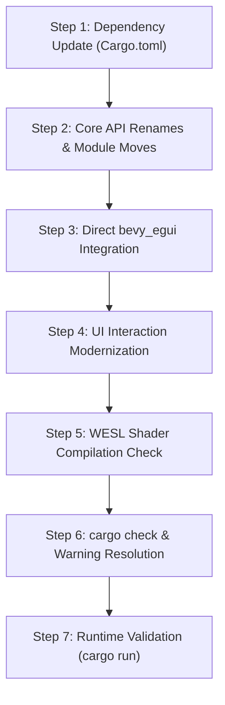

# Bevy 0.20 Engine Upgrade & Migration Plan

---

## 1. Overview & Objectives

This document establishes the official engineering roadmap and migration strategy to upgrade the Voxel Game Engine from **Bevy 0.19.1** to **Bevy 0.20.0**.

### Core Goals
1. **Engine Modernization**: Leverage Bevy 0.20 upstream advancements, including WESL shader framework integration, retained UI rendering, the Parley text engine, per-column ECS change detection, and rendering pipeline optimizations.
2. **Dependency Streamlining**: Eliminate the indirect `bevy-inspector-egui` wrapper dependency by migrating directly to `bevy_egui = "0.43"`, ensuring immediate Bevy 0.20 compatibility.
3. **Full UI Modernization**: Actively migrate away from the deprecated `Interaction` component across all interface menus (`creative_inventory.rs`, `pause.rs`, `settings.rs`), adopting modern Bevy 0.20 pointer/hover states and observers.
4. **Zero Gameplay Regression**: Guarantee unbroken functionality across greedy meshing, stochastic texture rotation, 3-axis directional block placement, 9-slot container interfaces, the F1 World Inspector, celestial atmosphere, and fluid simulation.

---

## 2. Dependency Changes (`Cargo.toml`)

The engine currently depends on `bevy-inspector-egui = "0.37"` solely to access the embedded `bevy_egui` runtime for the custom F1 Terrain Inspector. Replacing this wrapper with direct `bevy_egui` decouples the project from third-party update lag.

### Current vs. Target Dependencies

```toml
# ==============================================================================
# Cargo.toml - Dependencies Migration
# ==============================================================================

# --- [0.19 Current] ---
[dependencies]
bevy = "0.19"
bevy-inspector-egui = "0.37"
image = "0.25"
winit = "0.30"

# --- [0.20 Target] ---
[dependencies]
bevy = "0.20"
bevy_egui = "0.43"
image = "0.25"
winit = "0.30"
```

---

## 3. Breaking Changes & Code Migration Inventory

Comprehensive audit of engine files impacted by Bevy 0.20 breaking changes:

### 3.1. Meshing Pipeline AABB Renaming
- **File**: `src/meshing/pipeline.rs` (Line ~397)
- **Change**: `MeshAabb::compute_aabb` was renamed to `get_aabb` in Bevy 0.20.
- **Migration**:
  ```rust
  // Before (0.19)
  let tight_aabb = rebuilt_mesh.compute_aabb().unwrap_or(aabb);

  // After (0.20)
  let tight_aabb = rebuilt_mesh.get_aabb().unwrap_or(aabb);
  ```

### 3.2. Tonemapping Module Relocation
- **File**: `src/player/mod.rs` (Line ~15)
- **Change**: `Tonemapping` and `DebandDither` moved from `bevy::core_pipeline::tonemapping` to `bevy::render::view::Tonemapping`.
- **Migration**:
  ```rust
  // Before (0.19)
  use bevy::core_pipeline::{prepass::DepthPrepass, tonemapping::Tonemapping};

  // After (0.20)
  use bevy::core_pipeline::prepass::DepthPrepass;
  use bevy::render::view::Tonemapping;
  ```

### 3.3. Egui / Inspector Direct Dependency
- **Files**: `src/main.rs` (Line ~19), `src/generation/inspector.rs` (Line ~2)
- **Change**: Swapped import root from `bevy_inspector_egui::bevy_egui` to `bevy_egui`.
- **Migration**:
  ```rust
  // Before (0.19)
  use bevy_inspector_egui::bevy_egui::EguiPlugin;
  use bevy_inspector_egui::bevy_egui::{EguiContexts, EguiPrimaryContextPass, egui};

  // After (0.20)
  use bevy_egui::EguiPlugin;
  use bevy_egui::{EguiContexts, EguiPrimaryContextPass, egui};
  ```

### 3.4. UI Interaction Component Modernization (Deprecation Cleanup)
- **Files**:
  - `src/menu/creative_inventory.rs`
  - `src/menu/pause.rs`
  - `src/menu/settings.rs`
  - `src/menu/mod.rs`
- **Context**: In Bevy 0.20, `bevy::ui::widget::Button` and `bevy::ui::Interaction` are officially deprecated in favor of Bevy's modular picking system, specialized states (`Hovered`, `Pressed`), and observers (`On<Activate>`, `On<Pointer<Click>>`).
- **Migration Strategy**:
  1. Replace `Interaction::Pressed` and `Interaction::Hovered` polling loops with modern component tracking (`&Hovered`, `&Pressed`) or observer hooks on button entities.
  2. For slider and dragging interactions (e.g. settings sliders, creative scrollbar thumb), use pointer event observers or `Pressed` change detection with mouse motion delta.
  3. Ensure all button highlight styles (`#3c4552` metallic hover, button sound hooks) transition cleanly without per-frame polling overhead.

### 3.5. WESL Shader Framework Validation
- **Files**:
  - `assets/shaders/voxel_opaque.wgsl`
  - `assets/shaders/voxel_transparent.wgsl`
  - `assets/shaders/voxel_prepass.wgsl`
  - `assets/shaders/post_process.wgsl`
- **Context**: Bevy 0.20 natively standardizes on WESL (WebGPU Extended Shading Language) as a superset of WGSL.
- **Migration Strategy**:
  1. Validate that `#import bevy_pbr::{...}` statements conform to WESL module resolver rules.
  2. Confirm `@group(#{MATERIAL_BIND_GROUP})` binding expansion operates identically.
  3. Verify runtime texture array sampling (`texture_2d_array<f32>`, `sampler`) and spatial coordinate integer hashing for stochastic variant rotation.

---

## 4. Phased Execution Plan



### Step 1: Dependencies & Cargo Lock Resolution
1. Update `Cargo.toml`:
   - Set `bevy = "0.20"`.
   - Replace `bevy-inspector-egui = "0.37"` with `bevy_egui = "0.43"`.
2. Run `cargo update` to resolve crates.io dependency graph.

### Step 2: Core Engine API Renames
1. In `src/meshing/pipeline.rs`, update `.compute_aabb()` to `.get_aabb()`.
2. In `src/player/mod.rs`, update `Tonemapping` import to `bevy::render::view::Tonemapping`.

### Step 3: Inspector Decoupling
1. In `src/main.rs`, update `use bevy_inspector_egui::bevy_egui::EguiPlugin;` to `use bevy_egui::EguiPlugin;`.
2. In `src/generation/inspector.rs`, update imports to `use bevy_egui::{EguiContexts, EguiPrimaryContextPass, egui};`.

### Step 4: UI Interaction Refactoring
1. Modernize `src/menu/pause.rs`: Convert menu button clicks to observers or modern state components.
2. Modernize `src/menu/settings.rs`: Convert option toggles and resolution dropdowns.
3. Modernize `src/menu/creative_inventory.rs`:
   - Tab buttons (11 category tabs).
   - Card B toggle tab.
   - Slot hover overlays (36 Card B slots, 9 Hotbar slots, 90 Catalog slots, Offhand, Utility).
   - Search bar text input focus.
   - Vertical scroller thumb dragging.

### Step 5: Shader Verification
1. Inspect shader asset compiler output upon application launch.
2. Verify that vertex attributes (`ATTRIBUTE_UV_1`, `ATTRIBUTE_COLOR`) and material bindings (100, 101) bind properly in WESL.

### Step 6: Compilation & Diagnostic Pass
1. Run `cargo check` across all packages.
2. Resolve any remaining deprecation warnings, ensuring zero warnings in the default build profile.

### Step 7: Runtime Smoke Test Checklist
- [ ] Application launches cleanly into windowed mode at target resolution.
- [ ] World chunks stream and mesh smoothly with greedy quad merging.
- [ ] Opaque and transparent voxel shaders render correctly (natural texture rotation, water transparency).
- [ ] 3-Axis directional placement works on logs and columns.
- [ ] 9-Slot Hotbar HUD displays correctly with item selection, number keys `1`–`9`, and mouse wheel.
- [ ] Creative Inventory (<kbd>E</kbd>) opens with all tabs, search filter, and slot hover feedback.
- [ ] Pause Menu (<kbd>Esc</kbd>) and Settings Menu operate with unified buttons.
- [ ] Terrain Inspector (<kbd>F1</kbd>) opens and regenerates world seed on demand.
- [ ] 24-minute day/night cycle, stars, clouds, and sun/moon billboards render properly.
