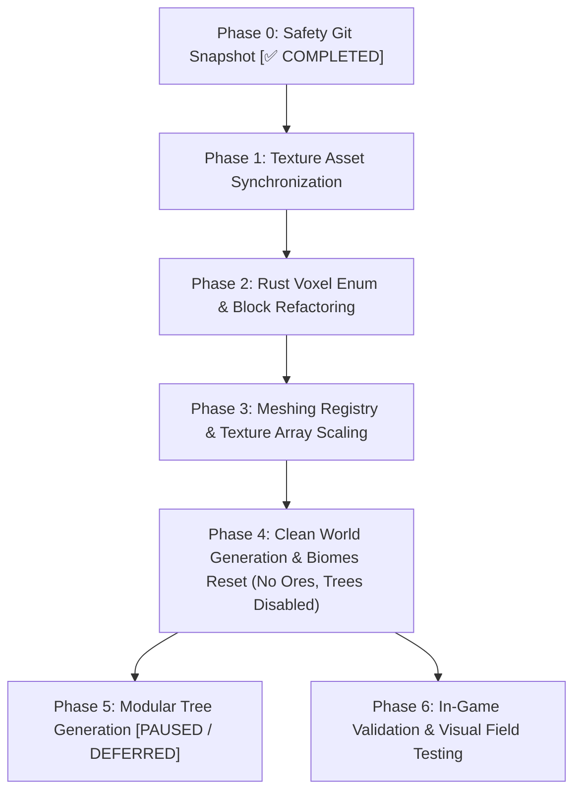

# Master Block Replacement Plan & World Refactoring Specification

This specification establishes the **operational transition plan** for replacing the legacy block catalog, textures, and world/biome generation systems with the centralized architecture documented in Categories **01 through 11** of [blocks_design.md](blocks_design.md) (**720 unique blocks and 1,366 active textures + 37 procedural overlays = 1,403 PNG files**).

---

## 1. Overview & Architectural Scope

### 1.1 Current Legacy State vs. New Ecosystem
* **Legacy Catalog**:
  * Located in `assets/textures/blocks/` (~367 non-standardized PNG files).
  * Block representation in `src/world/block.rs` restricted to a `u8` enum (`Voxel`), limiting catalog capacity to 256 items.
  * Meshing and texture arrays in `src/meshing/textures.rs` hardcoded around legacy naming exceptions.
  * World generator coupled to obsolete legacy soil rules and un-stratified rock layers.
* **New Unified Ecosystem (Categories 01–11 — 100% Complete)**:
  * **720 Unique Blocks** rigorously specified with strict semantic IDs across 11 worldbuilding domains.
  * **1,403 Texture Files**: 1,366 active domain textures (including triple stochastic variations `base`, `1`, `2`) + 37 procedural overlays in `blocks/overlays/`.
  * Categories 12 (`vegetation` — 38 blocks), 13 (`flowers` — 32 blocks), and 14 (`crops` — 34 blocks) remain in progress on the roadmap and are deferred to a subsequent integration phase.

---

## 2. Texture Asset Directory Architecture

### 2.1 Confirmed Decision: Flat Single Directory (`assets/textures/blocks/`)
The decision has been finalized to maintain a **Flat Single Directory** structure inside the engine runtime asset directory:

* **In-Game Assets (`assets/textures/blocks/*.png`)**:
  * All 1,403 textures are placed into a single flat directory.
  * **Immediate Engine Compatibility**: Preserves direct compatibility with Bevy asset loaders and `src/meshing/textures.rs` without complex nested directory resolution or path mapping.
  * **Zero Naming Collisions**: Strict semantic prefixes across domains (`rock_`, `soil_`, `tree_`, `crystal_`, `aqua_`, `organic_`, `deco_`, `fungi_`, `system_`, `liquid_`, `ore_`) guarantee unique filenames.
* **Worldbuilding Design Directory (`docs/worldbuilding/blocks/`)**:
  * Retains organized subdirectories (`rocks/`, `soils/`, `trees/`, `caverns/`, etc.) for documentation, asset auditing, and aesthetic curation.
  * An automated copy/sync task synchronizes textures from `docs/worldbuilding/blocks/{domain}/*.png` directly into `assets/textures/blocks/`.

---

## 3. Phased Operational Roadmap

---

### Phase 0: Safety Git Snapshot [✅ COMPLETED]
* **Status**: Completed.
* **Objective**: Preserve the legacy working engine state, legacy textures, and historical biomes.
* **Actions Taken**:
  * Created safety branch `legacy` containing the un-refactored codebase.
  * Published `legacy` branch to the remote repository (`origin`).
  * Returned to the working branch ready for Phase 1 execution.

---

### Phase 1: Texture Asset Synchronization [✅ COMPLETED]
* **Target Directory**: `assets/textures/blocks/`
* **Status**: Completed.
* **Results**: All 1,403 active PNG textures (1,366 domain textures across Categories 01–11 + 37 procedural overlays) are synchronized into a single flat directory `assets/textures/blocks/`.

---

### Phase 2: Rust Voxel Enum & Intelligent Compaction (`src/world/block.rs`)
* **Status**: Active / Refinement.
* **Problem in Naive Implementation**: Repeating 720 blocks across 10 handwritten `match` statements and duplicate category modules ballooned `block.rs` to 7,520 lines.
* **Algorithmic Solution (Shrinking from 7,520 to ~880 lines in a single file)**:
  1. **Single Source of Truth**:
     - `#[repr(u16)] pub enum Voxel`: Lists the 720 block variants once (~725 lines). No duplicate constant arrays or redundant category submodules (`pub mod soils`, etc.).
  2. **Contiguous Numeric Range Clustering for Physics & Flags**:
     - Instead of 600+ lines of handwritten `match` arms for every block, properties are evaluated via contiguous integer ID ranges (`matches!(self as u16, ...)`):
       - Rocks (92 blocks) + Ores (158 blocks): **250 blocks resolved in 1 single line** for `is_solid_opaque`.
       - Fluids (11..=18): All 8 fluids evaluated in 1 single range.
       - Cross-billboards: Crystals, coral fans, and mushrooms grouped into contiguous ranges.
       - Compiles down to instant, branchless integer range comparisons in assembly.
  3. **Algorithmic String & Label Derivation**:
     - Block IDs (`"rock_andesite"`) and display labels (`"Andesite"`) follow strict semantic conventions derived from the variant name (`PascalCase` -> `snake_case` and spaced words) or a compact static string table, eliminating ~1,450 lines of duplicate match arms.
  4. **Minimal Exception Table for Faces**:
     - Over 650 of the 720 blocks are uniform 6-face cubes.
     - Only the ~30 split-face blocks (soils with grass tops, tree logs with ring endcaps, bookshelves, baskets) are registered in a compact exceptions list.
  5. **No Hardness / Survival Attributes**:
     - Attributes remain strictly focused on collision, opacity, lighting, and rendering geometry.
  6. **Purge Legacy Aliases & Obsolete Tools**:
     - Remove the temporary 240 lines of backward-compatibility aliases (`Soil_Grass`, `Rock_Stone`) once the world generator uses canonical names.
     - Delete obsolete files in `tools/` (`all_textures.txt` and `build_voxel_registry.py`).

---

### Phase 3: Meshing Registry & Texture Array Scaling (`src/meshing/`) [✅ COMPLETED]
* **Status**: Completed.
* **Results**:
  - `MAX_VOXEL_VARIANTS` in `src/meshing/textures.rs` scaled to `2048`.
  - Texture Array natively supports triple stochastic variations (`base`, `1`, `2`), animated strips (16×64), and procedural overlays (`mossy_rock_overlay`, etc.).
  - `cargo check` compiles cleanly with zero errors.

---

### Phase 4: Clean World Generation & Biomes Reset (`src/generation/`)
* **Target Directory**: `src/generation/` (`biome.rs`, `generator.rs`, `trees.rs`)
* **Clean-Slate Strategy**:
  1. **Purge Obsolete Complex Biomes**: Replace the legacy biome table with the new clean generator using canonical block names (`Voxel::LoamGrass`, `Voxel::Andesite`, etc.).
  2. **Ore Generation**:
     - **No ore distribution required initially**: Generate 0 ores during initial terrain validation to maintain maximum simplicity while tuning surface and sub-surface rock layers.
  3. **Tree Generation Completely Disabled**:
     - Keep tree and foliage decorators completely disabled initially until base terrain, elevation, and biomes are satisfactory.
  4. **Balanced Terrestrial & Aquatic Biome Palette**:
     - **Terrestrial Biomes**:
       - *Temperate Plains*: Rich loams and climatic grasses.
       - *Dense Temperate Forest*: Deep forest soils, leaf litter, and mossy understories.
       - *Arid Desert & Badlands*: Sands, caliche, and scorched earth.
       - *Snowy Coniferous Taiga*: Permafrost, snowy silt, and cryosphere cover.
       - *Rocky Highlands / Mountain Tundra*: Exposed rock outcrops, scree, and cold alpine turf.
       - *Tropical Savanna*: Coarse dirt, laterite soils, and dry grasses.
     - **Aquatic & Marine Biomes**:
       - *Shallow Coastal Beach & Reef*: Sandy shallows, reefstone benches, and benthic coral gardens.
       - *Open Temperate Ocean*: Deep water columns with sand, silt, and kelp beds.
       - *Abyssal Ocean Trench*: Deep oceanic floor with black volcanic sand, vents, and abyssal mud.
       - *Inland Rivers & Lakes*: Alluvial silt, clay banks, and freshwater shallows.
       - *Mangrove Swamp & Wetland*: Muddy turf, peat bogs, and waterlogged soils.
  5. **Stratified Geological Bedrock**:
     - Implement realistic rock strata across depths using the 12 base lithologies (Sedimentary, Igneous, Metamorphic).

---

### Phase 5: Modular Tree Generation (`src/world/generation/features/trees/`) [PAUSED / DEFERRED]
* **Status**: **Paused / Deferred**.
* **Directive**: Kept completely disabled until terrain elevation, rock strata, and water/coastal transitions meet visual and structural expectations.
* **Future Scope**: Clean modular procedural generators for the 18 cataloged tree species (log trunk columns, bark branch framing, foliage canopies, mangrove prop roots, and bamboo stalks).

---

### Phase 6: In-Game Validation & Visual Field Testing
* **Success Criteria**:
  1. The project compiles cleanly via `cargo check` and `cargo build`.
  2. All 720 cataloged blocks load and render without triggering `null_block` fallback.
  3. Texture array allocates seamlessly without VRAM leakage or out-of-bounds indexing.
  4. Triple stochastic variants break terrain tiling repetition across continuous surfaces.
  5. Initial test biomes (both terrestrial and aquatic) display coherent geological stratification, realistic soil horizons, and distinct coastal/oceanic beds.
