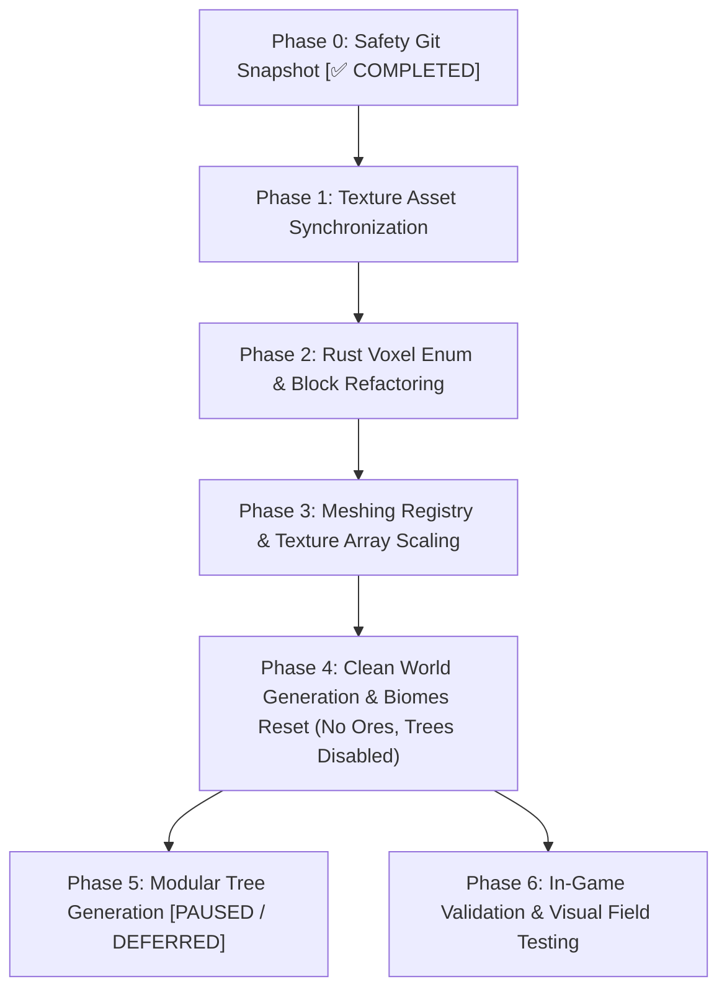

# Master Block Replacement Plan & World Refactoring Specification

This specification establishes the **operational transition plan** for replacing the legacy block catalog, textures, and world/biome generation systems with the centralized architecture documented in Categories **01 through 11** of [blocks_design.md](blocks_design.md) (**720 unique blocks and 1,366 active textures + 37 procedural overlays = 1,403 PNG files**).

---

## 1. Overview & Architectural Scope

### 1.1 Current Legacy State vs. New Ecosystem
* **Legacy Catalog**:
  * Located in `assets/textures/blocks/` (~367 non-standardized PNG files).
  * Block representation in `src/world/block.rs` restricted to a `u8` enum (`Voxel`), limiting catalog capacity to 256 items.
  * Meshing and texture arrays in `src/meshing/textures.rs` hardcoded around legacy naming exceptions.
  * World generator coupled to obsolete legacy soil rules and un-stratified rock layers.
* **New Unified Ecosystem (Categories 01–11 — 100% Complete)**:
  * **720 Unique Blocks** rigorously specified with strict semantic IDs across 11 worldbuilding domains.
  * **1,403 Texture Files**: 1,366 active domain textures (including triple stochastic variations `base`, `1`, `2`) + 37 procedural overlays in `blocks/overlays/`.
  * Categories 12 (`vegetation` — 38 blocks), 13 (`flowers` — 32 blocks), and 14 (`crops` — 34 blocks) remain in progress on the roadmap and are deferred to a subsequent integration phase.

---

## 2. Texture Asset Directory Architecture

### 2.1 Confirmed Decision: Flat Single Directory (`assets/textures/blocks/`)
The decision has been finalized to maintain a **Flat Single Directory** structure inside the engine runtime asset directory:

* **In-Game Assets (`assets/textures/blocks/*.png`)**:
  * All 1,403 textures are placed into a single flat directory.
  * **Immediate Engine Compatibility**: Preserves direct compatibility with Bevy asset loaders and `src/meshing/textures.rs` without complex nested directory resolution or path mapping.
  * **Zero Naming Collisions**: Strict semantic prefixes across domains (`rock_`, `soil_`, `tree_`, `crystal_`, `aqua_`, `organic_`, `deco_`, `fungi_`, `system_`, `liquid_`, `ore_`) guarantee unique filenames.
* **Worldbuilding Design Directory (`docs/worldbuilding/blocks/`)**:
  * Retains organized subdirectories (`rocks/`, `soils/`, `trees/`, `caverns/`, etc.) for documentation, asset auditing, and aesthetic curation.
  * An automated copy/sync task synchronizes textures from `docs/worldbuilding/blocks/{domain}/*.png` directly into `assets/textures/blocks/`.

---

## 3. Phased Operational Roadmap

---

### Phase 0: Safety Git Snapshot [✅ COMPLETED]
* **Status**: Completed.
* **Objective**: Preserve the legacy working engine state, legacy textures, and historical biomes.
* **Actions Taken**:
  * Created safety branch `legacy` containing the un-refactored codebase.
  * Published `legacy` branch to the remote repository (`origin`).
  * Returned to the working branch ready for Phase 1 execution.

---

### Phase 1: Texture Asset Synchronization
* **Target Directory**: `assets/textures/blocks/`
* **Execution Steps**:
  1. Create a local safety backup: `assets/textures/blocks_legacy_backup/`.
  2. Clear legacy textures from `assets/textures/blocks/`.
  3. Bulk copy all textures from the 11 completed domains in `docs/worldbuilding/blocks/`:
     * `systems/` (8 textures)
     * `fluids/` (54 textures)
     * `soils/` (184 textures)
     * `rocks/` (216 textures)
     * `trees/` (242 textures)
     * `ores/` (156 textures)
     * `caverns/` (122 textures)
     * `oceans/` (140 textures)
     * `organics/` (94 textures)
     * `decorations/` (96 textures)
     * `mushrooms/` (54 textures)
     * `overlays/` (37 textures)
  4. **Resulting Total**: **1,403 active PNG files** in `assets/textures/blocks/`.

---

### Phase 2: Rust Voxel Enum & Block Refactoring (`src/world/block.rs`)
* **Scale `Voxel` Enum to `u16`**:
  * Upgrade `#[repr(u8)] pub enum Voxel` to `#[repr(u16)] pub enum Voxel` to accommodate the 720 unique cataloged blocks plus technical markers.
  * Structure block definitions into clean domain modules following the canonical IDs from [blocks_design.md](blocks_design.md).
* **Block Flags & Properties**:
  * Define functional flags: `FLAG_TRANSPARENT`, `FLAG_SOLID_OPAQUE`, `FLAG_COLLIDABLE`, `FLAG_LEAVES`, `FLAG_POINT_LIGHT`, `FLAG_FLUID`.
  * Define geometric render shapes: Full Cube, Slab, Stair, Column, Cross-Billboard.
  * > [!IMPORTANT]
    > **No Hardness / Survival Attributes**: There is no concept of block hardness or item drop tables in the current engine design (survival gameplay is not yet implemented). Block properties remain strictly focused on collision, opacity, lighting, and rendering geometry.
* **Face Texture Mapping**:
  * **Uniform Cube (6 identical faces)**: e.g., `rock_basalt.png`, `soil_clay_blue.png`.
  * **Top / Side / Bottom Split**: e.g., `soil_grass_top.png`, `soil_grass_side.png`, `soil_dirt.png`.
  * **Directional Column (Logs / Stems)**: Transverse ring endcaps on top/bottom + longitudinal bark on sides.
  * **Cross-Billboard**: e.g., crystals, mushrooms, sea fans, corals.
  * **Animated Strips**: 16×64 vertical strips for flowing liquids and glinting crystal clusters.

---

### Phase 3: Meshing Registry & Texture Array Scaling (`src/meshing/`)
* **Pipeline Capabilities Already Functioning**:
  * The engine's meshing pipeline already has native support for:
    1. Triple stochastic variations (`base`, `1`, `2`) sampled procedurally in shaders via world coordinate hash `hash(x, y, z) % 3`.
    2. Animated texture strips (16×64 px vertical frames for fluids and emissive crystals).
    3. Procedural overlay layers (`mossy_rock_overlay`, `mossy_cobbled_overlay`).
* **Required Adjustments**:
  * Scale `MAX_VOXEL_VARIANTS` in `src/meshing/textures.rs` from `256` to `1024` (or `2048`) to support indexing all 720+ blocks.
  * Clean up legacy hardcoded mapping exceptions (such as alias workarounds for old texture names).
  * Ensure the Texture Array builder registers the new 1,403 textures cleanly.

---

### Phase 4: Clean World Generation & Biomes Reset (`src/world/generation/`)
* **Target Files**: `src/world/generation/`
* **Clean-Slate Strategy**:
  1. **Purge Obsolete Complex Biomes**: Remove the legacy biome table and hardcoded terrain rules.
  2. **Ore Generation**:
     * **No ore distribution required initially**: Can generate 0 ores during initial terrain validation to maintain maximum simplicity while tuning surface and sub-surface rock layers.
  3. **Tree Generation Completely Disabled**:
     * Disable tree and foliage decorators completely until base terrain, elevation, and biomes are satisfactory.
  4. **Balanced Terrestrial & Aquatic Biome Palette**:
     * Avoid over-simplification by providing a diverse foundation of both land and water biomes:
       * **Terrestrial Biomes**:
         * *Temperate Plains*: Rich loams and climatic grasses.
         * *Dense Temperate Forest*: Deep forest soils, leaf litter, and mossy understories.
         * *Arid Desert & Badlands*: Sands, caliche, and scorched earth.
         * *Snowy Coniferous Taiga*: Permafrost, snowy silt, and cryosphere cover.
         * *Rocky Highlands / Mountain Tundra*: Exposed rock outcrops, scree, and cold alpine turf.
         * *Tropical Savanna*: Coarse dirt, laterite soils, and dry grasses.
       * **Aquatic & Marine Biomes**:
         * *Shallow Coastal Beach & Reef*: Sandy shallows, reefstone benches, and benthic coral gardens.
         * *Open Temperate Ocean*: Deep water columns with sand, silt, and kelp beds.
         * *Abyssal Ocean Trench*: Deep oceanic floor with black volcanic sand, vents, and abyssal mud.
         * *Inland Rivers & Lakes*: Alluvial silt, clay banks, and freshwater shallows.
         * *Mangrove Swamp & Wetland*: Muddy turf, peat bogs, and waterlogged soils.
  5. **Stratified Geological Bedrock**:
     * Implement realistic rock strata across depths using the 12 base lithologies (Sedimentary, Igneous, Metamorphic).

---

### Phase 5: Modular Tree Generation (`src/world/generation/features/trees/`) [PAUSED / DEFERRED]
* **Status**: **Paused / Deferred**.
* **Directive**: Kept completely disabled until terrain elevation, rock strata, and water/coastal transitions meet visual and structural expectations.
* **Future Scope**: Clean modular procedural generators for the 18 cataloged tree species (log trunk columns, bark branch framing, foliage canopies, mangrove prop roots, and bamboo stalks).

---

### Phase 6: In-Game Validation & Visual Field Testing
* **Success Criteria**:
  1. The project compiles cleanly via `cargo check` and `cargo build`.
  2. All 720 cataloged blocks load and render without triggering `null_block` fallback.
  3. Texture array allocates seamlessly without VRAM leakage or out-of-bounds indexing.
  4. Triple stochastic variants break terrain tiling repetition across continuous surfaces.
  5. Initial test biomes (both terrestrial and aquatic) display coherent geological stratification, realistic soil horizons, and distinct coastal/oceanic beds.
