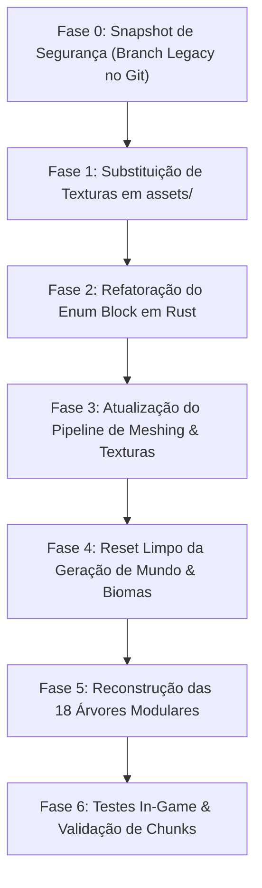

# Plano Estratégico de Substituição do Catálogo de Blocos & Refatoração do Mundo

Este documento estabelece o **plano operacional detalhado** para a transição completa do antigo catálogo legado de blocos e sistemas de geração de biomas/árvores para a nova arquitetura centralizada documentada nas categorias **01 até 11** de [blocks_design.md](blocks_design.md) (**718 blocos únicos e 1.360 texturas ativas**).

---

## 1. Visão Geral & Escopo da Migração

### 1.1. Estado Atual vs Novo Ecossistema
* **Catálogo Legado**:
  * Localizado em `assets/textures/blocks/` (aproximadamente 367 arquivos PNG não-padronizados em pasta única).
  * Lógica de blocos em `src/world/block.rs` fortemente acoplada a nomes antigos e hardcoded fallbacks.
  * Gerador de terreno e biomas acoplado a regras antigas de solo e árvores legadas.
* **Novo Ecossistema (Categorias 01–11 — 100% Finalizado)**:
  * **718 Blocos Únicos Catalogados** distribuídos em 11 domínios estritamente balanceados.
  * **1.360 Texturas Ativas** (+ 37 overlays procedurais em `overlays/`).
  * 100% com variações estocásticas triplas (`base`, `1`, `2`) para quebra de repetição de ladrilho (tiling).
  * Categorias 12 (`vegetation`), 13 (`flowers`) e 14 (`crops`) permanecem reservadas como roadmap futuro e não bloqueiam a refatoração do motor agora.

---

## 2. Decisão Arquitetural: Organização das Texturas em `assets/`

### 2.1. A Dúvida: Pasta Única (Flat) vs Subpastas por Categoria?
Atualmente em `assets/textures/blocks/`, todas as texturas legadas estão reunidas em um único diretório.

| Estrutura | Vantagens | Desvantagens | Veredito Técnico |
| :--- | :--- | :--- | :---: |
| **Opção A: Pasta Única Flat** `assets/textures/blocks/*.png` | • **Compatibilidade Imediata**: O carregador atual em `src/meshing/textures.rs` busca exatamente `assets/textures/blocks/{base_name}.png`. • **Zero Risco de Conflito**: Como o novo catálogo adotou prefixos semânticos estritos (`rock_`, `soil_`, `tree_`, `crystal_`, `aqua_`, `organic_`, `deco_`, `fungi_`, etc.), não existe nenhuma colisão de nomes entre categorias. • **Performance**: Menor sobrecarga de I/O em runtime para resolver caminhos relativos em Bevy. | • Pasta com 1.360 arquivos pode parecer extensa em exploradores de arquivo do sistema operacional. | ⭐ **Recomendada para `assets/`** |
| **Opção B: Subpastas por Categoria** `assets/textures/blocks/{categoria}/*.png` | • Espelhamento 1:1 com a pasta de design em `docs/worldbuilding/blocks/`. | • Exige alterar `src/meshing/textures.rs` para realizar busca recursiva em disco ou mapear manualmente o caminho de cada categoria. • Maior complexidade de manutenção no código Rust. | Alternativa opcional |

> [!TIP]
> **Recomendação Definitiva:**
> 1. Manter a pasta de design **`docs/worldbuilding/blocks/`** dividida em subpastas categorizadas (`rocks/`, `soils/`, `trees/`, etc.) para organização conceitual, auditoria e controle de arte.
> 2. No jogo final em **`assets/textures/blocks/`**, manter todas as texturas em pasta única flat. Um simples script de sincronização copia os arquivos das 11 categorias de `docs/` para `assets/`, garantindo 100% de compatibilidade sem alterar uma única linha do resolvedor de caminhos de texturas do Bevy.

---

## 3. Roteiro Operacional em Fases (Step-by-Step)

---

### Fase 0: Snapshot de Segurança (Git Legacy)
* **Objetivo**: Salvar todo o estado atual de código, biomas funcionais, geradores antigos e assets legados em uma branch permanente `legacy` no GitHub.
* **Ação**:
  1. Commit de todo o progresso atual.
  2. Criação da branch `legacy`.
  3. Push da branch `legacy` para o repositório remoto (`origin`).
  4. Retorno seguro para a branch de trabalho `main`.

---

### Fase 1: Limpeza & Substituição dos Assets de Textura
* **Diretório Alvo**: `assets/textures/blocks/`
* **Passos**:
  1. Criar um backup de segurança local: `assets/textures/blocks_legacy_backup/`.
  2. Limpar os arquivos antigos de `assets/textures/blocks/`.
  3. Copiar em lote todas as texturas das 11 categorias finalizadas de `docs/worldbuilding/blocks/`:
     * `systems/` (8 texturas)
     * `fluids/` (54 texturas)
     * `soils/` (184 texturas)
     * `rocks/` (216 texturas)
     * `trees/` (242 texturas)
     * `ores/` (156 texturas)
     * `caverns/` (122 texturas)
     * `oceans/` (140 texturas)
     * `organics/` (94 texturas)
     * `decorations/` (90 texturas)
     * `mushrooms/` (54 texturas)
     * `overlays/` (37 texturas)
  4. Total resultante em `assets/textures/blocks/`: **1.397 arquivos PNG**.

---

### Fase 2: Refatoração do Catálogo de Blocos em Rust (`src/world/block.rs`)
* **Substituição do Enum `Block`**:
  * Substituir a lista antiga de blocos pelo novo catálogo de **718 blocos**.
  * Organizar os blocos em módulos ou seções bem documentadas seguindo o padrão de `BlockID` de [blocks_design.md](blocks_design.md):
    * `Block::Air`, `Block::RockBasalt`, `Block::CobbledBasalt`, `Block::SoilLoam`, etc.
* **Atributos de Bloco (`BlockAttributes`)**:
  * Definir transparência (`is_transparent`), solidez colisor (`is_solid`), emissão de luz (`light_emission`), dureza (`hardness`) e tipo de drop.
* **Mapeamento de Faces**:
  * Configurar o mapeamento de texturas para cada formato:
    * **Cubo Uniforme (6 faces iguais)**: ex. `rock_granite.png`.
    * **Topo / Lado / Fundo (Split)**: ex. `soil_grass_top.png`, `soil_grass_side.png`, `soil_dirt.png`.
    * **Coluna Direcional (Log / Stalk)**: topo com anéis concêntricos + laterais de casca.
    * **Cross-Billboard (Modelo Cruzado)**: ex. cristais, corais leque, cogumelos.
    * **Emissivo Animado (4 frames)**: ex. `crystal_*_cluster_glinted.png`.

---

### Fase 3: Pipeline de Meshing & Texture Array (`src/meshing/`)
* **Arquivo**: `src/meshing/textures.rs`
  * Remover os tratamentos manuais antigos de exceções (ex. mapeamentos provisórios como `cobbled_tuffite -> cobbled_tuff`).
  * Atualizar o registro do Texture Array para carregar nativamente:
    * A textura base e suas 2 variantes estocásticas (`nome`, `nome1`, `nome2`).
    * Os overlays procedurais de musgo (`mossy_rock_overlay`, `mossy_cobbled_overlay`).
    * As tiras animadas verticais de líquidos (16×64) e cristais cintilantes.
* **Validação**: Assegurar que os shaders amostrem proceduralmente o índice da variante no array de texturas baseado na coordenada global do voxel `hash(x, y, z) % 3`.

---

### Fase 4: Reinicialização Limpa da Geração de Mundo & Biomas
* **Arquivos Alvo**: `src/world/generation/`
* **Estratégia de Tabula Rasa (Começar do Zero)**:
  1. **Remover biomas antigos complexos**: Eliminar a antiga tabela de biomas legado.
  2. **Estrutura Geológica Estratificada**:
     * Implementar o subsolo planetário com as **12 litologias de rochas reais** organizadas por profundidade/camadas tectônicas (Sedimentar, Ígnea, Metamórfica).
     * Distribuir os **158 minérios** de acordo com a matriz exata de 4 ocorrências litológicas por mineral definida em [ores_design.md](blocks/ores_design.md).
  3. **Superfície & Pedologia Realista**:
     * Utilizar os **58 solos** para criar transições naturais de horizontes de terra (argilas, podzols, areias, turfos e solos ricos com gramas climáticas).
  4. **Novo Gerador Simples de Teste**:
     * Inicializar com 3–4 biomas macro simplificados (ex. *Planície Temperada*, *Floresta Mista*, *Deserto Rochoso*, *Taiga Conífera*) para validar visualmente os novos blocos no mundo antes de expandir.

---

### Fase 5: Reconstrução do Gerador de Árvores
* **Arquivos Alvo**: `src/world/generation/features/trees/`
* **Estratégia**:
  1. Descartar os geradores de árvores antigos acoplados às texturas antigas.
  2. Implementar geradores modulares limpos para as **18 espécies de árvores**:
     * Estrutura de troncos (`tree_<especie>_log` com topo direcional).
     * Galhos e bifurcações usando o bloco de madeira de casca uniforme (`tree_<especie>_wood`).
     * Copas foliares (`tree_<especie>_leaves`) com variantes vivas e secas.
     * Casos especializados:
       * **Bambu**: colunas finas articuladas e folhas em leque.
       * **Manguezal**: rede de raízes aéreas (`tree_mangrove_roots`).
       * **Pinheiros / Coníferas**: silhuetas cônicas piramidais.

---

### Fase 6: Validação & Teste de Campo no Jogo
* **Critérios de Sucesso**:
  1. O jogo compila sem erros (`cargo check` & `cargo build`).
  2. Todos os 718 blocos renderizam sem o fallback visual `null_block`.
  3. Os shaders carregam o Texture Array de 16×16 px sem vazamento de memória.
  4. As variações estocásticas quebram suavemente a repetição das texturas no terreno.
  5. As cavernas geram com os novos cristais, espeleotemas e fósseis.

---

## 4. Resumo de Execução Imediata (Hoje)
1. Criar e publicar a branch de segurança `legacy` no GitHub contendo o código atual intacto.
2. Retornar à branch `main`.
3. Deixar a base pronta para, na próxima sessão, iniciarmos a migração de assets e a reescrita do catálogo de blocos e gerador de biomas.
