# Worldbuilding Architecture & Catalog: Caverns, Crystals, Speleothems & Fossils (caverns)

All active textures for subterranean geological formations, mineral crystals, modular dripstones, speleological cave stone strata, and paleontological fossil beds are organized in the folder:
📂 **`docs/worldbuilding/blocks/caverns`** *(114 active PNG textures on disk: 18 solid crystal blocks, 18 normal clusters, 18 animated glinted clusters, 36 modular speleothem pieces across 4 materials, 12 speleological stone textures across Cave Karst and Cave Calcite, 12 fossils across 4 types)*

Generating **30 unique blocks** in the master catalog: 6 solid crystal blocks + 6 crystal clusters + 6 glinted crystal clusters + 4 modular speleothem/dripstone systems (comprising 36 modular geometric pieces) + 4 speleological cave strata blocks (Cave Karst and Cave Calcite solid and cobbled) + 4 standalone paleontological fossil blocks.

---

## 1. Speleological, Crystallographic & Paleontological Classification

The subterranean caverns domain is divided into **4 Core Geological Branches (6 Real Crystals, 4 Speleothem Formations, 2 Cave Stone Strata & 4 Fossil Strata)**:

```mermaid
graph TD
    C["Subterranean Caverns (30 Blocks / 114 Textures)"] --> B1["1. Crystallogenesis & Geodes (6 Minerals / 54 Textures)"]
    C --> B2["2. Speleothems & Dripstones (4 Materials / 36 Textures)"]
    C --> B3["3. Speleological Cave Strata (2 Rocks / 12 Textures / 4 Blocks)"]
    C --> B4["4. Paleontology & Fossil Strata (4 Blocks / 12 Textures)"]

    B1 --> C1["Amethyst: Classic purple quartz geodes in basaltic cavities"]
    B1 --> C2["Aquamarine: Hydrothermal cyan-blue beryl in granitic pegmatites"]
    B1 --> C3["Citrine: Solar amber quartz formed by geothermal heating"]
    B1 --> C4["Fluorite: Fluorescent mint-green cubic calcium fluoride"]
    B1 --> C5["Pink Salt: Ancient evaporitic coral-pink halite from paleolakes"]
    B1 --> C6["Selenite: Pearlescent columnar gypsum giant crystals (Naica style)"]

    B2 --> S1["Karst: Classic calcium-carbonate dissolution dripstones (10 pieces)"]
    B2 --> S2["Calcite: High-purity pearlescent flowstone formations (10 pieces)"]
    B2 --> S3["Blue Ice: Compact azure glacial icicles in cryosphere caves (10 pieces)"]
    B2 --> S4["Pink Salt Straw: Delicate hollow tubular soda straws (6 pieces)"]

    B3 --> R1["Cave Karst: Porous dissolution cave rock & cobbled rubble"]
    B3 --> R2["Cave Calcite: Pearlescent crystalline flowstone host rock & cobbled rubble"]

    B4 --> F1["Fossil Bones: Mineralized primordial skeletons in dark strata"]
    B4 --> F2["Fossil Amber: Golden fossilized resin nodules with ancient inclusions"]
    B4 --> F3["Fossil Bitumen: Viscous lustrous hydrocarbon pitch seams"]
    B4 --> F4["Fossil Matrix: Barren host sedimentary stone surrounding bonebeds"]
```



---

## 2. Complete Texture Inventory in `worldbuilding/blocks/caverns/` (114 Active Textures)

### A. Real Mineral Crystals (54 Files: 18 Solid Blocks, 18 Normal Clusters, 18 Animated Glinted Clusters)
Each of the 6 crystal minerals features a complete set including 3-fold stochastic solid blocks, 3-fold cross-billboard clusters, and 3-fold animated 16×64 glinted emissive clusters (4 frames each):
* **Amethyst (9)**: `crystal_amethyst.png` *(+ `1`, `2`)*, `crystal_amethyst_cluster.png` *(+ `1`, `2`)*, `crystal_amethyst_cluster_glinted.png` *(16×64 + `1`, `2`)*
* **Aquamarine (9)**: `crystal_aquamarine.png` *(+ `1`, `2`)*, `crystal_aquamarine_cluster.png` *(+ `1`, `2`)*, `crystal_aquamarine_cluster_glinted.png` *(16×64 + `1`, `2`)*
* **Citrine (9)**: `crystal_citrine.png` *(+ `1`, `2`)*, `crystal_citrine_cluster.png` *(+ `1`, `2`)*, `crystal_citrine_cluster_glinted.png` *(16×64 + `1`, `2`)*
* **Fluorite (9)**: `crystal_fluorite.png` *(+ `1`, `2`)*, `crystal_fluorite_cluster.png` *(+ `1`, `2`)*, `crystal_fluorite_cluster_glinted.png` *(16×64 + `1`, `2`)*
* **Pink Salt (9)**: `crystal_pink_salt.png` *(+ `1`, `2`)*, `crystal_pink_salt_cluster.png` *(+ `1`, `2`)*, `crystal_pink_salt_cluster_glinted.png` *(16×64 + `1`, `2`)*
* **Selenite (9)**: `crystal_selenite.png` *(+ `1`, `2`)*, `crystal_selenite_cluster.png` *(+ `1`, `2`)*, `crystal_selenite_cluster_glinted.png` *(16×64 + `1`, `2`)*

### B. Modular Speleothems & Dripstones (36 Files, 16×16 px)
* **Karst Limestone (10)**:
  * Stalactite (Down): `speleothem_karst_down_base.png`, `_frustum`, `_middle`, `_tip`, `_tip_merge`
  * Stalagmite (Up): `speleothem_karst_up_base.png`, `_frustum`, `_middle`, `_tip`, `_tip_merge`
* **Calcite Flowstone (10)**:
  * Stalactite (Down): `speleothem_calcite_down_base.png`, `_frustum`, `_middle`, `_tip`, `_tip_merge`
  * Stalagmite (Up): `speleothem_calcite_up_base.png`, `_frustum`, `_middle`, `_tip`, `_tip_merge`
* **Blue Ice Icicle (10)**:
  * Stalactite (Down): `speleothem_blue_ice_down_base.png`, `_frustum`, `_middle`, `_tip`, `_tip_merge`
  * Stalagmite (Up): `speleothem_blue_ice_up_base.png`, `_frustum`, `_middle`, `_tip`, `_tip_merge`
* **Pink Salt Soda Straw (6)**:
  * Stalactite (Down): `speleothem_pink_salt_straw_down_top.png`, `_middle`, `_bottom`
  * Stalagmite (Up): `speleothem_pink_salt_straw_up_bottom.png`, `_middle`, `_top`

### C. Speleological Cave Strata & Host Rocks (12 Files: 6 Solid + 6 Cobbled, 16×16 px)
Specialized subterranean rocks associated with deep groundwater dissolution caves, speleothem anchors, and carbonate flowstones:
* **Cave Karst Limestone (6)**: `cave_karst.png` *(+ `1`, `2`)*, `cave_karst_cobbled.png` *(+ `1`, `2`)*
* **Cave Calcite Flowstone Rock (6)**: `cave_calcite.png` *(+ `1`, `2`)*, `cave_calcite_cobbled.png` *(+ `1`, `2`)*

### D. Paleontological Fossil Blocks (12 Files, 16×16 px)
Sedimentary subterranean strata embedding prehistoric biological remains. All 4 fossil blocks feature complete 3-fold stochastic variants (`_base`, `1`, `2`) to break repetition in fossil quarry walls:
* **Fossil Strata (12)**: `fossil_bones.png` *(+ `1`, `2`)*, `fossil_amber.png` *(+ `1`, `2`)*, `fossil_bitumen.png` *(+ `1`, `2`)*, `fossil_matrix.png` *(+ `1`, `2`)*

---

## 3. Complete Block Catalog (30 Unique Blocks)

### 3.1. Solid Crystal Blocks (6 Blocks)

Dense, solid blocks formed by compacting crystallized mineral geodes. Can be mined and used as luxury building materials.

| # | Block ID | Name | Category | Texture File(s) | Description |
| :-: | :--- | :--- | :--- | :--- | :--- |
| **01** | `crystal_amethyst_block` | Amethyst Block | **Crystal** | `crystal_amethyst.png` *(+ `1`, `2`)* | Violet quartz block with rich purple crystal facets ($SiO_2$). |
| **02** | `crystal_aquamarine_block` | Aquamarine Block | **Crystal** | `crystal_aquamarine.png` *(+ `1`, `2`)* | Translucent cyan-blue beryl block ($Be_3Al_2Si_6O_{18}$). |
| **03** | `crystal_citrine_block` | Citrine Block | **Crystal** | `crystal_citrine.png` *(+ `1`, `2`)* | Solar golden-amber quartz block created by geothermal heating ($SiO_2$). |
| **04** | `crystal_fluorite_block` | Fluorite Block | **Crystal** | `crystal_fluorite.png` *(+ `1`, `2`)* | Mint-green cubic calcium fluoride block with soft natural sheen ($CaF_2$). |
| **05** | `crystal_pink_salt_block` | Pink Salt Block | **Crystal** | `crystal_pink_salt.png` *(+ `1`, `2`)* | Ancient coral-pink evaporite halite salt block ($NaCl$). |
| **06** | `crystal_selenite_block` | Selenite Block | **Crystal** | `crystal_selenite.png` *(+ `1`, `2`)* | Pearlescent silvery-white columnar gypsum block ($CaSO_4 \cdot 2H_2O$). |

---

### 3.2. Wild Mineral Crystal Clusters (6 Blocks)

Natural mineral prism clusters growing on geode cavity walls, floors, and ceilings. Rendered as cross-billboard geometry.

| # | Block ID | Name | Category | Texture File(s) | Face Mapping |
| :-: | :--- | :--- | :--- | :--- | :--- |
| **07** | `crystal_amethyst_cluster` | Amethyst Cluster | **Cluster** | `crystal_amethyst_cluster.png` *(+ `1`, `2`)* | Cross-billboard |
| **08** | `crystal_aquamarine_cluster` | Aquamarine Cluster | **Cluster** | `crystal_aquamarine_cluster.png` *(+ `1`, `2`)* | Cross-billboard |
| **09** | `crystal_citrine_cluster` | Citrine Cluster | **Cluster** | `crystal_citrine_cluster.png` *(+ `1`, `2`)* | Cross-billboard |
| **10** | `crystal_fluorite_cluster` | Fluorite Cluster | **Cluster** | `crystal_fluorite_cluster.png` *(+ `1`, `2`)* | Cross-billboard |
| **11** | `crystal_pink_salt_cluster` | Pink Salt Cluster | **Cluster** | `crystal_pink_salt_cluster.png` *(+ `1`, `2`)* | Cross-billboard |
| **12** | `crystal_selenite_cluster` | Selenite Cluster | **Cluster** | `crystal_selenite_cluster.png` *(+ `1`, `2`)* | Cross-billboard |

---

### 3.3. Glinted Emissive Crystal Clusters (6 Blocks)

Rare, high-grade crystalline clusters featuring radiant optical reflections and emissive glow in dark caves.

| # | Block ID | Name | Category | Texture File(s) | Face Mapping |
| :-: | :--- | :--- | :--- | :--- | :--- |
| **13** | `crystal_amethyst_glinted` | Glinted Amethyst Cluster | **Emissive** | `crystal_amethyst_cluster_glinted.png` *(16×64 + `1`, `2`)* | Animated Cross-billboard (4 frames) |
| **14** | `crystal_aquamarine_glinted` | Glinted Aquamarine Cluster | **Emissive** | `crystal_aquamarine_cluster_glinted.png` *(16×64 + `1`, `2`)* | Animated Cross-billboard (4 frames) |
| **15** | `crystal_citrine_glinted` | Glinted Citrine Cluster | **Emissive** | `crystal_citrine_cluster_glinted.png` *(16×64 + `1`, `2`)* | Animated Cross-billboard (4 frames) |
| **16** | `crystal_fluorite_glinted` | Glinted Fluorite Cluster | **Emissive** | `crystal_fluorite_cluster_glinted.png` *(16×64 + `1`, `2`)* | Animated Cross-billboard (4 frames) |
| **17** | `crystal_pink_salt_glinted` | Glinted Pink Salt Cluster | **Emissive** | `crystal_pink_salt_cluster_glinted.png` *(16×64 + `1`, `2`)* | Animated Cross-billboard (4 frames) |
| **18** | `crystal_selenite_glinted` | Glinted Selenite Cluster | **Emissive** | `crystal_selenite_cluster_glinted.png` *(16×64 + `1`, `2`)* | Animated Cross-billboard (4 frames) |

---

### 3.4. Modular Speleothems & Dripstone Systems (4 Block Systems)

Dynamic, multi-stage subterranean dripstones. Each material supports procedural growth from ceiling (stalactite) or floor (stalagmite), merging seamlessly into solid cave pillars.

| # | Block ID | Name | Parent Bedrock | Pieces | Visual Identity | Geological Origin & Setting |
| :-: | :--- | :--- | :--- | :---: | :--- | :--- |
| **19** | `speleothem_karst` | Karst Dripstone | `cave_karst.png` | **10** | Rugged dark-grey weathered limestone | Classic dissolution caves formed by slow calcium bicarbonate seepage. |
| **20** | `speleothem_calcite` | Calcite Flowstone | `cave_calcite.png` | **10** | Smooth, pearlescent milk-white flowstone | Pure carbonate precipitation in pristine mineral-rich groundwater caverns. |
| **21** | `speleothem_blue_ice` | Blue Ice Icicle | `frost_blue_ice.png` | **10** | Vibrant crystalline azure ice needles | Compact blue glacial ice dripping and refreezing inside deep cryosphere caverns. |
| **22** | `speleothem_salt_straw` | Pink Salt Soda Straw | `crystal_pink_salt.png` | **6** | Ultra-thin hollow coral-pink salt tubes | Fragile tubular soda straws precipitating from the outer rims of saline droplets. |

---

### 3.5. Speleological Strata & Cave Rocks (4 Blocks: 2 Solid + 2 Cobbled)

Subterranean host stone strata associated with limestone caverns and hydrothermal calcite chambers:

| # | Block ID | Name | Category | Texture File(s) | Face Mapping |
| :-: | :--- | :--- | :--- | :--- | :--- |
| **23** | `cave_karst` | Cave Karst | **Speleological** | `cave_karst.png` *(+ `1`, `2`)* | 6 uniform faces *(Porous dissolution cave rock, speleothem parent)* |
| **24** | `cobbled_cave_karst` | Cobbled Cave Karst | **Speleological** | `cave_karst_cobbled.png` *(+ `1`, `2`)* | 6 uniform faces *(Fractured speleological cave rubble)* |
| **25** | `cave_calcite` | Cave Calcite | **Speleological** | `cave_calcite.png` *(+ `1`, `2`)* | 6 uniform faces *(High-purity crystalline carbonate rock)* |
| **26** | `cobbled_cave_calcite` | Cobbled Cave Calcite | **Speleological** | `cave_calcite_cobbled.png` *(+ `1`, `2`)* | 6 uniform faces *(Fractured pearlescent calcite rubble)* |

---

### 3.6. Paleontological Fossil Strata (4 Blocks)

Sedimentary subterranean formations containing ancient organic remnants, petroleum hydrocarbons, and amber inclusions. Can be excavated for paleontology, alchemy, and specialized chemical resources:

| # | Block ID | Name | Category | Texture File(s) | Face Mapping |
| :-: | :--- | :--- | :--- | :--- | :--- |
| **27** | `fossil_bones` | Fossil Bones | **Fossil** | `fossil_bones.png` *(+ `1`, `2`)* | 6 uniform faces |
| **28** | `fossil_amber` | Fossil Amber | **Fossil** | `fossil_amber.png` *(+ `1`, `2`)* | 6 uniform faces |
| **29** | `fossil_bitumen` | Fossil Bitumen | **Fossil** | `fossil_bitumen.png` *(+ `1`, `2`)* | 6 uniform faces |
| **30** | `fossil_matrix` | Fossil Matrix | **Fossil** | `fossil_matrix.png` *(+ `1`, `2`)* | 6 uniform faces |

---

## 4. Speleothem Growth & Assembly Architecture

Speleothems generate procedurally by stacking modular pieces depending on the distance between cavern ceiling and floor:

```mermaid
graph TD
    subgraph Stalactite (Ceiling Down)
        C0["Cavern Ceiling"] --> C1["_down_base (Wide anchor)"]
        C1 --> C2["_down_frustum (Tapering cone)"]
        C2 --> C3["_down_middle (Repeatable column trunk)"]
        C3 --> C4["_down_tip (Sharp droplet tip) OR _down_tip_merge"]
    end

    subgraph Stalagmite (Floor Up)
        F4["_up_tip (Sharp tip) OR _up_tip_merge"] --> F3["_up_middle (Repeatable column trunk)"]
        F3 --> F2["_up_frustum (Inverted taper)"]
        F2 --> F1["_up_base (Wide floor anchor)"]
        F1 --> F0["Cavern Floor"]
    end

    C4 -. "Pillar Merge (_down_tip_merge meets _up_tip_merge)" .- F4
```

### Stacking Rules:
1. **Single-Voxel Spikes (Height = 1)**: Directly place `_down_tip` or `_up_tip`.
2. **Medium Spikes (Height = 2)**: Place `_down_frustum` + `_down_tip` (or `_up_base` + `_up_tip`).
3. **Tall Columns (Height $\ge$ 3)**: Anchor with `_base`, transition through `_frustum`, repeat `_middle` as needed, and cap with `_tip`.
4. **Complete Cave Pillars**: When a stalactite meets a stalagmite, both terminate with `_tip_merge`, joining flush into a unified continuous stone column.
5. **Soda Straws**: Stack `_down_top` $\to$ `_down_middle` $\to$ `_down_bottom` (or `_up_bottom` $\to$ `_up_middle` $\to$ `_up_top`) for delicate 3-pixel-wide hollow formations.
