# Worldbuilding Architecture & Catalog: Caverns, Crystals, Speleothems & Fossils (Caverns)

All active textures for subterranean geological formations, mineral crystals, modular dripstones, and paleontological fossil beds are organized in the folder:
📂 **`docs/worldbuilding/blocks/caverns`** *(78 active PNG textures on disk)*

Generating **28 unique blocks** in the master catalog: 6 solid crystal blocks + 6 crystal clusters + 6 glinted crystal clusters + 6 modular speleothem/dripstone systems (comprising 56 modular geometric pieces) + 4 standalone paleontological fossil blocks.

---

## 1. Speleological, Crystallographic & Paleontological Classification

The subterranean caverns domain is divided into **3 Core Geological Branches (6 Real Crystals, 6 Speleothem Formations & 4 Fossil Strata)**:

```mermaid
graph TD
    C["Subterranean Caverns (28 Blocks / 78 Textures)"] --> B1["1. Crystallogenesis & Geodes (6 Minerals / 18 Textures)"]
    C --> B2["2. Speleothems & Dripstones (6 Materials / 56 Textures)"]
    C --> B3["3. Paleontology & Fossil Strata (4 Blocks / 4 Textures)"]

    B1 --> C1["Amethyst: Classic purple quartz geodes in basaltic cavities"]
    B1 --> C2["Aquamarine: Hydrothermal cyan-blue beryl in granitic pegmatites"]
    B1 --> C3["Citrine: Solar amber quartz formed by geothermal heating"]
    B1 --> C4["Fluorite: Fluorescent mint-green cubic calcium fluoride"]
    B1 --> C5["Pink Salt: Ancient evaporitic coral-pink halite from paleolakes"]
    B1 --> C6["Selenite: Pearlescent columnar gypsum giant crystals (Naica style)"]

    B2 --> S1["Karst: Classic calcium-carbonate dissolution dripstones (10 pieces)"]
    B2 --> S2["Calcite: High-purity pearlescent flowstone formations (10 pieces)"]
    B2 --> S3["Brimstone: Acicular sulfur sublimates around volcanic vents (10 pieces)"]
    B2 --> S4["Basalt / Lava Icicle: Cooled mafic dripstones with thermal veins (10 pieces)"]
    B2 --> S5["Ice / Glacial Icicle: Compact glacial icicles in permafrost caves (10 pieces)"]
    B2 --> S6["Pink Salt Straw: Delicate hollow tubular soda straws (6 pieces)"]

    B3 --> F1["Fossil Bones: Mineralized primordial skeletons in dark strata"]
    B3 --> F2["Fossil Amber: Golden fossilized resin nodules with ancient inclusions"]
    B3 --> F3["Fossil Bitumen: Viscous lustrous hydrocarbon pitch seams"]
    B3 --> F4["Fossil Matrix: Barren host sedimentary stone surrounding bonebeds"]
```



---

## 2. Complete Texture Inventory in `worldbuilding/blocks/caverns/` (74 Active Textures)

### A. Real Mineral Crystals (18 Files, 16×16 px)
Each of the 6 crystal minerals features a complete Triad:
* **Amethyst (3)**: `crystal_amethyst.png`, `crystal_amethyst_cluster.png`, `crystal_amethyst_cluster_glinted.png`
* **Aquamarine (3)**: `crystal_aquamarine.png`, `crystal_aquamarine_cluster.png`, `crystal_aquamarine_cluster_glinted.png`
* **Citrine (3)**: `crystal_citrine.png`, `crystal_citrine_cluster.png`, `crystal_citrine_cluster_glinted.png`
* **Fluorite (3)**: `crystal_fluorite.png`, `crystal_fluorite_cluster.png`, `crystal_fluorite_cluster_glinted.png`
* **Pink Salt (3)**: `crystal_pink_salt.png`, `crystal_pink_salt_cluster.png`, `crystal_pink_salt_cluster_glinted.png`
* **Selenite (3)**: `crystal_selenite.png`, `crystal_selenite_cluster.png`, `crystal_selenite_cluster_glinted.png`

### B. Modular Speleothems & Dripstones (56 Files, 16×16 px)
* **Karst Limestone (10)**:
  * Stalactite (Down): `speleothem_karst_down_base.png`, `_frustum`, `_middle`, `_tip`, `_tip_merge`
  * Stalagmite (Up): `speleothem_karst_up_base.png`, `_frustum`, `_middle`, `_tip`, `_tip_merge`
* **Calcite Flowstone (10)**:
  * Stalactite (Down): `speleothem_calcite_down_base.png`, `_frustum`, `_middle`, `_tip`, `_tip_merge`
  * Stalagmite (Up): `speleothem_calcite_up_base.png`, `_frustum`, `_middle`, `_tip`, `_tip_merge`
* **Brimstone Sulfur (10)**:
  * Stalactite (Down): `speleothem_brimstone_down_base.png`, `_frustum`, `_middle`, `_tip`, `_tip_merge`
  * Stalagmite (Up): `speleothem_brimstone_up_base.png`, `_frustum`, `_middle`, `_tip`, `_tip_merge`
* **Basalt Lava Icicle (10)**:
  * Stalactite (Down): `speleothem_basalt_down_base.png`, `_frustum`, `_middle`, `_tip`, `_tip_merge`
  * Stalagmite (Up): `speleothem_basalt_up_base.png`, `_frustum`, `_middle`, `_tip`, `_tip_merge`
* **Glacial Ice Icicle (10)**:
  * Stalactite (Down): `speleothem_ice_down_base.png`, `_frustum`, `_middle`, `_tip`, `_tip_merge`
  * Stalagmite (Up): `speleothem_ice_up_base.png`, `_frustum`, `_middle`, `_tip`, `_tip_merge`
* **Pink Salt Soda Straw (6)**:
  * Stalactite (Down): `speleothem_pink_salt_straw_down_top.png`, `_middle`, `_bottom`
  * Stalagmite (Up): `speleothem_pink_salt_straw_up_bottom.png`, `_middle`, `_top`

### C. Paleontological Fossil Blocks (4 Files, 16×16 px)
Sedimentary subterranean strata embedding prehistoric biological remains:
* **Fossil Strata (4)**: `fossil_bones.png`, `fossil_amber.png`, `fossil_bitumen.png`, `fossil_matrix.png`

---

## 3. Complete Block Catalog (28 Unique Blocks)

### 3.1. Solid Crystal Blocks (6 Blocks)

Dense, solid blocks formed by compacting crystallized mineral geodes. Can be mined and used as luxury building materials.

| # | Block ID | Name | Category | Texture File(s) | Description |
| :-: | :--- | :--- | :--- | :--- | :--- |
| **01** | `crystal_amethyst_block` | Amethyst Block | **Crystal** | `crystal_amethyst.png` | Violet quartz block with rich purple crystal facets ($SiO_2$). |
| **02** | `crystal_aquamarine_block` | Aquamarine Block | **Crystal** | `crystal_aquamarine.png` | Translucent cyan-blue beryl block ($Be_3Al_2Si_6O_{18}$). |
| **03** | `crystal_citrine_block` | Citrine Block | **Crystal** | `crystal_citrine.png` | Solar golden-amber quartz block created by geothermal heating ($SiO_2$). |
| **04** | `crystal_fluorite_block` | Fluorite Block | **Crystal** | `crystal_fluorite.png` | Mint-green cubic calcium fluoride block with soft natural sheen ($CaF_2$). |
| **05** | `crystal_pink_salt_block` | Pink Salt Block | **Crystal** | `crystal_pink_salt.png` | Ancient coral-pink evaporite halite salt block ($NaCl$). |
| **06** | `crystal_selenite_block` | Selenite Block | **Crystal** | `crystal_selenite.png` | Pearlescent silvery-white columnar gypsum block ($CaSO_4 \cdot 2H_2O$). |

---

### 3.2. Wild Mineral Crystal Clusters (6 Blocks)

Natural mineral prism clusters growing on geode cavity walls, floors, and ceilings. Rendered as cross-billboard geometry.

| # | Block ID | Name | Category | Texture File(s) | Face Mapping | Description |
| :-: | :--- | :--- | :--- | :--- | :--- | :--- |
| **07** | `crystal_amethyst_cluster` | Amethyst Cluster | **Cluster** | `crystal_amethyst_cluster.png` | Cross-billboard | Clustered prismatic violet quartz crystals. |
| **08** | `crystal_aquamarine_cluster` | Aquamarine Cluster | **Cluster** | `crystal_aquamarine_cluster.png` | Cross-billboard | Hexagonal prismatic sea-blue beryl cluster. |
| **09** | `crystal_citrine_cluster` | Citrine Cluster | **Cluster** | `crystal_citrine_cluster.png` | Cross-billboard | Radiant golden-amber hydrothermal quartz cluster. |
| **10** | `crystal_fluorite_cluster` | Fluorite Cluster | **Cluster** | `crystal_fluorite_cluster.png` | Cross-billboard | Cubic mint-green crystal cluster with natural cleavage. |
| **11** | `crystal_pink_salt_cluster` | Pink Salt Cluster | **Cluster** | `crystal_pink_salt_cluster.png` | Cross-billboard | Crystalline halite hopper crystals in coral pink. |
| **12** | `crystal_selenite_cluster` | Selenite Cluster | **Cluster** | `crystal_selenite_cluster.png` | Cross-billboard | Needle-sharp translucent pearlescent gypsum spires. |

---

### 3.3. Glinted Emissive Crystal Clusters (6 Blocks)

Rare, high-grade crystalline clusters featuring radiant optical reflections and emissive glow in dark caves.

| # | Block ID | Name | Category | Texture File(s) | Face Mapping | Description |
| :-: | :--- | :--- | :--- | :--- | :--- | :--- |
| **13** | `crystal_amethyst_glinted` | Glinted Amethyst Cluster | **Emissive** | `crystal_amethyst_cluster_glinted.png` | Cross-billboard | Deep purple cluster flashing radiant lavender glints. |
| **14** | `crystal_aquamarine_glinted` | Glinted Aquamarine Cluster | **Emissive** | `crystal_aquamarine_cluster_glinted.png` | Cross-billboard | Bioluminescent sea-foam cyan glints and reflections. |
| **15** | `crystal_citrine_glinted` | Glinted Citrine Cluster | **Emissive** | `crystal_citrine_cluster_glinted.png` | Cross-billboard | Fiery solar amber gleam emanating warm subterranean light. |
| **16** | `crystal_fluorite_glinted` | Glinted Fluorite Cluster | **Emissive** | `crystal_fluorite_cluster_glinted.png` | Cross-billboard | Naturally fluorescent ultraviolet emerald-green sparkle. |
| **17** | `crystal_pink_salt_glinted` | Glinted Pink Salt Cluster | **Emissive** | `crystal_pink_salt_cluster_glinted.png` | Cross-billboard | Warm salmon-pink shimmering salt cluster. |
| **18** | `crystal_selenite_glinted` | Glinted Selenite Cluster | **Emissive** | `crystal_selenite_cluster_glinted.png` | Cross-billboard | Pure silvery lunar brilliance reflecting ambient cavern light. |

---

### 3.4. Modular Speleothems & Dripstone Systems (6 Block Systems)

Dynamic, multi-stage subterranean dripstones. Each material supports procedural growth from ceiling (stalactite) or floor (stalagmite), merging seamlessly into solid cave pillars.

| # | Block ID | Name | Parent Bedrock | Pieces | Visual Identity | Geological Origin & Setting |
| :-: | :--- | :--- | :--- | :---: | :--- | :--- |
| **19** | `dripstone_karst` | Karst Dripstone | `rock_karst.png` | **10** | Rugged dark-grey weathered limestone | Classic dissolution caves formed by slow calcium bicarbonate seepage. |
| **20** | `dripstone_calcite` | Calcite Flowstone | `rock_calcite.png` | **10** | Smooth, pearlescent milk-white flowstone | Pure carbonate precipitation in pristine mineral-rich groundwater caverns. |
| **21** | `speleothem_brimstone` | Brimstone Spike | `rock_brimstone.png` | **10** | Sharp vivid sulfur-yellow needles | Acicular mineral spikes grown from gaseous sublimation around volcanic vents. |
| **22** | `speleothem_basalt` | Lava Icicle | `rock_basalt.png` | **10** | Charcoal basalt with glowing lava cracks | Lava tube stalactites formed by remelting and dripping basaltic magma. |
| **23** | `speleothem_ice` | Glacial Icicle | `frost_ice_packed.png` | **10** | Clear, crystalline glacial ice needles | Water dripping and refreezing inside polar cryosphere and permafrost caves. |
| **24** | `speleothem_salt_straw` | Pink Salt Soda Straw | `crystal_pink_salt.png` | **6** | Ultra-thin hollow coral-pink salt tubes | Fragile tubular soda straws precipitating from the outer rims of saline droplets. |

---

### 3.5. Paleontological Fossil Strata (4 Blocks)

Sedimentary subterranean formations containing ancient organic remnants, petroleum hydrocarbons, and amber inclusions. Can be excavated for paleontology, alchemy, and specialized chemical resources:

| # | Block ID | Name | Category | Texture File(s) | Face Mapping | Description |
| :-: | :--- | :--- | :--- | :--- | :--- | :--- |
| **25** | `fossil_bones` | Fossil Bones | **Fossil** | `fossil_bones.png` | 6 uniform faces | Dark sedimentary rock embedding mineralized prehistoric vertebrate bones and skull fragments ($Ca_3(PO_4)_2$). |
| **26** | `fossil_amber` | Fossil Amber | **Fossil** | `fossil_amber.png` | 6 uniform faces | Deep strata embedding golden translucent fossilized tree resin droplets with ancient botanical/insect inclusions. |
| **27** | `fossil_bitumen` | Fossil Bitumen | **Fossil** | `fossil_bitumen.png` | 6 uniform faces | Dark hydrocarbon-saturated sedimentary seam containing viscous lustrous petroleum pitch and asphaltum. |
| **28** | `fossil_matrix` | Fossil Matrix | **Fossil** | `fossil_matrix.png` | 6 uniform faces | Barren host sedimentary siltstone enclosing bonebeds and fossil deposits; thematic structural block. |

---

## 4. Speleothem Growth & Assembly Architecture

Speleothems generate procedurally by stacking modular pieces depending on the distance between cavern ceiling and floor:

```mermaid
graph TD
    subgraph Stalactite (Ceiling Down)
        C0["Cavern Ceiling"] --> C1["_down_base (Wide anchor)"]
        C1 --> C2["_down_frustum (Tapering cone)"]
        C2 --> C3["_down_middle (Repeatable column trunk)"]
        C3 --> C4["_down_tip (Sharp droplet tip) OR _down_tip_merge"]
    end

    subgraph Stalagmite (Floor Up)
        F4["_up_tip (Sharp tip) OR _up_tip_merge"] --> F3["_up_middle (Repeatable column trunk)"]
        F3 --> F2["_up_frustum (Inverted taper)"]
        F2 --> F1["_up_base (Wide floor anchor)"]
        F1 --> F0["Cavern Floor"]
    end

    C4 -. "Pillar Merge (_down_tip_merge meets _up_tip_merge)" .- F4
```

### Stacking Rules:
1. **Single-Voxel Spikes (Height = 1)**: Directly place `_down_tip` or `_up_tip`.
2. **Medium Spikes (Height = 2)**: Place `_down_frustum` + `_down_tip` (or `_up_base` + `_up_tip`).
3. **Tall Columns (Height $\ge$ 3)**: Anchor with `_base`, transition through `_frustum`, repeat `_middle` as needed, and cap with `_tip`.
4. **Complete Cave Pillars**: When a stalactite meets a stalagmite, both terminate with `_tip_merge`, joining flush into a unified continuous stone column.
5. **Soda Straws**: Stack `_down_top` $\to$ `_down_middle` $\to$ `_down_bottom` (or `_up_bottom` $\to$ `_up_middle` $\to$ `_up_top`) for delicate 3-pixel-wide hollow formations.
