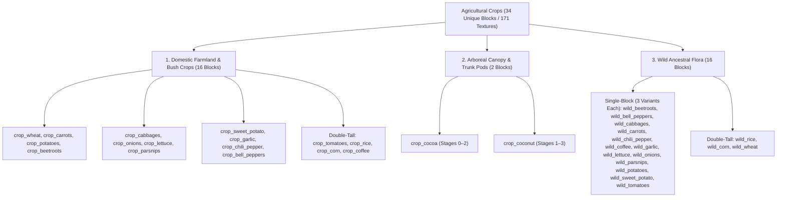

# Worldbuilding Architecture & Catalog: Agriculture & Domestic Crops (crops)

All active textures for domestic agricultural cultivars, cereal grains, root vegetables, leafy greens, solanaceous fruiting crops, climbing vines, arboreal trunk/canopy pods, semi-aquatic grains, and wild ancestral crops are organized in the folder:
📂 **`docs/worldbuilding/blocks/crops`** *(171 active PNG textures on disk)*

Generating **34 unique blocks** in the master catalog spanning 3 distinct agricultural divisions:
1. **16 Domestic Farmland & Bush Cultivars**: Beetroots, Bell Peppers, Cabbages, Carrots, Chili Pepper, Coffee, Corn, Garlic, Lettuce, Onions, Parsnips, Potatoes, Rice, Sweet Potato, Tomatoes, Wheat.
2. **2 Arboreal Fruit & Pod Crops**: Cocoa, Coconut.
3. **16 Wild Ancestral Harvestable Crops**: Wild Beetroots, Wild Bell Peppers, Wild Cabbages, Wild Carrots, Wild Chili Pepper, Wild Coffee, Wild Corn, Wild Garlic, Wild Lettuce, Wild Onions, Wild Parsnips, Wild Potatoes, Wild Rice, Wild Sweet Potato, Wild Tomatoes, Wild Wheat.

---

## 1. Agricultural Cultivation & Growth Lifecycle Mechanics

Domestic crops feature dynamic multi-stage vegetative lifecycles:
* **Farmland & Field Crops** require tilled, hydrated **Farmland** (`soil_loam_farmland_wet` / `soil_loam_farmland_dry`) or flooded paddy substrate.
* **Arboreal Trunk Pods** (`cocoa`) attach laterally to living jungle trunks (`mahogany_log`, `kapok_log`).
* **Arboreal Canopy Pods** (`coconut`) hang suspended beneath living palm canopies (`palm_leaves`).
* **Wild Ancestral Crops** (`wild_*`) spawn naturally across wild biomes (meadows, steppes, savannas, wetlands, and coastal dunes). Single-stage forbs feature **3 stochastic texture variants** (`base`, `1`, `2`) to introduce natural field variation, while double-tall wild flora (`wild_rice`, `wild_corn`, `wild_wheat`) utilize vertical dual-mesh pairing.
* **Multi-Block & Double-Tall Crop Growth Mechanics**:
  - `crop_tomatoes`: develops as a lower budding stem (`crops_budding_tomatoes_stage0...3.png`), then grows the upper fruiting trellis vine (`crops_tomatoes_stage0...3.png`).
  - `crop_rice`: develops as a lower paddy shoot (`crops_rice_stage0...3.png`), transitions to supporting foliage (`crops_rice_supporting.png`), and sprouts the upper panicle (`crops_rice_panicles_stage0...3.png`).
  - `crop_corn`: develops as a seedling bush (`crops_corn_budding_stage0...3.png`), then extends into a tall stalk (`crops_corn_bottom_stage0...3.png`) and flowering tassel canopy (`crops_corn_top_stage0...3.png`).
  - `crop_coffee`: develops initially as a young coffee bush (`crops_coffee_budding_stage0...3.png`), then extends into a productive two-tier shrub with lower woody branches (`crops_coffee_bottom_stage0...3.png`) and an upper blossoming/cherry canopy (`crops_coffee_top_stage0...3.png`).
  - `wild_wheat`: double-tall wild ancestral emmer/einkorn grass with lower grassy culms (`wild_wheat_bottom.png`) and tall swaying golden-olive awn spikes (`wild_wheat_top.png`).

---

## 2. Technical Texture Inventory in `worldbuilding/blocks/crops/` (171 Active Textures)

All textures adhere to strict nomenclature conventions: multi-stage growing crops use the `crops_` prefix, while single-stage wild ancestral forbs use the `wild_` prefix:

### A. Cereal Grains & Field Crops (39 Files)
* **Wheat (6)**: `crops_wheat_stage0.png` through `crops_wheat_stage5.png`
* **Rice (9)**:
  - Lower Stems: `crops_rice_stage0.png` through `crops_rice_stage3.png`, `crops_rice_supporting.png`
  - Upper Panicles: `crops_rice_panicles_stage0.png` through `crops_rice_panicles_stage3.png`
* **Corn (12)**:
  - Seedling Budding: `crops_corn_budding_stage0.png` through `crops_corn_budding_stage3.png`
  - Lower Stalk: `crops_corn_bottom_stage0.png` through `crops_corn_bottom_stage3.png`
  - Upper Tassel: `crops_corn_top_stage0.png` through `crops_corn_top_stage3.png`
* **Coffee (12)**:
  - Young Bush: `crops_coffee_budding_stage0.png` through `crops_coffee_budding_stage3.png`
  - Lower Canopy: `crops_coffee_bottom_stage0.png` through `crops_coffee_bottom_stage3.png`
  - Upper Blossoms / Cherries: `crops_coffee_top_stage0.png` through `crops_coffee_top_stage3.png`

### B. Root, Tuber & Bulb Crops (36 Files)
* **Carrots (4)**: `crops_carrots_stage0.png` through `crops_carrots_stage3.png`
* **Potatoes (4)**: `crops_potatoes_stage0.png` through `crops_potatoes_stage3.png`
* **Onions (4)**: `crops_onions_stage0.png` through `crops_onions_stage3.png`
* **Parsnips (4)**: `crops_parsnips_stage0.png` through `crops_parsnips_stage3.png`
* **Sweet Potato (8)**: `crops_sweet_potato_stage0.png` through `crops_sweet_potato_stage7.png`
* **Beetroots (4)**: `crops_beetroots_stage0.png` through `crops_beetroots_stage3.png`
* **Garlic (8)**: `crops_garlic_stage0.png` through `crops_garlic_stage7.png`

### C. Brassica & Leafy Greens (13 Files)
* **Cabbages (8)**: `crops_cabbages_stage0.png` through `crops_cabbages_stage7.png`
* **Lettuce (5)**: `crops_lettuce_stage0.png` through `crops_lettuce_stage4.png`

### D. Solanaceous & Climbing Vine Crops (24 Files)
* **Chili Pepper (8)**: `crops_chili_pepper_stage0.png` through `crops_chili_pepper_stage7.png`
* **Bell Peppers (8)**: `crops_bell_peppers_stage0.png` through `crops_bell_peppers_stage7.png`
* **Tomato Stem / Budding (4)**: `crops_budding_tomatoes_stage0.png` through `crops_budding_tomatoes_stage3.png`
* **Tomato Upper Fruiting Vine (4)**: `crops_tomatoes_stage0.png` through `crops_tomatoes_stage3.png`

### E. Arboreal Pods & Canopy Fruits (6 Files)
* **Cocoa (3)**: `crops_cocoa_stage0.png`, `crops_cocoa_stage1.png`, `crops_cocoa_stage2.png`
* **Coconut (3)**: `crops_coconut_hanging_stage1.png`, `crops_coconut_hanging_stage2.png`, `crops_coconut_hanging_stage3.png`

### F. Wild Ancestral Harvestable Forbs & Grasses (53 Files)
* **Wild Beetroots (3)**: `wild_beetroots.png`, `wild_beetroots1.png`, `wild_beetroots2.png`
* **Wild Bell Peppers (3)**: `wild_bell_peppers.png`, `wild_bell_peppers1.png`, `wild_bell_peppers2.png`
* **Wild Cabbages (3)**: `wild_cabbages.png`, `wild_cabbages1.png`, `wild_cabbages2.png`
* **Wild Carrots (3)**: `wild_carrots.png`, `wild_carrots1.png`, `wild_carrots2.png`
* **Wild Chili Pepper (3)**: `wild_chili_pepper.png`, `wild_chili_pepper1.png`, `wild_chili_pepper2.png`
* **Wild Coffee (3)**: `wild_coffee.png`, `wild_coffee1.png`, `wild_coffee2.png`
* **Wild Corn (6)**: `wild_corn_bottom.png` *(+ `1`, `2`)*, `wild_corn_top.png` *(+ `1`, `2`)*
* **Wild Garlic (3)**: `wild_garlic.png`, `wild_garlic1.png`, `wild_garlic2.png`
* **Wild Lettuce (3)**: `wild_lettuce.png`, `wild_lettuce1.png`, `wild_lettuce2.png`
* **Wild Onions (3)**: `wild_onions.png`, `wild_onions1.png`, `wild_onions2.png`
* **Wild Parsnips (3)**: `wild_parsnips.png`, `wild_parsnips1.png`, `wild_parsnips2.png`
* **Wild Potatoes (3)**: `wild_potatoes.png`, `wild_potatoes1.png`, `wild_potatoes2.png`
* **Wild Rice (2)**: `wild_rice_bottom.png`, `wild_rice_top.png`
* **Wild Sweet Potato (3)**: `wild_sweet_potato.png`, `wild_sweet_potato1.png`, `wild_sweet_potato2.png`
* **Wild Tomatoes (3)**: `wild_tomatoes.png`, `wild_tomatoes1.png`, `wild_tomatoes2.png`
* **Wild Wheat (6)**: `wild_wheat_bottom.png` *(+ `1`, `2`)*, `wild_wheat_top.png` *(+ `1`, `2`)*

---

## 3. Complete Crop Catalog (34 Unique Blocks)

| # | Block ID | Name | Category | Texture File(s) | Face Mapping / Lifecycle |
| :-: | :--- | :--- | :--- | :--- | :--- |
| **01** | `crop_beetroots` | Beetroot Crop | **Taproot** | `crops_beetroots_stage0...3.png` | 4 Stages (0–3) |
| **02** | `crop_bell_peppers` | Bell Pepper Crop | **Solanaceae** | `crops_bell_peppers_stage0...7.png` | 8 Stages (0–7) |
| **03** | `crop_cabbages` | Cabbage Crop | **Brassica** | `crops_cabbages_stage0...7.png` | 8 Stages (0–7) |
| **04** | `crop_carrots` | Carrot Crop | **Root Crop** | `crops_carrots_stage0...3.png` | 4 Stages (0–3) |
| **05** | `crop_chili_pepper` | Chili Pepper Crop | **Solanaceae** | `crops_chili_pepper_stage0...7.png` | 8 Stages (0–7) |
| **06** | `crop_cocoa` | Cocoa Pod | **Arboreal Pod** | `crops_cocoa_stage0...2.png` | 3 Stages (0–2) |
| **07** | `crop_coconut` | Hanging Coconut | **Arboreal Drupe** | `crops_coconut_hanging_stage1...3.png` | 3 Stages (1–3) |
| **08** | `crop_coffee` | Coffee Crop | **Beverage Shrub** | Budding: `crops_coffee_budding_stage0...3.png` Bottom: `crops_coffee_bottom_stage0...3.png` Top: `crops_coffee_top_stage0...3.png` | Double-Tall Shrub (4 Budding + 4 Lower + 4 Upper Stages) |
| **09** | `crop_corn` | Corn Crop | **Cereal** | Budding: `crops_corn_budding_stage0...3.png` Bottom: `crops_corn_bottom_stage0...3.png` Top: `crops_corn_top_stage0...3.png` | Double-Tall Stalk (4 Budding + 4 Lower + 4 Upper Stages) |
| **10** | `crop_garlic` | Garlic Crop | **Bulb** | `crops_garlic_stage0...7.png` | 8 Stages (0–7) |
| **11** | `crop_lettuce` | Lettuce Crop | **Leafy Vegetable** | `crops_lettuce_stage0...4.png` | 5 Stages (0–4) |
| **12** | `crop_onions` | Onion Crop | **Bulb** | `crops_onions_stage0...3.png` | 4 Stages (0–3) |
| **13** | `crop_parsnips` | Parsnip Crop | **Root Crop** | `crops_parsnips_stage0...3.png` | 4 Stages (0–3) |
| **14** | `crop_potatoes` | Potato Crop | **Tuber** | `crops_potatoes_stage0...3.png` | 4 Stages (0–3) |
| **15** | `crop_rice` | Rice Crop | **Cereal** | Bottom: `crops_rice_stage0...3.png` *(+ `supporting`)* Top: `crops_rice_panicles_stage0...3.png` | Double-Tall (4 Lower + Supporting + 4 Upper Stages) |
| **16** | `crop_sweet_potato` | Sweet Potato Crop | **Tuber** | `crops_sweet_potato_stage0...7.png` | 8 Stages (0–7) |
| **17** | `crop_tomatoes` | Tomato Crop | **Climbing Vine** | Bottom: `crops_budding_tomatoes_stage0...3.png` Top: `crops_tomatoes_stage0...3.png` | Double-Tall (4 Lower + 4 Upper Stages) |
| **18** | `crop_wheat` | Wheat Crop | **Cereal** | `crops_wheat_stage0...5.png` | 6 Stages (0–5) |
| **19** | `wild_beetroots` | Wild Beetroots | **Wild Ancestor** | `wild_beetroots.png` *(+ `1`, `2`)* | Cross-billboard (Harvestable Forb, 3 Variants) |
| **20** | `wild_bell_peppers` | Wild Bell Peppers | **Wild Ancestor** | `wild_bell_peppers.png` *(+ `1`, `2`)* | Cross-billboard (Harvestable Forb, 3 Variants) |
| **21** | `wild_cabbages` | Wild Cabbages | **Wild Ancestor** | `wild_cabbages.png` *(+ `1`, `2`)* | Cross-billboard (Harvestable Forb, 3 Variants) |
| **22** | `wild_carrots` | Wild Carrots | **Wild Ancestor** | `wild_carrots.png` *(+ `1`, `2`)* | Cross-billboard (Harvestable Forb, 3 Variants) |
| **23** | `wild_chili_pepper` | Wild Chili Pepper | **Wild Ancestor** | `wild_chili_pepper.png` *(+ `1`, `2`)* | Cross-billboard (Harvestable Forb, 3 Variants) |
| **24** | `wild_coffee` | Wild Coffee | **Wild Ancestor** | `wild_coffee.png` *(+ `1`, `2`)* | Cross-billboard (Harvestable Forb, 3 Variants) |
| **25** | `wild_corn` | Wild Corn | **Wild Ancestor** | Bottom: `wild_corn_bottom.png` *(+ `1`, `2`)* Top: `wild_corn_top.png` *(+ `1`, `2`)* | Double-Tall Cross-billboard (Harvestable Forb, 3 Variants) |
| **26** | `wild_garlic` | Wild Garlic | **Wild Ancestor** | `wild_garlic.png` *(+ `1`, `2`)* | Cross-billboard (Harvestable Forb, 3 Variants) |
| **27** | `wild_lettuce` | Wild Lettuce | **Wild Ancestor** | `wild_lettuce.png` *(+ `1`, `2`)* | Cross-billboard (Harvestable Forb, 3 Variants) |
| **28** | `wild_onions` | Wild Onions | **Wild Ancestor** | `wild_onions.png` *(+ `1`, `2`)* | Cross-billboard (Harvestable Forb, 3 Variants) |
| **29** | `wild_parsnips` | Wild Parsnips | **Wild Ancestor** | `wild_parsnips.png` *(+ `1`, `2`)* | Cross-billboard (Harvestable Forb, 3 Variants) |
| **30** | `wild_potatoes` | Wild Potatoes | **Wild Ancestor** | `wild_potatoes.png` *(+ `1`, `2`)* | Cross-billboard (Harvestable Forb, 3 Variants) |
| **31** | `wild_rice` | Wild Rice | **Wild Ancestor** | Bottom: `wild_rice_bottom.png` Top: `wild_rice_top.png` | Double-Tall Cross-billboard (Harvestable Forb) |
| **32** | `wild_sweet_potato` | Wild Sweet Potato | **Wild Ancestor** | `wild_sweet_potato.png` *(+ `1`, `2`)* | Cross-billboard (Harvestable Forb, 3 Variants) |
| **33** | `wild_tomatoes` | Wild Tomatoes | **Wild Ancestor** | `wild_tomatoes.png` *(+ `1`, `2`)* | Cross-billboard (Harvestable Forb, 3 Variants) |
| **34** | `wild_wheat` | Wild Wheat | **Wild Ancestor** | Bottom: `wild_wheat_bottom.png` *(+ `1`, `2`)* Top: `wild_wheat_top.png` *(+ `1`, `2`)* | Double-Tall Cross-billboard (Harvestable Grain, 3 Variants) |
