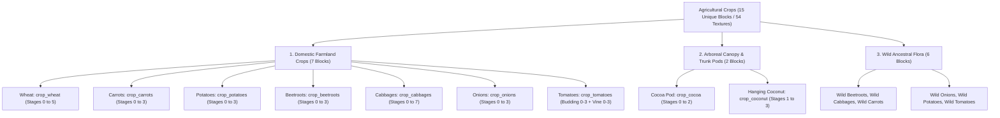

# Worldbuilding Architecture & Catalog: Agriculture & Domestic Crops (crops)

All active textures for domestic agricultural cultivars, cereal grains, root vegetables, climbing vines, hanging canopy fruits, and wild ancestral crops are organized in the folder:
📂 **`docs/worldbuilding/blocks/crops`** *(54 active PNG textures on disk)*

Generating **15 unique blocks** in the master catalog spanning 3 distinct agricultural divisions:
1. **7 Domestic Farmland Cultivars**: Wheat, Carrots, Potatoes, Beetroots, Cabbages, Onions, Tomatoes.
2. **2 Arboreal Fruit & Pod Crops**: Cocoa, Coconut.
3. **6 Wild Ancestral Harvestable Crops**: Wild Beetroots, Wild Cabbages, Wild Carrots, Wild Onions, Wild Potatoes, Wild Tomatoes.

---

## 1. Agricultural Cultivation & Growth Lifecycle Mechanics

Domestic crops feature dynamic multi-stage vegetative lifecycles:
* **Substrate Requirements**:
  - **Farmland Crops** (`wheat`, `carrots`, `potatoes`, `beetroots`, `cabbages`, `onions`, `tomatoes`) require tilled, hydrated **Farmland** (`soil_loam_farmland_wet` / `soil_loam_farmland_dry`).
  - **Arboreal Trunk Pods** (`cocoa`) attach laterally to living jungle trunks (`mahogany_log`, `kapok_log`).
  - **Arboreal Canopy Pods** (`coconut`) hang suspended beneath living palm canopies (`palm_leaves`).
  - **Wild Ancestral Crops** spawn naturally in wild terrain on untreated natural soils, sand, and coastal cliffs.
* **Growth Progression**: Growth advances on stochastic block ticks provided sunlight levels ($L \ge 9$) and hydration conditions are satisfied.
* **Double-Tall Climbing Mechanics**:
  - `crop_tomatoes` develops initially as a lower bush/stem (`budding_tomatoes` stages 0–3).
  - Upon reaching stage 3, it enables or grows the upper climbing trellis/vine (`tomatoes` stages 0–3). Harvesting the mature top block leaves the lower stem intact to produce subsequent harvests.
* **Harvest Yields**: Fully matured final stages yield harvested food products and seed replenishment; premature harvesting drops only seeds or immature shoots.

---

## 2. Technical Texture Inventory in `worldbuilding/blocks/crops/` (54 Active Textures)

All crop textures adhere to the standard prefix `crops_` and standard 16×16 px resolution:

### A. Cereal Grains & Field Crops (7 Files)
* **Wheat (7)**: `crops_wheat_stage0.png`, `crops_wheat_stage1.png`, `crops_wheat_stage2.png`, `crops_wheat_stage3.png`, `crops_wheat_stage4.png`, `crops_wheat_stage5.png`, `crops_wheat_stage5_1.png` *(Mature stochastic variant)*

### B. Root, Tuber & Bulb Crops (14 Files)
* **Carrots (5)**: `crops_carrots_stage0.png`, `crops_carrots_stage1.png`, `crops_carrots_stage2.png`, `crops_carrots_stage3.png`, `crops_carrots_stage3_1.png` *(Mature stochastic variant)*
* **Potatoes (5)**: `crops_potatoes_stage0.png`, `crops_potatoes_stage1.png`, `crops_potatoes_stage2.png`, `crops_potatoes_stage3.png`, `crops_potatoes_stage3_1.png` *(Mature stochastic variant)*
* **Onions (4)**: `crops_onions_stage0.png`, `crops_onions_stage1.png`, `crops_onions_stage2.png`, `crops_onions_stage3.png`

### C. Brassica & Taproot Crops (13 Files)
* **Beetroots (5)**: `crops_beetroots_stage0.png`, `crops_beetroots_stage1.png`, `crops_beetroots_stage2.png`, `crops_beetroots_stage3.png`, `crops_beetroots_stage3_1.png` *(Mature stochastic variant)*
* **Cabbages (8)**: `crops_cabbages_stage0.png`, `crops_cabbages_stage1.png`, `crops_cabbages_stage2.png`, `crops_cabbages_stage3.png`, `crops_cabbages_stage4.png`, `crops_cabbages_stage5.png`, `crops_cabbages_stage6.png`, `crops_cabbages_stage7.png`

### D. Trellis & Climbing Vine Crops (8 Files)
* **Tomato Stem / Budding (4)**: `crops_budding_tomatoes_stage0.png`, `crops_budding_tomatoes_stage1.png`, `crops_budding_tomatoes_stage2.png`, `crops_budding_tomatoes_stage3.png`
* **Tomato Upper Fruiting Vine (4)**: `crops_tomatoes_stage0.png`, `crops_tomatoes_stage1.png`, `crops_tomatoes_stage2.png`, `crops_tomatoes_stage3.png`

### E. Arboreal Pods & Canopy Fruits (6 Files)
* **Cocoa (3)**: `crops_cocoa_stage0.png` *(Small green pod)*, `crops_cocoa_stage1.png` *(Medium yellow pod)*, `crops_cocoa_stage2.png` *(Large orange-brown ripe pod)*
* **Coconut (3)**: `crops_coconut_hanging_stage_1.png` *(Small green pod)*, `crops_coconut_hanging_stage_2.png` *(Medium green drupe)*, `crops_coconut_hanging_stage_3.png` *(Mature brown coconut cluster)*

### F. Wild Ancestral Crops (6 Files)
* **Wild Beetroots (1)**: `crops_wild_beetroots.png`
* **Wild Cabbages (1)**: `crops_wild_cabbages.png`
* **Wild Carrots (1)**: `crops_wild_carrots.png`
* **Wild Onions (1)**: `crops_wild_onions.png`
* **Wild Potatoes (1)**: `crops_wild_potatoes.png`
* **Wild Tomatoes (1)**: `crops_wild_tomatoes.png`

---

## 3. Complete Crop Catalog (15 Unique Blocks)

| # | Block ID | Name | Category | Texture Stages | Growth Stages | Substrate Requirement | Agricultural Description |
| :-: | :--- | :--- | :--- | :--- | :--- | :--- | :--- |
| **01** | `crop_wheat` | Wheat Crop | **Cereal** | `crops_wheat_stage0...5.png` *(+ `5_1`)* | 6 Stages (0–5) | Hydrated Farmland | Golden domestic wheat grain; primary agricultural staple for baking bread and livestock feed. |
| **02** | `crop_carrots` | Carrot Crop | **Root Crop** | `crops_carrots_stage0...3.png` *(+ `3_1`)* | 4 Stages (0–3) | Hydrated Farmland | Crisp sweet orange biennial taproot with feathery green foliage; versatile nutritious vegetable. |
| **03** | `crop_potatoes`| Potato Crop | **Tuber** | `crops_potatoes_stage0...3.png` *(+ `3_1`)* | 4 Stages (0–3) | Hydrated Farmland | Underground starchy edible tubers with leafy bushy stems; high caloric staple yield. |
| **04** | `crop_beetroots`| Beetroot Crop | **Taproot** | `crops_beetroots_stage0...3.png` *(+ `3_1`)* | 4 Stages (0–3) | Hydrated Farmland | Bulbous deep-crimson sweet taproot and ruby-veined leaves; yields rich soup broth and dye. |
| **05** | `crop_cabbages` | Cabbage Crop | **Brassica** | `crops_cabbages_stage0...7.png` | 8 Stages (0–7) | Hydrated Farmland | Robust layered leafy green cabbage head maturing through 8 fine developmental stages. |
| **06** | `crop_onions` | Onion Crop | **Bulb** | `crops_onions_stage0...3.png` | 4 Stages (0–3) | Hydrated Farmland | Layered subterranean pungently aromatic allium bulb with slender erect hollow green scapes. |
| **07** | `crop_tomatoes` | Tomato Crop | **Climbing Vine** | Bottom: `crops_budding_tomatoes_stage0...3.png` Top: `crops_tomatoes_stage0...3.png` | Double-Tall (4 Lower + 4 Upper Stages) | Hydrated Farmland (Trellis) | 2-block climbing vine; lower budding stem supports an upper perennial fruiting tomato vine. |
| **08** | `crop_cocoa` | Cocoa Pod | **Arboreal Pod** | `crops_cocoa_stage0...2.png` | 3 Stages (0–2) | Jungle Wood Trunk | Woody pendant pod maturing on tropical tree trunks, housing bitter cocoa beans for chocolate. |
| **09** | `crop_coconut` | Hanging Coconut | **Arboreal Drupe** | `crops_coconut_hanging_stage_1...3.png` | 3 Stages (1–3) | Palm Tree Foliage | Fibrous palm drupe hanging beneath tropical palm canopies; yields coconut meat and water. |
| **10** | `crop_wild_beetroots` | Wild Beetroots | **Wild Ancestor** | `crops_wild_beetroots.png` | 1 (Harvestable Forb) | Coastal Beaches, Dunes | Wild ancestral sea-beet growing in littoral sands; source of early domestic cultivars. |
| **11** | `crop_wild_cabbages` | Wild Cabbages | **Wild Ancestor** | `crops_wild_cabbages.png` | 1 (Harvestable Forb) | Maritime Sea Cliffs | Hardy maritime wild brassica clinging to salty windswept limestone cliffs and shorelines. |
| **12** | `crop_wild_carrots` | Wild Carrots | **Wild Ancestor** | `crops_wild_carrots.png` | 1 (Harvestable Forb) | Meadows, Temperate Plains | Queen Anne's lace wild ancestor with umbels of white florets and slender edible taproots. |
| **13** | `crop_wild_onions` | Wild Onions | **Wild Ancestor** | `crops_wild_onions.png` | 1 (Harvestable Forb) | Grasslands, Savannas | Wild allium tuft growing in open savannahs, harvestable for pungent small bulbs. |
| **14** | `crop_wild_potatoes` | Wild Potatoes | **Wild Ancestor** | `crops_wild_potatoes.png` | 1 (Harvestable Forb) | Cold Slopes, Montane Taigas | Hardy montane ancestor bearing small starchy tubers adapted to high altitudes. |
| **15** | `crop_wild_tomatoes` | Wild Tomatoes | **Wild Ancestor** | `crops_wild_tomatoes.png` | 1 (Harvestable Forb) | Warm Riverbanks, Valleys | Bushy ancestral wild nightshade producing clusters of tart miniature cherry-sized fruit. |
