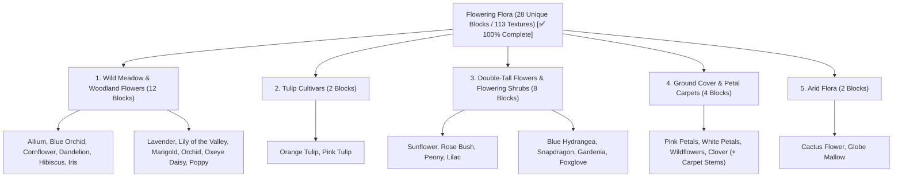

# Worldbuilding Architecture & Catalog: Flowers & Flowering Flora (Flowers)

All active textures for wild meadow flowers, tulip cultivars, double-tall flowering shrubs, and floral ground petal carpets are organized in the folder:
📂 **`docs/worldbuilding/blocks/flowers`** *(113 active PNG textures on disk)*

Generating **28 unique blocks** in the master catalog: 12 wild meadow & woodland flowers + 2 tulip cultivars + 8 double-tall flowers & shrubs + 4 ground cover carpets + 2 arid desert blooms (**100% Complete — Standardized with exactly 3 variants per block/part**).

---

## 1. Ecological Classification & Floral Strata

The flowering flora of the planetary ecosystem is structured into **5 Morphological Categories (28 Unique Blocks / 113 Textures)**:

---

## 2. Complete Texture Inventory in `worldbuilding/blocks/flowers/` (113 Active Textures)

All textures feature native **16×16 px RGBA** resolution with clean alpha-cutout boundaries and unified `flower_` prefix:

### A. Wild Meadow & Woodland Flowers (36 Files — 12 Blocks × 3 Variants)

* **Allium (3)**: `flower_allium.png`, `flower_allium1.png`, `flower_allium2.png`
* **Blue Orchid (3)**: `flower_blue_orchid.png`, `flower_blue_orchid1.png`, `flower_blue_orchid2.png`
* **Cornflower (3)**: `flower_cornflower.png`, `flower_cornflower1.png`, `flower_cornflower2.png`
* **Dandelion (3)**: `flower_dandelion.png`, `flower_dandelion1.png`, `flower_dandelion2.png`
* **Hibiscus (3)**: `flower_hibiscus.png`, `flower_hibiscus1.png`, `flower_hibiscus2.png`
* **Iris (3)**: `flower_iris.png`, `flower_iris1.png`, `flower_iris2.png`
* **Lavender (3)**: `flower_lavender.png`, `flower_lavender1.png`, `flower_lavender2.png`
* **Lily of the Valley (3)**: `flower_lily_of_the_valley.png`, `flower_lily_of_the_valley1.png`, `flower_lily_of_the_valley2.png`
* **Marigold (3)**: `flower_marigold.png`, `flower_marigold1.png`, `flower_marigold2.png`
* **Orchid (3)**: `flower_orchid.png`, `flower_orchid1.png`, `flower_orchid2.png` *(Classic white/magenta Phalaenopsis with golden throat)*
* **Oxeye Daisy (3)**: `flower_oxeye_daisy.png`, `flower_oxeye_daisy1.png`, `flower_oxeye_daisy2.png`
* **Poppy (3)**: `flower_poppy.png`, `flower_poppy1.png`, `flower_poppy2.png`

### B. Tulip Cultivars (6 Files — 2 Blocks × 3 Variants)

* **Orange Tulip (3)**: `flower_orange_tulip.png`, `flower_orange_tulip1.png`, `flower_orange_tulip2.png`
* **Pink Tulip (3)**: `flower_pink_tulip.png`, `flower_pink_tulip1.png`, `flower_pink_tulip2.png`

### C. Double-Tall Flowers & Flowering Shrubs (50 Files — 8 Blocks)

* **Sunflower (8)**: `flower_sunflower_bottom.png`, `1`, `2` `flower_sunflower_top.png`, `1`, `2` `flower_sunflower_front.png`, `flower_sunflower_back.png` (directional head faces)
* **Rose Bush (6)**: `flower_rose_bush_bottom.png`, `1`, `2` `flower_rose_bush_top.png`, `1`, `2`
* **Peony (6)**: `flower_peony_bottom.png`, `1`, `2` `flower_peony_top.png`, `1`, `2`
* **Lilac (6)**: `flower_lilac_bottom.png`, `1`, `2` `flower_lilac_top.png`, `1`, `2`
* **Blue Hydrangea (6)**: `flower_blue_hydrangea_bottom.png`, `1`, `2` `flower_blue_hydrangea_top.png`, `1`, `2`
* **Snapdragon (6)**: `flower_snapdragon_bottom.png`, `1`, `2` `flower_snapdragon_top.png`, `1`, `2`
* **Gardenia (6)**: `flower_gardenia_bottom.png`, `1`, `2` `flower_gardenia_top.png`, `1`, `2`
* **Foxglove (6)**: `flower_foxglove_bottom.png`, `1`, `2` `flower_foxglove_top.png`, `1`, `2`

### D. Ground Cover & Petal Carpets (15 Files — 4 Blocks × 3 Variants + 3 Shared Carpet Stems)

* **Pink Petals (3)**: `flower_pink_petals.png`, `flower_pink_petals1.png`, `flower_pink_petals2.png`
* **White Petals (3)**: `flower_white_petals.png`, `flower_white_petals1.png`, `flower_white_petals2.png`
* **Wildflowers (3)**: `flower_wildflowers.png`, `flower_wildflowers1.png`, `flower_wildflowers2.png`
* **Clover (3)**: `flower_clover.png`, `flower_clover1.png`, `flower_clover2.png`
* **Shared Carpet Stems (3)**: `flower_carpet_stem.png`, `flower_carpet_stem1.png`, `flower_carpet_stem2.png` *(Shared upright anchor stems for all carpet meshes)*

### E. Arid Flora (6 Files — 2 Blocks × 3 Variants)

* **Cactus Flower (3)**: `flower_cactus_flower.png`, `flower_cactus_flower1.png`, `flower_cactus_flower2.png`
* **Globe Mallow (3)**: `flower_globe_mallow.png`, `flower_globe_mallow1.png`, `flower_globe_mallow2.png`

---

## 3. Complete Block Catalog (28 Unique Blocks)

### 3.1. Wild Meadow & Woodland Flowers (12 Blocks)

Single-voxel tall flowers rendered as intersecting cross-billboards (`#` shape). Feature procedural rotation and 3 random visual variations per block.

| # | Block ID | Name | Category | Texture File(s) | Variations | Biome Occurrence | Description |
| :-: | :--- | :--- | :--- | :--- | :-: | :--- | :--- |
| **01** | `flower_allium` | Allium | **Wildflower** | `flower_allium.png` to `2` | 3 | Prairies, Rocky Slopes | Spherical globose purple-magenta bloom on a tall, slender stem. |
| **02** | `flower_blue_orchid` | Blue Orchid | **Wildflower** | `flower_blue_orchid.png` to `2` | 3 | Swamps, Moist Floodplains | Exotic electric-cyan zygomorphic orchid thriving in humid marshlands. |
| **03** | `flower_cornflower` | Cornflower | **Wildflower** | `flower_cornflower.png` to `2` | 3 | Open Fields, Grasslands | Radiant deep-blue fringed ray florets, pioneer of sunlit meadows. |
| **04** | `flower_dandelion` | Dandelion | **Wildflower** | `flower_dandelion.png` to `2` | 3 | Temperate Plains, Forests | Vibrant golden-yellow composite head with deeply toothed basal leaves. |
| **05** | `flower_hibiscus` | Hibiscus | **Wildflower** | `flower_hibiscus.png` to `2` | 3 | Tropical Jungles, Coasts | Large tropical scarlet-red actinomorphic flower with yellow staminal column. |
| **06** | `flower_iris` | Iris | **Wildflower** | `flower_iris.png` to `2` | 3 | Riverbanks, Marsh Edges | Majestic purple-violet flower with drooping falls and upright standards. |
| **07** | `flower_lavender` | Lavender | **Wildflower** | `flower_lavender.png` to `2` | 3 | Mediterranean Hills, Dunes | Aromatic whorled lavender-purple spikes with silver-tinted foliage. |
| **08** | `flower_lily_of_the_valley` | Lily of the Valley | **Wildflower** | `flower_lily_of_the_valley.png` to `2` | 3 | Shaded Woodlands, Glades | Pure white, nodding bell-shaped scented blossoms along a curved stalk. |
| **09** | `flower_marigold` | Marigold | **Wildflower** | `flower_marigold.png` to `2` | 3 | Valleys, Sunlit Plains | Ruffled pom-pom double heads in radiant orange and amber tones. |
| **10** | `flower_orchid` | Classic Orchid | **Wildflower** | `flower_orchid.png` to `2` | 3 | Tropical Canopies, Humid Glades | Elegant white and magenta zygomorphic orchid with radiant golden throat. |
| **11** | `flower_oxeye_daisy` | Oxeye Daisy | **Wildflower** | `flower_oxeye_daisy.png` to `2` | 3 | Pastures, Grassy Meadows | Classic meadow daisy with bright white ray petals and golden disc center. |
| **12** | `flower_poppy` | Poppy | **Wildflower** | `flower_poppy.png` to `2` | 3 | Steppes, Dry Hillsides | Delicate paper-thin scarlet-red petals with a dark basal center spot. |

---

### 3.2. Tulip Cultivars (2 Blocks)

Symmetrical cup-shaped perennial blooms on upright stems. Found across sunny plains, temperate slopes, and garden beds.

| # | Block ID | Name | Category | Texture File(s) | Variations | Biome Occurrence | Description |
| :-: | :--- | :--- | :--- | :--- | :-: | :--- | :--- |
| **13** | `flower_orange_tulip` | Orange Tulip | **Tulip** | `flower_orange_tulip.png` to `2` | 3 | Sunny Meadows, Savannas | Fiery amber-orange petals with warm golden throat tones. |
| **14** | `flower_pink_tulip` | Pink Tulip | **Tulip** | `flower_pink_tulip.png` to `2` | 3 | Flower Forests, Meadows | Delicate blush-pink petals fading gracefully to soft cream. |

---

### 3.3. Double-Tall Flowers & Flowering Shrubs (8 Blocks)

Two-block-high composite plants requiring both a root-anchored lower stem (`_bottom`) and a flowering canopy crown (`_top`). Features seamless vertical stem continuity between bottom row 0 and top row 15.

| # | Block ID | Name | Category | Texture File(s) | Variations | Growth Habit | Description |
| :-: | :--- | :--- | :--- | :--- | :-: | :--- | :--- |
| **15** | `flower_sunflower` | Sunflower | **Double-Tall** | `flower_sunflower_bottom.png` to `2` `flower_sunflower_top.png` to `2` `flower_sunflower_front.png`, `back.png` | 3 + Dir | Heliotropic Tall Stalk | Giant golden composite head that tracks the sun azimutally. |
| **16** | `flower_rose_bush` | Rose Bush | **Double-Tall** | `flower_rose_bush_bottom.png` to `2` `flower_rose_bush_top.png` to `2` | 3 | Dense Thorny Shrub | Multi-stemmed shrub densely studded with velvety scarlet roses. |
| **17** | `flower_peony` | Peony | **Double-Tall** | `flower_peony_bottom.png` to `2` `flower_peony_top.png` to `2` | 3 | Lush Bushy Perennial | Heavy ruffly globes of pastel-pink petals nestled among dark foliage. |
| **18** | `flower_lilac` | Lilac | **Double-Tall** | `flower_lilac_bottom.png` to `2` `flower_lilac_top.png` to `2` | 3 | Woody Flowering Shrub | Upright woody shrub crowned with conical lilac-purple fragrant panicles. |
| **19** | `flower_blue_hydrangea` | Blue Hydrangea | **Double-Tall** | `flower_blue_hydrangea_bottom.png` to `2` `flower_blue_hydrangea_top.png` to `2` | 3 | Acid-Soil Shrub | Massive globose pompons of saturated cobalt-blue flowers. |
| **20** | `flower_snapdragon` | Snapdragon | **Double-Tall** | `flower_snapdragon_bottom.png` to `2` `flower_snapdragon_top.png` to `2` | 3 | Dense Floral Spike | Upright spike of bilabiate blossoms gradienting from magenta to yellow. |
| **21** | `flower_gardenia` | Gardenia | **Double-Tall** | `flower_gardenia_bottom.png` to `2` `flower_gardenia_top.png` to `2` | 3 | Glossy Evergreen Bush | Glossy dark leaves bearing intensely fragrant waxy ivory-white flowers. |
| **22** | `flower_foxglove` | Foxglove | **Double-Tall** | `flower_foxglove_bottom.png` to `2` `flower_foxglove_top.png` to `2` | 3 | Tall Woodland Spike | Towering stately raceme of pendulous tubular spotted pink bells. |

---

### 3.4. Ground Cover & Petal Carpets (4 Blocks)

Low-lying sub-voxel floral carpets spread horizontally across soil, grass, or stone surfaces. Renders using a horizontal flat quad on top plus an upright central anchor stem.

| # | Block ID | Name | Category | Texture File(s) | Stem Texture | Description |
| :-: | :--- | :--- | :--- | :--- | :--- | :--- |
| **23** | `flower_pink_petals` | Pink Petals | **Carpet** | `flower_pink_petals.png` to `2` | `flower_carpet_stem.png` to `2` | Scattered wind-blown cherry blossom petals accumulating on terrain. |
| **24** | `flower_white_petals` | White Petals | **Carpet** | `flower_white_petals.png` to `2` | `flower_carpet_stem.png` to `2` | Soft snowfall of pale deciduous flower petals dusting the forest floor. |
| **25** | `flower_wildflowers` | Wildflowers Carpet | **Carpet** | `flower_wildflowers.png` to `2` | `flower_carpet_stem.png` to `2` | Dense multi-colored carpet of tiny creeping flowers covering pasture grass. |
| **26** | `flower_clover` | Clover Carpet | **Carpet** | `flower_clover.png` to `2` | `flower_carpet_stem.png` to `2` | Ground-hugging mat of trifoliate green clover with occasional white florets. |

---

### 3.5. Arid Flora (2 Blocks)

Drought-tolerant specialized desert flora thriving in arid deserts, dry mesas, dunes, and rocky badlands.

| # | Block ID | Name | Category | Texture File(s) | Variations | Growth Habit | Description |
| :-: | :--- | :--- | :--- | :--- | :-: | :--- | :--- |
| **27** | `flower_cactus_flower` | Cactus Flower | **Arid Flora** | `flower_cactus_flower.png` to `2` | 3 | Stem Crest Perch | Bright yellow multi-petaled bloom perching atop saguaro cactus ribs. |
| **28** | `flower_globe_mallow` | Globe Mallow | **Arid Flora** | `flower_globe_mallow.png` to `2` | 3 | Desert Shrub Spike | Apricot-orange cup-shaped desert blooms on erect sage-green stems. |

---

## 4. Structural Architecture & Rendering Specifications

### 4.1. Single-Block Cross-Billboard Geometry

Single flowers (`flower_allium` through `flower_poppy`, orchids, tulips, `flower_cactus_flower`, and `flower_globe_mallow`) render via two intersecting vertical planes in an **X** pattern:

* Plane A connects corner $[0, y, 0]$ to $[1, y+1, 1]$.
* Plane B connects corner $[0, y, 1]$ to $[1, y+1, 0]$.
* Procedural rotation applies an initial yaw offset of $0^\circ, 45^\circ, 90^\circ$, or $135^\circ$ to prevent artificial grid alignment across natural fields.

### 4.2. Double-Tall Composite Block Mechanics

Double-tall plants (`flower_sunflower`, `flower_rose_bush`, `flower_foxglove`, etc.) occupy two vertical blocks:

* **Lower Voxel (`_bottom`)**: Contains the stem root base and must be placed on solid soil.
* **Upper Voxel (`_top`)**: Contains the flowering canopy. Breaking either block triggers a neighbor update that breaks the partner block cleanly.
* **Vertical Seam Guarantee**: Row 0 of `_bottom` seamlessly matches Row 15 of `_top` across all 3 variants.

### 4.3. Heliotropic Orientation (Sunflower)

`flower_sunflower` features directional textures:

* `flower_sunflower_front.png`: The bright yellow floral face, oriented towards the sun.
* `flower_sunflower_back.png`: The green calyx and drooping leaves on the shaded side.
* The head tilts slightly toward the planetary daylight cycle vector.

### 4.4. Petal Carpets & Ground Cover Hybrid Mesh

Petal carpets (`flower_pink_petals`, `flower_white_petals`, `flower_wildflowers`, `flower_clover`) utilize a hybrid mesh consisting of:

1. **Horizontal Quad Plane (Top Surface)**: Positioned at sub-voxel height ($y \approx 0.05$ to $0.0625$ above ground), displaying the flat petal scatter textures (`_`, `1`, `2`).
2. **Upright Anchor Stem (Vertical Quad)**: An upright vertical stem quad underneath connecting ground ($y = 0.0$) to the petal plane, utilizing the shared generalized stem textures:
   * `flower_carpet_stem.png`: Central straight anchor stem.
   * `flower_carpet_stem1.png`: Angled anchor stem.
   * `flower_carpet_stem2.png`: Forked sepal anchor stem.
3. **Layer Density**: Stacking additional petal items in the same block increases visual coverage density (1 to 4 stages).
