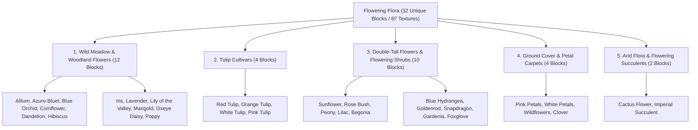

# Worldbuilding Architecture & Catalog: Flowers & Flowering Flora (Flowers)

All active textures for wild meadow flowers, tulip cultivars, double-tall flowering shrubs, and floral ground petal carpets are organized in the folder:
📂 **`docs/worldbuilding/blocks/flowers`** *(87 active PNG textures on disk)*

Generating **32 unique blocks** in the master catalog: 12 wild meadow & woodland flowers + 4 tulip cultivars + 10 double-tall flowers & shrubs + 4 ground cover carpets + 2 arid flowering succulents (all 5 categories are strictly even numbers).

---

## 1. Ecological Classification & Floral Strata

The flowering flora of the planetary ecosystem is structured into **5 Morphological Categories (32 Unique Blocks / 87 Textures)**:

---

## 2. Complete Texture Inventory in `worldbuilding/blocks/flowers/` (87 Active Textures)

All textures feature native **16×16 px RGBA** resolution with clean alpha-cutout boundaries and unified `flower_` prefix:

### A. Wild Meadow & Woodland Flowers (33 Files)
* **Allium (4)**: `flower_allium.png`, `flower_allium1.png`, `flower_allium2.png`, `flower_allium3.png`
* **Azure Bluet (4)**: `flower_azure_bluet.png`, `flower_azure_bluet1.png`, `flower_azure_bluet2.png`, `flower_azure_bluet3.png`
* **Blue Orchid (2)**: `flower_blue_orchid.png`, `flower_blue_orchid1.png`
* **Cornflower (3)**: `flower_cornflower.png`, `flower_cornflower1.png`, `flower_cornflower2.png`
* **Dandelion (4)**: `flower_dandelion.png`, `flower_dandelion1.png`, `flower_dandelion2.png`, `flower_dandelion3.png`
* **Hibiscus (1)**: `flower_hibiscus.png`
* **Iris (1)**: `flower_iris.png`
* **Lavender (1)**: `flower_lavender.png`
* **Lily of the Valley (3)**: `flower_lily_of_the_valley.png`, `flower_lily_of_the_valley1.png`, `flower_lily_of_the_valley2.png`
* **Marigold (2)**: `flower_marigold.png`, `flower_marigold1.png`
* **Oxeye Daisy (3)**: `flower_oxeye_daisy.png`, `flower_oxeye_daisy1.png`, `flower_oxeye_daisy2.png`
* **Poppy (5)**: `flower_poppy.png`, `flower_poppy1.png`, `flower_poppy2.png`, `flower_poppy3.png`, `flower_poppy4.png`

### B. Tulip Cultivars (12 Files)
* **Red Tulip (3)**: `flower_red_tulip.png`, `flower_red_tulip1.png`, `flower_red_tulip2.png`
* **Orange Tulip (3)**: `flower_orange_tulip.png`, `flower_orange_tulip1.png`, `flower_orange_tulip2.png`
* **White Tulip (3)**: `flower_white_tulip.png`, `flower_white_tulip1.png`, `flower_white_tulip2.png`
* **Pink Tulip (3)**: `flower_pink_tulip.png`, `flower_pink_tulip1.png`, `flower_pink_tulip2.png`

### C. Double-Tall Flowers & Flowering Shrubs (31 Files)
* **Sunflower (5)**: `flower_sunflower_bottom.png`, `flower_sunflower_bottom1.png`, `flower_sunflower_top.png`, `flower_sunflower_front.png`, `flower_sunflower_back.png`
* **Rose Bush (6)**: `flower_rose_bush_bottom.png`, `flower_rose_bush_bottom1.png`, `flower_rose_bush_top.png`, `flower_rose_bush_top1.png`, `flower_rose_bush_top2.png`, `flower_rose_bush_top3.png`
* **Peony (4)**: `flower_peony_bottom.png`, `flower_peony_bottom1.png`, `flower_peony_top.png`, `flower_peony_top1.png`
* **Lilac (4)**: `flower_lilac_bottom.png`, `flower_lilac_bottom1.png`, `flower_lilac_top.png`, `flower_lilac_top1.png`
* **Begonia (2)**: `flower_begonia_bottom.png`, `flower_begonia_top.png`
* **Blue Hydrangea (2)**: `flower_blue_hydrangea_bottom.png`, `flower_blue_hydrangea_top.png`
* **Goldenrod (2)**: `flower_goldenrod_bottom.png`, `flower_goldenrod_top.png`
* **Snapdragon (2)**: `flower_snapdragon_bottom.png`, `flower_snapdragon_top.png`
* **Gardenia (2)**: `flower_gardenia_bottom.png`, `flower_gardenia_top.png`
* **Foxglove (2)**: `flower_foxglove_bottom.png`, `flower_foxglove_top.png`

### D. Ground Cover & Petal Carpets (9 Files)
* **Pink Petals (2)**: `flower_pink_petals.png`, `flower_pink_petals_stem.png`
* **White Petals (2)**: `flower_white_petals.png`, `flower_white_petals_stem.png`
* **Wildflowers (3)**: `flower_wildflowers.png`, `flower_wildflowers1.png`, `flower_wildflowers_stem.png`
* **Clover (2)**: `flower_clover.png`, `flower_clover_stem.png`

### E. Arid Flora & Flowering Succulents (2 Files)
* **Cactus Flower (1)**: `flower_cactus_flower.png`
* **Imperial Succulent (1)**: `flower_imperial_succulent.png`

---

## 3. Complete Block Catalog (32 Unique Blocks)

### 3.1. Wild Meadow & Woodland Flowers (12 Blocks)

Single-voxel tall flowers rendered as intersecting cross-billboards (`#` shape). Feature procedural rotation and random visual variations.

| # | Block ID | Name | Category | Texture File(s) | Variations | Biome Occurrence | Description |
| :-: | :--- | :--- | :--- | :--- | :-: | :--- | :--- |
| **01** | `flower_allium` | Allium | **Wildflower** | `flower_allium.png` to `3` | 4 | Prairies, Rocky Slopes | Spherical globose purple-magenta bloom on a tall, slender stem. |
| **02** | `flower_azure_bluet` | Azure Bluet | **Wildflower** | `flower_azure_bluet.png` to `3` | 4 | Alpine Meadows, Clearings | Tufted dainty perennial with 4-lobed sky-blue petals and yellow eye. |
| **03** | `flower_blue_orchid` | Blue Orchid | **Wildflower** | `flower_blue_orchid.png`, `1` | 2 | Swamps, Moist Floodplains | Exotic electric-cyan zygomorphic orchid thriving in humid marshlands. |
| **04** | `flower_cornflower` | Cornflower | **Wildflower** | `flower_cornflower.png` to `2` | 3 | Open Fields, Grasslands | Radiant deep-blue fringed ray florets, pioneer of sunlit meadows. |
| **05** | `flower_dandelion` | Dandelion | **Wildflower** | `flower_dandelion.png` to `3` | 4 | Temperate Plains, Forests | Vibrant golden-yellow composite head with deeply toothed basal leaves. |
| **06** | `flower_hibiscus` | Hibiscus | **Wildflower** | `flower_hibiscus.png` | 1 | Tropical Jungles, Coasts | Large tropical scarlet-red actinomorphic flower with yellow staminal column. |
| **07** | `flower_iris` | Iris | **Wildflower** | `flower_iris.png` | 1 | Riverbanks, Marsh Edges | Majestic purple-violet flower with drooping falls and upright standards. |
| **08** | `flower_lavender` | Lavender | **Wildflower** | `flower_lavender.png` | 1 | Mediterranean Hills, Dunes | Aromatic whorled lavender-purple spikes with silver-tinted foliage. |
| **09** | `flower_lily_of_the_valley` | Lily of the Valley | **Wildflower** | `flower_lily_of_the_valley.png` to `2` | 3 | Shaded Woodlands, Glades | Pure white, nodding bell-shaped scented blossoms along a curved stalk. |
| **10** | `flower_marigold` | Marigold | **Wildflower** | `flower_marigold.png`, `1` | 2 | Valleys, Sunlit Plains | Ruffled pom-pom double heads in radiant orange and amber tones. |
| **11** | `flower_oxeye_daisy` | Oxeye Daisy | **Wildflower** | `flower_oxeye_daisy.png` to `2` | 3 | Pastures, Grassy Meadows | Classic meadow daisy with bright white ray petals and golden disc center. |
| **12** | `flower_poppy` | Poppy | **Wildflower** | `flower_poppy.png` to `4` | 5 | Steppes, Dry Hillsides | Delicate paper-thin scarlet-red petals with a dark basal center spot. |

---

### 3.2. Tulip Cultivars (4 Blocks)

Symmetrical cup-shaped perennial blooms on upright stems. Found across sunny plains, temperate slopes, and garden beds.

| # | Block ID | Name | Category | Texture File(s) | Variations | Biome Occurrence | Description |
| :-: | :--- | :--- | :--- | :--- | :-: | :--- | :--- |
| **13** | `flower_red_tulip` | Red Tulip | **Tulip** | `flower_red_tulip.png` to `2` | 3 | Temperate Plains, Valleys | Rich crimson-red chalice bloom on an erect stalk. |
| **14** | `flower_orange_tulip` | Orange Tulip | **Tulip** | `flower_orange_tulip.png` to `2` | 3 | Sunny Meadows, Savannas | Fiery amber-orange petals with warm golden throat tones. |
| **15** | `flower_white_tulip` | White Tulip | **Tulip** | `flower_white_tulip.png` to `2` | 3 | Cold Plains, Foothills | Immaculate porcelain-white petals with cool soft highlights. |
| **16** | `flower_pink_tulip` | Pink Tulip | **Tulip** | `flower_pink_tulip.png` to `2` | 3 | Flower Forests, Meadows | Delicate blush-pink petals fading gracefully to soft cream. |

---

### 3.3. Double-Tall Flowers & Flowering Shrubs (10 Blocks)

Two-block-high composite plants requiring both a root-anchored lower stem (`_bottom`) and a flowering canopy crown (`_top`).

| # | Block ID | Name | Category | Texture File(s) | Variations | Growth Habit | Description |
| :-: | :--- | :--- | :--- | :--- | :-: | :--- | :--- |
| **17** | `flower_sunflower` | Sunflower | **Double-Tall** | `flower_sunflower_bottom.png`, `1` `flower_sunflower_top.png` `flower_sunflower_front.png`, `back.png` | 5 | Heliotropic Tall Stalk | Giant golden composite head that tracks the sun azimutally. |
| **18** | `flower_rose_bush` | Rose Bush | **Double-Tall** | `flower_rose_bush_bottom.png`, `1` `flower_rose_bush_top.png` to `3` | 6 | Dense Thorny Shrub | Multi-stemmed shrub densely studded with velvety scarlet roses. |
| **19** | `flower_peony` | Peony | **Double-Tall** | `flower_peony_bottom.png`, `1` `flower_peony_top.png`, `1` | 4 | Lush Bushy Perennial | Heavy ruffly globes of pastel-pink petals nestled among dark foliage. |
| **20** | `flower_lilac` | Lilac | **Double-Tall** | `flower_lilac_bottom.png`, `1` `flower_lilac_top.png`, `1` | 4 | Woody Flowering Shrub | Upright woody shrub crowned with conical lilac-purple fragrant panicles. |
| **21** | `flower_begonia` | Begonia | **Double-Tall** | `flower_begonia_bottom.png` `flower_begonia_top.png` | 2 | Tropical Understory | Succulent-stemmed sub-shrub with asymmetrical leaves and scarlet bloom clusters. |
| **22** | `flower_blue_hydrangea` | Blue Hydrangea | **Double-Tall** | `flower_blue_hydrangea_bottom.png` `flower_blue_hydrangea_top.png` | 2 | Acid-Soil Shrub | Massive globose pompons of saturated cobalt-blue flowers. |
| **23** | `flower_goldenrod` | Goldenrod | **Double-Tall** | `flower_goldenrod_bottom.png` `flower_goldenrod_top.png` | 2 | Tall Feathered Stalk | Arching feathered plumes of golden-yellow sprays swaying in the breeze. |
| **24** | `flower_snapdragon` | Snapdragon | **Double-Tall** | `flower_snapdragon_bottom.png` `flower_snapdragon_top.png` | 2 | Dense Floral Spike | Upright spike of bilabiate blossoms gradienting from magenta to yellow. |
| **25** | `flower_gardenia` | Gardenia | **Double-Tall** | `flower_gardenia_bottom.png` `flower_gardenia_top.png` | 2 | Glossy Evergreen Bush | Glossy dark leaves bearing intensely fragrant waxy ivory-white flowers. |
| **26** | `flower_foxglove` | Foxglove | **Double-Tall** | `flower_foxglove_bottom.png` `flower_foxglove_top.png` | 2 | Tall Woodland Spike | Towering stately raceme of pendulous tubular spotted pink bells. |

---

### 3.4. Ground Cover & Petal Carpets (4 Blocks)

Low-lying sub-voxel floral carpets spread horizontally across soil, grass, or stone surfaces.

| # | Block ID | Name | Category | Texture File(s) | Density Stages | Description |
| :-: | :--- | :--- | :--- | :--- | :-: | :--- |
| **27** | `flower_pink_petals` | Pink Petals | **Carpet** | `flower_pink_petals.png` `flower_pink_petals_stem.png` | 1–4 layers | Scattered wind-blown cherry blossom petals accumulating on terrain. |
| **28** | `flower_white_petals` | White Petals | **Carpet** | `flower_white_petals.png` `flower_white_petals_stem.png` | 1–4 layers | Soft snowfall of pale deciduous flower petals dusting the forest floor. |
| **29** | `flower_wildflowers` | Wildflowers Carpet | **Carpet** | `flower_wildflowers.png`, `1` `flower_wildflowers_stem.png` | Multi-carpet | Dense multi-colored carpet of tiny creeping flowers covering pasture grass. |
| **30** | `flower_clover` | Clover Carpet | **Carpet** | `flower_clover.png` `flower_clover_stem.png` | Multi-carpet | Ground-hugging mat of trifoliate green clover with occasional white florets. |

---

### 3.5. Arid Flora & Flowering Succulents (2 Blocks)

Drought-tolerant specialized flora thriving in arid deserts, dry mesas, and rocky badlands.

| # | Block ID | Name | Category | Texture File(s) | Growth Habit | Description |
| :-: | :--- | :--- | :--- | :--- | :-: | :--- |
| **31** | `flower_cactus_flower` | Cactus Flower | **Arid Flora** | `flower_cactus_flower.png` | Stem Crest Perch | Bright yellow multi-petaled bloom perching atop saguaro cactus ribs. |
| **32** | `flower_imperial_succulent` | Imperial Succulent | **Arid Flora** | `flower_imperial_succulent.png` | Desert Rosette | Symmetrical geometric rosette of fleshy blue-green leaves with an erect bloom. |

---

## 4. Structural Architecture & Rendering Specifications

### 4.1. Single-Block Cross-Billboard Geometry
Single flowers (`flower_allium` through `flower_poppy`, tulips, and arid succulents) render via two intersecting vertical planes in an **X** pattern:
* Plane A connects corner $[0, y, 0]$ to $[1, y+1, 1]$.
* Plane B connects corner $[0, y, 1]$ to $[1, y+1, 0]$.
* Procedural rotation applies an initial yaw offset of $0^\circ, 45^\circ, 90^\circ$, or $135^\circ$ to prevent artificial grid alignment across natural fields.

### 4.2. Double-Tall Composite Block Mechanics
Double-tall plants (`flower_sunflower`, `flower_rose_bush`, `flower_foxglove`, etc.) occupy two vertical blocks:
* **Lower Voxel (`_bottom`)**: Contains the stem root base and must be placed on solid soil.
* **Upper Voxel (`_top`)**: Contains the flowering canopy. Breaking either block triggers a neighbor update that breaks the partner block cleanly.

### 4.3. Heliotropic Orientation (Sunflower)
`flower_sunflower` features directional textures:
* `flower_sunflower_front.png`: The bright yellow floral face, oriented towards the sun.
* `flower_sunflower_back.png`: The green calyx and drooping leaves on the shaded side.
* The head tilts slightly toward the planetary daylight cycle vector.

### 4.4. Petal Carpets & Ground Cover
Petal carpets (`flower_pink_petals`, `flower_white_petals`, `flower_wildflowers`, `flower_clover`) utilize sub-voxel height boxes ($y \in [0.0, 0.0625]$) lying flat on the supporting ground block:
* Stacking additional petals increases visual density (1, 2, 3, or 4 stages).
* The optional `_stem.png` provides an anchor tuft to ground the petals organically into underlying dirt or grass.
