# Worldbuilding Architecture & Catalog: Oceans & Benthic Ecosystems (Oceans)

All active textures for marine ecosystems, coral reefs, benthic substrates, hydrothermal vents, and pelagic flora are organized in the folder:
📂 **`docs/worldbuilding/blocks/oceans`** *(55 active PNG textures on disk)*

Generating **36 unique blocks** in the master catalog divided into 5 ecological categories:
* **12 Living Massive Corals**: Solid colonial aragonite blocks in vibrant colors.
* **12 Living Coral Fans**: Delicate branching cnidarian fans mounted on reef surfaces.
* **2 Dead Calcified Corals**: Skeletal calcium-carbonate fossilized reef structures.
* **8 Benthic Structures & Reef Substrates**: Sponges, sea anemones, hydrothermal vents, algae mats, and basaltic/biogenic bedrocks.
* **2 Subaquatic Pelagic Flora**: Animated vertical laminar kelp forests and sandy meadow seagrass.

---

## 1. Ecological Classification & Marine Strata

The oceanic and benthic domain is structured into **5 Major Morphological Categories (36 Unique Blocks / 55 Textures)**:

```mermaid
graph TD
    O["Marine & Benthic Ecosystems (36 Unique Blocks / 55 Textures)"] --> A["1. Living Massive Corals (12 Blocks)"]
    O --> B["2. Living Coral Fans (12 Blocks)"]
    O --> C["3. Dead Calcified Corals (2 Blocks)"]
    O --> D["4. Benthic Structures & Substrates (8 Blocks)"]
    O --> E["5. Subaquatic Pelagic Flora (2 Blocks)"]

    A --> A1["Tube Coral (Cobalt Blue), Brain Coral (Pink), Bubble Coral (Purple)"]
    A --> A2["Fire Coral (Scarlet Red), Horn Coral (Golden Yellow), Staghorn Coral (Emerald Green)"]
    A --> A3["Heart Coral (Crimson Magenta), Leaf Coral (Olive Green), Reed Coral (Deep Violet)"]
    A --> A4["Spike Coral (Cyan Turquoise), Thorn Coral (Obsidian Black), Wax Coral (Ivory White)"]

    B --> B1["Tube, Brain, Bubble, Fire, Horn, Staghorn Fan (2 variations each)"]
    B --> B2["Heart, Leaf, Reed, Spike, Thorn, Wax Fan (2 variations each)"]

    C --> C1["Dead Coral Block: Massive skeletal calcium carbonate block"]
    C --> C2["Dead Coral Fan: Bleached branching skeletal fan (2 variations)"]

    D --> D1["Natural Sponge: Porous tubular marine poriferan filter feeder"]
    D --> D2["Algae Mat: Coastal microalgal biofilm mat (Top and Side)"]
    D --> D3["Geothermal Vent: Abyssal hydrothermal sulfide chimney (Top and Side)"]
    D --> D4["Sea Anemone: Fleshy predatory benthic polyp (2 variations)"]
    D --> D5["Coralstone: Light biogenic reef calcarenite bedrock"]
    D --> D6["Reefstone: Dark volcanic basaltic foundation bedrock"]
    D --> D7["Algae Reefstone: Reefstone encrusted with lush green marine biofilm"]
    D --> D8["Barnacles: Dense crust of calcified acorn barnacles and cirripedes"]

    E --> E1["Kelp Plant: Giant vertical laminar brown macroalga (3 animated strip variations)"]
    E --> E2["Seagrass: Marine angiosperm meadows anchoring sandy beds (2 animated strip variations)"]
```

---

## 2. Rendering Standards & Texture Specifications

All textures adhere to the engine's naming conventions and geometry profiles:
* **`aqua_`**: Solid cubic blocks, poriferans, benthic bedrocks, and geothermal chimneys.
* **`vege_`**: Branching cross-billboard fans and animated vertical flora strips.

1. **Solid Cubic Blocks (`16×16 px RGB / RGBA`)**:
   - Uniform 6-sided textures for building massive biogenic reefs and ocean floor strata (`aqua_*_coral.png`, `aqua_dead_coral.png`, `aqua_sponge.png`, `aqua_coralstone.png`, `aqua_reefstone.png`, `aqua_reefstone_algae.png`, `aqua_reefstone_barnacles.png`).
2. **Differentiated Multi-Face Blocks (`16×16 px RGBA`)**:
   - Top and side profiles for surface mats and hydrothermal volcanic chimneys (`aqua_algae_mat_top/side.png`, `aqua_geothermal_vent_top/side.png`).
3. **Branching Cnidarians & Coral Fans (`16×16 px RGBA`)**:
   - Rendered as cross-quad billboards (`#` / `X` geometry) anchored to the upper face of coral blocks or benthic rock, featuring 2 morphological variations (`fan` and `fan1`).
4. **Animated Pelagic Water Column Strips (Strip Animations)**:
   - **Kelp (`16×320 px`)**: 20 vertical frames of `16×16 px` simulating undulating kelp fronds driven by maritime currents (3 variations: `vege_kelp_plant.png`, `1`, `2`).
   - **Seagrass (`16×240 px`)**: 15 vertical frames of `16×16 px` simulating flexible grass blades swaying in tidal surges (2 variations: `vege_seagrass.png`, `1`).

---

## 3. Technical Texture Inventory in `worldbuilding/blocks/oceans/` (55 Active Textures)

### A. Massive Coral Blocks & Cubic Marine Substrates (18 Files, 16×16 px)
* `aqua_tube_coral.png` *(Cobalt blue)*
* `aqua_brain_coral.png` *(Rose pink)*
* `aqua_bubble_coral.png` *(Vesicular purple)*
* `aqua_fire_coral.png` *(Vivid scarlet red)*
* `aqua_horn_coral.png` *(Golden amber yellow)*
* `aqua_staghorn_coral.png` *(Emerald green)*
* `aqua_heart_coral.png` *(Crimson / Magenta)*
* `aqua_leaf_coral.png` *(Olive green / Foliaceous)*
* `aqua_reed_coral.png` *(Indigo / Deep violet)*
* `aqua_spike_coral.png` *(Cyan / Marine turquoise)*
* `aqua_thorn_coral.png` *(Obsidian black coral)*
* `aqua_wax_coral.png` *(Ivory pearl white)*
* `aqua_dead_coral.png` *(Bleached skeletal grey)*
* `aqua_sponge.png` *(Natural poriferan)*
* `aqua_coralstone.png` *(Light biogenic reef limestone)*
* `aqua_reefstone.png` *(Dark volcanic reef foundation rock)*
* `aqua_reefstone_algae.png` *(Reefstone with marine green biofilm)*
* `aqua_reefstone_barnacles.png` *(Calcified barnacle crust)*

### B. Differentiated Top / Side Benthic Blocks (4 Files, 16×16 px)
* `aqua_algae_mat_top.png`, `aqua_algae_mat_side.png`
* `aqua_geothermal_vent_top.png`, `aqua_geothermal_vent_side.png`

### C. Benthic Organisms & Coral Fans in Cross-Billboard (28 Files, 16×16 px RGBA)
* `vege_tube_coral_fan.png`, `vege_tube_coral_fan1.png`
* `vege_brain_coral_fan.png`, `vege_brain_coral_fan1.png`
* `vege_bubble_coral_fan.png`, `vege_bubble_coral_fan1.png`
* `vege_fire_coral_fan.png`, `vege_fire_coral_fan1.png`
* `vege_horn_coral_fan.png`, `vege_horn_coral_fan1.png`
* `vege_staghorn_coral_fan.png`, `vege_staghorn_coral_fan1.png`
* `vege_heart_coral_fan.png`, `vege_heart_coral_fan1.png`
* `vege_leaf_coral_fan.png`, `vege_leaf_coral_fan1.png`
* `vege_reed_coral_fan.png`, `vege_reed_coral_fan1.png`
* `vege_spike_coral_fan.png`, `vege_spike_coral_fan1.png`
* `vege_thorn_coral_fan.png`, `vege_thorn_coral_fan1.png`
* `vege_wax_coral_fan.png`, `vege_wax_coral_fan1.png`
* `vege_dead_coral_fan.png`, `vege_dead_coral_fan1.png`
* `aqua_sea_anemone.png`, `aqua_sea_anemone1.png`

### D. Animated Pelagic Subaquatic Flora Strips (5 Files, Vertical Strips)
* `vege_kelp_plant.png`, `vege_kelp_plant1.png`, `vege_kelp_plant2.png` *(16×320 px each, 20 vertical frames)*
* `vege_seagrass.png`, `vege_seagrass1.png` *(16×240 px each, 15 vertical frames)*

---

## 4. Complete Block Catalog (36 Unique Blocks)

### 4.1. Living Massive Coral Blocks (12 Blocks)

Solid colonial anthozoan blocks composed of aragonite skeletons populated by photosynthetic zooxanthellae. Form the primary biological framework of tropical reefs.

| # | Block ID | Name | Category | Texture File(s) | Variations | Biome & Depth | Biological Description |
| :-: | :--- | :--- | :--- | :--- | :-: | :--- | :--- |
| **01** | `tube_coral` | Tube Coral | **Massive Coral** | `aqua_tube_coral.png` | 1 | Shallow Tropical Seas | Dense cylindrical tubular aragonite corallites in vibrant cobalt blue. |
| **02** | `brain_coral` | Brain Coral | **Massive Coral** | `aqua_brain_coral.png` | 1 | Shallow Warm Lagoons | Hemispherical massive colony with convoluted, meandering ridges in rose pink. |
| **03** | `bubble_coral` | Bubble Coral | **Massive Coral** | `aqua_bubble_coral.png` | 1 | Sunlit Reef Slopes | Inflated vesicular water-filled polyps of vivid violet-purple coloration. |
| **04** | `fire_coral` | Fire Coral | **Massive Coral** | `aqua_fire_coral.png` | 1 | Outer Reef Crests | Calcified hydrocoral in bright scarlet with stinging defensive nematocysts. |
| **05** | `horn_coral` | Horn Coral | **Massive Coral** | `aqua_horn_coral.png` | 1 | Clear Tropical Waters | Upright columnar gold-yellow corallum reaching toward intense sunlight. |
| **06** | `staghorn_coral` | Staghorn Coral | **Massive Coral** | `aqua_staghorn_coral.png` | 1 | Barrier Reef Flats | Fast-growing emerald-green branching acroporid structure with angular antlers. |
| **07** | `heart_coral` | Heart Coral | **Massive Coral** | `aqua_heart_coral.png` | 1 | Tropical Reef Drop-offs | Massive calcium colony displaying intense crimson-magenta polyps. |
| **08** | `leaf_coral` | Leaf Coral | **Massive Coral** | `aqua_leaf_coral.png` | 1 | Calm Sheltered Lagoons | Foliaceous ruffled plates and wavy ridges rich in olive-green pigments. |
| **09** | `reed_coral` | Reed Coral | **Massive Coral** | `aqua_reed_coral.png` | 1 | Mid-Depth Patch Reefs | Articulated vertical clustered stems in deep indigo and violet tones. |
| **10** | `spike_coral` | Spike Coral | **Massive Coral** | `aqua_spike_coral.png` | 1 | Deep Reef Margins | Heavy skeletal base with prominent conical spires in cyan-turquoise hues. |
| **11** | `thorn_coral` | Thorn Coral | **Massive Coral** | `aqua_thorn_coral.png` | 1 | Deep Trenches & Sea Caves | Antipatharian black coral with a tough, thorny obsidian-colored chitin skeleton. |
| **12** | `wax_coral` | Wax Coral | **Massive Coral** | `aqua_wax_coral.png` | 1 | Calcareous Reef Plateaus | Smooth, pale ivory-white colonial formation with a velvety waxy finish. |

---

### 4.2. Living Coral Fans (12 Blocks)

Delicate branching gorgonians and soft corals anchored atop reef blocks. Rendered as cross-quad billboards swaying with ambient water currents.

| # | Block ID | Name | Category | Texture File(s) | Variations | Mount Surface | Morphological Description |
| :-: | :--- | :--- | :--- | :--- | :-: | :--- | :--- |
| **13** | `tube_coral_fan` | Tube Coral Fan | **Coral Fan** | `vege_tube_coral_fan.png`, `fan1.png` | 2 | Top of Coral Blocks | Branching tubular cobalt-blue fan anchored perpendicularly to reef strata. |
| **14** | `brain_coral_fan` | Brain Coral Fan | **Coral Fan** | `vege_brain_coral_fan.png`, `fan1.png` | 2 | Top of Coral Blocks | Compact wavy pink frilled fan extending into tidal currents. |
| **15** | `bubble_coral_fan` | Bubble Coral Fan | **Coral Fan** | `vege_bubble_coral_fan.png`, `fan1.png` | 2 | Top of Coral Blocks | Clustered delicate purple vesicles on a thin flexible calcareous stem. |
| **16** | `fire_coral_fan` | Fire Coral Fan | **Coral Fan** | `vege_fire_coral_fan.png`, `fan1.png` | 2 | Top of Coral Blocks | Upright fiery scarlet branching fan thriving in energetic breaker zones. |
| **17** | `horn_coral_fan` | Horn Coral Fan | **Coral Fan** | `vege_horn_coral_fan.png`, `fan1.png` | 2 | Top of Coral Blocks | Slender yellow antlers spreading outward to catch drifting micro-nutrients. |
| **18** | `staghorn_coral_fan` | Staghorn Coral Fan | **Coral Fan** | `vege_staghorn_coral_fan.png`, `fan1.png` | 2 | Top of Coral Blocks | Intricate green digitiform branching fan mimicking juvenile staghorns. |
| **19** | `heart_coral_fan` | Heart Coral Fan | **Coral Fan** | `vege_heart_coral_fan.png`, `fan1.png` | 2 | Top of Coral Blocks | Broad crimson-pink fan displaying gentle lobed contours. |
| **20** | `leaf_coral_fan` | Leaf Coral Fan | **Coral Fan** | `vege_leaf_coral_fan.png`, `fan1.png` | 2 | Top of Coral Blocks | Leaf-like ruffled olive-green fronds undulating with ocean swell. |
| **21** | `reed_coral_fan` | Reed Coral Fan | **Coral Fan** | `vege_reed_coral_fan.png`, `fan1.png` | 2 | Top of Coral Blocks | Vertical violet spires and delicate reedy branches rising from a basal cup. |
| **22** | `spike_coral_fan` | Spike Coral Fan | **Coral Fan** | `vege_spike_coral_fan.png`, `fan1.png` | 2 | Top of Coral Blocks | Radiant turquoise thorny fan with sharp needle-pointed tips. |
| **23** | `thorn_coral_fan` | Thorn Coral Fan | **Coral Fan** | `vege_thorn_coral_fan.png`, `fan1.png` | 2 | Top of Coral Blocks | Delicate black obsidian fan armed with minute microscopic thorns. |
| **24** | `wax_coral_fan` | Wax Coral Fan | **Coral Fan** | `vege_wax_coral_fan.png`, `fan1.png` | 2 | Top of Coral Blocks | Translucent ivory-white fan with velvety waxy texture. |

---

### 4.3. Dead Calcified Coral Formations (2 Blocks)

Bleached, fossilized remnants of destroyed or aged coral reefs that have lost their living symbionts.

| # | Block ID | Name | Category | Texture File(s) | Variations | Occurrence | Geological Description |
| :-: | :--- | :--- | :--- | :--- | :-: | :--- | :--- |
| **25** | `dead_coral` | Dead Coral Block | **Dead Coral** | `aqua_dead_coral.png` | 1 | Bleached Reefs, Sunken Atolls | Porous, chalky mineralized calcium carbonate block in ghostly grey. |
| **26** | `dead_coral_fan` | Dead Coral Fan | **Dead Coral** | `vege_dead_coral_fan.png`, `fan1.png` | 2 | Top of Dead Reefs | Brittle, desaturated skeletal fan with chalky grey limestone texture. |

---

### 4.4. Benthic Structures & Substrates (8 Blocks)

Sessile marine fauna, thermal geological vents, and foundational oceanic bedrocks supporting benthic biodiversity.

| # | Block ID | Name | Category | Texture File(s) | Face Mapping | Biome Occurrence | Description |
| :-: | :--- | :--- | :--- | :--- | :-: | :--- | :--- |
| **27** | `sponge` | Natural Sponge | **Poriferan** | `aqua_sponge.png` | Uniform (6 faces) | Deep Warm Reefs | Multicellular sessile poriferan with porous water-filtration canals. |
| **28** | `algae_mat` | Algae Mat | **Biofilm** | `aqua_algae_mat_top.png` `aqua_algae_mat_side.png` | Top/Side split | Intertidal Shores, Docks | Dense green biofilm of microalgae and bryophytes coating coastal stone. |
| **29** | `geothermal_vent` | Geothermal Vent | **Hydrothermal** | `aqua_geothermal_vent_top.png` `aqua_geothermal_vent_side.png` | Top/Side split | Abyssal Trenches | Submarine volcanic chimney venting superheated mineral-rich water. |
| **30** | `sea_anemone` | Sea Anemone | **Anthozoan** | `aqua_sea_anemone.png`, `1.png` | Cross-billboard | Reef Walls, Tide Pools | Predatory sessile polyp with pedal disc and ring of stinging tentacles. |
| **31** | `coralstone` | Coralstone | **Biogenic Rock** | `aqua_coralstone.png` | Uniform (6 faces) | Shallow Reefs, Sandbars | Porous light-colored calcarenite formed from consolidated coral fragments. |
| **32** | `reefstone` | Reefstone | **Volcanic Rock** | `aqua_reefstone.png` | Uniform (6 faces) | Reef Foundations | Dense, dark basaltic bedrock providing geological support for coral reefs. |
| **33** | `algae_reefstone` | Algae Reefstone | **Encrusted Rock** | `aqua_reefstone_algae.png` | Uniform (6 faces) | Sunlit Reef Slopes | Dark reefstone heavily coated with vibrant green marine algal biofilm. |
| **34** | `barnacles` | Barnacles | **Crustacean** | `aqua_reefstone_barnacles.png` | Uniform (6 faces) | Rocky Coasts, Shipwrecks | Compact colonial crust of conical calcified acorn barnacles. |

---

### 4.5. Subaquatic Pelagic Flora (2 Blocks)

Tall photosynthetic marine plants growing from the seabed toward the sunlit surface. Rendered with custom frame-strip animations.

| # | Block ID | Name | Category | Texture File(s) | Variations | Animation | Biological Description |
| :-: | :--- | :--- | :--- | :--- | :-: | :--- | :--- |
| **35** | `kelp_plant` | Kelp Plant | **Laminar Macroalga** | `vege_kelp_plant.png`, `1`, `2` | 3 | 16×320 px (20 frames) | Giant vertical brown laminar kelp forming dense underwater kelp forests. |
| **36** | `seagrass` | Seagrass | **Marine Angiosperm** | `vege_seagrass.png`, `1` | 2 | 16×240 px (15 frames) | Flowering marine grass anchoring soft sediments in shallow coastal meadows. |
