# Worldbuilding Architecture & Catalog: Oceans & Benthic Ecosystems (Oceans)

This master document specifies the marine geology, biogenic coral reef systems, hydrothermal venting structures, benthic substrates, and subaquatic flora for the Voxel Game Engine, located in:
📂 **`docs/worldbuilding/blocks/oceans`** *(140 active PNG textures on disk)*  
📂 **`docs/worldbuilding/overlays`** *(Procedural marine overlays: `algae_dead_overlay.png`, `barnacles_overlay.png`)*

Generating **50 unique blocks** in the master catalog divided into 5 ecological categories:
1. **Living Massive Coral Blocks** (14 species)
2. **Living Coral Fans** (14 species)
3. **Senescent & Dead Coral Formations** (4 blocks: Dying Coral Block & Fan, Dead Coral Block & Fan)
4. **Benthic Structures & Substrates** (10 blocks: Sponge, Algae Mat, Geothermal Vent, Sea Anemone, Coralstone, Reefstone, Algae Reefstone, Barnacles Reefstone, Turtle Scute Block, Pearl Block)
5. **Subaquatic Pelagic Flora** (8 blocks: Kelp, Bull Kelp, Delesseria, Sargassum, Seagrass, Bone Worms, Seaweed, Red Algae)

---

## 1. Ecological Classification & Marine Strata

The oceanic and benthic domain is structured into **5 Major Morphological Categories (50 Unique Blocks / 140 Textures)**:

```mermaid
graph TD
    O["Marine and Benthic Ecosystems (50 Unique Blocks / 140 Textures)"] --> A["1. Living Massive Corals (14 Blocks)"]
    O --> B["2. Living Coral Fans (14 Blocks)"]
    O --> C["3. Senescent and Dead Corals (4 Blocks)"]
    O --> D["4. Benthic Structures and Substrates (10 Blocks)"]
    O --> E["5. Subaquatic Pelagic Flora (8 Blocks)"]

    A --> A1["Tube Coral (Cobalt Blue), Brain Coral (Pink), Bubble Coral (Purple)"]
    A --> A2["Fire Coral (Scarlet Red), Horn Coral (Golden Yellow), Staghorn Coral (Emerald Green)"]
    A --> A3["Heart Coral (Crimson Magenta), Leaf Coral (Olive Green), Reed Coral (Deep Violet)"]
    A --> A4["Spike Coral (Cyan Turquoise), Thorn Coral (Obsidian Black), Wax Coral (Ivory White)"]
    A --> A5["Sun Coral (Vibrant Orange), Zigzag Coral (Graphite Dark Grey)"]

    B --> B1["Tube, Brain, Bubble, Fire, Horn, Staghorn Fan (3 variations each)"]
    B --> B2["Heart, Leaf, Reed, Spike, Thorn, Wax Fan (3 variations each)"]
    B --> B3["Sun Coral Fan, Zigzag Coral Fan (3 variations each)"]

    C --> C1["Dying Coral Block: Moribund necrotic brownish-tan colony (3 variations)"]
    C --> C2["Dying Coral Fan: Decaying brownish-ochre gorgonian fan (3 variations)"]
    C --> C3["Dead Coral Block: Massive skeletal calcium carbonate block (3 variations)"]
    C --> C4["Dead Coral Fan: Bleached branching skeletal fan (3 variations)"]

    D --> D1["Natural Sponge: Porous tubular marine poriferan filter feeder (3 variations)"]
    D --> D2["Algae Mat: Coastal microalgal biofilm mat (3 variations)"]
    D --> D3["Geothermal Vent: Hydrothermal chimney (Top, Side, Bottom)"]
    D --> D4["Sea Anemone: Benthic predatory anthozoan block (Top, Side, Bottom)"]
    D --> D5["Coralstone: Light biogenic reef calcarenite bedrock (3 variations)"]
    D --> D6["Reefstone: Dark volcanic basaltic foundation bedrock (3 variations)"]
    D --> D7["Algae Reefstone: Reefstone base encrusted with dead/surface algae overlay"]
    D --> D8["Barnacles Reefstone: Reefstone base encrusted with clean calcified barnacle overlay"]
    D --> D9["Turtle Scute Block: Tough biogenic keratinous carapace plates (Top, Side, Bottom)"]
    D --> D10["Pearl Block: Iridescent nacreous aragonite block (Top, Side, Bottom)"]

    E --> E1["Multi-Block Tall Flora: Kelp, Bull Kelp, Delesseria, Sargassum (Plant Body + Top)"]
    E --> E2["Single-Block Benthic Flora: Seagrass, Bone Worms, Seaweed, Red Algae (3 variations each)"]
```

---

## 2. Rendering Standards & Texture Specifications

All textures adhere to the engine's naming conventions and geometry profiles:
* **`aqua_`**: Solid cubic blocks, poriferans, benthic bedrocks, shell/nacre blocks, anthozoans, and geothermal chimneys.
* **`vege_`**: Branching cross-billboard fans, single-block benthic plants, and animated vertical flora strips.

1. **Solid Cubic Blocks (`16×16 px RGB / RGBA`)**:
   - Uniform 6-sided textures for building massive biogenic reefs and ocean floor strata (`aqua_*_coral.png` *(+ `1`, `2`)*, `aqua_dying_coral.png` *(+ `1`, `2`)*, `aqua_dead_coral.png` *(+ `1`, `2`)*, `aqua_sponge.png` *(+ `1`, `2`)*, `aqua_coralstone.png` *(+ `1`, `2`)*, `aqua_reefstone.png` *(+ `1`, `2`)*, `aqua_algae_mat.png` *(+ `1`, `2`)*).
   - Dynamic multi-texturing / composite blocks: `algae_reefstone` and `barnacles_reefstone` utilize the underlying `aqua_reefstone.png` base combined with decal shader overlays (`algae_dead_overlay.png` and `barnacles_overlay.png`).
2. **Directional Cubic Blocks (`16×16 px RGB / RGBA`)**:
   - Specialized face mappings for anatomy, shell layering, and geological venting:
     - **Geothermal Vent**: `aqua_geothermal_vent_top.png` (active hydrothermal mineral orifice), `aqua_geothermal_vent_side.png` (columnar basaltic chimney wall), `aqua_geothermal_vent_bot.png` (dark subterranean feeding conduit).
     - **Turtle Scute**: `aqua_scute_top.png` (carapace dorsal scutes), `aqua_scute_side.png` (lateral marginal scutes), `aqua_scute_bot.png` (plastron ventral plates).
     - **Pearl Block**: `aqua_pearl_top.png` (spherical crown specular dome), `aqua_pearl_side.png` (lateral lustrous nacre band), `aqua_pearl_bot.png` (shadowed oyster attachment base).
     - **Sea Anemone**: `aqua_sea_anemone_top.png` (oral disc with radiating tentacles and central mouth), `aqua_sea_anemone_side.png` (columnar body wall with verrucae and overhanging rim), `aqua_sea_anemone_bot.png` (muscular pedal suction disc).
3. **Branching Cross-Billboard Fans (`16×16 px RGBA`)**:
   - Two intersecting diagonal vertical quads displaying intricate coral fans (`vege_*_coral_fan.png`, `vege_*_coral_fan1.png`, `vege_*_coral_fan2.png`). All 16 coral fans feature complete 3-fold stochastic variants (`base`, `1`, `2`).
4. **Single-Block Benthic Flora (`16×16 px` or `16×Height Strips RGBA`)**:
   - Low-profile seafloor vegetation spanning exactly 1 block in height, featuring complete 3-fold variants (`base`, `1`, `2`):
     - `vege_bone_worms.png`, `1`, `2`: 16×16 px deep-sea hydrothermal/bone tube worms.
     - `vege_seaweed.png`, `1`, `2`: 16×16 px cross-billboard brown seaweed.
     - `vege_seagrass.png`, `1`, `2`: 16×240 px animated strips (15 frames).
     - `vege_red_algae.png`, `1`, `2`: 16×320 px animated strips (20 frames).
5. **Multi-Block Tall Marine Flora (`16×320 px Strips RGBA`)**:
   - Continuous columnar kelp and macroalgae forest flora that grow vertically across multiple stacked water blocks. Architecturally registered as **1 unique block per species**, utilizing an autonomous 2-texture body/top distribution:
     - **Corpo (`_plant.png`)**: Textura aplicada a todos os blocos inferiores e intermediários da coluna submersa.
     - **Topo (`.png`)**: Textura aplicada exclusivamente ao bloco do ápice (fronde terminal superior).
     - Espécies: `vege_kelp.png` / `vege_kelp_plant.png`, `vege_bull_kelp.png` / `vege_bull_kelp_plant.png`, `vege_delesseria.png` / `vege_delesseria_plant.png`, `vege_sargassum.png` / `vege_sargassum_plant.png`.

---

## 3. Technical Texture Inventory in `worldbuilding/blocks/oceans/` (140 Active Textures)

### A. Massive Coral Blocks & Directional Marine Substrates (72 Files, 16×16 px)
* `aqua_tube_coral.png` *(+ `1`, `2`)* *(Cobalt blue)* (3)
* `aqua_brain_coral.png` *(+ `1`, `2`)* *(Rose pink)* (3)
* `aqua_bubble_coral.png` *(+ `1`, `2`)* *(Vesicular purple)* (3)
* `aqua_fire_coral.png` *(+ `1`, `2`)* *(Vivid scarlet red)* (3)
* `aqua_horn_coral.png` *(+ `1`, `2`)* *(Golden amber yellow)* (3)
* `aqua_staghorn_coral.png` *(+ `1`, `2`)* *(Emerald green)* (3)
* `aqua_heart_coral.png` *(+ `1`, `2`)* *(Crimson / Magenta)* (3)
* `aqua_leaf_coral.png` *(+ `1`, `2`)* *(Olive green / Foliaceous)* (3)
* `aqua_reed_coral.png` *(+ `1`, `2`)* *(Indigo / Deep violet)* (3)
* `aqua_spike_coral.png` *(+ `1`, `2`)* *(Cyan / Marine turquoise)* (3)
* `aqua_thorn_coral.png` *(+ `1`, `2`)* *(Obsidian black coral)* (3)
* `aqua_wax_coral.png` *(+ `1`, `2`)* *(Ivory pearl white)* (3)
* `aqua_sun_coral.png` *(+ `1`, `2`)* *(Vibrant orange / Saffron)* (3)
* `aqua_zigzag_coral.png` *(+ `1`, `2`)* *(Graphite dark grey / Volcanic ash)* (3)
* `aqua_dying_coral.png` *(+ `1`, `2`)* *(Moribund necrotic brownish-tan)* (3)
* `aqua_dead_coral.png` *(+ `1`, `2`)* *(Bleached skeletal grey)* (3)
* `aqua_sponge.png` *(+ `1`, `2`)* *(Natural poriferan filter feeder)* (3)
* `aqua_coralstone.png` *(+ `1`, `2`)* *(Light biogenic reef limestone)* (3)
* `aqua_reefstone.png` *(+ `1`, `2`)* *(Dark volcanic reef foundation rock)* (3)
* `aqua_algae_mat.png` *(+ `1`, `2`)* *(Dense coastal marine microalgal biofilm)* (3)
* `aqua_pearl_top.png`, `aqua_pearl_side.png`, `aqua_pearl_bot.png` *(Iridescent pearl block: top crown, side band, and bottom base)* (3)
* `aqua_sea_anemone_top.png`, `aqua_sea_anemone_side.png`, `aqua_sea_anemone_bot.png` *(Sea anemone: oral disc top, columnar side, pedal disc bottom)* (3)
* `aqua_geothermal_vent_top.png`, `aqua_geothermal_vent_side.png`, `aqua_geothermal_vent_bot.png` *(Top active vent, side column, and bottom conduit)* (3)
* `aqua_scute_top.png`, `aqua_scute_side.png`, `aqua_scute_bot.png` *(Dorsal carapace, lateral margin, and ventral plastron plates)* (3)

### B. Procedural Marine Overlays in `worldbuilding/overlays/` (External Decals)
* `algae_dead_overlay.png` *(Surface/dead reddish-brown marine algal biofilm layer)*
* `barnacles_overlay.png` *(Cleaned calcified acorn barnacle crust without stone halos)*

### C. Coral Fans in Cross-Billboard (48 Files, 16×16 px RGBA)
* `vege_tube_coral_fan.png`, `1.png`, `2.png` (3)
* `vege_brain_coral_fan.png`, `1.png`, `2.png` (3)
* `vege_bubble_coral_fan.png`, `1.png`, `2.png` (3)
* `vege_fire_coral_fan.png`, `1.png`, `2.png` (3)
* `vege_horn_coral_fan.png`, `1.png`, `2.png` (3)
* `vege_staghorn_coral_fan.png`, `1.png`, `2.png` (3)
* `vege_heart_coral_fan.png`, `1.png`, `2.png` (3)
* `vege_leaf_coral_fan.png`, `1.png`, `2.png` (3)
* `vege_reed_coral_fan.png`, `1.png`, `2.png` (3)
* `vege_spike_coral_fan.png`, `1.png`, `2.png` (3)
* `vege_thorn_coral_fan.png`, `1.png`, `2.png` (3)
* `vege_wax_coral_fan.png`, `1.png`, `2.png` (3)
* `vege_sun_coral_fan.png`, `1.png`, `2.png` (3)
* `vege_zigzag_coral_fan.png`, `1.png`, `2.png` (3)
* `vege_dying_coral_fan.png`, `1.png`, `2.png` (3)
* `vege_dead_coral_fan.png`, `1.png`, `2.png` (3)

### D. Single-Block Benthic Flora (12 Files)
* `vege_bone_worms.png`, `1.png`, `2.png` *(16×16 px cross-billboard tube worms)* (3)
* `vege_seaweed.png`, `1.png`, `2.png` *(16×16 px cross-billboard brown seaweed)* (3)
* `vege_seagrass.png`, `1.png`, `2.png` *(16×240 px animated strips, 15 frames)* (3)
* `vege_red_algae.png`, `1.png`, `2.png` *(16×320 px animated strips, 20 frames)* (3)

### E. Multi-Block Tall Pelagic Macroalgae Strips (8 Files, 16×320 px Strips RGBA)
* `vege_kelp.png` *(Topo)*, `vege_kelp_plant.png` *(Corpo)* (2)
* `vege_bull_kelp.png` *(Topo)*, `vege_bull_kelp_plant.png` *(Corpo)* (2)
* `vege_delesseria.png` *(Topo)*, `vege_delesseria_plant.png` *(Corpo)* (2)
* `vege_sargassum.png` *(Topo)*, `vege_sargassum_plant.png` *(Corpo)* (2)

---

## 4. Complete Block Catalog (50 Unique Blocks)

### 4.1. Living Massive Coral Blocks (14 Blocks)

Solid calcareous biogenic blocks forming the massive framework of tropical coral reefs. Rendered as standard full-block solids with procedural stochastic variation (`base`, `1`, `2`).

| # | Block ID | Name | Category | Texture File(s) | Variations | Biome Occurrence | Ecological Description |
| :-: | :--- | :--- | :--- | :--- | :-: | :--- | :--- |
| **01** | `tube_coral` | Tube Coral | **Massive Coral** | `aqua_tube_coral.png` *(+ `1`, `2`)* | 3 | Shallow Tropical Seas | Dense cylindrical tubular aragonite corallites in vibrant cobalt blue. |
| **02** | `brain_coral` | Brain Coral | **Massive Coral** | `aqua_brain_coral.png` *(+ `1`, `2`)* | 3 | Shallow Warm Lagoons | Hemispherical massive colony with convoluted, meandering ridges in rose pink. |
| **03** | `bubble_coral` | Bubble Coral | **Massive Coral** | `aqua_bubble_coral.png` *(+ `1`, `2`)* | 3 | Sunlit Reef Slopes | Inflated vesicular water-filled polyps of vivid violet-purple coloration. |
| **04** | `fire_coral` | Fire Coral | **Massive Coral** | `aqua_fire_coral.png` *(+ `1`, `2`)* | 3 | Outer Reef Crests | Calcified hydrocoral in bright scarlet with stinging defensive nematocysts. |
| **05** | `horn_coral` | Horn Coral | **Massive Coral** | `aqua_horn_coral.png` *(+ `1`, `2`)* | 3 | Clear Tropical Waters | Upright columnar gold-yellow corallum reaching toward intense sunlight. |
| **06** | `staghorn_coral` | Staghorn Coral | **Massive Coral** | `aqua_staghorn_coral.png` *(+ `1`, `2`)* | 3 | Barrier Reef Flats | Fast-growing emerald-green branching acroporid structure with angular antlers. |
| **07** | `heart_coral` | Heart Coral | **Massive Coral** | `aqua_heart_coral.png` *(+ `1`, `2`)* | 3 | Tropical Reef Drop-offs | Massive calcium colony displaying intense crimson-magenta polyps. |
| **08** | `leaf_coral` | Leaf Coral | **Massive Coral** | `aqua_leaf_coral.png` *(+ `1`, `2`)* | 3 | Calm Sheltered Lagoons | Foliaceous ruffled plates and wavy ridges rich in olive-green pigments. |
| **09** | `reed_coral` | Reed Coral | **Massive Coral** | `aqua_reed_coral.png` *(+ `1`, `2`)* | 3 | Mid-Depth Patch Reefs | Articulated vertical clustered stems in deep indigo and violet tones. |
| **10** | `spike_coral` | Spike Coral | **Massive Coral** | `aqua_spike_coral.png` *(+ `1`, `2`)* | 3 | Deep Reef Margins | Heavy skeletal base with prominent conical spires in cyan-turquoise hues. |
| **11** | `thorn_coral` | Thorn Coral | **Massive Coral** | `aqua_thorn_coral.png` *(+ `1`, `2`)* | 3 | Deep Trenches & Sea Caves | Antipatharian black coral with a tough, thorny obsidian-colored chitin skeleton. |
| **12** | `wax_coral` | Wax Coral | **Massive Coral** | `aqua_wax_coral.png` *(+ `1`, `2`)* | 3 | Calcareous Reef Plateaus | Smooth, pale ivory-white colonial formation with a velvety waxy finish. |
| **13** | `sun_coral` | Sun Coral | **Massive Coral** | `aqua_sun_coral.png` *(+ `1`, `2`)* | 3 | Tropical Atolls & Sunlit Reefs | Radiating golden-orange corallites with intense saffron centers. |
| **14** | `zigzag_coral` | Zigzag Coral | **Massive Coral** | `aqua_zigzag_coral.png` *(+ `1`, `2`)* | 3 | Deep Barrier Slopes, Mesophotic Reefs | Angular labyrinthine skeletal ridges in graphite dark grey hues. |

---

### 4.2. Living Coral Fans (14 Blocks)

Delicate branching gorgonians and soft corals anchored atop reef blocks. Rendered as cross-quad billboards swaying with ambient water currents. Each fan features 3 distinct stochastic variations.

| # | Block ID | Name | Category | Texture File(s) | Variations | Mount Surface | Morphological Description |
| :-: | :--- | :--- | :--- | :--- | :-: | :--- | :--- |
| **15** | `tube_coral_fan` | Tube Coral Fan | **Coral Fan** | `vege_tube_coral_fan.png` *(+ `1`, `2`)* | 3 | Top of Coral Blocks | Branching tubular cobalt-blue fan anchored perpendicularly to reef strata. |
| **16** | `brain_coral_fan` | Brain Coral Fan | **Coral Fan** | `vege_brain_coral_fan.png` *(+ `1`, `2`)* | 3 | Top of Coral Blocks | Compact wavy pink frilled fan extending into tidal currents. |
| **17** | `bubble_coral_fan` | Bubble Coral Fan | **Coral Fan** | `vege_bubble_coral_fan.png` *(+ `1`, `2`)* | 3 | Top of Coral Blocks | Clustered delicate purple vesicles on a thin flexible calcareous stem. |
| **18** | `fire_coral_fan` | Fire Coral Fan | **Coral Fan** | `vege_fire_coral_fan.png` *(+ `1`, `2`)* | 3 | Top of Coral Blocks | Upright fiery scarlet branching fan thriving in energetic breaker zones. |
| **19** | `horn_coral_fan` | Horn Coral Fan | **Coral Fan** | `vege_horn_coral_fan.png` *(+ `1`, `2`)* | 3 | Top of Coral Blocks | Slender yellow antlers spreading outward to catch drifting micro-nutrients. |
| **20** | `staghorn_coral_fan` | Staghorn Coral Fan | **Coral Fan** | `vege_staghorn_coral_fan.png` *(+ `1`, `2`)* | 3 | Top of Coral Blocks | Intricate green digitiform branching fan mimicking juvenile staghorns. |
| **21** | `heart_coral_fan` | Heart Coral Fan | **Coral Fan** | `vege_heart_coral_fan.png` *(+ `1`, `2`)* | 3 | Top of Coral Blocks | Broad crimson-pink fan displaying gentle lobed contours. |
| **22** | `leaf_coral_fan` | Leaf Coral Fan | **Coral Fan** | `vege_leaf_coral_fan.png` *(+ `1`, `2`)* | 3 | Top of Coral Blocks | Leaf-like ruffled olive-green fronds undulating with ocean swell. |
| **23** | `reed_coral_fan` | Reed Coral Fan | **Coral Fan** | `vege_reed_coral_fan.png` *(+ `1`, `2`)* | 3 | Top of Coral Blocks | Vertical violet spires and delicate reedy branches rising from a basal cup. |
| **24** | `spike_coral_fan` | Spike Coral Fan | **Coral Fan** | `vege_spike_coral_fan.png` *(+ `1`, `2`)* | 3 | Top of Coral Blocks | Radiant turquoise thorny fan with sharp needle-pointed tips. |
| **25** | `thorn_coral_fan` | Thorn Coral Fan | **Coral Fan** | `vege_thorn_coral_fan.png` *(+ `1`, `2`)* | 3 | Top of Coral Blocks | Delicate black obsidian fan armed with minute microscopic thorns. |
| **26** | `wax_coral_fan` | Wax Coral Fan | **Coral Fan** | `vege_wax_coral_fan.png` *(+ `1`, `2`)* | 3 | Top of Coral Blocks | Translucent ivory-white fan with velvety waxy texture. |
| **27** | `sun_coral_fan` | Sun Coral Fan | **Coral Fan** | `vege_sun_coral_fan.png` *(+ `1`, `2`)* | 3 | Top of Coral Blocks | Branching cup-shaped golden-orange fan radiating into sunlit waters. |
| **28** | `zigzag_coral_fan` | Zigzag Coral Fan | **Coral Fan** | `vege_zigzag_coral_fan.png` *(+ `1`, `2`)* | 3 | Top of Coral Blocks | Rigid angular branching dark grey fan with step-like zigzag structure. |

---

### 4.3. Senescent & Dead Coral Formations (4 Blocks)

Bleached, damaged, or moribund remnants of coral reefs that have lost their living symbionts or are undergoing necrotic decay.

| # | Block ID | Name | Category | Texture File(s) | Variations | Occurrence | Geological / Biological Description |
| :-: | :--- | :--- | :--- | :--- | :-: | :--- | :--- |
| **29** | `dying_coral` | Dying Coral Block | **Senescent Coral** | `aqua_dying_coral.png` *(+ `1`, `2`)* | 3 | Stressed Reef Margins, Warming Shallows | Moribund, decaying coral colony displaying dull necrotic brownish-tan tones with fading bleached rims. |
| **30** | `dying_coral_fan` | Dying Coral Fan | **Senescent Coral** | `vege_dying_coral_fan.png` *(+ `1`, `2`)* | 3 | Top of Stressed Reefs | Fading brownish-ochre gorgonian fan with decaying petal lobes and withered tips. |
| **31** | `dead_coral` | Dead Coral Block | **Dead Coral** | `aqua_dead_coral.png` *(+ `1`, `2`)* | 3 | Bleached Reefs, Sunken Atolls | Porous, chalky mineralized calcium carbonate block in ghostly grey. |
| **32** | `dead_coral_fan` | Dead Coral Fan | **Dead Coral** | `vege_dead_coral_fan.png` *(+ `1`, `2`)* | 3 | Top of Dead Reefs | Brittle, desaturated skeletal fan with chalky grey limestone texture. |

---

### 4.4. Benthic Structures & Substrates (10 Blocks)

Sessile marine fauna, thermal geological vents, biogenic animal shell blocks, pearl matrices, and foundational oceanic bedrocks supporting benthic biodiversity.

| # | Block ID | Name | Category | Texture File(s) | Face Mapping | Biome Occurrence | Description |
| :-: | :--- | :--- | :--- | :--- | :-: | :--- | :--- |
| **33** | `sponge` | Natural Sponge | **Poriferan** | `aqua_sponge.png` *(+ `1`, `2`)* | Uniform (6 faces) | Deep Warm Reefs | Multicellular sessile poriferan with porous water-filtration canals. |
| **34** | `algae_mat` | Algae Mat | **Biofilm** | `aqua_algae_mat.png` *(+ `1`, `2`)* | Uniform (6 faces) | Intertidal Shores, Docks | Dense green biofilm of microalgae and bryophytes coating coastal stone. |
| **35** | `geothermal_vent` | Geothermal Vent | **Hydrothermal** | `aqua_geothermal_vent_top.png` `aqua_geothermal_vent_side.png` `aqua_geothermal_vent_bot.png` | Top / Side / Bottom split | Abyssal Trenches | Submarine volcanic chimney venting superheated mineral-rich water; dark basal feeding conduit. |
| **36** | `sea_anemone` | Sea Anemone | **Anthozoan** | `aqua_sea_anemone_top.png` `aqua_sea_anemone_side.png` `aqua_sea_anemone_bot.png` | Top / Side / Bottom split | Reef Walls, Tide Pools | Predatory sessile anthozoan block with crown of stinging tentacles, fleshy scapus column, and basal pedal disc. |
| **37** | `coralstone` | Coralstone | **Biogenic Rock** | `aqua_coralstone.png` *(+ `1`, `2`)* | Uniform (6 faces) | Shallow Reefs, Sandbars | Porous light-colored calcarenite formed from consolidated coral fragments. |
| **38** | `reefstone` | Reefstone | **Volcanic Rock** | `aqua_reefstone.png` *(+ `1`, `2`)* | Uniform (6 faces) | Reef Foundations | Dense, dark basaltic bedrock providing geological support for coral reefs. |
| **39** | `algae_reefstone` | Algae Reefstone | **Encrusted Rock** | `aqua_reefstone.png` *(+ `algae_dead_overlay.png`)* | Uniform + Overlay | Sunlit Reef Slopes | Dark reefstone heavily coated with surface/dead marine algal biofilm layer. |
| **40** | `barnacles_reefstone` | Barnacles Reefstone | **Crustacean Encrusted Rock** | `aqua_reefstone.png` *(+ `barnacles_overlay.png`)* | Uniform + Overlay | Rocky Coasts, Shipwrecks | Compact colonial crust of conical calcified acorn barnacles. |
| **41** | `scute_block` | Turtle Scute Block | **Biogenic Shell** | `aqua_scute_top.png` `aqua_scute_side.png` `aqua_scute_bot.png` | Top / Side / Bottom split | Sandy Beaches, Coastal Dunes | Dense keratinous carapace plates harvested from sea turtles; high impact resistance. |
| **42** | `pearl_block` | Pearl Block | **Biogenic Nacre** | `aqua_pearl_top.png` `aqua_pearl_side.png` `aqua_pearl_bot.png` | Top / Side / Bottom split | Deep Pearl Oyster Beds | Iridescent aragonite-conchiolin nacreous block with lustrous rosy sheen and shadowed attachment base. |

---

### 4.5. Subaquatic Pelagic Flora (8 Blocks)

Sessile photosynthetic marine vegetation, kelp forests, and deep-sea hydrothermal tube worms. Divided into multi-block vertical columns (corpo + topo) and single-block seafloor species (3 variantes estocásticas).

| # | Block ID | Name | Category | Texture File(s) | Structure | Animation / Frames | Biological Description |
| :-: | :--- | :--- | :--- | :--- | :-: | :--- | :--- |
| **43** | `kelp` | Giant Kelp | **Laminar Macroalga** | `vege_kelp.png` *(Topo)* `vege_kelp_plant.png` *(Corpo)* | Multi-block Column | 16×320 px (20 frames) | Giant vertical brown laminar kelp forming dense underwater forest canopies. |
| **44** | `bull_kelp` | Bull Kelp | **Laminar Macroalga** | `vege_bull_kelp.png` *(Topo)* `vege_bull_kelp_plant.png` *(Corpo)* | Multi-block Column | 16×320 px (20 frames) | Heavy annual kelp with hollow bulbous pneumatocyst bulb supporting long trailing blades. |
| **45** | `delesseria` | Delesseria | **Rhodophyte** | `vege_delesseria.png` *(Topo)* `vege_delesseria_plant.png` *(Corpo)* | Multi-block Column | 16×320 px (20 frames) | Elegant deep-sea red alga with delicate leaf-like sinuous fronds with midribs. |
| **46** | `sargassum` | Sargassum | **Pelagic Phaeophyte**| `vege_sargassum.png` *(Topo)* `vege_sargassum_plant.png` *(Corpo)* | Multi-block Column | 16×320 px (20 frames) | Free-floating or anchored bushy brown macroalga with berry-like gas vesicles. |
| **47** | `seagrass` | Seagrass | **Marine Angiosperm** | `vege_seagrass.png` *(+ `1`, `2`)* | Single-block (1 bloco) | 16×240 px (15 frames) | Flowering marine grass meadows stabilizing sandy benthic sediment shelves. |
| **48** | `bone_worms` | Bone Worms | **Siboglinid Annelid** | `vege_bone_worms.png` *(+ `1`, `2`)* | Single-block (1 bloco) | 16×16 px Cross-billboard | Deep-sea *Osedax* bone-eating tube worms with vibrant scarlet respiratory feather plumes. |
| **49** | `seaweed` | Seaweed | **Littoral Macroalga** | `vege_seaweed.png` *(+ `1`, `2`)* | Single-block (1 bloco) | 16×16 px Cross-billboard | Intertidal golden-brown wrack anchoring to stones and tide pools. |
| **50** | `red_algae` | Red Algae | **Rhodophyte** | `vege_red_algae.png` *(+ `1`, `2`)* | Single-block (1 bloco) | 16×320 px (20 frames) | Crimson coastal marine rhodophyte rich in phycoerythrin pigments. |
