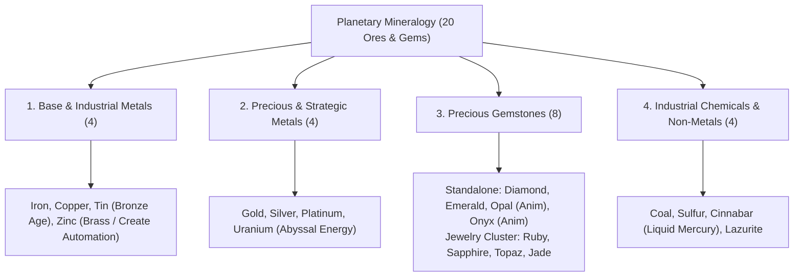

# Worldbuilding Architecture & Catalog: Ores, Minerals & Gemology (ores)

All active textures for metallogenic ore veins, mineral crystals, precious gems, and solid raw/rough blocks are organized in the folder:

📂 **`docs/worldbuilding/blocks/ores`** *(111 active PNG textures on disk: 60 solid raw/rough mineral block variations across 20 types, and 51 procedural vein overlays across 17 vein types)*

Host rock matrices that receive dynamic procedural ore overlays are located in:

📂 **`docs/worldbuilding/blocks/rocks`** *(13 mineralized rock matrices in rocks/ + 4 sterile rocks: sandstone_dune, obsidian, magma, mantle)*

Generating **74 unique blocks** in the master catalog:

* **20 Solid Mineral Blocks**: 8 raw metals + 4 raw chemicals/non-metals + 8 rough gemstones.

* **54 Procedural Ore Vein Blocks**: 54 unique ore-in-stone blocks dynamically generated across 13 mineralized host rock matrices (featuring the 3 primary crustal macro-strata: Slate with 8 veins, Dolomite with 6 veins, and Gabbro with 6 veins).

---

## 1. Mineral Classification & Domains (20 Minerals)

The planetary mineralogy is structured into **4 Core Domains (20 Minerals)**, with each domain strictly organized:

---

## 2. Technical Texture Inventory in `worldbuilding/blocks/ores/` (111 Active Textures)

Each mineral features either an individual procedural **Vein Overlay** or generates via the collective **`gem_vein_overlay`** (Jewelry Ore), alongside a **Solid Massive Block** (`raw` for metals/chemicals, `rough` for gems) across 3 stochastic variants:

### A. Base & Industrial Metals (24 Files, 16×16 px)

* **Iron (6)**: `ore_iron_overlay.png` (+ `1`, `2`), `ore_iron_raw.png` (+ `1`, `2`)
* **Copper (6)**: `ore_copper_overlay.png` (+ `1`, `2`), `ore_copper_raw.png` (+ `1`, `2`)
* **Tin (6)**: `ore_tin_overlay.png` (+ `1`, `2`), `ore_tin_raw.png` (+ `1`, `2`)
* **Zinc (6)**: `ore_zinc_overlay.png` (+ `1`, `2`), `ore_zinc_raw.png` (+ `1`, `2`)

### B. Precious & Strategic Metals (24 Files, 16×16 px)

* **Gold (6)**: `ore_gold_overlay.png` (+ `1`, `2`), `ore_gold_raw.png` (+ `1`, `2`)
* **Silver (6)**: `ore_silver_overlay.png` (+ `1`, `2`), `ore_silver_raw.png` (+ `1`, `2`)
* **Platinum (6)**: `ore_platinum_overlay.png` (+ `1`, `2`), `ore_platinum_raw.png` (+ `1`, `2`)
* **Uranium (6)**: `ore_uranium_overlay.png` (+ `1`, `2`), `ore_uranium_raw.png` (+ `1`, `2`)

### C. Industrial Chemicals & Non-Metals (24 Files, 16×16 px)

* **Coal (6)**: `ore_coal_overlay.png` (+ `1`, `2`), `ore_coal_raw.png` (+ `1`, `2`)
* **Sulfur (6)**: `ore_sulfur_overlay.png` (+ `1`, `2`), `ore_sulfur_raw.png` (+ `1`, `2`)
* **Cinnabar (6)**: `ore_cinnabar_overlay.png` (+ `1`, `2`), `ore_cinnabar_raw.png` (+ `1`, `2`)
* **Lazurite (6)**: `ore_lazurite_overlay.png` (+ `1`, `2`), `ore_lazurite_raw.png` (+ `1`, `2`)

### D. Precious Gemstones (39 Files, 16×16 px & 16×64 px)

* **Standalone Overlays (12)**:
  * `gem_diamond_overlay.png` (+ `1`, `2`)
  * `gem_emerald_overlay.png` (+ `1`, `2`)
  * `gem_opal_overlay.png` (+ `1`, `2`) *(Animated 16×64 px)*
  * `gem_onyx_overlay.png` (+ `1`, `2`) *(Animated 16×64 px)*
* **Collective Jewelry Vein Overlay (3)**:
  * `gem_vein_overlay.png` (+ `1`, `2`) *(Embedded 4-gem cluster: Ruby, Sapphire, Topaz, Jade)*
* **Solid Rough Gemstone Blocks (24)**:
  * `gem_diamond_rough.png` (+ `1`, `2`)
  * `gem_emerald_rough.png` (+ `1`, `2`)
  * `gem_opal_rough.png` (+ `1`, `2`) *(Animated 16×64 px)*
  * `gem_onyx_rough.png` (+ `1`, `2`) *(Animated 16×64 px)*
  * `gem_ruby_rough.png` (+ `1`, `2`)
  * `gem_sapphire_rough.png` (+ `1`, `2`)
  * `gem_topaz_rough.png` (+ `1`, `2`)
  * `gem_jade_rough.png` (+ `1`, `2`)

---

## 3. Animated Texture Specifications (16×64 px)

Two gemstones utilize vertical strips of **16×64 pixels (4 stacked 16×16 frames)** for procedural optical rendering:

* **Opal**: 4-phase chromatic play-of-color loop (Frame 0: Amber/Fire $\\to$ Frame 1: Aurora/Emerald $\\to$ Frame 2: Oceanic/Cyan $\\to$ Frame 3: Cosmic/Magenta). Exclusively hosted in `sandstone_white`.
* **Onyx**: 4-phase specular starlight glint loop (Frame 0: Upper facet gleam $\\to$ Frame 1: Peak central white flare $\\to$ Frame 2: Diagonal banded facet sweep $\\to$ Frame 3: Soft ambient starlight fade). Exclusively hosted in `slate`.

---

## 4. Complete Block Catalog (74 Unique Blocks)

### Part A: Solid Unrefined Mineral Blocks (20 Blocks)

#### 4.1. Base & Industrial Metals (4 Blocks)

| # | Block ID | Name | Category | Texture File(s) | Face Mapping | Host Rocks | Visual Description |
| :-: | :--- | :--- | :--- | :--- | :--- | :--- | :--- |
| **001** | `ore_iron_raw` | Raw Iron Block | **Metal** | `ore_iron_raw.png` | Uniform (6 faces) | 7 Host Rocks | Dense unrefined block of hematite and magnetite ore with dark brown-orange mineral crust. |
| **002** | `ore_copper_raw` | Raw Copper Block | **Metal** | `ore_copper_raw.png` | Uniform (6 faces) | 4 Host Rocks | Aggregate of raw native copper and green malachite nodules with warm terracotta-bronze hues. |
| **003** | `ore_tin_raw` | Raw Tin Block | **Metal** | `ore_tin_raw.png` | Uniform (6 faces) | 4 Host Rocks | Heavy crystalline cassiterite block with mottled brownish-grey and silvery-white facets. Used for Bronze. |
| **004** | `ore_zinc_raw` | Raw Zinc Block | **Metal** | `ore_zinc_raw.png` | Uniform (6 faces) | 4 Host Rocks | Compact sphalerite ore block with dark sub-metallic luster. Alloyed with copper for Brass mechanics. |

#### 4.2. Precious, Tech & Strategic Metals (4 Blocks)

| # | Block ID | Name | Category | Texture File(s) | Face Mapping | Host Rocks | Visual Description |
| :-: | :--- | :--- | :--- | :--- | :--- | :--- | :--- |
| **005** | `ore_gold_raw` | Raw Gold Block | **Metal** | `ore_gold_raw.png` | Uniform (6 faces) | 4 Host Rocks | Brilliant unrefined native gold chunk mass with rich yellow metallic grains and quartz traces. |
| **006** | `ore_silver_raw` | Raw Silver Block | **Metal** | `ore_silver_raw.png` | Uniform (6 faces) | 3 Host Rocks | Dense tarnished argentite and native silver aggregate with shimmering grey-white metallic veins. |
| **007** | `ore_platinum_raw` | Raw Platinum Block | **Metal** | `ore_platinum_raw.png` | Uniform (6 faces) | 2 Host Rocks | Ultra-dense compact block of native platinum grains with cool silvery-white metallic sheen. |
| **008** | `ore_uranium_raw` | Raw Uranium Block | **Heavy Metal** | `ore_uranium_raw.png` | Uniform (6 faces) | 2 Host Rocks | Heavy pitchblende uraninite block displaying mottled pitch-black surface with sulfur-yellow oxide flecks. |

#### 4.3. Precious Gemstones (8 Blocks)

| # | Block ID | Name | Category | Texture File(s) | Face Mapping | Host Rocks | Visual Description |
| :-: | :--- | :--- | :--- | :--- | :--- | :--- | :--- |
| **009** | `gem_diamond_rough` | Rough Diamond Block | **Gemstone** | `gem_diamond_rough.png` | Uniform (6 faces) | Basalt, Gabbro | Uncut octahedral carbon diamond crystal cluster with brilliant icy-white and pale cyan highlights. |
| **010** | `gem_emerald_rough` | Rough Emerald Block | **Gemstone** | `gem_emerald_rough.png` | Uniform (6 faces) | Slate, Marble | Vivid deep forest-green hexagonal beryl crystals intergrown in a crystalline emerald aggregate. |
| **011** | `gem_opal_rough` | Rough Opal Block | **Gemstone** | `gem_opal_rough.png` *(16×64)* | Animated (4 frames) | Sandstone White | Hydrated silica matrix with dynamic 4-phase animated rainbow play-of-color across faces. |
| **012** | `gem_onyx_rough` | Rough Onyx Block | **Gemstone** | `gem_onyx_rough.png` *(16×64)* | Animated (4 frames) | Slate | Deep jet-black banded chalcedony with subtle parallel micro-layers and traveling silver glints. |
| **013** | `gem_ruby_rough` | Rough Ruby Block | **Gemstone** | `gem_ruby_rough.png` | Uniform (6 faces) | Via Gem Vein | Deep crimson and scarlet corundum crystal mass with rich vitreous ruby cleavage facets. |
| **014** | `gem_sapphire_rough` | Rough Sapphire Block | **Gemstone** | `gem_sapphire_rough.png` | Uniform (6 faces) | Via Gem Vein | Royal ocean-blue corundum crystal mass with navy undertones and vitreous cleavage facets. |
| **015** | `gem_topaz_rough` | Rough Topaz Block | **Gemstone** | `gem_topaz_rough.png` | Uniform (6 faces) | Via Gem Vein | Radiant golden-amber and solar-orange prismatic nesosilicate crystal aggregate. |
| **016** | `gem_jade_rough` | Rough Jade Block | **Gemstone** | `gem_jade_rough.png` | Uniform (6 faces) | Via Gem Vein | Smooth, fibrous nephrite/jadeite aggregate with silky apple-green to sage-green translucency. |

#### 4.4. Industrial Chemicals & Non-Metals (4 Blocks)

| # | Block ID | Name | Category | Texture File(s) | Face Mapping | Host Rocks | Visual Description |
| :-: | :--- | :--- | :--- | :--- | :--- | :--- | :--- |
| **017** | `ore_coal_raw` | Raw Coal Block | **Chemical** | `ore_coal_raw.png` | Uniform (6 faces) | 7 Host Rocks | Dense, jet-black carbonaceous sedimentary block with vitreous to sub-metallic fracture surfaces. |
| **018** | `ore_sulfur_raw` | Raw Sulfur Block | **Chemical** | `ore_sulfur_raw.png` | Uniform (6 faces) | Basalt | Vivid canary-yellow crystalline native sulfur aggregate with resinous to greasy luster. |
| **019** | `ore_cinnabar_raw` | Raw Cinnabar Block | **Chemical** | `ore_cinnabar_raw.png` | Uniform (6 faces) | Basalt | Bright vermilion scarlet mercury sulfide mineral block. Source of liquid elemental mercury. |
| **020** | `ore_lazurite_raw` | Raw Lazurite Block | **Chemical** | `ore_lazurite_raw.png` | Uniform (6 faces) | Limestone, Marble | Deep royal ultramarine blue sodalite mineral aggregate speckled with golden pyrite flecks. |

---

### Part B: Procedural Ore Vein Blocks (54 Blocks)

#### 4.5. Sedimentary Sandstone Ores (6 Blocks)

| # | Block ID | Name | Category | Host Rock | Overlay Texture | Face Mapping |
| :-: | :--- | :--- | :--- | :--- | :--- | :--- |
| **021** | `ore_coal_sandstone_common` | Coal Ore (Sandstone) | **Chemical** | `rock_sandstone_common.png` | `ore_coal_overlay.png` | Uniform 6 faces (Shader Overlay) |
| **022** | `ore_copper_sandstone_common` | Copper Ore (Sandstone) | **Metal** | `rock_sandstone_common.png` | `ore_copper_overlay.png` | Uniform 6 faces (Shader Overlay) |
| **023** | `ore_copper_sandstone_red` | Copper Ore (Red Sandstone) | **Metal** | `rock_sandstone_red.png` | `ore_copper_overlay.png` | Uniform 6 faces (Shader Overlay) |
| **024** | `ore_gold_sandstone_red` | Gold Ore (Red Sandstone) | **Metal** | `rock_sandstone_red.png` | `ore_gold_overlay.png` | Uniform 6 faces (Shader Overlay) |
| **025** | `ore_copper_sandstone_white` | Copper Ore (White Sandstone) | **Metal** | `rock_sandstone_white.png` | `ore_copper_overlay.png` | Uniform 6 faces (Shader Overlay) |
| **026** | `gem_opal_sandstone_white` | Opal Ore (White Sandstone) | **Gemstone** | `rock_sandstone_white.png` | `gem_opal_overlay.png` | Uniform 6 faces (Animated 16×64 Overlay) |

#### 4.6. Macro-Estrato Nível 1: Alpine Dolomite Strata (6 Blocks)

| # | Block ID | Name | Category | Host Rock | Overlay Texture | Face Mapping |
| :-: | :--- | :--- | :--- | :--- | :--- | :--- |
| **027** | `ore_coal_dolomite` | Coal Ore (Dolomite) | **Chemical** | `rock_dolomite.png` | `ore_coal_overlay.png` | Uniform 6 faces (Shader Overlay) |
| **028** | `ore_copper_dolomite` | Copper Ore (Dolomite) | **Metal** | `rock_dolomite.png` | `ore_copper_overlay.png` | Uniform 6 faces (Shader Overlay) |
| **029** | `ore_tin_dolomite` | Tin Ore (Dolomite) | **Metal** | `rock_dolomite.png` | `ore_tin_overlay.png` | Uniform 6 faces (Shader Overlay) |
| **030** | `ore_iron_dolomite` | Iron Ore (Dolomite) | **Metal** | `rock_dolomite.png` | `ore_iron_overlay.png` | Uniform 6 faces (Shader Overlay) |
| **031** | `ore_zinc_dolomite` | Zinc Ore (Dolomite) | **Metal** | `rock_dolomite.png` | `ore_zinc_overlay.png` | Uniform 6 faces (Shader Overlay) |
| **032** | `gem_vein_dolomite` | Gem Vein (Dolomite) | **Gemstone** | `rock_dolomite.png` | `gem_vein_overlay.png` | Uniform 6 faces (4-Gem Composite Overlay) |

#### 4.7. Surface & Continental Mother Rocks (12 Blocks)

| # | Block ID | Name | Category | Host Rock | Overlay Texture | Face Mapping |
| :-: | :--- | :--- | :--- | :--- | :--- | :--- |
| **033** | `ore_coal_granite` | Coal Ore (Granite) | **Chemical** | `rock_granite.png` | `ore_coal_overlay.png` | Uniform 6 faces (Shader Overlay) |
| **034** | `ore_copper_granite` | Copper Ore (Granite) | **Metal** | `rock_granite.png` | `ore_copper_overlay.png` | Uniform 6 faces (Shader Overlay) |
| **035** | `ore_tin_granite` | Tin Ore (Granite) | **Metal** | `rock_granite.png` | `ore_tin_overlay.png` | Uniform 6 faces (Shader Overlay) |
| **036** | `ore_iron_granite` | Iron Ore (Granite) | **Metal** | `rock_granite.png` | `ore_iron_overlay.png` | Uniform 6 faces (Shader Overlay) |
| **037** | `ore_gold_granite` | Gold Ore (Granite) | **Metal** | `rock_granite.png` | `ore_gold_overlay.png` | Uniform 6 faces (Shader Overlay) |
| **038** | `gem_vein_granite` | Gem Vein (Granite) | **Gemstone** | `rock_granite.png` | `gem_vein_overlay.png` | Uniform 6 faces (4-Gem Composite Overlay) |
| **039** | `ore_copper_andesite` | Copper Ore (Andesite) | **Metal** | `rock_andesite.png` | `ore_copper_overlay.png` | Uniform 6 faces (Shader Overlay) |
| **040** | `ore_tin_andesite` | Tin Ore (Andesite) | **Metal** | `rock_andesite.png` | `ore_tin_overlay.png` | Uniform 6 faces (Shader Overlay) |
| **041** | `ore_iron_andesite` | Iron Ore (Andesite) | **Metal** | `rock_andesite.png` | `ore_iron_overlay.png` | Uniform 6 faces (Shader Overlay) |
| **042** | `ore_zinc_andesite` | Zinc Ore (Andesite) | **Metal** | `rock_andesite.png` | `ore_zinc_overlay.png` | Uniform 6 faces (Shader Overlay) |
| **043** | `ore_silver_andesite` | Silver Ore (Andesite) | **Metal** | `rock_andesite.png` | `ore_silver_overlay.png` | Uniform 6 faces (Shader Overlay) |
| **044** | `gem_vein_andesite` | Gem Vein (Andesite) | **Gemstone** | `rock_andesite.png` | `gem_vein_overlay.png` | Uniform 6 faces (4-Gem Composite Overlay) |

#### 4.8. Sedimentary Basin Rocks: Limestone, Chalk, Argillite (6 Blocks)

| # | Block ID | Name | Category | Host Rock | Overlay Texture | Face Mapping |
| :-: | :--- | :--- | :--- | :--- | :--- | :--- |
| **045** | `ore_coal_limestone` | Coal Ore (Limestone) | **Chemical** | `rock_limestone.png` | `ore_coal_overlay.png` | Uniform 6 faces (Shader Overlay) |
| **046** | `ore_lazurite_limestone` | Lazurite Ore (Limestone) | **Chemical** | `rock_limestone.png` | `ore_lazurite_overlay.png` | Uniform 6 faces (Shader Overlay) |
| **047** | `ore_coal_chalk` | Coal Ore (Chalk) | **Chemical** | `rock_chalk.png` | `ore_coal_overlay.png` | Uniform 6 faces (Shader Overlay) |
| **048** | `ore_tin_chalk` | Tin Ore (Chalk) | **Metal** | `rock_chalk.png` | `ore_tin_overlay.png` | Uniform 6 faces (Shader Overlay) |
| **049** | `ore_coal_argillite` | Coal Ore (Argillite) | **Chemical** | `rock_argillite.png` | `ore_coal_overlay.png` | Uniform 6 faces (Shader Overlay) |
| **050** | `ore_zinc_argillite` | Zinc Ore (Argillite) | **Metal** | `rock_argillite.png` | `ore_zinc_overlay.png` | Uniform 6 faces (Shader Overlay) |

#### 4.9. Macro-Estrato Nível 2: Subterranean Slate Strata (8 Blocks)

| # | Block ID | Name | Category | Host Rock | Overlay Texture | Face Mapping |
| :-: | :--- | :--- | :--- | :--- | :--- | :--- |
| **051** | `ore_iron_slate` | Iron Ore (Slate) | **Metal** | `rock_slate.png` | `ore_iron_overlay.png` | Uniform 6 faces (Shader Overlay) |
| **052** | `ore_zinc_slate` | Zinc Ore (Slate) | **Metal** | `rock_slate.png` | `ore_zinc_overlay.png` | Uniform 6 faces (Shader Overlay) |
| **053** | `ore_gold_slate` | Gold Ore (Slate) | **Metal** | `rock_slate.png` | `ore_gold_overlay.png` | Uniform 6 faces (Shader Overlay) |
| **054** | `ore_silver_slate` | Silver Ore (Slate) | **Metal** | `rock_slate.png` | `ore_silver_overlay.png` | Uniform 6 faces (Shader Overlay) |
| **055** | `ore_uranium_slate` | Uranium Ore (Slate) | **Heavy Metal** | `rock_slate.png` | `ore_uranium_overlay.png` | Uniform 6 faces (Shader Overlay) |
| **056** | `gem_emerald_slate` | Emerald Ore (Slate) | **Gemstone** | `rock_slate.png` | `gem_emerald_overlay.png` | Uniform 6 faces (Shader Overlay) |
| **057** | `gem_onyx_slate` | Onyx Ore (Slate) | **Gemstone** | `rock_slate.png` | `gem_onyx_overlay.png` | Uniform 6 faces (Animated 16×64 Overlay) |
| **058** | `gem_vein_slate` | Gem Vein (Slate) | **Gemstone** | `rock_slate.png` | `gem_vein_overlay.png` | Uniform 6 faces (4-Gem Composite Overlay) |

#### 4.10. Macro-Estrato Nível 3: Abyssal Gabbro Strata (6 Blocks)

| # | Block ID | Name | Category | Host Rock | Overlay Texture | Face Mapping |
| :-: | :--- | :--- | :--- | :--- | :--- | :--- |
| **059** | `ore_iron_gabbro` | Iron Ore (Gabbro) | **Metal** | `rock_gabbro.png` | `ore_iron_overlay.png` | Uniform 6 faces (Shader Overlay) |
| **060** | `ore_gold_gabbro` | Gold Ore (Gabbro) | **Metal** | `rock_gabbro.png` | `ore_gold_overlay.png` | Uniform 6 faces (Shader Overlay) |
| **061** | `gem_diamond_gabbro` | Diamond Ore (Gabbro) | **Gemstone** | `rock_gabbro.png` | `gem_diamond_overlay.png` | Uniform 6 faces (Shader Overlay) |
| **062** | `ore_platinum_gabbro` | Platinum Ore (Gabbro) | **Metal** | `rock_gabbro.png` | `ore_platinum_overlay.png` | Uniform 6 faces (Shader Overlay) |
| **063** | `ore_uranium_gabbro` | Uranium Ore (Gabbro) | **Heavy Metal** | `rock_gabbro.png` | `ore_uranium_overlay.png` | Uniform 6 faces (Shader Overlay) |
| **064** | `gem_vein_gabbro` | Gem Vein (Gabbro) | **Gemstone** | `rock_gabbro.png` | `gem_vein_overlay.png` | Uniform 6 faces (4-Gem Composite Overlay) |

#### 4.11. Volcanic Basalt & Metamorphic Marble Pockets (10 Blocks)

| # | Block ID | Name | Category | Host Rock | Overlay Texture | Face Mapping |
| :-: | :--- | :--- | :--- | :--- | :--- | :--- |
| **065** | `ore_iron_basalt` | Iron Ore (Basalt) | **Metal** | `rock_basalt.png` | `ore_iron_overlay.png` | Uniform 6 faces (Shader Overlay) |
| **066** | `gem_diamond_basalt` | Diamond Ore (Basalt) | **Gemstone** | `rock_basalt.png` | `gem_diamond_overlay.png` | Uniform 6 faces (Shader Overlay) |
| **067** | `ore_platinum_basalt` | Platinum Ore (Basalt) | **Metal** | `rock_basalt.png` | `ore_platinum_overlay.png` | Uniform 6 faces (Shader Overlay) |
| **068** | `ore_sulfur_basalt` | Sulfur Ore (Basalt) | **Chemical** | `rock_basalt.png` | `ore_sulfur_overlay.png` | Uniform 6 faces (Shader Overlay) |
| **069** | `ore_cinnabar_basalt` | Cinnabar Ore (Basalt) | **Chemical** | `rock_basalt.png` | `ore_cinnabar_overlay.png` | Uniform 6 faces (Shader Overlay) |
| **070** | `gem_vein_basalt` | Gem Vein (Basalt) | **Gemstone** | `rock_basalt.png` | `gem_vein_overlay.png` | Uniform 6 faces (4-Gem Composite Overlay) |
| **071** | `ore_silver_marble` | Silver Ore (Marble) | **Metal** | `rock_marble.png` | `ore_silver_overlay.png` | Uniform 6 faces (Shader Overlay) |
| **072** | `ore_lazurite_marble` | Lazurite Ore (Marble) | **Chemical** | `rock_marble.png` | `ore_lazurite_overlay.png` | Uniform 6 faces (Shader Overlay) |
| **073** | `gem_emerald_marble` | Emerald Ore (Marble) | **Gemstone** | `rock_marble.png` | `gem_emerald_overlay.png` | Uniform 6 faces (Shader Overlay) |
| **074** | `gem_vein_marble` | Gem Vein (Marble) | **Gemstone** | `rock_marble.png` | `gem_vein_overlay.png` | Uniform 6 faces (4-Gem Composite Overlay) |

---

## 5. Mineral Occurrence Matrix (Distribution Across Host Rocks)

Summary of the **17 active vein types** and the rock matrices in which they generate:

| Vein Mineral / Type | Category | Overlay File | Occurrence Count | Associated Host Rock Matrices |
| :--- | :---: | :--- | :-: | :--- |
| **Iron** | Metal | `ore_iron_overlay.png` | **7** | `sandstone_red`, `granite`, `andesite`, `dolomite`, `slate`, `gabbro`, `basalt` |
| **Coal** | Chemical | `ore_coal_overlay.png` | **6** | `sandstone_common`, `granite`, `dolomite`, `limestone`, `chalk`, `argillite` |
| **Gem Vein** | Gemstone Cluster | `gem_vein_overlay.png` | **6** | `dolomite`, `granite`, `andesite`, `slate`, `gabbro`, `marble` *(Drops: Ruby, Sapphire, Topaz, Jade)* |
| **Copper** | Metal | `ore_copper_overlay.png` | **4** | `sandstone_common`, `sandstone_red`, `granite`, `andesite`, `dolomite` |
| **Tin** | Metal | `ore_tin_overlay.png` | **4** | `granite`, `andesite`, `dolomite`, `chalk` |
| **Zinc** | Metal | `ore_zinc_overlay.png` | **4** | `andesite`, `dolomite`, `argillite`, `slate` |
| **Gold** | Metal | `ore_gold_overlay.png` | **4** | `sandstone_red`, `granite`, `slate`, `gabbro` |
| **Silver** | Metal | `ore_silver_overlay.png` | **3** | `andesite`, `slate`, `marble` |
| **Diamond** | Gemstone | `gem_diamond_overlay.png` | **2** | `gabbro`, `basalt` |
| **Platinum** | Metal | `ore_platinum_overlay.png` | **2** | `gabbro`, `basalt` |
| **Uranium** | Heavy Metal | `ore_uranium_overlay.png` | **2** | `slate`, `gabbro` |
| **Lazurite** | Chemical | `ore_lazurite_overlay.png` | **2** | `limestone`, `marble` |
| **Emerald** | Gemstone | `gem_emerald_overlay.png` | **2** | `slate`, `marble` |
| **Sulfur** | Chemical | `ore_sulfur_overlay.png` | **1** | `basalt` |
| **Cinnabar** | Chemical | `ore_cinnabar_overlay.png` | **1** | `basalt` |
| **Opal** | Gemstone | `gem_opal_overlay.png` *(16×64)* | **1** | `sandstone_white` *(Exclusive)* |
| **Onyx** | Gemstone | `gem_onyx_overlay.png` *(16×64)* | **1** | `slate` *(Exclusive)* |
| **Total** | — | — | **54** | — |

---

## 6. Host Rock Vein Capacity Matrix (The 17 Rocks Breakdown)

Breakdown of all **17 planetary rock matrices**, showing exactly which mineral veins are hosted by each rock:

| # | Rock ID | Name | Stratum Level | Hosted Veins Count | Hosted Mineral Veins | Vein Blocks Generated |
| :-: | :--- | :--- | :--- | :-: | :--- | :-: |
| **01** | `sandstone_common` | Sandstone | Surface Sediment | **2** | Coal, Copper | **2** |
| **02** | `sandstone_red` | Red Sandstone | Surface Sediment | **2** | Copper, Gold | **2** |
| **03** | `sandstone_dune` | Dune Sandstone | Surface Sediment | **0** | *(Sterile)* | **0** |
| **04** | `sandstone_white` | White Sandstone | Surface Sediment | **1** | Opal *(Exclusive)* | **1** |
| **05** | `dolomite` | Dolomite | **Macro-Estrato Nível 1** | **6** | Coal, Copper, Tin, Iron, Zinc, Gem Vein | **6** |
| **06** | `granite` | Granite | Surface / Loam Mother | **6** | Coal, Copper, Tin, Iron, Gold, Gem Vein | **6** |
| **07** | `andesite` | Andesite | Surface / Permafrost Mother | **6** | Copper, Tin, Iron, Zinc, Silver, Gem Vein | **6** |
| **08** | `limestone` | Limestone | Surface / Caliche Mother | **2** | Coal, Lazurite | **2** |
| **09** | `chalk` | Chalk | Surface / Silt Mother | **2** | Coal, Tin | **2** |
| **10** | `argillite` | Argillite | Surface / Peat Mother | **2** | Coal, Zinc | **2** |
| **11** | `slate` | Slate | **Macro-Estrato Nível 2** | **8** | Iron, Zinc, Gold, Silver, Uranium, Emerald, Onyx, Gem Vein | **8** |
| **12** | `gabbro` | Gabbro | **Macro-Estrato Nível 3** | **6** | Iron, Gold, Diamond, Platinum, Uranium, Gem Vein | **6** |
| **13** | `basalt` | Basalt | Volcanic / Laterite Mother | **6** | Iron, Diamond, Platinum, Sulfur, Cinnabar, Gem Vein | **6** |
| **14** | `marble` | Marble | Metamorphic Pocket | **4** | Silver, Lazurite, Emerald, Gem Vein | **4** |
| **15** | `obsidian` | Obsidian | Volcanic Glass Pocket | **0** | *(Sterile)* | **0** |
| **16** | `magma` | Magma | Geothermal Pocket | **0** | *(Sterile)* | **0** |
| **17** | `mantle` | Mantle | World Floor Bedrock | **0** | *(Sterile)* | **0** |
| **Total** | — | — | — | **54** | **54 Unique Mineral Associations** | **54 Vein Blocks** |
