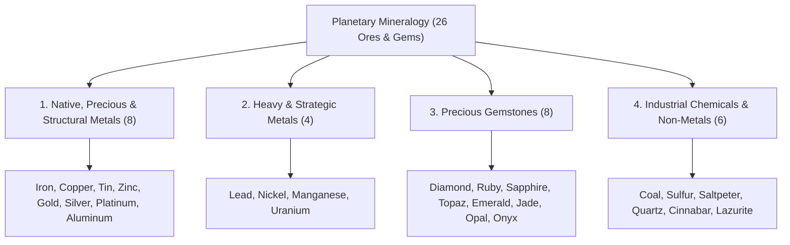

# Worldbuilding Architecture & Catalog: Ores, Minerals & Gemology (ores)

All active textures for metallogenic ore veins, mineral crystals, precious gems, and solid raw/rough blocks are organized in the folder:

📂 **`docs/worldbuilding/blocks/ores`** *(156 active PNG textures on disk: 78 vein overlays and 78 solid blocks across 3 variations: base, 1, 2)*

Host rock matrices that receive dynamic procedural ore overlays are located in:

📂 **`docs/worldbuilding/blocks/rocks`** *(28 mineable rock matrices)*

Generating **158 unique blocks** in the master catalog:

* **26 Solid Mineral Blocks**: 18 raw metal/chemical blocks + 8 rough gemstone blocks.

* **132 Procedural Ore Vein Blocks**: 132 unique ore-in-stone blocks dynamically generated across 24 mineralized host rock matrices (with 4 sterile rocks: obsidian, magma, mantle, and mantle plume).

---

## 1. Mineral Classification & Domains (26 Minerals)

The planetary mineralogy is structured into **4 Core Domains (26 Minerals)**, with every single domain featuring a clean, balanced, even number of mineral types:

---

## 2. Technical Texture Inventory in `worldbuilding/blocks/ores/` (52 Active Textures)

Each mineral features a dual texture system: a procedural **Vein Overlay** (transparent alpha mask) and a **Solid Massive Block** (`raw` for metals/chemicals, `rough` for gems).

### A. Native, Precious & Structural Metals (16 Files, 16×16 px)

* **Iron (2)**: `ore_iron_overlay.png`, `ore_iron_raw.png`

* **Copper (2)**: `ore_copper_overlay.png`, `ore_copper_raw.png`

* **Tin (2)**: `ore_tin_overlay.png`, `ore_tin_raw.png`

* **Zinc (2)**: `ore_zinc_overlay.png`, `ore_zinc_raw.png`

* **Gold (2)**: `ore_gold_overlay.png`, `ore_gold_raw.png`

* **Silver (2)**: `ore_silver_overlay.png`, `ore_silver_raw.png`

* **Platinum (2)**: `ore_platinum_overlay.png`, `ore_platinum_raw.png`

* **Aluminum (2)**: `ore_aluminum_overlay.png`, `ore_aluminum_raw.png`

### B. Heavy & Strategic Metals (8 Files, 16×16 px)

* **Lead (2)**: `ore_lead_overlay.png`, `ore_lead_raw.png`

* **Nickel (2)**: `ore_nickel_overlay.png`, `ore_nickel_raw.png`

* **Manganese (2)**: `ore_manganese_overlay.png`, `ore_manganese_raw.png`

* **Uranium (2)**: `ore_uranium_overlay.png`, `ore_uranium_raw.png`

### C. Precious Gemstones (16 Files)

* **Diamond (2)**: `gem_diamond_overlay.png`, `gem_diamond_rough.png` *(16×16 px)*

* **Ruby (2)**: `gem_ruby_overlay.png`, `gem_ruby_rough.png` *(16×16 px)*

* **Sapphire (2)**: `gem_sapphire_overlay.png`, `gem_sapphire_rough.png` *(16×16 px)*

* **Topaz (2)**: `gem_topaz_overlay.png`, `gem_topaz_rough.png` *(16×16 px)*

* **Emerald (2)**: `gem_emerald_overlay.png`, `gem_emerald_rough.png` *(16×16 px)*

* **Jade (2)**: `gem_jade_overlay.png`, `gem_jade_rough.png` *(16×16 px)*

* **Opal (2)**: `gem_opal_overlay.png`, `gem_opal_rough.png` *(16×64 px animated, 4 frames)*

* **Onyx (2)**: `gem_onyx_overlay.png`, `gem_onyx_rough.png` *(16×64 px animated, 4 frames)*

### D. Industrial Chemicals & Non-Metals (12 Files, 16×16 px)

* **Coal (2)**: `ore_coal_overlay.png`, `ore_coal_raw.png`

* **Sulfur (2)**: `ore_sulfur_overlay.png`, `ore_sulfur_raw.png`

* **Saltpeter (2)**: `ore_saltpeter_overlay.png`, `ore_saltpeter_raw.png`

* **Quartz (2)**: `ore_quartz_overlay.png`, `ore_quartz_raw.png`

* **Cinnabar (2)**: `ore_cinnabar_overlay.png`, `ore_cinnabar_raw.png`

* **Lazurite (2)**: `ore_lazurite_overlay.png`, `ore_lazurite_raw.png`

---

## 3. Animated Texture Specifications (16×64 px)

Two gemstones utilize vertical strips of **16×64 pixels (4 stacked 16×16 frames)** for procedural optical rendering:

* **Opal**: 4-phase chromatic play-of-color loop (Frame 0: Amber/Fire $\to$ Frame 1: Aurora/Emerald $\to$ Frame 2: Oceanic/Cyan $\to$ Frame 3: Cosmic/Magenta).

* **Onyx**: 4-phase specular starlight glint loop (Frame 0: Upper facet gleam $\to$ Frame 1: Peak central white flare $\to$ Frame 2: Diagonal banded facet sweep $\to$ Frame 3: Soft ambient starlight fade).

---

## 4. Complete Block Catalog (158 Unique Blocks)

### Part A: Solid Unrefined Mineral Blocks (26 Blocks)

#### 4.1. Native, Precious & Structural Metals (8 Blocks)

| # | Block ID | Name | Category | Texture File(s) | Face Mapping | Host Rocks | Visual Description |
| :-: | :--- | :--- | :--- | :--- | :--- | :--- | :--- |
| **001** | `ore_iron_raw` | Raw Iron Block | **Metal** | `ore_iron_raw.png` | Uniform (6 faces) | 12 Host Rocks | Dense unrefined block of hematite and magnetite ore with dark brown-orange mineral crust. |
| **002** | `ore_copper_raw` | Raw Copper Block | **Metal** | `ore_copper_raw.png` | Uniform (6 faces) | 14 Host Rocks | Aggregate of raw native copper and green malachite nodules with warm terracotta-bronze hues. |
| **003** | `ore_tin_raw` | Raw Tin Block | **Metal** | `ore_tin_raw.png` | Uniform (6 faces) | 6 Host Rocks | Heavy crystalline cassiterite block with mottled brownish-grey and silvery-white facets. |
| **004** | `ore_zinc_raw` | Raw Zinc Block | **Metal** | `ore_zinc_raw.png` | Uniform (6 faces) | 8 Host Rocks | Compact sphalerite ore block with dark sub-metallic luster and dull greyish-brown crystalline veins. |
| **005** | `ore_gold_raw` | Raw Gold Block | **Metal** | `ore_gold_raw.png` | Uniform (6 faces) | 4 Host Rocks | Brilliant unrefined native gold chunk mass with rich yellow metallic grains and quartz traces. |
| **006** | `ore_silver_raw` | Raw Silver Block | **Metal** | `ore_silver_raw.png` | Uniform (6 faces) | 4 Host Rocks | Dense tarnished argentite and native silver aggregate with shimmering grey-white metallic veins. |
| **007** | `ore_platinum_raw` | Raw Platinum Block | **Metal** | `ore_platinum_raw.png` | Uniform (6 faces) | 4 Host Rocks | Ultra-dense compact block of native platinum grains with cool silvery-white metallic sheen. |
| **008** | `ore_aluminum_raw` | Raw Aluminum Block | **Metal** | `ore_aluminum_raw.png` | Uniform (6 faces) | 4 Host Rocks | Earthy pisolitic bauxite block with characteristic reddish-brown and pale ochre clay nodules. |

#### 4.2. Heavy & Strategic Metals (4 Blocks)

| # | Block ID | Name | Category | Texture File(s) | Face Mapping | Host Rocks | Visual Description |
| :-: | :--- | :--- | :--- | :--- | :--- | :--- | :--- |
| **009** | `ore_lead_raw` | Raw Lead Block | **Heavy Metal** | `ore_lead_raw.png` | Uniform (6 faces) | 8 Host Rocks | Heavy block of cubic galena ore with distinctive steely-grey metallic luster and cubic cleavage planes. |
| **010** | `ore_nickel_raw` | Raw Nickel Block | **Heavy Metal** | `ore_nickel_raw.png` | Uniform (6 faces) | 4 Host Rocks | Dense pentlandite and pyrrhotite aggregate with pale bronze-yellow to brassy metallic sheen. |
| **011** | `ore_manganese_raw` | Raw Manganese Block | **Heavy Metal** | `ore_manganese_raw.png` | Uniform (6 faces) | 6 Host Rocks | Raspberry-pink crystalline rhodochrosite mineral block with rose-red banded carbonate patterns. |
| **012** | `ore_uranium_raw` | Raw Uranium Block | **Heavy Metal** | `ore_uranium_raw.png` | Uniform (6 faces) | 4 Host Rocks | Heavy pitchblende uraninite block displaying mottled pitch-black surface with sulfur-yellow oxide flecks. |

#### 4.3. Precious Gemstones (8 Blocks)

| # | Block ID | Name | Category | Texture File(s) | Face Mapping | Host Rocks | Visual Description |
| :-: | :--- | :--- | :--- | :--- | :--- | :--- | :--- |
| **013** | `gem_diamond_rough` | Rough Diamond Block | **Gemstone** | `gem_diamond_rough.png` | Uniform (6 faces) | Gabbro, Serpentinite | Uncut octahedral carbon diamond crystal cluster with brilliant icy-white and pale cyan highlights. |
| **014** | `gem_ruby_rough` | Rough Ruby Block | **Gemstone** | `gem_ruby_rough.png` | Uniform (6 faces) | Basalt, Marble | Deep crimson and scarlet corundum crystal mass with rich vitreous ruby cleavage facets. |
| **015** | `gem_sapphire_rough` | Rough Sapphire Block | **Gemstone** | `gem_sapphire_rough.png` | Uniform (6 faces) | Basalt, Marble | Royal ocean-blue corundum crystal mass with navy undertones and vitreous cleavage facets. |
| **016** | `gem_topaz_rough` | Rough Topaz Block | **Gemstone** | `gem_topaz_rough.png` | Uniform (6 faces) | Sandstone Pink, Granite | Radiant golden-amber and solar-orange prismatic nesosilicate crystal aggregate. |
| **017** | `gem_emerald_rough` | Rough Emerald Block | **Gemstone** | `gem_emerald_rough.png` | Uniform (6 faces) | Slate, Marble | Vivid deep forest-green hexagonal beryl crystals intergrown in a crystalline emerald aggregate. |
| **018** | `gem_jade_rough` | Rough Jade Block | **Gemstone** | `gem_jade_rough.png` | Uniform (6 faces) | Marble, Serpentinite | Smooth, fibrous nephrite/jadeite aggregate with silky apple-green to sage-green translucency. |
| **019** | `gem_opal_rough` | Rough Opal Block | **Gemstone** | `gem_opal_rough.png` *(16×64)* | Animated (4 frames) | Sandstone White, Sandstone Pink, Basalt, Tuff | Hydrated silica matrix with dynamic 4-phase animated rainbow play-of-color across faces. |
| **020** | `gem_onyx_rough` | Rough Onyx Block | **Gemstone** | `gem_onyx_rough.png` *(16×64)* | Animated (4 frames) | Sandstone Black, Slate, Marble, Calcite | Deep jet-black banded chalcedony with subtle parallel micro-layers and traveling silver glints. |

#### 4.4. Industrial Chemicals & Non-Metals (6 Blocks)

| # | Block ID | Name | Category | Texture File(s) | Face Mapping | Host Rocks | Visual Description |
| :-: | :--- | :--- | :--- | :--- | :--- | :--- | :--- |
| **021** | `ore_coal_raw` | Raw Coal Block | **Chemical** | `ore_coal_raw.png` | Uniform (6 faces) | 12 Host Rocks | Dense, jet-black carbonaceous sedimentary block with vitreous to sub-metallic fracture surfaces. |
| **022** | `ore_sulfur_raw` | Raw Sulfur Block | **Chemical** | `ore_sulfur_raw.png` | Uniform (6 faces) | Basalt, Tuff, Scoria, Brimstone | Vivid canary-yellow crystalline native sulfur aggregate with resinous to greasy luster. |
| **023** | `ore_saltpeter_raw` | Raw Saltpeter Block | **Chemical** | `ore_saltpeter_raw.png` | Uniform (6 faces) | 4 Host Rocks | Powdery, chalky white to pale grey encrustation of crystalline potassium nitrate niter. |
| **024** | `ore_quartz_raw` | Raw Quartz Block | **Chemical** | `ore_quartz_raw.png` | Uniform (6 faces) | 6 Host Rocks | Crystalline mass of milky to vitreous clear hydrothermal quartz with interlocking trigonal prisms. |
| **025** | `ore_cinnabar_raw` | Raw Cinnabar Block | **Chemical** | `ore_cinnabar_raw.png` | Uniform (6 faces) | Basalt, Tuff, Brimstone, Karst | Bright cochineal to vermilion scarlet mercury sulfide mineral block with adamantine luster. |
| **026** | `ore_lazurite_raw` | Raw Lazurite Block | **Chemical** | `ore_lazurite_raw.png` | Uniform (6 faces) | Sandstone Black, Limestone, Marble, Calcite | Deep royal ultramarine blue sodalite mineral aggregate speckled with golden pyrite flecks. |

---

### Part B: Procedural Ore Vein Blocks (132 Blocks)

### 4.1. Aeolian & Marine Sandstone Ores (22 Blocks)

| # | Block ID | Name | Category | Host Rock | Overlay Texture | Face Mapping |
| :-: | :--- | :--- | :--- | :--- | :--- | :--- |
| **027** | `ore_coal_sandstone_common` | Coal Ore (Common Sandstone) | **Chemical** | `rock_sandstone_common.png` | `ore_coal_overlay.png` | Uniform 6 faces (Shader Overlay) |
| **028** | `ore_copper_sandstone_common` | Copper Ore (Common Sandstone) | **Metal** | `rock_sandstone_common.png` | `ore_copper_overlay.png` | Uniform 6 faces (Shader Overlay) |
| **029** | `ore_iron_sandstone_common` | Iron Ore (Common Sandstone) | **Metal** | `rock_sandstone_common.png` | `ore_iron_overlay.png` | Uniform 6 faces (Shader Overlay) |
| **030** | `ore_lead_sandstone_common` | Lead Ore (Common Sandstone) | **Heavy Metal** | `rock_sandstone_common.png` | `ore_lead_overlay.png` | Uniform 6 faces (Shader Overlay) |
| **031** | `ore_quartz_sandstone_common` | Quartz Ore (Common Sandstone) | **Chemical** | `rock_sandstone_common.png` | `ore_quartz_overlay.png` | Uniform 6 faces (Shader Overlay) |
| **032** | `ore_tin_sandstone_common` | Tin Ore (Common Sandstone) | **Metal** | `rock_sandstone_common.png` | `ore_tin_overlay.png` | Uniform 6 faces (Shader Overlay) |
| **033** | `ore_copper_sandstone_red` | Copper Ore (Red Sandstone) | **Metal** | `rock_sandstone_red.png` | `ore_copper_overlay.png` | Uniform 6 faces (Shader Overlay) |
| **034** | `ore_gold_sandstone_red` | Gold Ore (Red Sandstone) | **Metal** | `rock_sandstone_red.png` | `ore_gold_overlay.png` | Uniform 6 faces (Shader Overlay) |
| **035** | `ore_iron_sandstone_red` | Iron Ore (Red Sandstone) | **Metal** | `rock_sandstone_red.png` | `ore_iron_overlay.png` | Uniform 6 faces (Shader Overlay) |
| **036** | `ore_quartz_sandstone_red` | Quartz Ore (Red Sandstone) | **Chemical** | `rock_sandstone_red.png` | `ore_quartz_overlay.png` | Uniform 6 faces (Shader Overlay) |
| **037** | `ore_coal_sandstone_dune` | Coal Ore (Dune Sandstone) | **Chemical** | `rock_sandstone_dune.png` | `ore_coal_overlay.png` | Uniform 6 faces (Shader Overlay) |
| **038** | `ore_saltpeter_sandstone_dune` | Saltpeter Ore (Dune Sandstone) | **Chemical** | `rock_sandstone_dune.png` | `ore_saltpeter_overlay.png` | Uniform 6 faces (Shader Overlay) |
| **039** | `ore_aluminum_sandstone_white` | Aluminum Ore (White Sandstone) | **Metal** | `rock_sandstone_white.png` | `ore_aluminum_overlay.png` | Uniform 6 faces (Shader Overlay) |
| **040** | `gem_opal_sandstone_white` | Opal Ore (White Sandstone) | **Gemstone** | `rock_sandstone_white.png` | `gem_opal_overlay.png` | Uniform 6 faces (Animated 16×64 Overlay) |
| **041** | `ore_quartz_sandstone_white` | Quartz Ore (White Sandstone) | **Chemical** | `rock_sandstone_white.png` | `ore_quartz_overlay.png` | Uniform 6 faces (Shader Overlay) |
| **042** | `ore_saltpeter_sandstone_white` | Saltpeter Ore (White Sandstone) | **Chemical** | `rock_sandstone_white.png` | `ore_saltpeter_overlay.png` | Uniform 6 faces (Shader Overlay) |
| **043** | `gem_opal_sandstone_pink` | Opal Ore (Pink Sandstone) | **Gemstone** | `rock_sandstone_pink.png` | `gem_opal_overlay.png` | Uniform 6 faces (Animated 16×64 Overlay) |
| **044** | `gem_topaz_sandstone_pink` | Topaz Ore (Pink Sandstone) | **Gemstone** | `rock_sandstone_pink.png` | `gem_topaz_overlay.png` | Uniform 6 faces (Shader Overlay) |
| **045** | `ore_coal_sandstone_black` | Coal Ore (Black Sandstone) | **Chemical** | `rock_sandstone_black.png` | `ore_coal_overlay.png` | Uniform 6 faces (Shader Overlay) |
| **046** | `ore_iron_sandstone_black` | Iron Ore (Black Sandstone) | **Metal** | `rock_sandstone_black.png` | `ore_iron_overlay.png` | Uniform 6 faces (Shader Overlay) |
| **047** | `ore_lazurite_sandstone_black` | Lazurite Ore (Black Sandstone) | **Chemical** | `rock_sandstone_black.png` | `ore_lazurite_overlay.png` | Uniform 6 faces (Shader Overlay) |
| **048** | `gem_onyx_sandstone_black` | Onyx Ore (Black Sandstone) | **Gemstone** | `rock_sandstone_black.png` | `gem_onyx_overlay.png` | Uniform 6 faces (Animated 16×64 Overlay) |

### 4.2. Continental & Orogenic Plutonic Ores (30 Blocks)

| # | Block ID | Name | Category | Host Rock | Overlay Texture | Face Mapping |
| :-: | :--- | :--- | :--- | :--- | :--- | :--- |
| **049** | `ore_coal_granite` | Coal Ore (Granite) | **Chemical** | `rock_granite.png` | `ore_coal_overlay.png` | Uniform 6 faces (Shader Overlay) |
| **050** | `ore_copper_granite` | Copper Ore (Granite) | **Metal** | `rock_granite.png` | `ore_copper_overlay.png` | Uniform 6 faces (Shader Overlay) |
| **051** | `ore_gold_granite` | Gold Ore (Granite) | **Metal** | `rock_granite.png` | `ore_gold_overlay.png` | Uniform 6 faces (Shader Overlay) |
| **052** | `ore_iron_granite` | Iron Ore (Granite) | **Metal** | `rock_granite.png` | `ore_iron_overlay.png` | Uniform 6 faces (Shader Overlay) |
| **053** | `ore_quartz_granite` | Quartz Ore (Granite) | **Chemical** | `rock_granite.png` | `ore_quartz_overlay.png` | Uniform 6 faces (Shader Overlay) |
| **054** | `ore_tin_granite` | Tin Ore (Granite) | **Metal** | `rock_granite.png` | `ore_tin_overlay.png` | Uniform 6 faces (Shader Overlay) |
| **055** | `gem_topaz_granite` | Topaz Ore (Granite) | **Gemstone** | `rock_granite.png` | `gem_topaz_overlay.png` | Uniform 6 faces (Shader Overlay) |
| **056** | `ore_uranium_granite` | Uranium Ore (Granite) | **Heavy Metal** | `rock_granite.png` | `ore_uranium_overlay.png` | Uniform 6 faces (Shader Overlay) |
| **057** | `ore_coal_diorite` | Coal Ore (Diorite) | **Chemical** | `rock_diorite.png` | `ore_coal_overlay.png` | Uniform 6 faces (Shader Overlay) |
| **058** | `ore_copper_diorite` | Copper Ore (Diorite) | **Metal** | `rock_diorite.png` | `ore_copper_overlay.png` | Uniform 6 faces (Shader Overlay) |
| **059** | `ore_iron_diorite` | Iron Ore (Diorite) | **Metal** | `rock_diorite.png` | `ore_iron_overlay.png` | Uniform 6 faces (Shader Overlay) |
| **060** | `ore_lead_diorite` | Lead Ore (Diorite) | **Heavy Metal** | `rock_diorite.png` | `ore_lead_overlay.png` | Uniform 6 faces (Shader Overlay) |
| **061** | `ore_silver_diorite` | Silver Ore (Diorite) | **Metal** | `rock_diorite.png` | `ore_silver_overlay.png` | Uniform 6 faces (Shader Overlay) |
| **062** | `ore_tin_diorite` | Tin Ore (Diorite) | **Metal** | `rock_diorite.png` | `ore_tin_overlay.png` | Uniform 6 faces (Shader Overlay) |
| **063** | `ore_uranium_diorite` | Uranium Ore (Diorite) | **Heavy Metal** | `rock_diorite.png` | `ore_uranium_overlay.png` | Uniform 6 faces (Shader Overlay) |
| **064** | `ore_zinc_diorite` | Zinc Ore (Diorite) | **Metal** | `rock_diorite.png` | `ore_zinc_overlay.png` | Uniform 6 faces (Shader Overlay) |
| **065** | `ore_coal_andesite` | Coal Ore (Andesite) | **Chemical** | `rock_andesite.png` | `ore_coal_overlay.png` | Uniform 6 faces (Shader Overlay) |
| **066** | `ore_copper_andesite` | Copper Ore (Andesite) | **Metal** | `rock_andesite.png` | `ore_copper_overlay.png` | Uniform 6 faces (Shader Overlay) |
| **067** | `ore_iron_andesite` | Iron Ore (Andesite) | **Metal** | `rock_andesite.png` | `ore_iron_overlay.png` | Uniform 6 faces (Shader Overlay) |
| **068** | `ore_lead_andesite` | Lead Ore (Andesite) | **Heavy Metal** | `rock_andesite.png` | `ore_lead_overlay.png` | Uniform 6 faces (Shader Overlay) |
| **069** | `ore_quartz_andesite` | Quartz Ore (Andesite) | **Chemical** | `rock_andesite.png` | `ore_quartz_overlay.png` | Uniform 6 faces (Shader Overlay) |
| **070** | `ore_silver_andesite` | Silver Ore (Andesite) | **Metal** | `rock_andesite.png` | `ore_silver_overlay.png` | Uniform 6 faces (Shader Overlay) |
| **071** | `ore_tin_andesite` | Tin Ore (Andesite) | **Metal** | `rock_andesite.png` | `ore_tin_overlay.png` | Uniform 6 faces (Shader Overlay) |
| **072** | `ore_zinc_andesite` | Zinc Ore (Andesite) | **Metal** | `rock_andesite.png` | `ore_zinc_overlay.png` | Uniform 6 faces (Shader Overlay) |
| **073** | `ore_copper_gabbro` | Copper Ore (Gabbro) | **Metal** | `rock_gabbro.png` | `ore_copper_overlay.png` | Uniform 6 faces (Shader Overlay) |
| **074** | `gem_diamond_gabbro` | Diamond Ore (Gabbro) | **Gemstone** | `rock_gabbro.png` | `gem_diamond_overlay.png` | Uniform 6 faces (Shader Overlay) |
| **075** | `ore_iron_gabbro` | Iron Ore (Gabbro) | **Metal** | `rock_gabbro.png` | `ore_iron_overlay.png` | Uniform 6 faces (Shader Overlay) |
| **076** | `ore_nickel_gabbro` | Nickel Ore (Gabbro) | **Heavy Metal** | `rock_gabbro.png` | `ore_nickel_overlay.png` | Uniform 6 faces (Shader Overlay) |
| **077** | `ore_platinum_gabbro` | Platinum Ore (Gabbro) | **Metal** | `rock_gabbro.png` | `ore_platinum_overlay.png` | Uniform 6 faces (Shader Overlay) |
| **078** | `ore_uranium_gabbro` | Uranium Ore (Gabbro) | **Heavy Metal** | `rock_gabbro.png` | `ore_uranium_overlay.png` | Uniform 6 faces (Shader Overlay) |

### 4.3. Sedimentary Strata & Cliff Ores (26 Blocks)

| # | Block ID | Name | Category | Host Rock | Overlay Texture | Face Mapping |
| :-: | :--- | :--- | :--- | :--- | :--- | :--- |
| **079** | `ore_coal_dolomite` | Coal Ore (Dolomite) | **Chemical** | `rock_dolomite.png` | `ore_coal_overlay.png` | Uniform 6 faces (Shader Overlay) |
| **080** | `ore_copper_dolomite` | Copper Ore (Dolomite) | **Metal** | `rock_dolomite.png` | `ore_copper_overlay.png` | Uniform 6 faces (Shader Overlay) |
| **081** | `ore_iron_dolomite` | Iron Ore (Dolomite) | **Metal** | `rock_dolomite.png` | `ore_iron_overlay.png` | Uniform 6 faces (Shader Overlay) |
| **082** | `ore_manganese_dolomite` | Manganese Ore (Dolomite) | **Heavy Metal** | `rock_dolomite.png` | `ore_manganese_overlay.png` | Uniform 6 faces (Shader Overlay) |
| **083** | `ore_tin_dolomite` | Tin Ore (Dolomite) | **Metal** | `rock_dolomite.png` | `ore_tin_overlay.png` | Uniform 6 faces (Shader Overlay) |
| **084** | `ore_zinc_dolomite` | Zinc Ore (Dolomite) | **Metal** | `rock_dolomite.png` | `ore_zinc_overlay.png` | Uniform 6 faces (Shader Overlay) |
| **085** | `ore_aluminum_limestone` | Aluminum Ore (Limestone) | **Metal** | `rock_limestone.png` | `ore_aluminum_overlay.png` | Uniform 6 faces (Shader Overlay) |
| **086** | `ore_coal_limestone` | Coal Ore (Limestone) | **Chemical** | `rock_limestone.png` | `ore_coal_overlay.png` | Uniform 6 faces (Shader Overlay) |
| **087** | `ore_copper_limestone` | Copper Ore (Limestone) | **Metal** | `rock_limestone.png` | `ore_copper_overlay.png` | Uniform 6 faces (Shader Overlay) |
| **088** | `ore_lazurite_limestone` | Lazurite Ore (Limestone) | **Chemical** | `rock_limestone.png` | `ore_lazurite_overlay.png` | Uniform 6 faces (Shader Overlay) |
| **089** | `ore_lead_limestone` | Lead Ore (Limestone) | **Heavy Metal** | `rock_limestone.png` | `ore_lead_overlay.png` | Uniform 6 faces (Shader Overlay) |
| **090** | `ore_manganese_limestone` | Manganese Ore (Limestone) | **Heavy Metal** | `rock_limestone.png` | `ore_manganese_overlay.png` | Uniform 6 faces (Shader Overlay) |
| **091** | `ore_saltpeter_limestone` | Saltpeter Ore (Limestone) | **Chemical** | `rock_limestone.png` | `ore_saltpeter_overlay.png` | Uniform 6 faces (Shader Overlay) |
| **092** | `ore_zinc_limestone` | Zinc Ore (Limestone) | **Metal** | `rock_limestone.png` | `ore_zinc_overlay.png` | Uniform 6 faces (Shader Overlay) |
| **093** | `ore_aluminum_chalk` | Aluminum Ore (Chalk) | **Metal** | `rock_chalk.png` | `ore_aluminum_overlay.png` | Uniform 6 faces (Shader Overlay) |
| **094** | `ore_coal_chalk` | Coal Ore (Chalk) | **Chemical** | `rock_chalk.png` | `ore_coal_overlay.png` | Uniform 6 faces (Shader Overlay) |
| **095** | `ore_copper_chalk` | Copper Ore (Chalk) | **Metal** | `rock_chalk.png` | `ore_copper_overlay.png` | Uniform 6 faces (Shader Overlay) |
| **096** | `ore_lead_chalk` | Lead Ore (Chalk) | **Heavy Metal** | `rock_chalk.png` | `ore_lead_overlay.png` | Uniform 6 faces (Shader Overlay) |
| **097** | `ore_manganese_chalk` | Manganese Ore (Chalk) | **Heavy Metal** | `rock_chalk.png` | `ore_manganese_overlay.png` | Uniform 6 faces (Shader Overlay) |
| **098** | `ore_zinc_chalk` | Zinc Ore (Chalk) | **Metal** | `rock_chalk.png` | `ore_zinc_overlay.png` | Uniform 6 faces (Shader Overlay) |
| **099** | `ore_aluminum_argillite` | Aluminum Ore (Argillite) | **Metal** | `rock_argillite.png` | `ore_aluminum_overlay.png` | Uniform 6 faces (Shader Overlay) |
| **100** | `ore_coal_argillite` | Coal Ore (Argillite) | **Chemical** | `rock_argillite.png` | `ore_coal_overlay.png` | Uniform 6 faces (Shader Overlay) |
| **101** | `ore_copper_argillite` | Copper Ore (Argillite) | **Metal** | `rock_argillite.png` | `ore_copper_overlay.png` | Uniform 6 faces (Shader Overlay) |
| **102** | `ore_lead_argillite` | Lead Ore (Argillite) | **Heavy Metal** | `rock_argillite.png` | `ore_lead_overlay.png` | Uniform 6 faces (Shader Overlay) |
| **103** | `ore_manganese_argillite` | Manganese Ore (Argillite) | **Heavy Metal** | `rock_argillite.png` | `ore_manganese_overlay.png` | Uniform 6 faces (Shader Overlay) |
| **104** | `ore_zinc_argillite` | Zinc Ore (Argillite) | **Metal** | `rock_argillite.png` | `ore_zinc_overlay.png` | Uniform 6 faces (Shader Overlay) |

### 4.4. Volcanic & Pyroclastic Ores (16 Blocks)

| # | Block ID | Name | Category | Host Rock | Overlay Texture | Face Mapping |
| :-: | :--- | :--- | :--- | :--- | :--- | :--- |
| **105** | `ore_cinnabar_basalt` | Cinnabar Ore (Basalt) | **Chemical** | `rock_basalt.png` | `ore_cinnabar_overlay.png` | Uniform 6 faces (Shader Overlay) |
| **106** | `ore_iron_basalt` | Iron Ore (Basalt) | **Metal** | `rock_basalt.png` | `ore_iron_overlay.png` | Uniform 6 faces (Shader Overlay) |
| **107** | `ore_nickel_basalt` | Nickel Ore (Basalt) | **Heavy Metal** | `rock_basalt.png` | `ore_nickel_overlay.png` | Uniform 6 faces (Shader Overlay) |
| **108** | `gem_opal_basalt` | Opal Ore (Basalt) | **Gemstone** | `rock_basalt.png` | `gem_opal_overlay.png` | Uniform 6 faces (Animated 16×64 Overlay) |
| **109** | `ore_platinum_basalt` | Platinum Ore (Basalt) | **Metal** | `rock_basalt.png` | `ore_platinum_overlay.png` | Uniform 6 faces (Shader Overlay) |
| **110** | `gem_ruby_basalt` | Ruby Ore (Basalt) | **Gemstone** | `rock_basalt.png` | `gem_ruby_overlay.png` | Uniform 6 faces (Shader Overlay) |
| **111** | `gem_sapphire_basalt` | Sapphire Ore (Basalt) | **Gemstone** | `rock_basalt.png` | `gem_sapphire_overlay.png` | Uniform 6 faces (Shader Overlay) |
| **112** | `ore_sulfur_basalt` | Sulfur Ore (Basalt) | **Chemical** | `rock_basalt.png` | `ore_sulfur_overlay.png` | Uniform 6 faces (Shader Overlay) |
| **113** | `ore_cinnabar_tuff` | Cinnabar Ore (Tuff) | **Chemical** | `rock_tuff.png` | `ore_cinnabar_overlay.png` | Uniform 6 faces (Shader Overlay) |
| **114** | `ore_copper_tuff` | Copper Ore (Tuff) | **Metal** | `rock_tuff.png` | `ore_copper_overlay.png` | Uniform 6 faces (Shader Overlay) |
| **115** | `gem_opal_tuff` | Opal Ore (Tuff) | **Gemstone** | `rock_tuff.png` | `gem_opal_overlay.png` | Uniform 6 faces (Animated 16×64 Overlay) |
| **116** | `ore_sulfur_tuff` | Sulfur Ore (Tuff) | **Chemical** | `rock_tuff.png` | `ore_sulfur_overlay.png` | Uniform 6 faces (Shader Overlay) |
| **117** | `ore_iron_scoria` | Iron Ore (Scoria) | **Metal** | `rock_scoria.png` | `ore_iron_overlay.png` | Uniform 6 faces (Shader Overlay) |
| **118** | `ore_nickel_scoria` | Nickel Ore (Scoria) | **Heavy Metal** | `rock_scoria.png` | `ore_nickel_overlay.png` | Uniform 6 faces (Shader Overlay) |
| **119** | `ore_platinum_scoria` | Platinum Ore (Scoria) | **Metal** | `rock_scoria.png` | `ore_platinum_overlay.png` | Uniform 6 faces (Shader Overlay) |
| **120** | `ore_sulfur_scoria` | Sulfur Ore (Scoria) | **Chemical** | `rock_scoria.png` | `ore_sulfur_overlay.png` | Uniform 6 faces (Shader Overlay) |

### 4.5. Metamorphic Foundation Ores (30 Blocks)

| # | Block ID | Name | Category | Host Rock | Overlay Texture | Face Mapping |
| :-: | :--- | :--- | :--- | :--- | :--- | :--- |
| **121** | `ore_coal_slate` | Coal Ore (Slate) | **Chemical** | `rock_slate.png` | `ore_coal_overlay.png` | Uniform 6 faces (Shader Overlay) |
| **122** | `ore_copper_slate` | Copper Ore (Slate) | **Metal** | `rock_slate.png` | `ore_copper_overlay.png` | Uniform 6 faces (Shader Overlay) |
| **123** | `gem_emerald_slate` | Emerald Ore (Slate) | **Gemstone** | `rock_slate.png` | `gem_emerald_overlay.png` | Uniform 6 faces (Shader Overlay) |
| **124** | `ore_gold_slate` | Gold Ore (Slate) | **Metal** | `rock_slate.png` | `ore_gold_overlay.png` | Uniform 6 faces (Shader Overlay) |
| **125** | `ore_lead_slate` | Lead Ore (Slate) | **Heavy Metal** | `rock_slate.png` | `ore_lead_overlay.png` | Uniform 6 faces (Shader Overlay) |
| **126** | `ore_manganese_slate` | Manganese Ore (Slate) | **Heavy Metal** | `rock_slate.png` | `ore_manganese_overlay.png` | Uniform 6 faces (Shader Overlay) |
| **127** | `gem_onyx_slate` | Onyx Ore (Slate) | **Gemstone** | `rock_slate.png` | `gem_onyx_overlay.png` | Uniform 6 faces (Animated 16×64 Overlay) |
| **128** | `ore_uranium_slate` | Uranium Ore (Slate) | **Heavy Metal** | `rock_slate.png` | `ore_uranium_overlay.png` | Uniform 6 faces (Shader Overlay) |
| **129** | `gem_emerald_marble` | Emerald Ore (Marble) | **Gemstone** | `rock_marble.png` | `gem_emerald_overlay.png` | Uniform 6 faces (Shader Overlay) |
| **130** | `ore_gold_marble` | Gold Ore (Marble) | **Metal** | `rock_marble.png` | `ore_gold_overlay.png` | Uniform 6 faces (Shader Overlay) |
| **131** | `gem_jade_marble` | Jade Ore (Marble) | **Gemstone** | `rock_marble.png` | `gem_jade_overlay.png` | Uniform 6 faces (Shader Overlay) |
| **132** | `ore_lazurite_marble` | Lazurite Ore (Marble) | **Chemical** | `rock_marble.png` | `ore_lazurite_overlay.png` | Uniform 6 faces (Shader Overlay) |
| **133** | `gem_onyx_marble` | Onyx Ore (Marble) | **Gemstone** | `rock_marble.png` | `gem_onyx_overlay.png` | Uniform 6 faces (Animated 16×64 Overlay) |
| **134** | `gem_ruby_marble` | Ruby Ore (Marble) | **Gemstone** | `rock_marble.png` | `gem_ruby_overlay.png` | Uniform 6 faces (Shader Overlay) |
| **135** | `gem_sapphire_marble` | Sapphire Ore (Marble) | **Gemstone** | `rock_marble.png` | `gem_sapphire_overlay.png` | Uniform 6 faces (Shader Overlay) |
| **136** | `ore_silver_marble` | Silver Ore (Marble) | **Metal** | `rock_marble.png` | `ore_silver_overlay.png` | Uniform 6 faces (Shader Overlay) |
| **137** | `ore_coal_gneiss` | Coal Ore (Gneiss) | **Chemical** | `rock_gneiss.png` | `ore_coal_overlay.png` | Uniform 6 faces (Shader Overlay) |
| **138** | `ore_copper_gneiss` | Copper Ore (Gneiss) | **Metal** | `rock_gneiss.png` | `ore_copper_overlay.png` | Uniform 6 faces (Shader Overlay) |
| **139** | `ore_iron_gneiss` | Iron Ore (Gneiss) | **Metal** | `rock_gneiss.png` | `ore_iron_overlay.png` | Uniform 6 faces (Shader Overlay) |
| **140** | `ore_manganese_gneiss` | Manganese Ore (Gneiss) | **Heavy Metal** | `rock_gneiss.png` | `ore_manganese_overlay.png` | Uniform 6 faces (Shader Overlay) |
| **141** | `ore_quartz_gneiss` | Quartz Ore (Gneiss) | **Chemical** | `rock_gneiss.png` | `ore_quartz_overlay.png` | Uniform 6 faces (Shader Overlay) |
| **142** | `ore_silver_gneiss` | Silver Ore (Gneiss) | **Metal** | `rock_gneiss.png` | `ore_silver_overlay.png` | Uniform 6 faces (Shader Overlay) |
| **143** | `ore_tin_gneiss` | Tin Ore (Gneiss) | **Metal** | `rock_gneiss.png` | `ore_tin_overlay.png` | Uniform 6 faces (Shader Overlay) |
| **144** | `ore_zinc_gneiss` | Zinc Ore (Gneiss) | **Metal** | `rock_gneiss.png` | `ore_zinc_overlay.png` | Uniform 6 faces (Shader Overlay) |
| **145** | `ore_copper_serpentinite` | Copper Ore (Serpentinite) | **Metal** | `rock_serpentinite.png` | `ore_copper_overlay.png` | Uniform 6 faces (Shader Overlay) |
| **146** | `gem_diamond_serpentinite` | Diamond Ore (Serpentinite) | **Gemstone** | `rock_serpentinite.png` | `gem_diamond_overlay.png` | Uniform 6 faces (Shader Overlay) |
| **147** | `ore_iron_serpentinite` | Iron Ore (Serpentinite) | **Metal** | `rock_serpentinite.png` | `ore_iron_overlay.png` | Uniform 6 faces (Shader Overlay) |
| **148** | `gem_jade_serpentinite` | Jade Ore (Serpentinite) | **Gemstone** | `rock_serpentinite.png` | `gem_jade_overlay.png` | Uniform 6 faces (Shader Overlay) |
| **149** | `ore_nickel_serpentinite` | Nickel Ore (Serpentinite) | **Heavy Metal** | `rock_serpentinite.png` | `ore_nickel_overlay.png` | Uniform 6 faces (Shader Overlay) |
| **150** | `ore_platinum_serpentinite` | Platinum Ore (Serpentinite) | **Metal** | `rock_serpentinite.png` | `ore_platinum_overlay.png` | Uniform 6 faces (Shader Overlay) |

### 4.6. Subterranean & Geothermal Special Ores (8 Blocks)

| # | Block ID | Name | Category | Host Rock | Overlay Texture | Face Mapping |
| :-: | :--- | :--- | :--- | :--- | :--- | :--- |
| **151** | `ore_cinnabar_brimstone` | Cinnabar Ore (Brimstone) | **Chemical** | `rock_brimstone.png` | `ore_cinnabar_overlay.png` | Uniform 6 faces (Shader Overlay) |
| **152** | `ore_sulfur_brimstone` | Sulfur Ore (Brimstone) | **Chemical** | `rock_brimstone.png` | `ore_sulfur_overlay.png` | Uniform 6 faces (Shader Overlay) |
| **153** | `ore_lazurite_calcite` | Lazurite Ore (Calcite) | **Chemical** | `rock_calcite.png` | `ore_lazurite_overlay.png` | Uniform 6 faces (Shader Overlay) |
| **154** | `gem_onyx_calcite` | Onyx Ore (Calcite) | **Gemstone** | `rock_calcite.png` | `gem_onyx_overlay.png` | Uniform 6 faces (Animated 16×64 Overlay) |
| **155** | `ore_cinnabar_karst` | Cinnabar Ore (Karst) | **Chemical** | `rock_karst.png` | `ore_cinnabar_overlay.png` | Uniform 6 faces (Shader Overlay) |
| **156** | `ore_lead_karst` | Lead Ore (Karst) | **Heavy Metal** | `rock_karst.png` | `ore_lead_overlay.png` | Uniform 6 faces (Shader Overlay) |
| **157** | `ore_saltpeter_karst` | Saltpeter Ore (Karst) | **Chemical** | `rock_karst.png` | `ore_saltpeter_overlay.png` | Uniform 6 faces (Shader Overlay) |
| **158** | `ore_zinc_karst` | Zinc Ore (Karst) | **Metal** | `rock_karst.png` | `ore_zinc_overlay.png` | Uniform 6 faces (Shader Overlay) |

---

## 5. Mineral Occurrence Matrix (Distribution Across Host Rocks)

Summary of the **26 minerals** and the rock matrices in which they generate (strictly even counts across all minerals):

| Mineral | Category | Overlay File | Occurrence Count | Associated Host Rock Matrices |
| :--- | :---: | :--- | :-: | :--- |
| **Copper** | Metal | `ore_copper_overlay.png` | **14** | `sandstone_common`, `sandstone_red`, `granite`, `diorite`, `andesite`, `gabbro`, `dolomite`, `limestone`, `chalk`, `argillite`, `tuff`, `slate`, `gneiss`, `serpentinite` |
| **Coal** | Chemical | `ore_coal_overlay.png` | **12** | `sandstone_common`, `sandstone_dune`, `sandstone_black`, `granite`, `diorite`, `andesite`, `dolomite`, `limestone`, `chalk`, `argillite`, `slate`, `gneiss` |
| **Iron** | Metal | `ore_iron_overlay.png` | **12** | `sandstone_common`, `sandstone_red`, `sandstone_black`, `granite`, `diorite`, `andesite`, `gabbro`, `dolomite`, `basalt`, `scoria`, `gneiss`, `serpentinite` |
| **Lead** | Heavy Metal | `ore_lead_overlay.png` | **8** | `sandstone_common`, `diorite`, `andesite`, `limestone`, `chalk`, `argillite`, `slate`, `karst` |
| **Zinc** | Metal | `ore_zinc_overlay.png` | **8** | `diorite`, `andesite`, `dolomite`, `limestone`, `chalk`, `argillite`, `gneiss`, `karst` |
| **Manganese** | Heavy Metal | `ore_manganese_overlay.png` | **6** | `dolomite`, `limestone`, `chalk`, `argillite`, `slate`, `gneiss` |
| **Quartz** | Chemical | `ore_quartz_overlay.png` | **6** | `sandstone_common`, `sandstone_red`, `sandstone_white`, `granite`, `andesite`, `gneiss` |
| **Tin** | Metal | `ore_tin_overlay.png` | **6** | `sandstone_common`, `granite`, `diorite`, `andesite`, `dolomite`, `gneiss` |
| **Aluminum** | Metal | `ore_aluminum_overlay.png` | **4** | `sandstone_white`, `limestone`, `chalk`, `argillite` |
| **Cinnabar** | Chemical | `ore_cinnabar_overlay.png` | **4** | `basalt`, `tuff`, `brimstone`, `karst` |
| **Gold** | Metal | `ore_gold_overlay.png` | **4** | `sandstone_red`, `granite`, `slate`, `marble` |
| **Lazurite** | Chemical | `ore_lazurite_overlay.png` | **4** | `sandstone_black`, `limestone`, `marble`, `calcite` |
| **Nickel** | Heavy Metal | `ore_nickel_overlay.png` | **4** | `gabbro`, `basalt`, `scoria`, `serpentinite` |
| **Onyx** | Gemstone | `gem_onyx_overlay.png` *(16×64)* | **4** | `sandstone_black`, `slate`, `marble`, `calcite` |
| **Opal** | Gemstone | `gem_opal_overlay.png` *(16×64)* | **4** | `sandstone_white`, `sandstone_pink`, `basalt`, `tuff` |
| **Platinum** | Metal | `ore_platinum_overlay.png` | **4** | `gabbro`, `basalt`, `scoria`, `serpentinite` |
| **Saltpeter** | Chemical | `ore_saltpeter_overlay.png` | **4** | `sandstone_dune`, `sandstone_white`, `limestone`, `karst` |
| **Silver** | Metal | `ore_silver_overlay.png` | **4** | `diorite`, `andesite`, `marble`, `gneiss` |
| **Sulfur** | Chemical | `ore_sulfur_overlay.png` | **4** | `basalt`, `tuff`, `scoria`, `brimstone` |
| **Uranium** | Heavy Metal | `ore_uranium_overlay.png` | **4** | `granite`, `diorite`, `gabbro`, `slate` |
| **Diamond** | Gemstone | `gem_diamond_overlay.png` | **2** | `gabbro`, `serpentinite` |
| **Emerald** | Gemstone | `gem_emerald_overlay.png` | **2** | `slate`, `marble` |
| **Jade** | Gemstone | `gem_jade_overlay.png` | **2** | `marble`, `serpentinite` |
| **Ruby** | Gemstone | `gem_ruby_overlay.png` | **2** | `basalt`, `marble` |
| **Sapphire** | Gemstone | `gem_sapphire_overlay.png` | **2** | `basalt`, `marble` |
| **Topaz** | Gemstone | `gem_topaz_overlay.png` | **2** | `sandstone_pink`, `granite` |
| **Total** | — | — | **132** | — |

---

## 6. Host Rock Vein Capacity Matrix (The 28 Rocks Breakdown)

Breakdown of all **28 planetary rock matrices**, showing exactly which mineral veins are hosted by each rock (strictly balanced: exactly **8 rocks with 8**, **6 rocks with 6**, **6 rocks with 4**, **4 rocks with 2**, and **4 sterile rocks with 0**):

| # | Rock ID | Name | Petrological Category | Hosted Minerals Count | Hosted Mineral Veins | Vein Blocks Generated |
| :-: | :--- | :--- | :--- | :-: | :--- | :-: |
| **01** | `sandstone_common` | Common Sandstone | **Sandstone** | **6** | Coal, Copper, Iron, Lead, Quartz, Tin | **6** |
| **02** | `sandstone_red` | Red Sandstone | **Sandstone** | **4** | Copper, Gold, Iron, Quartz | **4** |
| **03** | `sandstone_dune` | Dune Sandstone | **Sandstone** | **2** | Coal, Saltpeter | **2** |
| **04** | `sandstone_white` | White Sandstone | **Sandstone** | **4** | Aluminum, Opal, Quartz, Saltpeter | **4** |
| **05** | `sandstone_pink` | Pink Sandstone | **Sandstone** | **2** | Opal, Topaz | **2** |
| **06** | `sandstone_black` | Black Sandstone | **Sandstone** | **4** | Coal, Iron, Lazurite, Onyx | **4** |
| **07** | `granite` | Granite | **Plutonic** | **8** | Coal, Copper, Gold, Iron, Quartz, Tin, Topaz, Uranium | **8** |
| **08** | `diorite` | Diorite | **Plutonic** | **8** | Coal, Copper, Iron, Lead, Silver, Tin, Uranium, Zinc | **8** |
| **09** | `andesite` | Andesite | **Plutonic** | **8** | Coal, Copper, Iron, Lead, Quartz, Silver, Tin, Zinc | **8** |
| **10** | `gabbro` | Gabbro | **Plutonic** | **6** | Copper, Diamond, Iron, Nickel, Platinum, Uranium | **6** |
| **11** | `dolomite` | Dolomite | **Sedimentary** | **6** | Coal, Copper, Iron, Manganese, Tin, Zinc | **6** |
| **12** | `limestone` | Limestone | **Sedimentary** | **8** | Aluminum, Coal, Copper, Lazurite, Lead, Manganese, Saltpeter, Zinc | **8** |
| **13** | `chalk` | Chalk | **Sedimentary** | **6** | Aluminum, Coal, Copper, Lead, Manganese, Zinc | **6** |
| **14** | `argillite` | Argillite | **Sedimentary** | **6** | Aluminum, Coal, Copper, Lead, Manganese, Zinc | **6** |
| **15** | `basalt` | Basalt | **Volcanic** | **8** | Cinnabar, Iron, Nickel, Opal, Platinum, Ruby, Sapphire, Sulfur | **8** |
| **16** | `obsidian` | Obsidian | **Volcanic** | **0** | *None (Sterile Volcanic Glass)* | **0** |
| **17** | `tuff` | Tuff | **Volcanic** | **4** | Cinnabar, Copper, Opal, Sulfur | **4** |
| **18** | `scoria` | Scoria | **Volcanic** | **4** | Iron, Nickel, Platinum, Sulfur | **4** |
| **19** | `slate` | Slate | **Metamorphic** | **8** | Coal, Copper, Emerald, Gold, Lead, Manganese, Onyx, Uranium | **8** |
| **20** | `marble` | Marble | **Metamorphic** | **8** | Emerald, Gold, Jade, Lazurite, Onyx, Ruby, Sapphire, Silver | **8** |
| **21** | `gneiss` | Gneiss | **Metamorphic** | **8** | Coal, Copper, Iron, Manganese, Quartz, Silver, Tin, Zinc | **8** |
| **22** | `serpentinite` | Serpentinite | **Metamorphic** | **6** | Copper, Diamond, Iron, Jade, Nickel, Platinum | **6** |
| **23** | `magma` | Magma | **Subterranean Special** | **0** | *None (Sterile Liquid Hot Rock)* | **0** |
| **24** | `brimstone` | Brimstone | **Subterranean Special** | **2** | Cinnabar, Sulfur | **2** |
| **25** | `calcite` | Calcite | **Subterranean Special** | **2** | Lazurite, Onyx | **2** |
| **26** | `karst` | Karst | **Subterranean Special** | **4** | Cinnabar, Lead, Saltpeter, Zinc | **4** |
| **27** | `mantle` | Mantle | **Primordial Mantle** | **0** | *None (Sterile Bedrock)* | **0** |
| **28** | `mantle_plume` | Mantle Plume | **Primordial Mantle** | **0** | *None (Sterile Bedrock)* | **0** |
| **Total** | — | — | **7 Petrological Domains** | **132** | **132 Unique Mineral Associations** | **132 Vein Blocks** |
