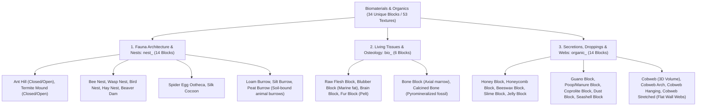

# Worldbuilding Architecture & Catalog: Biomaterials, Fauna & Organic Matter (Organics)

All active textures for animal architecture, nests, living animal tissues, osteology, secretions, natural waxes, biological droppings, and spiderwebs are organized in the folder:
📂 **`docs/worldbuilding/blocks/organics`** *(53 active PNG textures on disk)*

Generating **34 unique blocks** in the master catalog divided into 3 biological categories (all strictly even numbers):
* **14 Fauna Architecture & Animal Nests (`nest_`)**: Hives, colonies, half-height nests, oothecae, cocoons, dams, and multi-soil animal burrows.
* **6 Living Tissues, Organs & Osteology (`bio_`)**: Raw muscle, adipose blubber, nervous tissue, animal pelt, and axial skeletal bones.
* **14 Secretions, Waxes, Droppings & Spiderwebs (`organic_`)**: Honey, honeycomb, pure beeswax, colloidal gels, guano, manure, fossils, seashells, and modular vertical spiderwebs.

---

## 1. Ecological Classification & Fauna Strata

The biomaterial and zoological domain is structured into **3 Core Categories (34 Unique Blocks / 53 Textures)**:

---

## 2. Rendering Standards & Texture Prefix Taxonomy

All textures adhere to a clean, 3-prefix functional taxonomy:
* **`nest_`**: Animal colonies, excavated mounds, tree-suspended hives, cocoons, dams, and burrows.
* **`bio_`**: Raw anatomical animal tissues, organs, pelts, and skeletal osseous matter.
* **`organic_`**: Viscous secretions, insect waxes, colloidal gels, natural droppings, and spider silk webs.

### 1. Directional Face Mapping Standards
* Standard cubic and slab directional tags: **`_top`** (upper face), **`_side`** (lateral faces), **`_bot`** (bottom/floor face), **`_front`** (entrance face), and **`_front_honey`** (dripping honey variant).
* **Bone Cylindrical Orientation**: `bio_bone_side.png` wraps the compact cortical bone shaft, while `bio_bone_top.png` represents the porous marrow canal on both axial caps.

### 2. Multi-Soil Burrow Architecture & Layered Rendering
Animal burrows (rabbits, badgers, marmots) utilize a dual-texture composite top face over soil bedrock:
* **`nest_burrow_top.png` (Grayscale Alpha Cutout)**: Renders the outer grass fringe surrounding the burrow opening, receiving dynamic **Biome Tinting** to seamlessly blend with adjacent terrain turf.
* **`nest_burrow_top_layer.png` (Full-Color Earth)**: Un-tinted soil threshold and interior depth shadow rendered directly atop the opening.
* **3 Dedicated Soil Burrows**: To guarantee full runtime simplicity without complex dynamic face replacement, 3 dedicated blocks exist for natural soil habitats:
  * **Loam Burrow (`loam_burrow`)**: Top burrow aperture + Bottom `soil_loam_dirt.png` + Sides `soil_loam_grass_side.png`.
  * **Silt Burrow (`silt_burrow`)**: Top burrow aperture + Bottom `soil_silt_dirt.png` + Sides `soil_silt_grass_side.png`.
  * **Peat Burrow (`peat_burrow`)**: Top burrow aperture + Bottom `soil_peat_dirt.png` + Sides `soil_peat_grass_side.png`.

### 3. Half-Height Fauna Nests (Slabs / 8px Height)
* **Bird Nest (`bird_nest`)**: Shallow bowl woven from twigs, moss, and feathers. Features a concave top displaying speckled cyan robin eggs (`nest_bird_nest_top.png`), side texture with transparent upper half (`nest_bird_nest_side.png`), and compact twig bottom (`nest_bird_nest_bot.png`).
* **Hay Nest (`hay_nest`)**: Farm poultry nest woven from dry agricultural hay and straw. Top concave hay bed (`nest_hay_nest_top.png`), side texture with transparent upper half (`nest_hay_nest_side.png`), and dense straw bottom (`nest_hay_nest_bot.png`).

### 4. Spider Silk Webs: Volumetric 3D vs. Flat Vertical Quad Cutouts
* **Volumetric 3D Cobweb (`organic_cobweb.png`)**: Full-voxel intersecting cross-billboard block slowing movement.
* **Flat Wall-Mounted Cobwebs**: 2D vertical quad blocks placed flush against walls, archways, and ceilings:
  * **`organic_cobweb_arch.png`**: Corner arch web hugging the upper joint between wall and ceiling.
  * **`organic_cobweb_hanging.png`**: Hanging curtain of silk fringe suspended from ceilings or lintels.
  * **`organic_cobweb_stretched.png`**: Stretched cobweb trap tensioned between two vertical surfaces.

---

## 3. Technical Texture Inventory in `worldbuilding/blocks/organics/` (53 Active Textures)

### A. Fauna Architecture & Nests (27 Files, 16×16 px)
* **Ant Hill (2)**: `nest_ant_hill.png`, `nest_ant_hill_open.png`
* **Termite Mound (2)**: `nest_termite_mound.png`, `nest_termite_mound_open.png`
* **Bee Nest (5)**: `nest_bee_nest_bot.png`, `nest_bee_nest_front.png`, `nest_bee_nest_front_honey.png`, `nest_bee_nest_side.png`, `nest_bee_nest_top.png`
* **Wasp Nest (3)**: `nest_wasp_nest_bot.png`, `nest_wasp_nest_side.png`, `nest_wasp_nest_top.png`
* **Bird Nest (3)**: `nest_bird_nest_bot.png`, `nest_bird_nest_side.png`, `nest_bird_nest_top.png` *(Slab model)*
* **Hay Nest (3)**: `nest_hay_nest_bot.png`, `nest_hay_nest_side.png`, `nest_hay_nest_top.png` *(Slab model)*
* **Beaver Dam (1)**: `nest_beaver_dam.png` *(+ `1`, `2`)*
* **Spider Egg (3)**: `nest_spider_egg_bot.png`, `nest_spider_egg_side.png`, `nest_spider_egg_top.png`
* **Silk Cocoon (3)**: `nest_silk_cocoon_bot.png`, `nest_silk_cocoon_side.png`, `nest_silk_cocoon_top.png`
* **Burrow (2)**: `nest_burrow_top.png` *(Grayscale tinted turf)*, `nest_burrow_top_layer.png` *(Soil entry layer)*

### B. Living Tissues, Organs & Osteology (10 Base Files + Stochastic Variations, 16×16 px)
* **Raw Flesh (2)**: `bio_flesh_top.png`, `bio_flesh_side.png` *(+ `1`, `2`)*
* **Blubber (1)**: `bio_blubber.png` *(Translucent adipose layer)*
* **Brain (1)**: `bio_brain.png` *(Convoluted neural cerebral mass)*
* **Animal Fur (2)**: `bio_fur_top.png`, `bio_fur_side.png`
* **Bone Block (2)**: `bio_bone_top.png`, `bio_bone_side.png` *(+ `1`, `2`)*
* **Calcined Bone (2)**: `bio_calcined_bone_top.png`, `bio_calcined_bone_side.png`

### C. Secretions, Waxes, Gels, Droppings & Spiderwebs (16 Base Files + Stochastic Variations, 16×16 px)
* **Honey Block (3)**: `organic_honey_block_bot.png`, `organic_honey_block_side.png`, `organic_honey_block_top.png` *(Translucent)*
* **Honeycomb Block (1)**: `organic_honeycomb_block.png` *(+ `1`, `2`)*
* **Beeswax Block (1)**: `organic_wax.png`
* **Slime Block (2)**: `organic_slime.png` (Top/Sides), `organic_slime_bot.png` (Bottom) *(Translucent green)*
* **Jelly Block (2)**: `organic_jelly.png` (Top/Sides), `organic_jelly_bot.png` (Bottom) *(Translucent purple)*
* **Guano Block (1)**: `organic_guano.png`
* **Poop Block (1)**: `organic_poop.png` *(+ `1`, `2`)*
* **Coprolite Block (1)**: `organic_coprolite.png`
* **Dust Block (1)**: `organic_dust.png` *(+ `1`, `2`)*
* **Seashell Block (1)**: `organic_seashell.png`
* **Cobweb (4)**: `organic_cobweb.png` *(+ `1`, `2`)*, `organic_cobweb_arch.png`, `organic_cobweb_hanging.png`, `organic_cobweb_stretched.png`

---

## 4. Complete Block Catalog (34 Unique Blocks)

### 4.1. Fauna Architecture & Animal Nests (14 Blocks)

Structures engineered by colonial insects, avian species, mammals, and arachnids.

| # | Block ID | Name | Category | Texture File(s) | Face Mapping | Biome Occurrence | Biological Description |
| :-: | :--- | :--- | :--- | :--- | :--- | :--- | :--- |
| **01** | `ant_hill` | Ant Hill (Closed) | **Colony** | `nest_ant_hill.png` | Uniform (6 faces) | Plains, Savannas | Cemented mound of mineral soil particles and salivary secretions in dormant closed state. |
| **02** | `ant_hill_open` | Ant Hill (Active) | **Colony** | `nest_ant_hill_open.png` | Uniform (6 faces) | Plains, Savannas | Active ant mound featuring excavated gallery entryways and active insect swarms. |
| **03** | `termite_mound` | Termite Mound (Closed) | **Colony** | `nest_termite_mound.png` | Uniform (6 faces) | Arid Savannas | Towering spire of red clay soil cemented by termites with monolithic flute ridges. |
| **04** | `termite_mound_open`| Termite Mound (Active) | **Colony** | `nest_termite_mound_open.png` | Uniform (6 faces) | Arid Savannas | Active termite mound displaying open thermal chimneys and ventilation tunnels. |
| **05** | `bee_nest` | Wild Bee Nest | **Hive** | `nest_bee_nest_bot...top.png` `nest_bee_nest_front_honey.png` | Directional (5 faces) | Flower Forests, Meadows | Natural hive hanging from tree canopies, filled with wax comb cells and dripping wild honey. |
| **06** | `wasp_nest` | Paper Wasp Nest | **Hive** | `nest_wasp_nest_bot...top.png` | Directional (3 faces) | Dense Forests, Ruins | Papery cellulose nest chewed from plant fibers by social wasps, with inverted entry pore. |
| **07** | `bird_nest` | Songbird Nest | **Nest** | `nest_bird_nest_bot...top.png` | Half-height Slab | Forest Canopies, Cliffs | Woven bowl of twigs and moss featuring speckled cyan robin eggs; half-height slab geometry. |
| **08** | `hay_nest` | Hay Poultry Nest | **Nest** | `nest_hay_nest_bot...top.png` | Half-height Slab | Barnyards, Farmsteads | Agricultural laying nest woven from golden cured straw and dry hay; half-height slab geometry. |
| **09** | `beaver_dam` | Beaver Dam | **Architecture** | `nest_beaver_dam.png` | Uniform (6 faces) | Forest Rivers, Swamps | Hydraulic blockage matrix woven from debarked river branches, mud mortar, and river gravel. |
| **10** | `spider_egg` | Spider Egg Sac | **Ootheca** | `nest_spider_egg_bot...top.png` | Directional (3 faces) | Deep Caverns, Mines | Dense fibrous silk ootheca enclosing clutches of gestating scarlet spider eggs. |
| **11** | `silk_cocoon` | Wild Silk Cocoon | **Pupa** | `nest_silk_cocoon_bot...top.png` | Directional (3 faces) | Temperate Woods, Jungles | Compact ellipsoidal pupal shell of continuous pearlescent silk fibers; premium silk harvest. |
| **12** | `loam_burrow` | Loam Animal Burrow | **Burrow** | Top: `nest_burrow_top.png` + `layer.png` Bot: `soils/soil_loam_dirt.png` Sides: `soils/soil_loam_grass_side.png` | Composite Top + Loam soil | Fertile Plains, Meadows | Excavated wildlife den in rich loam soil with grass-fringed aperture and earth depth. |
| **13** | `silt_burrow` | Silt Animal Burrow | **Burrow** | Top: `nest_burrow_top.png` + `layer.png` Bot: `soils/soil_silt_dirt.png` Sides: `soils/soil_silt_grass_side.png` | Composite Top + Silt soil | Woodland Hills, Slopes | Excavated wildlife den in fine silt forest soils with shaded earthen entry tunnel. |
| **14** | `peat_burrow` | Peat Animal Burrow | **Burrow** | Top: `nest_burrow_top.png` + `layer.png` Bot: `soils/soil_peat_dirt.png` Sides: `soils/soil_peat_grass_side.png` | Composite Top + Peat soil | Bogs, Moorlands, Fens | Subterranean burrow dug into dense dark acidic peat moorland, sheltering hardy marsh fauna. |

---

### 4.2. Living Tissues, Organs & Osteology (6 Blocks)

Biological anatomical materials harvested from animal carcasses or skeletal deposits.

| # | Block ID | Name | Category | Texture File(s) | Face Mapping | Biome Occurrence | Biological Description |
| :-: | :--- | :--- | :--- | :--- | :--- | :--- | :--- |
| **15** | `bone_block` | Bone Block | **Osteology** | `bio_bone_top.png` `bio_bone_side.png` | Axial Column (2 faces) | Deserts, Fossils, Caves | Dense calcium phosphate and hydroxyapatite fossil megafauna bone with central marrow canal. |
| **16** | `calcined_bone` | Calcined Bone | **Osteology** | `bio_calcined_bone_top.png` `bio_calcined_bone_side.png` | Axial Column (2 faces) | Volcanic Ash, Kilns, Catacombs | Thermally altered, pyromineralized bone recrystallized into chalky pale grey hydroxyapatite. |
| **17** | `flesh_block` | Raw Flesh Block | **Tissue** | `bio_flesh_top.png` `bio_flesh_side.png` | Directional (2 faces) | Butcheries, Lairs, Carcasses | Fresh striated skeletal muscle and fibrous connective tissue with membrane top and fibril sides. |
| **18** | `blubber_block` | Blubber Block | **Adipose** | `bio_blubber.png` | Translucent (Alpha 204) | Polar Oceans, Arctic Tundras | Thick subcutaneous marine adipose tissue; excellent thermal insulator and long-burning fuel. |
| **19** | `brain_block` | Brain Block | **Neural** | `bio_brain.png` | Uniform (6 faces) | Abyssal Depths, Lairs | Convoluted cerebral gray and pink neural matter exhibiting synaptic twitching. |
| **20** | `fur_block` | Animal Fur Block | **Integument** | `bio_fur_top.png` `bio_fur_side.png` | Directional (2 faces) | Arctic Taigas, Pastures | Heavy mammal hide with dense vertical hair flow on sides and whorled rosette on top. |

---

### 4.3. Secretions, Waxes, Gels, Droppings & Spiderwebs (14 Blocks)

Physiological secretions, insect products, biological wastes, and structural spider silk.

| # | Block ID | Name | Category | Texture File(s) | Face Mapping | Biome Occurrence | Description |
| :-: | :--- | :--- | :--- | :--- | :--- | :--- | :--- |
| **21** | `honey_block` | Honey Block | **Secretion** | `organic_honey_block_bot...top.png` | Translucent (3 faces) | Beehives, Apiaries | Viscous colloidal nectar concentrate; cushions kinetic impact and adheres to surfaces. |
| **22** | `honeycomb_block`| Honeycomb Block | **Wax Matrix** | `organic_honeycomb_block.png` | Uniform (6 faces) | Apiaries, Tree Cavities | Regular hexagonal prismatic matrix of pure insect wax synthesized by honeybee workers. |
| **23** | `wax_block` | Beeswax Block | **Wax** | `organic_wax.png` | Uniform (6 faces) | Domestic Hives, Workshops | Compact block of rendered virgin beeswax; waterproof sealant and architectural candle craft. |
| **24** | `slime_block` | Slime Block | **Colloid** | `organic_slime.png` `organic_slime_bot.png` | Top/Sides + Bottom split | Swamps, Deep Caves | Elastic green colloidal gel; high viscoelastic resilience providing kinetic bounce. |
| **25** | `jelly_block` | Royal Jelly Block | **Colloid** | `organic_jelly.png` `organic_jelly_bot.png` | Top/Sides + Bottom split | Queen Chambers, Orchards | Viscoelastic translucent purple royal gel providing bounce without slime stickiness. |
| **26** | `guano_block` | Guano Block | **Dropping** | `organic_guano.png` | Uniform (6 faces) | Bat Caves, Sea Islands | Compact nitrogen and phosphate-rich natural fertilizer accumulated from bat and seabird guano. |
| **27** | `poop_block` | Manure Block | **Dropping** | `organic_poop.png` | Uniform (6 faces) | Pastures, Livestock Corrals | Rich agricultural farm animal dung with undigested vegetable fiber; high-potency soil fertilizer. |
| **28** | `coprolite_block`| Coprolite Block | **Fossil** | `organic_coprolite.png` | Uniform (6 faces) | Fossil Beds, Dry Caves | Prehistoric petrified fossil dung mineralized into solid calcium phosphate sedimentary rock. |
| **29** | `dust_block` | Organic Dust | **Detritus** | `organic_dust.png` | Uniform (6 faces) | Tombs, Forgotten Crypts | Dense accumulation of inert biological detritus, dead epithelial cells, and micro-arthropod debris. |
| **30** | `seashell_block`| Seashell Block | **Sediment** | `organic_seashell.png` | Uniform (6 faces) | Warm Beaches, Coastlines | Dense coastal coquina formed from crushed whole marine bivalves and iridescent sea shells. |
| **31** | `cobweb` | Cobweb Block | **Silk** | `organic_cobweb.png` | Volumetric 3D Cross | Abandoned Mines, Crypts | Full-voxel 3D intersecting cross of adhesive proteinaceous spider silk threads. |
| **32** | `cobweb_arch` | Cobweb Arch | **Silk** | `organic_cobweb_arch.png` | Flat Vertical Quad | Tunnel Corners, Doorways | Diagonal fan-shaped silk web mounted flush in the upper corner between wall and ceiling. |
| **33** | `cobweb_hanging`| Hanging Cobweb | **Silk** | `organic_cobweb_hanging.png` | Flat Vertical Quad | Tunnel Ceilings, Architraves | Pendant veil of cobweb fringe suspended from top horizontal joints and lintels. |
| **34** | `cobweb_stretched`| Stretched Cobweb | **Silk** | `organic_cobweb_stretched.png` | Flat Vertical Quad | Narrow Corridors, Gaps | Tensioned vertical silk web stretched taut between two parallel vertical surfaces. |
