# Worldbuilding Architecture & Catalog: Procedural Texture Overlays

All engine multi-texturing decal overlays, biome masks, and surface compositing textures are organized in the folder:
📂 **`docs/worldbuilding/blocks/overlays`** *(37 active PNG textures on disk)*

> [!IMPORTANT]
> **Zero Standalone Blocks Registered**:  
> The `overlays/` domain does **not** register any standalone voxel blocks. Every texture in this directory acts as a **secondary shader layer**, **alpha mask**, or **procedural surface decal** rendered atop primary base blocks cataloged across the 13 worldbuilding domains (`rocks`, `soils`, `oceans`, `organics`, `trees`).

---

## 1. Engine Multi-Texturing & Overlay Architecture

The Voxel Game Engine renders surface detail and environmental adaptations using a multi-pass texture compositing pipeline. This eliminates texture tiling repetition, supports dynamic biome color modulation, and allows composite block variations without duplicating full base texture matrices.

```mermaid
graph TD
    subgraph "Base Terrain Blocks"
        B1["Rock Matrices (rock_*.png)"]
        B2["Cobbled Rocks (rock_*_cobbled.png)"]
        B3["Reefstone (aqua_reefstone.png)"]
        B4["Biological Tissue (bio_brain, bio_flesh)"]
        B5["Canopy Foliage (tree_leaves_*.png)"]
        B6["Outcrop Side Textures (rock_*_grass_side, soil_*_grass_side)"]
    end

    subgraph "Overlay Shader Layer (docs/worldbuilding/blocks/overlays/)"
        O1["Bryophyte Decals: mossy_rock_overlay (0, 1, 2)"]
        O2["Cobble Decals: mossy_cobbled_overlay (0, 1, 2)"]
        O3["Marine Epifauna: barnacles_overlay, algae_dead_overlay (0, 1, 2)"]
        O4["Visceral Gore: bloody_overlay (0, 1, 2)"]
        O5["Flora Overlays: flower_leaves_*_overlay (0, 1, 2)"]
        O6["Foliage Biome Masks: rock_grass_side_overlay, soil_grass_side_overlay"]
    end

    subgraph "Engine Render Output"
        R1["16 Mossy Rock Blocks (rocks_design.md)"]
        R2["2 Encrusted Reefstone Blocks (oceans_design.md)"]
        R3["2 Bloody Visceral Blocks (organics_design.md)"]
        R4["Flowering Canopy Leaves (trees_design.md)"]
        R5["Dynamic Biome-Tinted Turf Outcrops (rocks & soils)"]
    end

    B1 & O1 --> R1
    B2 & O2 --> R1
    B3 & O3 --> R2
    B4 & O4 --> R3
    B5 & O5 --> R4
    B6 & O6 --> R5
```

### Rendering Modes

1. **Direct Decal Composite (Alpha Blending)**:
   - The shader renders the primary block base (Diffuse Layer 0) and blends the overlay decal (Layer 1) using RGBA alpha channels.
   - Used by `mossy_rock_overlay*`, `mossy_cobbled_overlay*`, `barnacles_overlay*`, `algae_dead_overlay*`, `bloody_overlay*`, and `flower_leaves_*`.
2. **Dynamic Biome-Tinted Alpha Masking**:
   - The greyscale mask defines where biome foliage colors are multiplied against the terrain face.
   - Pixel color = `Base_Pixel * (1 - Mask_Alpha) + (Mask_Alpha * Biome_Colormap_Color * Base_Luminance)`.
   - Used by `rock_grass_side_overlay.png` and `soil_grass_side_overlay.png`.
3. **Stochastic Tiling Mitigation**:
   - Overlays with `0` (base), `1`, and `2` variants are sampled per block world-coordinate hash `Hash(X, Y, Z) % 3` to break pattern repetition across large continuous surfaces.

---

## 2. Comprehensive Inventory of Overlays (39 PNG Files)

All 39 files stored in `docs/worldbuilding/blocks/overlays/` are cataloged below by operational classification:

### 2.1. Bryophyte & Lithic Moss Overlays (6 Active Files)

Applied to geological blocks in [`rocks_design.md`](rocks_design.md) to generate **16 registered mossy rock blocks** (8 solid matrices + 8 fractured cobbled variants):

| Overlay File | Variants | Target Domain | Target Blocks | Shader Application |
| :--- | :---: | :--- | :--- | :--- |
| `mossy_rock_overlay.png` | `base`, `1`, `2` | [`rocks`](rocks_design.md) | `mossy_granite`, `mossy_basalt`, `mossy_diorite`, `mossy_andesite`, `mossy_limestone`, `mossy_sandstone`, `mossy_slate`, `mossy_schist` | 6 uniform faces; composited over base `rock_<type>.png`. |
| `mossy_cobbled_overlay.png` | `base`, `1`, `2` | [`rocks`](rocks_design.md) | `mossy_cobbled_granite`, `mossy_cobbled_basalt`, `mossy_cobbled_diorite`, `mossy_cobbled_andesite`, `mossy_cobbled_limestone`, `mossy_cobbled_sandstone`, `mossy_cobbled_slate`, `mossy_cobbled_schist` | 6 uniform faces; composited over fractured `rock_<type>_cobbled.png`. |

### 2.2. Marine Benthic & Reef Overlays (9 Active Files: 6 Active, 3 Staged)

Applied to oceanic substrates in [`oceans_design.md`](oceans_design.md):

| Overlay File | Variants | Target Domain | Target Blocks / Usage | Operational Status |
| :--- | :---: | :--- | :--- | :---: |
| `barnacles_overlay.png` | `base`, `1`, `2` | [`oceans`](oceans_design.md) | `barnacles_reefstone` (`aqua_reefstone.png` base) | **Active** (In Use) |
| `algae_dead_overlay.png` | `base`, `1`, `2` | [`oceans`](oceans_design.md) | `algae_reefstone` (`aqua_reefstone.png` base) | **Active** (In Use) |
| `algae_overlay.png` | `base`, `1`, `2` | [`oceans`](oceans_design.md) | Staged for future healthy living algae encrustation on submerged rocks and shallow reef flats. | ⏳ **Staged** (Future Use) |

### 2.3. Visceral & Biological Overlays (3 Active Files)

Applied to organic and necrotic tissues in [`organics_design.md`](organics_design.md) to generate **2 registered bloody blocks**:

| Overlay File | Variants | Target Domain | Target Blocks | Shader Application |
| :--- | :---: | :--- | :--- | :--- |
| `bloody_overlay.png` | `base`, `1`, `2` | [`organics`](organics_design.md) | `bloody_brain` | 6 uniform faces; arterial blood and coagulated gore composited over `bio_brain.png`. |
| `bloody_overlay.png` | `base`, `1`, `2` | [`organics`](organics_design.md) | `bloody_flesh` | Lateral faces only; dripping blood streaks composited over `bio_flesh_side.png` (top/bot remain clean striated `bio_flesh_top.png`). |

### 2.4. Canopy Floral & Snow Overlays (14 Active Files)

Applied to arboreal foliage in [`trees_design.md`](trees_design.md):

| Overlay File | Variants | Target Domain | Target Blocks / Usage | Operational Status |
| :--- | :---: | :--- | :--- | :---: |
| `flower_leaves_blue_overlay.png` | `base`, `1`, `2` | [`trees`](trees_design.md) | Blue flowering canopy leaves (Wisteria, Jacaranda, Mountain Flora) | **Active** (In Use) |
| `flower_leaves_magenta_overlay.png` | `base`, `1`, `2` | [`trees`](trees_design.md) | Magenta flowering canopy leaves (Cherry Blossom, Redbud) | **Active** (In Use) |
| `flower_leaves_white_overlay.png` | `base`, `1`, `2` | [`trees`](trees_design.md) | White flowering canopy leaves (Apple, Dogwood, Magnolia) | **Active** (In Use) |
| `flower_leaves_yellow_overlay.png` | `base`, `1`, `2` | [`trees`](trees_design.md) | Yellow flowering canopy leaves (Golden Wattle, Tabebuia) | **Active** (In Use) |

### 2.5. Turf Outcrop Biome Tinting Masks (2 Active Files)

Greyscale alpha masks used by the terrain shader to blend biome colormaps along vertical cliff margins:

| Overlay File | Target Domain | Target Blocks | Functional Role |
| :--- | :--- | :--- | :--- |
| `rock_grass_side_overlay.png` | [`rocks`](rocks_design.md) | 8 Rock Outcrop Turf Sides (`rock_*_grass_side.png`) | Modulates biome grass tint across the upper hanging grass fringes of rocky cliffside faces. |
| `soil_grass_side_overlay.png` | [`soils`](soils_design.md) | 6 Soil Grass Sides (`soil_*_grass_side.png`) | Modulates biome grass tint across the upper hanging turf margins of dirt and pedological blocks. |

### 2.6. Arboreal Epiphytic Overlays (3 Staged Files)

Decals prepared for future dendrological systems:

| Overlay File | Variants | Target Domain | Planned Role | Operational Status |
| :--- | :---: | :--- | :--- | :---: |
| `mossy_tree_overlay.png` | `base`, `1`, `2` | [`trees`](trees_design.md) | Epiphytic bryophyte bark encrustation on humid temperate and jungle tree logs/trunks. | ⏳ **Staged** (Future Use) |

### 2.7. Reference-Only, Deprecated & Non-Usable Overlays (2 Files on Disk + Purged History)

| Asset File / Name | Location / Status | Why It Must NOT Be Used at Runtime |
| :--- | :--- | :--- |
| `rock_grass_side_overlay_colored.png` | `docs/worldbuilding/blocks/overlays/` | **Static Mockup Only**: Contains hardcoded pre-tinted green pixels. Runtime shaders require greyscale `rock_grass_side_overlay.png` to modulate against dynamic biome temperature/humidity colormaps. |
| `soil_grass_side_overlay_colored.png` | `docs/worldbuilding/blocks/overlays/` | **Static Mockup Only**: Contains hardcoded pre-tinted green pixels. Runtime shaders require greyscale `soil_grass_side_overlay.png` to dynamically tint grass edges to match the local biome colormap. |
| *Former `snow_side_overlay.png`* | **Deleted from disk** | **Unnecessary**: Snow has zero chromatic biome temperature variation (always neutral white). Snow overhangs are directly drawn/baked into individual `*_snow_side.png` textures without runtime mask overhead. |
| *Former `moss_*_side_overlay.png`* | **Deleted from disk** | **Deprecated**: Ground moss blocks (`moss_forest`, `moss_crimson`, `moss_amber`, `moss_cave`) utilize 6 uniform cubic faces without lateral edge transition decals. |
| *Former `slimy_overlay*` & `lichen_overlay*`* | **Deleted from disk** | **Purged**: Streamlined out of the asset pipeline; no registered blocks or active procedural passes utilize these decals. |

---

## 3. Cross-Domain Mapping Matrix

Summary table demonstrating how overlays interconnect with the engine's primary domain design specifications:

| Domain | Design Document | Associated Overlays | Number of Composite Blocks |
| :--- | :--- | :--- | :---: |
| **Geology & Rocks** | [`rocks_design.md`](rocks_design.md) | `mossy_rock_overlay*`, `mossy_cobbled_overlay*`, `rock_grass_side_overlay` | **16 Blocks** (`mossy_*`, `mossy_cobbled_*`) + 8 Outcrop Transitions |
| **Pedology & Soils** | [`soils_design.md`](soils_design.md) | `soil_grass_side_overlay` | 6 Outcrop Transitions |
| **Ocean Ecosystems** | [`oceans_design.md`](oceans_design.md) | `barnacles_overlay*`, `algae_dead_overlay*` *(and staged `algae_overlay*`)* | **2 Blocks** (`barnacles_reefstone`, `algae_reefstone`) |
| **Biomaterials & Organics** | [`organics_design.md`](organics_design.md) | `bloody_overlay*` | **2 Blocks** (`bloody_brain`, `bloody_flesh`) |
| **Trees & Forestry** | [`trees_design.md`](trees_design.md) | `flower_leaves_*_overlay*`, `leaves_snowy_*` *(and staged `mossy_tree_overlay*`)* | Dynamic flowering canopies & snowy conifer foliage |
| **Procedural Overlays** | `overlays_design.md` | *(Self - Master Decal Catalog)* | **0 Standalone Blocks** |
