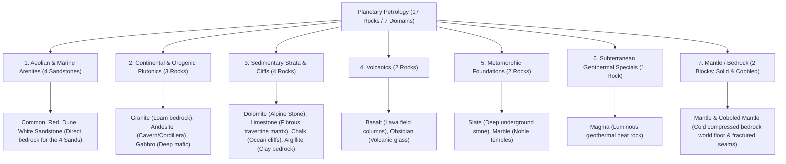

# Worldbuilding Architecture & Catalog: Rocks & Petrology (rocks)

All active textures for geological matrices, bedrock strata, cobbled stones, and loose ground pebbles are organized in:
📂 **`docs/worldbuilding/blocks/rocks`** *(162 active PNG textures on disk: 51 solid rock matrices across 17 base types + stochastic variants, 51 mined cobbled stones across 17 types + stochastic variants, 42 outcrop grass/snow shelves across 7 surface rocks, 18 ground pebbles across 3 materials)*

Shared surface overlays are located in:
📂 **`docs/worldbuilding/blocks/overlays`**

Generating **68 unique blocks** in the master catalog: **48 structural blocks** (17 solid stone + 17 mined cobbled stone + 14 surface relief outcrops) + **6 hand-collectable surface pebbles** + **14 humid biome mossy composite blocks** (7 solid + 7 cobbled).

---

## 1. Geological Classification & Pedological Connections

The planetary geology is structured into **7 Core Petrological Domains (17 Rocks + 3 Hand-Collectable Pebble Materials)**:

> [!NOTE]
> **Subterranean Cave Formations Note:**
> `Karst Limestone` and `Calcite` have been relocated to the dedicated subterranean domain in `docs/worldbuilding/blocks/caverns/` (documented in [caverns_design.md](caverns_design.md)), grouping them directly alongside their modular dissolution speleothems and flowstone structures.

---

### Surface Outcrops vs. Subterranean Isolation Logic

To maintain strict geological realism and prevent visual anomalies (e.g., surface turf generating deep inside pitch-black caverns):

- **Surface Outcrop Rocks (7 Rocks)**: Only rocks that naturally form open-air mountains, alpine ridges, river canyons, or coastal cliffs possess `_grass_side` and `_snow_side` textures (`Dolomite`, `Granite`, `Andesite`, `Basalt`, `Limestone`, `Chalk`, `Argillite`).
- **Subterranean & Deep Rocks (10 Rocks)**: Caves, deep strata, hydrothermal formations, volcanic pockets, and the mantle do **not** possess grass or snow variants (`Slate`, `Gabbro`, `Marble`, `Magma`, `Obsidian`, `Mantle`, and the 4 `Sandstones` which are exclusively topped by loose sands).

---

## 2. Complete Texture Inventory in `worldbuilding/blocks/rocks/` (150 Active Textures)

> [!NOTE]
> **Stochastic Variations for Dynamic Shader Sampling:**
> To break visual repetition across expansive cliff faces, mountain peaks, and deep caverns, key rock matrices possess 3-fold texture variations (`_base`, `1`, `2`) dynamically sampled by terrain shaders. These apply strictly to the solid rock base matrices without registering duplicate blocks.

### A. Solid Rock Matrix Textures (17 Base Types + Stochastic Variations = 51 Files, 16×16 px)

- **Sandstones (4 base × 3 = 12)**: `rock_sandstone_common.png` *(+ `1`, `2`)*, `rock_sandstone_red.png` *(+ `1`, `2`)*, `rock_sandstone_dune.png` *(+ `1`, `2`)*, `rock_sandstone_white.png` *(+ `1`, `2`)*

- **Continental Plutonics (3 base × 3 = 9)**: `rock_granite.png` *(+ `1`, `2`)*, `rock_andesite.png` *(+ `1`, `2`)*, `rock_gabbro.png` *(+ `1`, `2`)*
- **Sedimentary Strata (4 base × 3 = 12)**: `rock_dolomite.png` *(+ `1`, `2`)*, `rock_limestone.png` *(+ `1`, `2`)*, `rock_chalk.png` *(+ `1`, `2`)*, `rock_argillite.png` *(+ `1`, `2`)*
- **Volcanics (2 base × 3 = 6)**: `rock_basalt.png` *(+ `1`, `2`)*, `rock_obsidian.png` *(+ `1`, `2`)*
- **Metamorphic Foundations (2 base × 3 = 6)**: `rock_slate.png` *(+ `1`, `2`)*, `rock_marble.png` *(+ `1`, `2`)*
- **Geothermal Specials (1 base × 3 = 3)**: `rock_magma.png` *(animated 16×112 px, + `1`, `2`)*
- **Mantle (1 base × 3 = 3)**: `rock_mantle.png` *(+ `1`, `2`)*

### B. Mined Cobblestone Variants (17 Base Types + Stochastic Variations = 51 Files, 16×16 px)

All mineable solid rocks drop an unrefined fractured cobblestone upon excavation (or generate as fractured bedrock seams in the mantle). All 17 cobbled stone matrices feature complete 3-fold stochastic variants (`_base`, `1`, `2`):

- **Sandstones (4 base × 3 = 12)**: `rock_sandstone_common_cobbled.png` *(+ `1`, `2`)*, `rock_sandstone_red_cobbled.png` *(+ `1`, `2`)*, `rock_sandstone_dune_cobbled.png` *(+ `1`, `2`)*, `rock_sandstone_white_cobbled.png` *(+ `1`, `2`)*
- **Continental Plutonics (3 base × 3 = 9)**: `rock_granite_cobbled.png` *(+ `1`, `2`)*, `rock_andesite_cobbled.png` *(+ `1`, `2`)*, `rock_gabbro_cobbled.png` *(+ `1`, `2`)*
- **Sedimentary Strata (4 base × 3 = 12)**: `rock_dolomite_cobbled.png` *(+ `1`, `2`)*, `rock_limestone_cobbled.png` *(+ `1`, `2`)*, `rock_chalk_cobbled.png` *(+ `1`, `2`)*, `rock_argillite_cobbled.png` *(+ `1`, `2`)*
- **Volcanics (2 base × 3 = 6)**: `rock_basalt_cobbled.png` *(+ `1`, `2`)*, `rock_obsidian_cobbled.png` *(+ `1`, `2`)*
- **Metamorphic Foundations (2 base × 3 = 6)**: `rock_slate_cobbled.png` *(+ `1`, `2`)*, `rock_marble_cobbled.png` *(+ `1`, `2`)*
- **Geothermal Specials (1 base × 3 = 3)**: `rock_magma_cobbled.png` *(animated 16×112 px, + `1`, `2`)*
- **Mantle (1 base × 3 = 3)**: `rock_mantle_cobbled.png` *(+ `1`, `2`)*

### C. Mountain Outcrop Veg/Snow Sides (7 Rocks × 2 Types × 3 Variations = 42 Files, 16×16 px)

Exactly **7 surface alpine and cliff rocks** possess lateral turf and snow shelf cutouts with complete 3-fold stochastic variants (`base`, `1`, `2`):

- **Grass Sides (7 base × 3 = 21)**: `rock_dolomite_grass_side.png` *(+ `1`, `2`)*, `rock_granite_grass_side.png` *(+ `1`, `2`)*, `rock_andesite_grass_side.png` *(+ `1`, `2`)*, `rock_basalt_grass_side.png` *(+ `1`, `2`)*, `rock_limestone_grass_side.png` *(+ `1`, `2`)*, `rock_chalk_grass_side.png` *(+ `1`, `2`)*, `rock_argillite_grass_side.png` *(+ `1`, `2`)*.
- **Snow Sides (7 base × 3 = 21)**: `rock_dolomite_snow_side.png` *(+ `1`, `2`)*, `rock_granite_snow_side.png` *(+ `1`, `2`)*, `rock_andesite_snow_side.png` *(+ `1`, `2`)*, `rock_basalt_snow_side.png` *(+ `1`, `2`)*, `rock_limestone_snow_side.png` *(+ `1`, `2`)*, `rock_chalk_snow_side.png` *(+ `1`, `2`)*, `rock_argillite_snow_side.png` *(+ `1`, `2`)*.

### D. Ground Pebbles & River Shingle (3 Materials × 2 Forms × 3 Stochastic Variations = 18 Files, 16×16 px)

- **Flint (6)**: `pebble_flint.png` *(Single; + `1`, `2`)*, `pebble_flint_cluster.png` *(Cluster; + `1`, `2`)* *(Dark chert/flint fire-striker & primitive arrowheads)*
- **Quartz (6)**: `pebble_quartz.png` *(Single; + `1`, `2`)*, `pebble_quartz_cluster.png` *(Cluster; + `1`, `2`)* *(Smooth crystalline milky-white river pebbles)*
- **Chert (6)**: `pebble_chert.png` *(Single; + `1`, `2`)*, `pebble_chert_cluster.png` *(Cluster; + `1`, `2`)* *(Cryptocrystalline warm caramel, ochre, and amber-tan riverbed shingle)*

---

## 3. Block Catalog (68 Unique Blocks: 48 Structural Blocks + 6 Ground Pebble Blocks + 14 Humid Mossy Composite Blocks)

### 3.1. Aeolian & Marine Arenites (8 Blocks: 4 Solid + 4 Cobbled)

| # | Block ID | Name | Category | Texture File(s) | Face Mapping |
| :-: | :--- | :--- | :--- | :--- | :--- |
| **01** | `sandstone_common` | Sandstone | **Sedimentary** | `rock_sandstone_common.png` | 6 uniform faces |
| **02** | `cobbled_sandstone_common` | Cobbled Sandstone | **Sedimentary** | `rock_sandstone_common_cobbled.png` | 6 uniform faces |
| **03** | `sandstone_red` | Red Sandstone | **Sedimentary** | `rock_sandstone_red.png` | 6 uniform faces |
| **04** | `cobbled_sandstone_red` | Cobbled Red Sandstone | **Sedimentary** | `rock_sandstone_red_cobbled.png` | 6 uniform faces |
| **05** | `sandstone_dune` | Dune Sandstone | **Sedimentary** | `rock_sandstone_dune.png` | 6 uniform faces |
| **06** | `cobbled_sandstone_dune` | Cobbled Dune Sandstone | **Sedimentary** | `rock_sandstone_dune_cobbled.png` | 6 uniform faces |
| **07** | `sandstone_white` | White Sandstone | **Sedimentary** | `rock_sandstone_white.png` | 6 uniform faces |
| **08** | `cobbled_sandstone_white` | Cobbled White Sandstone | **Sedimentary** | `rock_sandstone_white_cobbled.png` | 6 uniform faces |

---

### 3.2. Continental Plutonics & Orogenics (10 Blocks: 3 Solid + 3 Cobbled + 4 Outcrops)

| # | Block ID | Name | Category | Texture File(s) | Face Mapping |
| :-: | :--- | :--- | :--- | :--- | :--- |
| **09** | `granite` | Granite | **Plutonic** | `rock_granite.png` | 6 uniform faces |
| **10** | `cobbled_granite` | Cobbled Granite | **Plutonic** | `rock_granite_cobbled.png` | 6 uniform faces |
| **11** | `granite_grass` | Granite Grass Outcrop | **Plutonic** | Top: `soil_grass.png` Bot: `rock_granite.png` Sides: `rock_granite_grass_side.png` | Top + Bot + 4 sides (overlay `soil_grass_side_overlay.png`) |
| **12** | `granite_snow` | Granite Snow Outcrop | **Plutonic** | Top: `soil_snow.png` Bot: `rock_granite.png` Sides: `rock_granite_snow_side.png` | Top + Bot + 4 sides |
| **13** | `andesite` | Andesite | **Continental** | `rock_andesite.png` | 6 uniform faces |
| **14** | `cobbled_andesite` | Cobbled Andesite | **Continental** | `rock_andesite_cobbled.png` | 6 uniform faces |
| **15** | `andesite_grass` | Andesite Grass Outcrop | **Continental** | Top: `soil_grass.png` Bot: `rock_andesite.png` Sides: `rock_andesite_grass_side.png` | Top + Bot + 4 sides (overlay `soil_grass_side_overlay.png`) |
| **16** | `andesite_snow` | Andesite Snow Outcrop | **Continental** | Top: `soil_snow.png` Bot: `rock_andesite.png` Sides: `rock_andesite_snow_side.png` | Top + Bot + 4 sides |
| **17** | `gabbro` | Gabbro | **Plutonic** | `rock_gabbro.png` | 6 uniform faces *(Deep intrusive mafic bedrock)* |
| **18** | `cobbled_gabbro` | Cobbled Gabbro | **Plutonic** | `rock_gabbro_cobbled.png` | 6 uniform faces |

---

### 3.3. Sedimentary Strata & Cliffs (16 Blocks: 4 Solid + 4 Cobbled + 8 Outcrops)

| # | Block ID | Name | Category | Texture File(s) | Face Mapping |
| :-: | :--- | :--- | :--- | :--- | :--- |
| **19** | `dolomite` | Dolomite (Alpine Stone) | **Sedimentary** | `rock_dolomite.png` | 6 uniform faces *(The classic Stone baseline)* |
| **20** | `cobbled_dolomite` | Cobbled Dolomite | **Sedimentary** | `rock_dolomite_cobbled.png` | 6 uniform faces |
| **21** | `dolomite_grass` | Dolomite Grass Outcrop | **Sedimentary** | Top: `soil_grass.png` Bot: `rock_dolomite.png` Sides: `rock_dolomite_grass_side.png` | Top + Bot + 4 sides (overlay `soil_grass_side_overlay.png`) |
| **22** | `dolomite_snow` | Dolomite Snow Outcrop | **Sedimentary** | Top: `soil_snow.png` Bot: `rock_dolomite.png` Sides: `rock_dolomite_snow_side.png` | Top + Bot + 4 sides |
| **23** | `limestone` | Limestone | **Sedimentary** | `rock_limestone.png` | 6 uniform faces *(Fibrous travertine matrix)* |
| **24** | `cobbled_limestone` | Cobbled Limestone | **Sedimentary** | `rock_limestone_cobbled.png` | 6 uniform faces |
| **25** | `limestone_grass` | Limestone Grass Outcrop | **Sedimentary** | Top: `soil_grass.png` Bot: `rock_limestone.png` Sides: `rock_limestone_grass_side.png` | Top + Bot + 4 sides (overlay `soil_grass_side_overlay.png`) |
| **26** | `limestone_snow` | Limestone Snow Outcrop | **Sedimentary** | Top: `soil_snow.png` Bot: `rock_limestone.png` Sides: `rock_limestone_snow_side.png` | Top + Bot + 4 sides |
| **27** | `chalk` | Chalk | **Sedimentary** | `rock_chalk.png` | 6 uniform faces *(Oceanic white cliff face)* |
| **28** | `cobbled_chalk` | Cobbled Chalk | **Sedimentary** | `rock_chalk_cobbled.png` | 6 uniform faces |
| **29** | `chalk_grass` | Chalk Grass Outcrop | **Sedimentary** | Top: `soil_grass.png` Bot: `rock_chalk.png` Sides: `rock_chalk_grass_side.png` | Top + Bot + 4 sides (overlay `soil_grass_side_overlay.png`) |
| **30** | `chalk_snow` | Chalk Snow Outcrop | **Sedimentary** | Top: `soil_snow.png` Bot: `rock_chalk.png` Sides: `rock_chalk_snow_side.png` | Top + Bot + 4 sides |
| **31** | `argillite` | Argillite | **Sedimentary** | `rock_argillite.png` | 6 uniform faces *(Clay bedrock)* |
| **32** | `cobbled_argillite` | Cobbled Argillite | **Sedimentary** | `rock_argillite_cobbled.png` | 6 uniform faces |
| **33** | `argillite_grass` | Argillite Grass Outcrop | **Sedimentary** | Top: `soil_grass.png` Bot: `rock_argillite.png` Sides: `rock_argillite_grass_side.png` | Top + Bot + 4 sides (overlay `soil_grass_side_overlay.png`) |
| **34** | `argillite_snow` | Argillite Snow Outcrop | **Sedimentary** | Top: `soil_snow.png` Bot: `rock_argillite.png` Sides: `rock_argillite_snow_side.png` | Top + Bot + 4 sides |

---

### 3.4. Volcanics (6 Blocks: 2 Solid + 2 Cobbled + 2 Outcrops)

| # | Block ID | Name | Category | Texture File(s) | Face Mapping |
| :-: | :--- | :--- | :--- | :--- | :--- |
| **35** | `basalt` | Basalt | **Volcanic** | `rock_basalt.png` | 6 uniform faces |
| **36** | `cobbled_basalt` | Cobbled Basalt | **Volcanic** | `rock_basalt_cobbled.png` | 6 uniform faces |
| **37** | `basalt_grass` | Basalt Grass Outcrop | **Volcanic** | Top: `soil_grass.png` Bot: `rock_basalt.png` Sides: `rock_basalt_grass_side.png` | Top + Bot + 4 sides (overlay `soil_grass_side_overlay.png`) |
| **38** | `basalt_snow` | Basalt Snow Outcrop | **Volcanic** | Top: `soil_snow.png` Bot: `rock_basalt.png` Sides: `rock_basalt_snow_side.png` | Top + Bot + 4 sides |
| **39** | `obsidian` | Obsidian | **Volcanic** | `rock_obsidian.png` | 6 uniform faces *(Amorphous volcanic glass)* |
| **40** | `cobbled_obsidian` | Cobbled Obsidian | **Volcanic** | `rock_obsidian_cobbled.png` | 6 uniform faces |

---

### 3.5. Metamorphic Foundations (4 Blocks: 2 Solid + 2 Cobbled)

| # | Block ID | Name | Category | Texture File(s) | Face Mapping |
| :-: | :--- | :--- | :--- | :--- | :--- |
| **41** | `slate` | Slate | **Metamorphic** | `rock_slate.png` | 6 uniform faces *(Laminated deep underground stone)* |
| **42** | `cobbled_slate` | Cobbled Slate | **Metamorphic** | `rock_slate_cobbled.png` | 6 uniform faces |
| **43** | `marble` | Marble | **Metamorphic** | `rock_marble.png` | 6 uniform faces *(Pure white architectural stone)* |
| **44** | `cobbled_marble` | Cobbled Marble | **Metamorphic** | `rock_marble_cobbled.png` | 6 uniform faces |

---

### 3.6. Subterranean Geothermal Specials (2 Blocks: 1 Solid + 1 Cobbled)

| # | Block ID | Name | Category | Texture File(s) | Face Mapping |
| :-: | :--- | :--- | :--- | :--- | :--- |
| **45** | `magma` | Magma | **Geothermal** | `rock_magma.png` *(+ `1`, `2`)* | 6 uniform faces *(Animated incandescent veins, emits light)* |
| **46** | `cobbled_magma` | Cobbled Magma | **Geothermal** | `rock_magma_cobbled.png` *(+ `1`, `2`)* | 6 uniform faces *(Animated incandescent veins)* |

---

### 3.7. Mantle (2 Bedrock Blocks: Solid & Cobbled)

| # | Block ID | Name | Category | Texture File(s) | Face Mapping |
| :-: | :--- | :--- | :--- | :--- | :--- |
| **47** | `mantle` | Mantle | **Bedrock** | `rock_mantle.png` *(+ `1`, `2`)* | 6 uniform faces *(Cold high-pressure world floor, unbreakable)* |
| **48** | `cobbled_mantle` | Cobbled Mantle | **Bedrock** | `rock_mantle_cobbled.png` *(+ `1`, `2`)* | 6 uniform faces *(Fractured primordial bedrock pocket seams, unbreakable)* |

---

### 3.8. Ground Pebbles & River Shingles (6 Sub-Voxel Cluster Blocks)

| # | Block ID | Name | Cluster Stage | Texture File | Model Geometry |
| :-: | :--- | :--- | :-: | :--- | :--- |
| **49** | `pebble_chert` | Chert Pebble | Single | `pebble_chert.png` *(+ `1`, `2`)* | Low sub-voxel ground pebble |
| **50** | `pebble_chert_cluster` | Chert Pebble Cluster | Cluster | `pebble_chert_cluster.png` *(+ `1`, `2`)* | Low sub-voxel cluster pebbles |
| **51** | `pebble_flint` | Flint Pebble | Single | `pebble_flint.png` *(+ `1`, `2`)* | Low sub-voxel ground pebble |
| **52** | `pebble_flint_cluster` | Flint Pebble Cluster | Cluster | `pebble_flint_cluster.png` *(+ `1`, `2`)* | Low sub-voxel cluster pebbles |
| **53** | `pebble_quartz` | Quartz Pebble | Single | `pebble_quartz.png` *(+ `1`, `2`)* | Low sub-voxel ground pebble |
| **54** | `pebble_quartz_cluster` | Quartz Pebble Cluster | Cluster | `pebble_quartz_cluster.png` *(+ `1`, `2`)* | Low sub-voxel cluster pebbles |

---

### 3.9. Humid Biome Mossy Rocks (14 Composite Blocks: 7 Solid + 7 Cobbled)

Natural weathering and bryophyte colonization across temperate, rainforest, wetland, and riparian zones. Rendered via dynamic shader composite using base rock matrices and 3-fold stochastic moss overlays (`mossy_rock_overlay*.png` for solid matrices; `mossy_cobbled_overlay*.png` for fractured cobblestones):

| # | Block ID | Name | Category | Texture File(s) & Overlays | Face Mapping / Shaders | Biome Occurrence |
| :-: | :--- | :--- | :--- | :--- | :--- | :--- |
| **55** | `mossy_dolomite` | Mossy Dolomite | **Sedimentary** | `rock_dolomite.png` *(+ `mossy_rock_overlay.png`, `1`, `2`)* | 6 faces + Shader Moss Overlay | Humid Alpine Forests, Overgrown Ruins, Dungeons |
| **56** | `mossy_cobbled_dolomite` | Mossy Cobbled Dolomite | **Sedimentary** | `rock_dolomite_cobbled.png` *(+ `mossy_cobbled_overlay.png`, `1`, `2`)* | 6 faces + Shader Cobble Joint Moss | Ruined Keeps, Dungeons, Ancient Cobbled Roads |
| **57** | `mossy_granite` | Mossy Granite | **Plutonic** | `rock_granite.png` *(+ `mossy_rock_overlay.png`, `1`, `2`)* | 6 faces + Shader Moss Overlay | Temperate Old-Growth Woods, Riverbanks |
| **58** | `mossy_cobbled_granite` | Mossy Cobbled Granite | **Plutonic** | `rock_granite_cobbled.png` *(+ `mossy_cobbled_overlay.png`, `1`, `2`)* | 6 faces + Shader Cobble Joint Moss | Forest Ruins, Riverbed Foundations |
| **59** | `mossy_andesite` | Mossy Andesite | **Continental** | `rock_andesite.png` *(+ `mossy_rock_overlay.png`, `1`, `2`)* | 6 faces + Shader Moss Overlay | Rainforest Cordilleras, Misty Taiga Cliffs |
| **60** | `mossy_cobbled_andesite` | Mossy Cobbled Andesite | **Continental** | `rock_andesite_cobbled.png` *(+ `mossy_cobbled_overlay.png`, `1`, `2`)* | 6 faces + Shader Cobble Joint Moss | Mountain Passes, Damp Fortress Walls |
| **61** | `mossy_basalt` | Mossy Basalt | **Volcanic** | `rock_basalt.png` *(+ `mossy_rock_overlay.png`, `1`, `2`)* | 6 faces + Shader Moss Overlay | Cloud Forests, Coastal Sea Caves, Waterfalls |
| **62** | `mossy_cobbled_basalt` | Mossy Cobbled Basalt | **Volcanic** | `rock_basalt_cobbled.png` *(+ `mossy_cobbled_overlay.png`, `1`, `2`)* | 6 faces + Shader Cobble Joint Moss | Damp Volcanic Ruin Basements |
| **63** | `mossy_limestone` | Mossy Limestone | **Sedimentary** | `rock_limestone.png` *(+ `mossy_rock_overlay.png`, `1`, `2`)* | 6 faces + Shader Moss Overlay | Karstic Springs, Humid River Gorges, Caves |
| **64** | `mossy_cobbled_limestone` | Mossy Cobbled Limestone | **Sedimentary** | `rock_limestone_cobbled.png` *(+ `mossy_cobbled_overlay.png`, `1`, `2`)* | 6 faces + Shader Cobble Joint Moss | Aqueducts, Wet Caves, Riparian Structures |
| **65** | `mossy_chalk` | Mossy Chalk | **Sedimentary** | `rock_chalk.png` *(+ `mossy_rock_overlay.png`, `1`, `2`)* | 6 faces + Shader Moss Overlay | Coastal White Cliffs, Humid Ocean Coves |
| **66** | `mossy_cobbled_chalk` | Mossy Cobbled Chalk | **Sedimentary** | `rock_chalk_cobbled.png` *(+ `mossy_cobbled_overlay.png`, `1`, `2`)* | 6 faces + Shader Cobble Joint Moss | Maritime Ruins, Wet Cliff Steps & Sea Paths |
| **67** | `mossy_argillite` | Mossy Argillite | **Sedimentary** | `rock_argillite.png` *(+ `mossy_rock_overlay.png`, `1`, `2`)* | 6 faces + Shader Moss Overlay | River Floodplains, Mangroves, Dense Swamps |
| **68** | `mossy_cobbled_argillite` | Mossy Cobbled Argillite | **Sedimentary** | `rock_argillite_cobbled.png` *(+ `mossy_cobbled_overlay.png`, `1`, `2`)* | 6 faces + Shader Cobble Joint Moss | Swamp Dikes, Bog Pathways |
