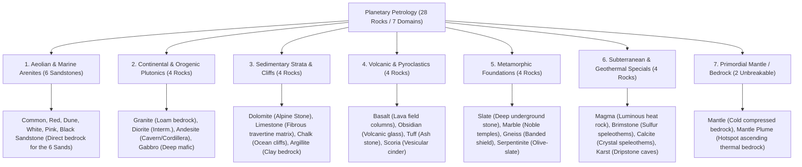

# Worldbuilding Architecture & Catalog: Rocks & Petrology (rocks)

All active textures for geological matrices, bedrock strata, cobbled stones, and loose ground pebbles are organized in:
📂 **`docs/worldbuilding/rocks`**

Shared surface overlays are located in:
📂 **`docs/worldbuilding/overlays`**

---

## 1. Geological Classification & Pedological Connections

The planetary geology is structured into **7 Core Petrological Domains (28 Rocks + 2 Hand-Collectable Pebbles)**, with every single domain featuring a clean, balanced, even number of rock types:

---

### Surface Outcrops vs. Subterranean Isolation Logic

To maintain strict geological realism and prevent visual anomalies (e.g., surface turf generating deep inside pitch-black caverns):
- **Surface Outcrop Rocks (8 Rocks)**: Only rocks that naturally form open-air mountains, alpine ridges, river canyons, or coastal cliffs possess `_grass_side` and `_snow_side` textures (`Dolomite`, `Granite`, `Andesite`, `Basalt`, `Limestone`, `Chalk`, `Argillite`, `Gneiss`).
- **Subterranean & Deep Rocks (20 Rocks)**: Caves, deep strata, hydrothermal formations, volcanic pockets, and the mantle do **not** possess grass or snow variants (`Karst`, `Slate`, `Gabbro`, `Diorite`, `Marble`, `Serpentinite`, `Magma`, `Brimstone`, `Calcite`, `Obsidian`, `Tuff`, `Scoria`, `Mantle`, `Mantle Plume`, and the 6 `Sandstones` which are exclusively topped by loose sands).

---

## 2. Complete Texture Inventory in `worldbuilding/blocks/rocks/`

> [!NOTE]
> **Stochastic Variations for Dynamic Shader Sampling:**
> To break visual repetition across expansive cliff faces, mountain peaks, and deep caverns, key rock matrices possess 3-fold texture variations (`_base`, `1`, `2`) dynamically sampled by terrain shaders. These apply strictly to the solid rock base matrices without registering duplicate blocks.

### A. Solid Rock Matrix Textures (28 Base Files + Stochastic Variations, 16×16 px)
* **Sandstones (6)**: `rock_sandstone_common.png`, `rock_sandstone_red.png`, `rock_sandstone_dune.png`, `rock_sandstone_white.png`, `rock_sandstone_pink.png`, `rock_sandstone_black.png`
* **Continental Plutonics (4)**: `rock_granite.png` *(+ stochastic variants `rock_granite1.png`, `rock_granite2.png`)*, `rock_diorite.png`, `rock_andesite.png`, `rock_gabbro.png`
* **Sedimentary Strata (4)**: `rock_dolomite.png` *(+ stochastic variants `rock_dolomite1.png`, `rock_dolomite2.png`)*, `rock_limestone.png` *(+ stochastic variants `rock_limestone1.png`, `rock_limestone2.png`)*, `rock_chalk.png` *(+ stochastic variants `rock_chalk1.png`, `rock_chalk2.png`)*, `rock_argillite.png` *(+ stochastic variants `rock_argillite1.png`, `rock_argillite2.png`)*
* **Volcanics & Pyroclastics (4)**: `rock_basalt.png` *(+ stochastic variants `rock_basalt1.png`, `rock_basalt2.png`)*, `rock_obsidian.png`, `rock_tuff.png`, `rock_scoria.png`
* **Metamorphic Foundations (4)**: `rock_slate.png` *(+ stochastic variants `rock_slate1.png`, `rock_slate2.png`)*, `rock_marble.png`, `rock_gneiss.png` *(+ stochastic variants `rock_gneiss1.png`, `rock_gneiss2.png`)*, `rock_serpentinite.png`
* **Subterranean & Specials (4)**: `rock_magma.png` *(animated)*, `rock_brimstone.png`, `rock_calcite.png`, `rock_karst.png`
* **Primordial Mantle (2)**: `rock_mantle.png`, `rock_mantle_plume.png`

### B. Mined Cobblestone Variants (26 Files, 16×16 px)
All mineable solid rocks drop an unrefined fractured cobblestone upon excavation:
* **Sandstones (6)**: `rock_sandstone_common_cobbled.png`, `rock_sandstone_red_cobbled.png`, `rock_sandstone_dune_cobbled.png`, `rock_sandstone_white_cobbled.png`, `rock_sandstone_pink_cobbled.png`, `rock_sandstone_black_cobbled.png`
* **Continental Plutonics (4)**: `rock_granite_cobbled.png`, `rock_diorite_cobbled.png`, `rock_andesite_cobbled.png`, `rock_gabbro_cobbled.png`
* **Sedimentary Strata (4)**: `rock_dolomite_cobbled.png`, `rock_limestone_cobbled.png`, `rock_chalk_cobbled.png`, `rock_argillite_cobbled.png`
* **Volcanics & Pyroclastics (4)**: `rock_basalt_cobbled.png`, `rock_obsidian_cobbled.png`, `rock_tuff_cobbled.png`, `rock_scoria_cobbled.png`
* **Metamorphic Foundations (4)**: `rock_slate_cobbled.png`, `rock_marble_cobbled.png`, `rock_gneiss_cobbled.png`, `rock_serpentinite_cobbled.png`
* **Subterranean & Specials (4)**: `rock_magma_cobbled.png` *(animated)*, `rock_brimstone_cobbled.png`, `rock_calcite_cobbled.png`, `rock_karst_cobbled.png`
*(Note: `mantle` and `mantle_plume` are unbreakable and have no cobbled variants).*

### C. Mountain Outcrop Veg/Snow Sides (16 Files, 16×16 px)
Exactly **8 surface alpine and cliff rocks** possess lateral turf and snow shelf cutouts:
* **Grass Sides (8)**: `rock_dolomite_grass_side.png`, `rock_granite_grass_side.png`, `rock_andesite_grass_side.png`, `rock_basalt_grass_side.png`, `rock_limestone_grass_side.png`, `rock_chalk_grass_side.png`, `rock_argillite_grass_side.png`, `rock_gneiss_grass_side.png`
* **Snow Sides (8)**: `rock_dolomite_snow_side.png`, `rock_granite_snow_side.png`, `rock_andesite_snow_side.png`, `rock_basalt_snow_side.png`, `rock_limestone_snow_side.png`, `rock_chalk_snow_side.png`, `rock_argillite_snow_side.png`, `rock_gneiss_snow_side.png`

### D. Ground Pebbles & River Shingle (2 Types × 3 Cluster Stages = 6 Files, 16×16 px)
Loose surface pebbles collectable by hand, generated on riverbeds, beaches, gravel banks, and cavern floors. Pebble types are strictly minerals/rocks without full solid block equivalents (Flint and Quartz). Each pebble type features 3 cluster density stages (1 pebble, 2 pebbles, and 3 pebbles):
* **Flint (3)**: `pebble_flint_one.png`, `pebble_flint_two.png`, `pebble_flint_three.png` *(Pyrite/flint fire-striker & primitive arrowheads)*
* **Quartz (3)**: `pebble_quartz_one.png`, `pebble_quartz_two.png`, `pebble_quartz_three.png` *(Smooth crystalline white river pebbles)*

---

## 3. Block Catalog (76 Unique Blocks: 70 Structural Blocks + 6 Ground Pebble Blocks)

### 3.1. Aeolian & Marine Arenites (12 Blocks: 6 Solid + 6 Cobbled)

| # | Block ID | Name | Category | Texture File(s) | Face Mapping |
| :-: | :--- | :--- | :--- | :--- | :--- |
| **01** | `sandstone_common` | Common Sandstone | **Sedimentary** | `rock_sandstone_common.png` | 6 uniform faces |
| **02** | `cobbled_sandstone_common` | Cobbled Sandstone | **Sedimentary** | `rock_sandstone_common_cobbled.png` | 6 uniform faces |
| **03** | `sandstone_red` | Red Sandstone | **Sedimentary** | `rock_sandstone_red.png` | 6 uniform faces |
| **04** | `cobbled_sandstone_red` | Cobbled Red Sandstone | **Sedimentary** | `rock_sandstone_red_cobbled.png` | 6 uniform faces |
| **05** | `sandstone_dune` | Dune Sandstone | **Sedimentary** | `rock_sandstone_dune.png` | 6 uniform faces |
| **06** | `cobbled_sandstone_dune` | Cobbled Dune Sandstone | **Sedimentary** | `rock_sandstone_dune_cobbled.png` | 6 uniform faces |
| **07** | `sandstone_white` | White Sandstone | **Sedimentary** | `rock_sandstone_white.png` | 6 uniform faces |
| **08** | `cobbled_sandstone_white` | Cobbled White Sandstone | **Sedimentary** | `rock_sandstone_white_cobbled.png` | 6 uniform faces |
| **09** | `sandstone_pink` | Pink Sandstone | **Sedimentary** | `rock_sandstone_pink.png` | 6 uniform faces |
| **10** | `cobbled_sandstone_pink` | Cobbled Pink Sandstone | **Sedimentary** | `rock_sandstone_pink_cobbled.png` | 6 uniform faces |
| **11** | `sandstone_black` | Black Sandstone | **Sedimentary** | `rock_sandstone_black.png` | 6 uniform faces |
| **12** | `cobbled_sandstone_black` | Cobbled Black Sandstone | **Sedimentary** | `rock_sandstone_black_cobbled.png` | 6 uniform faces |

---

### 3.2. Continental Plutonics & Orogenics (12 Blocks: 4 Solid + 4 Cobbled + 4 Outcrops)

| # | Block ID | Name | Category | Texture File(s) | Face Mapping |
| :-: | :--- | :--- | :--- | :--- | :--- |
| **13** | `granite` | Granite | **Plutonic** | `rock_granite.png` | 6 uniform faces |
| **14** | `cobbled_granite` | Cobbled Granite | **Plutonic** | `rock_granite_cobbled.png` | 6 uniform faces |
| **15** | `granite_grass` | Granite Grass Outcrop | **Plutonic** | Top: `soil_grass.png` Bot: `rock_granite.png` Sides: `rock_granite_grass_side.png` | Top + Bot + 4 sides (overlay `soil_grass_side_overlay.png`) |
| **16** | `granite_snow` | Granite Snow Outcrop | **Plutonic** | Top: `soil_snow.png` Bot: `rock_granite.png` Sides: `rock_granite_snow_side.png` | Top + Bot + 4 sides |
| **17** | `andesite` | Andesite | **Continental** | `rock_andesite.png` | 6 uniform faces |
| **18** | `cobbled_andesite` | Cobbled Andesite | **Continental** | `rock_andesite_cobbled.png` | 6 uniform faces |
| **19** | `andesite_grass` | Andesite Grass Outcrop | **Continental** | Top: `soil_grass.png` Bot: `rock_andesite.png` Sides: `rock_andesite_grass_side.png` | Top + Bot + 4 sides (overlay `soil_grass_side_overlay.png`) |
| **20** | `andesite_snow` | Andesite Snow Outcrop | **Continental** | Top: `soil_snow.png` Bot: `rock_andesite.png` Sides: `rock_andesite_snow_side.png` | Top + Bot + 4 sides |
| **21** | `diorite` | Diorite | **Plutonic** | `rock_diorite.png` | 6 uniform faces |
| **22** | `cobbled_diorite` | Cobbled Diorite | **Plutonic** | `rock_diorite_cobbled.png` | 6 uniform faces |
| **23** | `gabbro` | Gabbro | **Plutonic** | `rock_gabbro.png` | 6 uniform faces *(Deep intrusive mafic bedrock)* |
| **24** | `cobbled_gabbro` | Cobbled Gabbro | **Plutonic** | `rock_gabbro_cobbled.png` | 6 uniform faces |

---

### 3.3. Sedimentary Strata & Cliffs (16 Blocks: 4 Solid + 4 Cobbled + 8 Outcrops)

| # | Block ID | Name | Category | Texture File(s) | Face Mapping |
| :-: | :--- | :--- | :--- | :--- | :--- |
| **25** | `dolomite` | Dolomite (Alpine Stone) | **Sedimentary** | `rock_dolomite.png` | 6 uniform faces *(The classic Stone baseline)* |
| **26** | `cobbled_dolomite` | Cobbled Dolomite | **Sedimentary** | `rock_dolomite_cobbled.png` | 6 uniform faces |
| **27** | `dolomite_grass` | Dolomite Grass Outcrop | **Sedimentary** | Top: `soil_grass.png` Bot: `rock_dolomite.png` Sides: `rock_dolomite_grass_side.png` | Top + Bot + 4 sides (overlay `soil_grass_side_overlay.png`) |
| **28** | `dolomite_snow` | Dolomite Snow Outcrop | **Sedimentary** | Top: `soil_snow.png` Bot: `rock_dolomite.png` Sides: `rock_dolomite_snow_side.png` | Top + Bot + 4 sides |
| **29** | `limestone` | Limestone | **Sedimentary** | `rock_limestone.png` | 6 uniform faces *(Fibrous travertine matrix)* |
| **30** | `cobbled_limestone` | Cobbled Limestone | **Sedimentary** | `rock_limestone_cobbled.png` | 6 uniform faces |
| **31** | `limestone_grass` | Limestone Grass Outcrop | **Sedimentary** | Top: `soil_grass.png` Bot: `rock_limestone.png` Sides: `rock_limestone_grass_side.png` | Top + Bot + 4 sides (overlay `soil_grass_side_overlay.png`) |
| **32** | `limestone_snow` | Limestone Snow Outcrop | **Sedimentary** | Top: `soil_snow.png` Bot: `rock_limestone.png` Sides: `rock_limestone_snow_side.png` | Top + Bot + 4 sides |
| **33** | `chalk` | Chalk | **Sedimentary** | `rock_chalk.png` | 6 uniform faces *(Oceanic white cliff face)* |
| **34** | `cobbled_chalk` | Cobbled Chalk | **Sedimentary** | `rock_chalk_cobbled.png` | 6 uniform faces |
| **35** | `chalk_grass` | Chalk Grass Outcrop | **Sedimentary** | Top: `soil_grass.png` Bot: `rock_chalk.png` Sides: `rock_chalk_grass_side.png` | Top + Bot + 4 sides (overlay `soil_grass_side_overlay.png`) |
| **36** | `chalk_snow` | Chalk Snow Outcrop | **Sedimentary** | Top: `soil_snow.png` Bot: `rock_chalk.png` Sides: `rock_chalk_snow_side.png` | Top + Bot + 4 sides |
| **37** | `argillite` | Argillite | **Sedimentary** | `rock_argillite.png` | 6 uniform faces *(Clay bedrock)* |
| **38** | `cobbled_argillite` | Cobbled Argillite | **Sedimentary** | `rock_argillite_cobbled.png` | 6 uniform faces |
| **39** | `argillite_grass` | Argillite Grass Outcrop | **Sedimentary** | Top: `soil_grass.png` Bot: `rock_argillite.png` Sides: `rock_argillite_grass_side.png` | Top + Bot + 4 sides (overlay `soil_grass_side_overlay.png`) |
| **40** | `argillite_snow` | Argillite Snow Outcrop | **Sedimentary** | Top: `soil_snow.png` Bot: `rock_argillite.png` Sides: `rock_argillite_snow_side.png` | Top + Bot + 4 sides |

---

### 3.4. Volcanic & Pyroclastics (10 Blocks: 4 Solid + 4 Cobbled + 2 Outcrops)

| # | Block ID | Name | Category | Texture File(s) | Face Mapping |
| :-: | :--- | :--- | :--- | :--- | :--- |
| **41** | `basalt` | Basalt | **Volcanic** | `rock_basalt.png` | 6 uniform faces |
| **42** | `cobbled_basalt` | Cobbled Basalt | **Volcanic** | `rock_basalt_cobbled.png` | 6 uniform faces |
| **43** | `basalt_grass` | Basalt Grass Outcrop | **Volcanic** | Top: `soil_grass.png` Bot: `rock_basalt.png` Sides: `rock_basalt_grass_side.png` | Top + Bot + 4 sides (overlay `soil_grass_side_overlay.png`) |
| **44** | `basalt_snow` | Basalt Snow Outcrop | **Volcanic** | Top: `soil_snow.png` Bot: `rock_basalt.png` Sides: `rock_basalt_snow_side.png` | Top + Bot + 4 sides |
| **45** | `obsidian` | Obsidian | **Volcanic** | `rock_obsidian.png` | 6 uniform faces *(Amorphous volcanic glass)* |
| **46** | `cobbled_obsidian` | Cobbled Obsidian | **Volcanic** | `rock_obsidian_cobbled.png` | 6 uniform faces |
| **47** | `tuff` | Tuff | **Pyroclastic** | `rock_tuff.png` | 6 uniform faces *(Compacted volcanic ash)* |
| **48** | `cobbled_tuff` | Cobbled Tuff | **Pyroclastic** | `rock_tuff_cobbled.png` | 6 uniform faces |
| **49** | `scoria` | Scoria | **Pyroclastic** | `rock_scoria.png` | 6 uniform faces *(Vesicular basaltic cinders)* |
| **50** | `cobbled_scoria` | Cobbled Scoria | **Pyroclastic** | `rock_scoria_cobbled.png` | 6 uniform faces |

---

### 3.5. Metamorphic Foundations (10 Blocks: 4 Solid + 4 Cobbled + 2 Outcrops)

| # | Block ID | Name | Category | Texture File(s) | Face Mapping |
| :-: | :--- | :--- | :--- | :--- | :--- |
| **51** | `slate` | Slate | **Metamorphic** | `rock_slate.png` | 6 uniform faces *(Laminated deep underground stone)* |
| **52** | `cobbled_slate` | Cobbled Slate | **Metamorphic** | `rock_slate_cobbled.png` | 6 uniform faces |
| **53** | `marble` | Marble | **Metamorphic** | `rock_marble.png` | 6 uniform faces *(Pure white architectural stone)* |
| **54** | `cobbled_marble` | Cobbled Marble | **Metamorphic** | `rock_marble_cobbled.png` | 6 uniform faces |
| **55** | `gneiss` | Gneiss | **Metamorphic** | `rock_gneiss.png` | 6 uniform faces *(Ancient banded shield bedrock)* |
| **56** | `cobbled_gneiss` | Cobbled Gneiss | **Metamorphic** | `rock_gneiss_cobbled.png` | 6 uniform faces |
| **57** | `gneiss_grass` | Gneiss Grass Outcrop | **Metamorphic** | Top: `soil_grass.png` Bot: `rock_gneiss.png` Sides: `rock_gneiss_grass_side.png` | Top + Bot + 4 sides (overlay `soil_grass_side_overlay.png`) |
| **58** | `gneiss_snow` | Gneiss Snow Outcrop | **Metamorphic** | Top: `soil_snow.png` Bot: `rock_gneiss.png` Sides: `rock_gneiss_snow_side.png` | Top + Bot + 4 sides |
| **59** | `serpentinite` | Serpentinite | **Metamorphic** | `rock_serpentinite.png` | 6 uniform faces *(Deep muted olive-slate hydrated rock)* |
| **60** | `cobbled_serpentinite`| Cobbled Serpentinite | **Metamorphic** | `rock_serpentinite_cobbled.png` | 6 uniform faces |

---

### 3.6. Subterranean & Geothermal Specials (8 Blocks: 4 Solid + 4 Cobbled)

| # | Block ID | Name | Category | Texture File(s) | Face Mapping |
| :-: | :--- | :--- | :--- | :--- | :--- |
| **61** | `magma` | Magma Rock | **Geothermal** | `rock_magma.png` | 6 uniform faces *(Animated incandescent veins, emits light)* |
| **62** | `cobbled_magma` | Cobbled Magma | **Geothermal** | `rock_magma_cobbled.png` | 6 uniform faces *(Animated incandescent veins)* |
| **63** | `brimstone` | Brimstone | **Hydrothermal** | `rock_brimstone.png` | 6 uniform faces *(Sulfur fumaroles, cave speleothems)* |
| **64** | `cobbled_brimstone` | Cobbled Brimstone | **Hydrothermal** | `rock_brimstone_cobbled.png` | 6 uniform faces |
| **65** | `calcite` | Calcite | **Mineral** | `rock_calcite.png` | 6 uniform faces *(Crystalline geode matrix, speleothems)* |
| **66** | `cobbled_calcite` | Cobbled Calcite | **Mineral** | `rock_calcite_cobbled.png` | 6 uniform faces |
| **67** | `karst` | Karst Limestone | **Speleological** | `rock_karst.png` | 6 uniform faces *(Porous cave limestone, speleothems)* |
| **68** | `cobbled_karst` | Cobbled Karst | **Speleological** | `rock_karst_cobbled.png` | 6 uniform faces |

---

### 3.7. Primordial Mantle (2 Unbreakable Bedrock Blocks)

| # | Block ID | Name | Category | Texture File(s) | Face Mapping |
| :-: | :--- | :--- | :--- | :--- | :--- |
| **69** | `mantle` | Primordial Mantle | **Bedrock** | `rock_mantle.png` | 6 uniform faces *(Cold high-pressure world floor, unbreakable)* |
| **70** | `mantle_plume` | Mantle Plume | **Bedrock** | `rock_mantle_plume.png` | 6 uniform faces *(Thermal hotspot ascending plume, unbreakable)* |

---

### 3.8. Ground Pebbles & River Shingles (6 Sub-Voxel Cluster Blocks)

| # | Block ID | Name | Cluster Stage | Texture File | Model Geometry |
| :-: | :--- | :--- | :-: | :--- | :--- |
| **71** | `pebble_flint_one` | Flint Pebble (Single) | 1 Pebble | `pebble_flint_one.png` | Sub-voxel box `[7..11, 0..2, 5..10]` |
| **72** | `pebble_flint_two` | Flint Pebble (Pair) | 2 Pebbles | `pebble_flint_two.png` | Corner micro-box `[3..5, 0..1, 10..12]` |
| **73** | `pebble_flint_three`| Flint Pebble (Cluster)| 3 Pebbles | `pebble_flint_three.png` | Dual boxes `[7..12, 0..2, 8..13]` + `[5..8, 0..1, 6..10]` |
| **74** | `pebble_quartz_one` | Quartz Pebble (Single) | 1 Pebble | `pebble_quartz_one.png` | Sub-voxel box `[7..11, 0..2, 5..10]` |
| **75** | `pebble_quartz_two` | Quartz Pebble (Pair) | 2 Pebbles | `pebble_quartz_two.png` | Corner micro-box `[3..5, 0..1, 10..12]` |
| **76** | `pebble_quartz_three`| Quartz Pebble (Cluster)| 3 Pebbles | `pebble_quartz_three.png` | Dual boxes `[7..12, 0..2, 8..13]` + `[5..8, 0..1, 6..10]` |
