# Worldbuilding Architecture & Catalog: Trees, Forestry & Dendrology (trees)

All active textures for living forest trees, timbers, foliage, and lumber are organized in the folder:
📂 **`docs/worldbuilding/blocks/trees`** *(100 active PNG textures on disk across 18 botanical species)*

Dynamic canopy overlays for seasonal flowers and snowy side accumulations are located in:
📂 **`docs/worldbuilding/blocks/overlays`** *(2 snowy branch overlays and 12 modular flowering overlays across 4 colors)*

Generating **98 unique blocks** in the master catalog:
* **18 Tree Species**: All true, living trees organized across 5 planetary bioclimatic zones.
* **98 Unique Blocks**: 36 log/wood structural blocks, 18 building plank blocks, 43 foliage blocks (healthy, flowering, lush, snowy, and dead), and 1 aerial root block.

---

## 1. Dendrological & Botanical Classification (18 Species)

Planetary forestry is organized into **5 Major Bioclimatic Zones & Canopy Morphologies (18 Botanical Species)**, with each zone featuring an even number of species:

```mermaid
graph TD
    A["Planetary Dendrology (18 Forest Species)"] --> B["1. Temperate & Deciduous Forests (6)"]
    A --> C["2. Boreal & Coniferous Taigas (4)"]
    A --> D["3. Tropical & Rainforest Jungles (4)"]
    A --> E["4. Arid Savannas & Woodlands (2)"]
    A --> F["5. Coastal & Wetland Groves (2)"]

    B --> B1["Oak: Classical temperate oak (Healthy, Flowering, Lush, Dead)"]
    B --> B2["Birch: White paper birch with slender trunk and ivory lumber (Healthy, Dead)"]
    B --> B3["Maple: Vibrant autumn maple (Orange, Red, Yellow, Dead)"]
    B --> B4["Cherry: Ornamental mountain cherry with delicate blossoms (Sakura, Dead)"]
    B --> B5["Aspen: Mountain trembling aspen (Golden, Snowy Top/Side, Dead)"]
    B --> B6["Willow: Weeping riverbank willow with drooping foliage (Healthy, Dead)"]

    C --> C1["Pine: Boreal Scots pine with rugged bark (Healthy, Snowy, Dead)"]
    C --> C2["Fir: Conical high-altitude silver fir (Healthy, Snowy, Dead)"]
    C --> C3["Redwood: Colossal ancient sequoia with massive red-brick heartwood (Healthy, Dead)"]
    C --> C4["Yew: Ancient shade yew with deep chocolate-black lumber (Healthy, Snowy, Dead)"]

    D --> D1["Mahogany: Dense jungle timber tree with deep reddish-brown heartwood (Healthy, Dead)"]
    D --> D2["Bamboo: Woody giant grass with segmented hollow stalks and fan foliage (Large, Small)"]
    D --> D3["Mangrove: Estuarine saltwater tree with stilt aerial root network (Healthy, Dead)"]
    D --> D4["Kapok: Colossal tropical emergent rainforest giant with buttress roots (Healthy, Dead)"]

    E --> E1["Acacia: Flat-topped umbrella savanna tree with vivid orange lumber (Healthy, Dead)"]
    E --> E2["Baobab: Ancient swollen water-storing pachycaul tree (Healthy, Dead)"]

    F --> F1["Palm: Tropical coastal and desert oasis palm with feathered fronds (Healthy, Dead)"]
    F --> F2["Cypress: Slender rot-resistant swamp and Mediterranean cypress (Healthy, Dead)"]
```

---

## 2. Dendrological Species Matrix (18 Species)

| # | Species | Botanical Reference | Native Biome | Trunk & Bark Morphology | Plank Color Profile (`planks`) | Foliage Variants / Seasonality | Ecological Role |
| :-: | :--- | :--- | :--- | :--- | :--- | :--- | :--- |
| **01** | **Oak** | *Quercus robur* | Temperate Plains & Forests | Rugged brown bark, balanced concentric rings | Neutral warm amber brown | Normal, Flowering, Lush, **Dead** *(+ Floral overlays)* | Universal forest canopy and baseline building timber. |
| **02** | **Birch** | *Betula pendula* | Temperate Forests & Foothills | Chalky white papery bark with horizontal dark lenticels | Pale ivory / cream blond wood | Normal, **Dead** | High-contrast luminous groves and Nordic architecture. |
| **03** | **Maple** | *Acer saccharum* | Deciduous Autumn Forests | Smooth grey-brown bark with warm beige rings | Soft cozy honey brown | 3 seasonal phases (Orange, Red, Yellow), **Dead** | Permanent autumn biomes with sweeping color gradients. |
| **04** | **Cherry** | *Prunus serrulata* | Oriental Groves & Highlands | Polished greyish-brown bark with fine annular rings | Delicate pastel pinkish-beige | Sakura blossom canopy, **Dead** | Ornamental groves, mountain shrines, and gardens. |
| **05** | **Aspen** | *Populus tremuloides* | Alpine Slopes & Mountain Ridges | Pale bone-white bark with vertical black scars | Clean pale chalk beige | Golden autumn, **Snowy (Top/Side)**, **Dead** | Subalpine transition zones and snowcapped mountain slopes. |
| **06** | **Willow** | *Salix babylonica* | Riparian Riverbanks & Swamps | Dark furrowed twisted fibrous bark | Gentle warm tan beige | Drooping pendulous foliage, **Dead** | Riverbanks, murky marshes, and lakeshore wetlands. |
| **07** | **Pine** | *Pinus sylvestris* | Boreal Taigas & Tundras | Rugged reddish-grey scaly bark plates | Deep rustic earthy brown | Needle canopy (tintable), **Snowy Top/Side**, **Dead** | Cold taigas, mountain log cabins, and rustic beams. |
| **08** | **Fir** | *Abies alba* | Mountain Taigas & Glacial Slopes | Dense vertical dark grey bark | Soft elegant coffee brown | Native green needles, **Snowy needles**, **Dead** | Steep alpine peaks, conical fir ridges, and snowy crests. |
| **09** | **Redwood** | *Sequoia sempervirens* | Coastal Fog Giants & Old-Growth | Thick deeply furrowed fibrous reddish-brown bark | Rich noble brick-red (Sequoia) | Evergreen needles, **Dead** | Colossal ancient trees with wide trunks (2×2 to 4×4 blocks). |
| **10** | **Yew** | *Taxus baccata* | Dark Woods & Ancient Sanctuaries | Deep near-black purple-tinged bark | Ultra-dark chocolate / Ebony (Dark Oak) | Dark needle canopy, **Snowy Top/Side**, **Dead** | Gothic cathedrals, shadowy dungeons, and luxury furnishings. |
| **11** | **Mahogany** | *Swietenia macrophylla* | Tropical Jungles & Rainforests | Rugged deep brown rainforest bark | Rich deep reddish-auburn timber | Broad tropical leaves, **Dead** | Lush equatorial canopies, naval shipbuilding, and fine furniture. |
| **12** | **Bamboo** | *Bambusoideae* | Bamboo Jungles & River Valleys | Hollow green jointed nodal culms (`stalk`) | Woven golden straw matting | Large Leaves (high canopy), Small Leaves (shoots) | Scaffolding, lightweight construction, and oriental mats. |
| **13** | **Mangrove** | *Rhizophora mangle* | Tidal Estuaries & Salt Marshes | Olive-grey bark with exposed stilt root arches | Earthy coppery-tan wood | Salt-tolerant waxy leaves, **Stilt Roots**, **Dead** | Intertidal mudflats, brackish deltas, and drowned forests. |
| **14** | **Kapok** | *Ceiba pentandra* | Equatorial Rainforests | Smooth grey bark with buttress roots and thorned nodules | Warm pale tropical clay beige | Broad palmate leaves, **Dead** | Colossal emergent trees piercing the high rainforest canopy. |
| **15** | **Acacia** | *Acacia sensu lato* | Arid Savannas & Scrublands | Striped grey bark with light fissured furrows | Striking vivid terracotta orange | Sparse umbrella foliage, **Dead** | Distinctive horizontal umbrella silhouettes on savanna horizons. |
| **16** | **Baobab** | *Adansonia digitata* | Arid Savannas & Dry Valleys | Smooth grey fibrous bark on swollen water-storing trunk | Fibrous sunny copper orange | Tufted foliage clusters, **Dead** | Colossal pachycaul landmarks enduring severe seasonal drought. |
| **17** | **Palm** | *Arecaceae* | Tropical Beaches, Coasts & Oases | Ringed golden-beige fibrous curved stipe bark | Sunny golden blonde timber | Broad arching green fronds, **Dead** | Tropical coastlines, sandy beaches, and desert oases. |
| **18** | **Cypress** | *Cupressus sempervirens* | Mediterranean Valleys & Swamps | Smooth dark greyish-brown fibrous bark | Resilient neutral warm hazel | Slender columnar emerald foliage, **Dead** | Formal vertical landscaping and desolate dead swamps. |

---

## 3. Botanical Anatomy & Texturing Standards

### 3.1. Logs vs Wood (Bark Blocks)
* **`tree_<name>_log` (Directional Circular Log)**:
  * **Top / Bottom**: Concentric annual growth rings showing heartwood and sapwood (`tree_<name>_log.png`).
  * **Sides**: Textured outer bark (`tree_<name>_bark.png`).
  * Supports 3-axis directional alignment (X, Y, Z axes).
* **`tree_<name>_wood` (6-Sided Bark Block)**:
  * Uses `tree_<name>_bark.png` across all 6 faces.
  * Used for horizontal branches, natural forks, and architectural pillars where cut rings must remain concealed.

### 3.2. Planks (`planks`): Staggered Board Standard
* Every wood species features a standardized **4-board staggered pattern** (16×16 px wood brick format).
* Built strictly using a 5-tone ramp:
  1. `Tone A`: Darkest deep seam / saw cut shadow.
  2. `Tone B`: Groove bevel shade.
  3. `Tone C`: Base lumber tone.
  4. `Tone D`: Mid-lit grain highlight.
  5. `Tone E`: Specular fiber highlight.

### 3.3. Foliage: Healthy, Snowy, and Dead Canopies
* **Healthy Canopies (`tree_*_leaves.png`)**: Binary alpha cutout transparency representing vibrant, turgid leaves.
* **Snowy Canopies (`tree_*_leaves_snowy`)**:
  * **Top**: Planar accumulation of snow seen from above (`tree_*_leaves_snowy_top.png`).
  * **Sides**: Snow buildup along horizontal boughs (`tree_*_leaves_snowy_side.png` or modular overlay).
* **Dead Canopies (`tree_*_leaves_dead.png`)**:
  * Represents withered, drought-parched, or frost-killed canopies.
  * Strictly standardized to the **Botanical Senescence Palette (5 tones)**:
    * `(88, 57, 44)`: Deep withered shadow
    * `(103, 72, 53)`: Earthy brown shade
    * `(124, 92, 57)`: Dry straw / dead leaf midtone
    * `(140, 106, 60)`: Brittle ochre highlight
    * `(154, 125, 83)`: Sun-bleached brittle leaf tips

---

## 4. Technical Texture Inventory in `worldbuilding/blocks/trees/` (100 Base Textures + Stochastic Variations)

> [!NOTE]
> **Stochastic Variations for Dynamic Shader Sampling:**
> * **Planks**: All 18 wood species feature complete 3-fold plank variations (`tree_<species>_planks.png`, `tree_<species>_planks1.png`, `tree_<species>_planks2.png`) based on universal staggered lumber patterns A, B, and C.
> * **Barks**: All 17 bark-bearing tree species feature complete 3-fold bark variations (`tree_<species>_bark.png`, `tree_<species>_bark1.png`, `tree_<species>_bark2.png`) to break vertical trunk wallpapering and seam repetition across forest biomes.

### A. Temperate & Deciduous Forests (35 Base Files, 16×16 px)
* **Oak (7)**: `tree_oak_bark.png` *(+ bark1, bark2)*, `tree_oak_log.png`, `tree_oak_planks.png` *(+ planks1, planks2)*, `tree_oak_leaves.png`, `tree_oak_leaves_flowering.png`, `tree_oak_leaves_lush.png`, `tree_oak_leaves_dead.png`
* **Birch (5)**: `tree_birch_bark.png` *(+ bark1, bark2)*, `tree_birch_log.png`, `tree_birch_planks.png` *(+ planks1, planks2)*, `tree_birch_leaves.png`, `tree_birch_leaves_dead.png`
* **Maple (7)**: `tree_maple_bark.png` *(+ bark1, bark2)*, `tree_maple_log.png`, `tree_maple_planks.png` *(+ planks1, planks2)*, `tree_maple_leaves_orange.png`, `tree_maple_leaves_red.png`, `tree_maple_leaves_yellow.png`, `tree_maple_leaves_dead.png`
* **Cherry (5)**: `tree_cherry_bark.png` *(+ bark1, bark2)*, `tree_cherry_log.png`, `tree_cherry_planks.png` *(+ planks1, planks2)*, `tree_cherry_leaves.png`, `tree_cherry_leaves_dead.png`
* **Aspen (6)**: `tree_aspen_bark.png` *(+ bark1, bark2)*, `tree_aspen_log.png`, `tree_aspen_planks.png` *(+ planks1, planks2)*, `tree_aspen_leaves.png`, `tree_aspen_leaves_snowy_top.png`, `tree_aspen_leaves_snowy_side.png`, `tree_aspen_leaves_dead.png` *(Aspen uses 7 textures)*
* **Willow (5)**: `tree_willow_bark.png` *(+ bark1, bark2)*, `tree_willow_log.png`, `tree_willow_planks.png` *(+ planks1, planks2)*, `tree_willow_leaves.png`, `tree_willow_leaves_dead.png`

### B. Boreal & Coniferous Taigas (23 Base Files, 16×16 px)
* **Pine (6)**: `tree_pine_bark.png` *(+ bark1, bark2)*, `tree_pine_log.png`, `tree_pine_planks.png` *(+ planks1, planks2)*, `tree_pine_leaves.png`, `tree_pine_leaves_snowy_top.png`, `tree_pine_leaves_dead.png`
* **Fir (6)**: `tree_fir_bark.png` *(+ bark1, bark2)*, `tree_fir_log.png`, `tree_fir_planks.png` *(+ planks1, planks2)*, `tree_fir_leaves.png`, `tree_fir_leaves_snowy.png`, `tree_fir_leaves_dead.png`
* **Redwood (5)**: `tree_redwood_bark.png` *(+ bark1, bark2)*, `tree_redwood_log.png`, `tree_redwood_planks.png` *(+ planks1, planks2)*, `tree_redwood_leaves.png`, `tree_redwood_leaves_dead.png`
* **Yew (6)**: `tree_yew_bark.png` *(+ bark1, bark2)*, `tree_yew_log.png`, `tree_yew_planks.png` *(+ planks1, planks2)*, `tree_yew_leaves.png`, `tree_yew_leaves_snowy_top.png`, `tree_yew_leaves_dead.png`

### C. Tropical & Rainforest Jungles (22 Base Files, 16×16 px)
* **Mahogany (5)**: `tree_mahogany_bark.png` *(+ bark1, bark2)*, `tree_mahogany_log.png`, `tree_mahogany_planks.png` *(+ planks1, planks2)*, `tree_mahogany_leaves.png`, `tree_mahogany_leaves_dead.png`
* **Bamboo (4)**: `tree_bamboo_stalk.png`, `tree_bamboo_planks.png` *(+ planks1, planks2)*, `tree_bamboo_large_leaves.png`, `tree_bamboo_small_leaves.png`
* **Mangrove (7)**: `tree_mangrove_bark.png` *(+ bark1, bark2)*, `tree_mangrove_log.png`, `tree_mangrove_planks.png` *(+ planks1, planks2)*, `tree_mangrove_leaves.png`, `tree_mangrove_roots.png` *(+ roots1, roots2)*, `tree_mangrove_roots_top.png` *(+ top1, top2)*, `tree_mangrove_leaves_dead.png`
* **Kapok (5)**: `tree_kapok_bark.png` *(+ bark1, bark2)*, `tree_kapok_log.png`, `tree_kapok_planks.png` *(+ planks1, planks2)*, `tree_kapok_leaves.png`, `tree_kapok_leaves_dead.png`

### D. Arid Savannas & Woodlands (10 Base Files, 16×16 px)
* **Acacia (5)**: `tree_acacia_bark.png` *(+ bark1, bark2)*, `tree_acacia_log.png`, `tree_acacia_planks.png` *(+ planks1, planks2)*, `tree_acacia_leaves.png`, `tree_acacia_leaves_dead.png`
* **Baobab (5)**: `tree_baobab_bark.png` *(+ bark1, bark2)*, `tree_baobab_log.png`, `tree_baobab_planks.png` *(+ planks1, planks2)*, `tree_baobab_leaves.png`, `tree_baobab_leaves_dead.png`

### E. Coastal & Wetland Groves (10 Base Files, 16×16 px)
* **Palm (5)**: `tree_palm_bark.png` *(+ bark1, bark2)*, `tree_palm_log.png`, `tree_palm_planks.png` *(+ planks1, planks2)*, `tree_palm_leaves.png`, `tree_palm_leaves_dead.png`
* **Cypress (5)**: `tree_cypress_bark.png` *(+ bark1, bark2)*, `tree_cypress_log.png`, `tree_cypress_planks.png` *(+ planks1, planks2)*, `tree_cypress_leaves.png`, `tree_cypress_leaves_dead.png`

---

## 5. Canopy Overlays in `worldbuilding/blocks/overlays/` (14 Active Files)

| Overlay File | Function | Primary Associated Species |
| :--- | :--- | :--- |
| `leaves_snowy_pine_side_overlay.png` | Lateral snow build-up on evergreen needle boughs | `Pine` *(Cold taigas & mountain summits)* |
| `leaves_snowy_yew_side_overlay.png` | Lateral snow accumulation on dense yew foliage | `Yew` *(Dark boreal woods & harsh winters)* |
| `flower_leaves_white_overlay.png` | Tiny white spring blossoms (Var 0) | `Oak`, `Birch`, `Cherry` (white sakura) |
| `flower_leaves_white_overlay1.png` | Clustered white spring floral bouquets (Var 1) | `Oak`, `Birch`, `Willow` (catkins) |
| `flower_leaves_magenta_overlay.png` | Vivid pinkish-magenta floral blossoms (Var 0) | `Cherry` (pink sakura), `Mahogany`, `Kapok` |
| `flower_leaves_magenta_overlay1.png` | Clustered vibrant magenta floral bunches (Var 1) | `Cherry`, `Kapok`, `Oak` |
| `flower_leaves_yellow_overlay.png` | Golden yellow spring inflorescences (Var 0) | `Acacia`, `Oak`, `Birch` |
| `flower_leaves_yellow_overlay1.png` | Clustered golden yellow blossom sprays (Var 1) | `Acacia`, `Willow`, `Kapok` |
| `flower_leaves_blue_overlay.png` | Delicate sky-blue inflorescences (Var 0) | `Willow`, mystical enchanted forest canopies |
| `flower_leaves_blue_overlay1.png` | Clustered blue blossom bouquets (Var 1) | `Willow`, highland alpine groves |

---

## 6. Complete Block Catalog (98 Unique Blocks)

### 6.1. Temperate & Deciduous Forest Blocks (35 Blocks)

| # | Block ID | Name | Category | Top Face | Bottom Face | Side Faces | Properties |
| :-: | :--- | :--- | :--- | :--- | :--- | :--- | :--- |
| **001** | `oak_log` | Oak Log | **Wood** | `tree_oak_log.png` | `tree_oak_log.png` | `tree_oak_bark.png` | 3D Axis, Flammable |
| **002** | `oak_wood` | Oak Wood | **Wood** | `tree_oak_bark.png` | `tree_oak_bark.png` | `tree_oak_bark.png` | Solid Bark, Flammable |
| **003** | `oak_planks` | Oak Planks | **Planks** | `tree_oak_planks.png` | `tree_oak_planks.png` | `tree_oak_planks.png` | Solid, Building Material |
| **004** | `oak_leaves` | Oak Leaves | **Foliage** | `tree_oak_leaves.png` | `tree_oak_leaves.png` | `tree_oak_leaves.png` | Cutout, Canopy Decay |
| **005** | `oak_leaves_lush_flowering` | Flowering Lush Oak Leaves | **Foliage** | `tree_oak_leaves_flowering.png` | `tree_oak_leaves_flowering.png` | `tree_oak_leaves_flowering.png` | Cutout, Canopy Decay |
| **006** | `oak_leaves_lush` | Lush Oak Leaves | **Foliage** | `tree_oak_leaves_lush.png` | `tree_oak_leaves_lush.png` | `tree_oak_leaves_lush.png` | Cutout, Canopy Decay |
| **007** | `oak_leaves_dead` | Dead Oak Leaves | **Foliage** | `tree_oak_leaves_dead.png` | `tree_oak_leaves_dead.png` | `tree_oak_leaves_dead.png` | Cutout, Brittle, Highly Flammable |
| **008** | `birch_log` | Birch Log | **Wood** | `tree_birch_log.png` | `tree_birch_log.png` | `tree_birch_bark.png` | 3D Axis, Flammable |
| **009** | `birch_wood` | Birch Wood | **Wood** | `tree_birch_bark.png` | `tree_birch_bark.png` | `tree_birch_bark.png` | Solid Bark, Flammable |
| **010** | `birch_planks` | Birch Planks | **Planks** | `tree_birch_planks.png` | `tree_birch_planks.png` | `tree_birch_planks.png` | Solid, Building Material |
| **011** | `birch_leaves` | Birch Leaves | **Foliage** | `tree_birch_leaves.png` | `tree_birch_leaves.png` | `tree_birch_leaves.png` | Cutout, Canopy Decay |
| **012** | `birch_leaves_dead` | Dead Birch Leaves | **Foliage** | `tree_birch_leaves_dead.png` | `tree_birch_leaves_dead.png` | `tree_birch_leaves_dead.png` | Cutout, Brittle, Highly Flammable |
| **013** | `maple_log` | Maple Log | **Wood** | `tree_maple_log.png` | `tree_maple_log.png` | `tree_maple_bark.png` | 3D Axis, Flammable |
| **014** | `maple_wood` | Maple Wood | **Wood** | `tree_maple_bark.png` | `tree_maple_bark.png` | `tree_maple_bark.png` | Solid Bark, Flammable |
| **015** | `maple_planks` | Maple Planks | **Planks** | `tree_maple_planks.png` | `tree_maple_planks.png` | `tree_maple_planks.png` | Solid, Building Material |
| **016** | `maple_leaves_orange` | Orange Maple Leaves | **Foliage** | `tree_maple_leaves_orange.png` | `tree_maple_leaves_orange.png` | `tree_maple_leaves_orange.png` | Cutout, Canopy Decay |
| **017** | `maple_leaves_red` | Red Maple Leaves | **Foliage** | `tree_maple_leaves_red.png` | `tree_maple_leaves_red.png` | `tree_maple_leaves_red.png` | Cutout, Canopy Decay |
| **018** | `maple_leaves_yellow` | Yellow Maple Leaves | **Foliage** | `tree_maple_leaves_yellow.png` | `tree_maple_leaves_yellow.png` | `tree_maple_leaves_yellow.png` | Cutout, Canopy Decay |
| **019** | `maple_leaves_dead` | Dead Maple Leaves | **Foliage** | `tree_maple_leaves_dead.png` | `tree_maple_leaves_dead.png` | `tree_maple_leaves_dead.png` | Cutout, Brittle, Highly Flammable |
| **020** | `cherry_log` | Cherry Log | **Wood** | `tree_cherry_log.png` | `tree_cherry_log.png` | `tree_cherry_bark.png` | 3D Axis, Flammable |
| **021** | `cherry_wood` | Cherry Wood | **Wood** | `tree_cherry_bark.png` | `tree_cherry_bark.png` | `tree_cherry_bark.png` | Solid Bark, Flammable |
| **022** | `cherry_planks` | Cherry Planks | **Planks** | `tree_cherry_planks.png` | `tree_cherry_planks.png` | `tree_cherry_planks.png` | Solid, Building Material |
| **023** | `cherry_leaves` | Cherry Blossom Leaves | **Foliage** | `tree_cherry_leaves.png` | `tree_cherry_leaves.png` | `tree_cherry_leaves.png` | Cutout, Sakura Canopy Decay |
| **024** | `cherry_leaves_dead` | Dead Cherry Leaves | **Foliage** | `tree_cherry_leaves_dead.png` | `tree_cherry_leaves_dead.png` | `tree_cherry_leaves_dead.png` | Cutout, Brittle, Highly Flammable |
| **025** | `aspen_log` | Aspen Log | **Wood** | `tree_aspen_log.png` | `tree_aspen_log.png` | `tree_aspen_bark.png` | 3D Axis, Flammable |
| **026** | `aspen_wood` | Aspen Wood | **Wood** | `tree_aspen_bark.png` | `tree_aspen_bark.png` | `tree_aspen_bark.png` | Solid Bark, Flammable |
| **027** | `aspen_planks` | Aspen Planks | **Planks** | `tree_aspen_planks.png` | `tree_aspen_planks.png` | `tree_aspen_planks.png` | Solid, Building Material |
| **028** | `aspen_leaves` | Golden Aspen Leaves | **Foliage** | `tree_aspen_leaves.png` | `tree_aspen_leaves.png` | `tree_aspen_leaves.png` | Cutout, Canopy Decay |
| **029** | `aspen_leaves_snowy` | Snowy Aspen Leaves | **Foliage** | `tree_aspen_leaves_snowy_top.png` | `tree_aspen_leaves.png` | `tree_aspen_leaves_snowy_side.png` | Cutout, Canopy Decay, Snowy |
| **030** | `aspen_leaves_dead` | Dead Aspen Leaves | **Foliage** | `tree_aspen_leaves_dead.png` | `tree_aspen_leaves_dead.png` | `tree_aspen_leaves_dead.png` | Cutout, Brittle, Highly Flammable |
| **031** | `willow_log` | Willow Log | **Wood** | `tree_willow_log.png` | `tree_willow_log.png` | `tree_willow_bark.png` | 3D Axis, Flammable |
| **032** | `willow_wood` | Willow Wood | **Wood** | `tree_willow_bark.png` | `tree_willow_bark.png` | `tree_willow_bark.png` | Solid Bark, Flammable |
| **033** | `willow_planks` | Willow Planks | **Planks** | `tree_willow_planks.png` | `tree_willow_planks.png` | `tree_willow_planks.png` | Solid, Building Material |
| **034** | `willow_leaves` | Weeping Willow Leaves | **Foliage** | `tree_willow_leaves.png` | `tree_willow_leaves.png` | `tree_willow_leaves.png` | Cutout, Drooping Canopy Decay |
| **035** | `willow_leaves_dead` | Dead Willow Leaves | **Foliage** | `tree_willow_leaves_dead.png` | `tree_willow_leaves_dead.png` | `tree_willow_leaves_dead.png` | Cutout, Brittle, Highly Flammable |

---

### 6.2. Boreal & Coniferous Taiga Blocks (23 Blocks)

| # | Block ID | Name | Category | Top Face | Bottom Face | Side Faces | Properties |
| :-: | :--- | :--- | :--- | :--- | :--- | :--- | :--- |
| **036** | `pine_log` | Pine Log | **Wood** | `tree_pine_log.png` | `tree_pine_log.png` | `tree_pine_bark.png` | 3D Axis, Flammable |
| **037** | `pine_wood` | Pine Wood | **Wood** | `tree_pine_bark.png` | `tree_pine_bark.png` | `tree_pine_bark.png` | Solid Bark, Flammable |
| **038** | `pine_planks` | Pine Planks | **Planks** | `tree_pine_planks.png` | `tree_pine_planks.png` | `tree_pine_planks.png` | Solid, Building Material |
| **039** | `pine_leaves` | Pine Needles | **Foliage** | `tree_pine_leaves.png` | `tree_pine_leaves.png` | `tree_pine_leaves.png` | Cutout, Canopy Decay, Tintable |
| **040** | `pine_leaves_snowy` | Snowy Pine Needles | **Foliage** | `tree_pine_leaves_snowy_top.png` | `tree_pine_leaves.png` | `tree_pine_leaves.png` *(+ overlay)* | Cutout, Snowy |
| **041** | `pine_leaves_dead` | Dead Pine Needles | **Foliage** | `tree_pine_leaves_dead.png` | `tree_pine_leaves_dead.png` | `tree_pine_leaves_dead.png` | Cutout, Dry Needles, Flammable |
| **042** | `fir_log` | Fir Log | **Wood** | `tree_fir_log.png` | `tree_fir_log.png` | `tree_fir_bark.png` | 3D Axis, Flammable |
| **043** | `fir_wood` | Fir Wood | **Wood** | `tree_fir_bark.png` | `tree_fir_bark.png` | `tree_fir_bark.png` | Solid Bark, Flammable |
| **044** | `fir_planks` | Fir Planks | **Planks** | `tree_fir_planks.png` | `tree_fir_planks.png` | `tree_fir_planks.png` | Solid, Building Material |
| **045** | `fir_leaves` | Fir Needles | **Foliage** | `tree_fir_leaves.png` | `tree_fir_leaves.png` | `tree_fir_leaves.png` | Cutout, Canopy Decay |
| **046** | `fir_leaves_snowy` | Snowy Fir Needles | **Foliage** | `tree_fir_leaves_snowy.png` | `tree_fir_leaves_snowy.png` | `tree_fir_leaves_snowy.png` | Cutout, Canopy Decay, Snowy |
| **047** | `fir_leaves_dead` | Dead Fir Needles | **Foliage** | `tree_fir_leaves_dead.png` | `tree_fir_leaves_dead.png` | `tree_fir_leaves_dead.png` | Cutout, Dry Needles, Flammable |
| **048** | `redwood_log` | Redwood Log | **Wood** | `tree_redwood_log.png` | `tree_redwood_log.png` | `tree_redwood_bark.png` | 3D Axis, Colossal Trunk |
| **049** | `redwood_wood` | Redwood Wood | **Wood** | `tree_redwood_bark.png` | `tree_redwood_bark.png` | `tree_redwood_bark.png` | Solid Bark, Flammable |
| **050** | `redwood_planks` | Redwood Planks | **Planks** | `tree_redwood_planks.png` | `tree_redwood_planks.png` | `tree_redwood_planks.png` | Solid, Brick-Red Building Material |
| **051** | `redwood_leaves` | Redwood Foliage | **Foliage** | `tree_redwood_leaves.png` | `tree_redwood_leaves.png` | `tree_redwood_leaves.png` | Cutout, Canopy Decay |
| **052** | `redwood_leaves_dead` | Dead Redwood Foliage | **Foliage** | `tree_redwood_leaves_dead.png` | `tree_redwood_leaves_dead.png` | `tree_redwood_leaves_dead.png` | Cutout, Brittle, Highly Flammable |
| **053** | `yew_log` | Yew Log | **Wood** | `tree_yew_log.png` | `tree_yew_log.png` | `tree_yew_bark.png` | 3D Axis, Dark Heartwood |
| **054** | `yew_wood` | Yew Wood | **Wood** | `tree_yew_bark.png` | `tree_yew_bark.png` | `tree_yew_bark.png` | Solid Bark, Flammable |
| **055** | `yew_planks` | Yew Planks | **Planks** | `tree_yew_planks.png` | `tree_yew_planks.png` | `tree_yew_planks.png` | Solid, Dark Ebony Material |
| **056** | `yew_leaves` | Yew Foliage | **Foliage** | `tree_yew_leaves.png` | `tree_yew_leaves.png` | `tree_yew_leaves.png` | Cutout, Canopy Decay |
| **057** | `yew_leaves_snowy` | Snowy Yew Foliage | **Foliage** | `tree_yew_leaves_snowy_top.png` | `tree_yew_leaves.png` | `tree_yew_leaves.png` *(+ overlay)* | Cutout, Snowy |
| **058** | `yew_leaves_dead` | Dead Yew Foliage | **Foliage** | `tree_yew_leaves_dead.png` | `tree_yew_leaves_dead.png` | `tree_yew_leaves_dead.png` | Cutout, Brittle, Highly Flammable |

---

### 6.3. Tropical & Rainforest Jungle Blocks (20 Blocks)

| # | Block ID | Name | Category | Top Face | Bottom Face | Side Faces | Properties |
| :-: | :--- | :--- | :--- | :--- | :--- | :--- | :--- |
| **059** | `mahogany_log` | Mahogany Log | **Wood** | `tree_mahogany_log.png` | `tree_mahogany_log.png` | `tree_mahogany_bark.png` | 3D Axis, Flammable |
| **060** | `mahogany_wood` | Mahogany Wood | **Wood** | `tree_mahogany_bark.png` | `tree_mahogany_bark.png` | `tree_mahogany_bark.png` | Solid Bark, Flammable |
| **061** | `mahogany_planks` | Mahogany Planks | **Planks** | `tree_mahogany_planks.png` | `tree_mahogany_planks.png` | `tree_mahogany_planks.png` | Solid, Deep Auburn Material |
| **062** | `mahogany_leaves` | Mahogany Leaves | **Foliage** | `tree_mahogany_leaves.png` | `tree_mahogany_leaves.png` | `tree_mahogany_leaves.png` | Cutout, Canopy Decay |
| **063** | `mahogany_leaves_dead` | Dead Mahogany Leaves | **Foliage** | `tree_mahogany_leaves_dead.png` | `tree_mahogany_leaves_dead.png` | `tree_mahogany_leaves_dead.png` | Cutout, Brittle, Highly Flammable |
| **064** | `bamboo_stalk` | Bamboo Stalk | **Wood / Stalk** | `tree_bamboo_stalk.png` | `tree_bamboo_stalk.png` | `tree_bamboo_stalk.png` | Slim Tube / Column, Orientable |
| **065** | `bamboo_planks` | Bamboo Planks | **Planks** | `tree_bamboo_planks.png` | `tree_bamboo_planks.png` | `tree_bamboo_planks.png` | Solid, Woven Mat Pattern |
| **066** | `bamboo_large_leaves` | Large Bamboo Leaves | **Foliage** | `tree_bamboo_large_leaves.png` | `tree_bamboo_large_leaves.png` | `tree_bamboo_large_leaves.png` | Cutout, High Canopy |
| **067** | `bamboo_small_leaves` | Small Bamboo Leaves | **Foliage** | `tree_bamboo_small_leaves.png` | `tree_bamboo_small_leaves.png` | `tree_bamboo_small_leaves.png` | Cutout, Low Shoot Leaves |
| **068** | `mangrove_log` | Mangrove Log | **Wood** | `tree_mangrove_log.png` | `tree_mangrove_log.png` | `tree_mangrove_bark.png` | 3D Axis, Salt-Tolerant |
| **069** | `mangrove_wood` | Mangrove Wood | **Wood** | `tree_mangrove_bark.png` | `tree_mangrove_bark.png` | `tree_mangrove_bark.png` | Solid Bark, Flammable |
| **070** | `mangrove_planks` | Mangrove Planks | **Planks** | `tree_mangrove_planks.png` | `tree_mangrove_planks.png` | `tree_mangrove_planks.png` | Solid, Coppery-Tan Material |
| **071** | `mangrove_leaves` | Mangrove Leaves | **Foliage** | `tree_mangrove_leaves.png` | `tree_mangrove_leaves.png` | `tree_mangrove_leaves.png` | Cutout, Canopy Decay |
| **072** | `mangrove_roots` | Mangrove Aerial Roots | **Root** | `tree_mangrove_roots_top.png` | `tree_mangrove_roots_top.png` | `tree_mangrove_roots.png` | Semi-Solid, Waterlogged Permeable |
| **073** | `mangrove_leaves_dead` | Dead Mangrove Leaves | **Foliage** | `tree_mangrove_leaves_dead.png` | `tree_mangrove_leaves_dead.png` | `tree_mangrove_leaves_dead.png` | Cutout, Brittle, Salted Decay |
| **074** | `kapok_log` | Kapok Log | **Wood** | `tree_kapok_log.png` | `tree_kapok_log.png` | `tree_kapok_bark.png` | 3D Axis, Colossal Emergent |
| **075** | `kapok_wood` | Kapok Wood | **Wood** | `tree_kapok_bark.png` | `tree_kapok_bark.png` | `tree_kapok_bark.png` | Solid Bark, Buttress Core |
| **076** | `kapok_planks` | Kapok Planks | **Planks** | `tree_kapok_planks.png` | `tree_kapok_planks.png` | `tree_kapok_planks.png` | Solid, Warm Pale Tropical Wood |
| **077** | `kapok_leaves` | Kapok Leaves | **Foliage** | `tree_kapok_leaves.png` | `tree_kapok_leaves.png` | `tree_kapok_leaves.png` | Cutout, Palmate Canopy Decay |
| **078** | `kapok_leaves_dead` | Dead Kapok Leaves | **Foliage** | `tree_kapok_leaves_dead.png` | `tree_kapok_leaves_dead.png` | `tree_kapok_leaves_dead.png` | Cutout, Brittle, Highly Flammable |

---

### 6.4. Arid Savanna & Woodland Blocks (10 Blocks)

| # | Block ID | Name | Category | Top Face | Bottom Face | Side Faces | Properties |
| :-: | :--- | :--- | :--- | :--- | :--- | :--- | :--- |
| **079** | `acacia_log` | Acacia Log | **Wood** | `tree_acacia_log.png` | `tree_acacia_log.png` | `tree_acacia_bark.png` | 3D Axis, Flammable |
| **080** | `acacia_wood` | Acacia Wood | **Wood** | `tree_acacia_bark.png` | `tree_acacia_bark.png` | `tree_acacia_bark.png` | Solid Bark, Flammable |
| **081** | `acacia_planks` | Acacia Planks | **Planks** | `tree_acacia_planks.png` | `tree_acacia_planks.png` | `tree_acacia_planks.png` | Solid, Vibrant Terracotta Material |
| **082** | `acacia_leaves` | Acacia Leaves | **Foliage** | `tree_acacia_leaves.png` | `tree_acacia_leaves.png` | `tree_acacia_leaves.png` | Cutout, Umbrella Canopy Decay |
| **083** | `acacia_leaves_dead` | Dead Acacia Leaves | **Foliage** | `tree_acacia_leaves_dead.png` | `tree_acacia_leaves_dead.png` | `tree_acacia_leaves_dead.png` | Cutout, Brittle, Arid Drought Decay |
| **084** | `baobab_log` | Baobab Log | **Wood** | `tree_baobab_log.png` | `tree_baobab_log.png` | `tree_baobab_bark.png` | 3D Axis, Pachycaul Water-Rich |
| **085** | `baobab_wood` | Baobab Wood | **Wood** | `tree_baobab_bark.png` | `tree_baobab_bark.png` | `tree_baobab_bark.png` | Solid Bark, Massive Trunk Core |
| **086** | `baobab_planks` | Baobab Planks | **Planks** | `tree_baobab_planks.png` | `tree_baobab_planks.png` | `tree_baobab_planks.png` | Solid, Fibrous Copper-Orange |
| **087** | `baobab_leaves` | Baobab Leaves | **Foliage** | `tree_baobab_leaves.png` | `tree_baobab_leaves.png` | `tree_baobab_leaves.png` | Cutout, Tufted Canopy Decay |
| **088** | `baobab_leaves_dead` | Dead Baobab Leaves | **Foliage** | `tree_baobab_leaves_dead.png` | `tree_baobab_leaves_dead.png` | `tree_baobab_leaves_dead.png` | Cutout, Brittle, Severe Estivation Decay |

---

### 6.5. Coastal & Wetland Grove Blocks (10 Blocks)

| # | Block ID | Name | Category | Top Face | Bottom Face | Side Faces | Properties |
| :-: | :--- | :--- | :--- | :--- | :--- | :--- | :--- |
| **089** | `palm_log` | Palm Log | **Wood** | `tree_palm_log.png` | `tree_palm_log.png` | `tree_palm_bark.png` | 3D Axis, Fibrous Stipe |
| **090** | `palm_wood` | Palm Wood | **Wood** | `tree_palm_bark.png` | `tree_palm_bark.png` | `tree_palm_bark.png` | Solid Stipe Bark, Flammable |
| **091** | `palm_planks` | Palm Planks | **Planks** | `tree_palm_planks.png` | `tree_palm_planks.png` | `tree_palm_planks.png` | Solid, Golden Blonde Material |
| **092** | `palm_leaves` | Palm Fronds | **Foliage** | `tree_palm_leaves.png` | `tree_palm_leaves.png` | `tree_palm_leaves.png` | Cutout, Broad Arching Fronds |
| **093** | `palm_leaves_dead` | Dead Palm Fronds | **Foliage** | `tree_palm_leaves_dead.png` | `tree_palm_leaves_dead.png` | `tree_palm_leaves_dead.png` | Cutout, Dry Thatch Straw Fronds |
| **094** | `cypress_log` | Cypress Log | **Wood** | `tree_cypress_log.png` | `tree_cypress_log.png` | `tree_cypress_bark.png` | 3D Axis, Rot-Resistant |
| **095** | `cypress_wood` | Cypress Wood | **Wood** | `tree_cypress_bark.png` | `tree_cypress_bark.png` | `tree_cypress_bark.png` | Solid Bark, Rot-Resistant |
| **096** | `cypress_planks` | Cypress Planks | **Planks** | `tree_cypress_planks.png` | `tree_cypress_planks.png` | `tree_cypress_planks.png` | Solid, Resilient Hazel Material |
| **097** | `cypress_leaves` | Cypress Foliage | **Foliage** | `tree_cypress_leaves.png` | `tree_cypress_leaves.png` | `tree_cypress_leaves.png` | Cutout, Dense Columnar Foliage |
| **098** | `cypress_leaves_dead` | Dead Cypress Foliage | **Foliage** | `tree_cypress_leaves_dead.png` | `tree_cypress_leaves_dead.png` | `tree_cypress_leaves_dead.png` | Cutout, Brittle, Swamp Decay |
