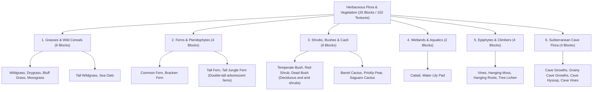

# Worldbuilding Architecture & Catalog: Groundcover & Herbaceous Flora (vegetation)

All active textures for herbaceous flora, meadows, wild cereals, ferns, xerophytes, cacti, wetland plants, and epiphytes are organized in the folder:
📂 **`docs/worldbuilding/blocks/vegetation`** *(102 PNG textures on disk: 100 active face variants + 2 composite LOD icons, representing 26 unique blocks across 6 categories, each with standard 3 variants)*

Generating **26 unique blocks** in the master catalog:

* **6 Grasses & Wild Cereals**: 4 single-block carpet grasses + 2 double-tall prairie/coastal grasses.
* **4 Ferns & Pteridophytes**: 2 understory fronds + 2 double-tall giant and jungle ferns.
* **6 Shrubs, Bushes & Cacti**: 3 temperate/arid shrubs + 2 xerophytic cacti/succulents + 1 column 3D Saguaro cactus.
* **2 Wetlands, Aquatics & Floating Pads**: Riparian cattail reeds and freshwater floating lily pads.
* **4 Epiphytes, Climbers & Root Hangings**: Wall vines, tree lichens, and ceiling hanging root mosses.
* **4 Subterranean Cave Flora**: Umbrophilic mosses, mineral encrustations, deep geode herbs, and ceiling hanging cave vines.

---

## 1. Ecological Classification & Physiognomic Domains (26 Unique Blocks)

The herbaceous and shrub layer is organized into **6 Major Physiognomic Domains (26 Unique Blocks / 102 Textures)**:

---

## 2. Rendering Profiles & Architectural Geometry

1. **Simple Cross-Mesh / Billboard Flora (`16×16 px RGBA Cutout`)**:
   * Rendered using intersecting diagonal planes (X-shape) or offset vertical billboard quads.
   * Includes 3 procedural variations (`_`, `1`, `2`) to break visual tiling repetition across open fields.
2. **Double-Tall Composite Flora (Two-Block Plants)**:
   * **Lower Segment (`vege_*_bottom.png`, `bottom1.png`, `bottom2.png`)**: Dense basal root clusters, clumps, or heavy lower stalks (3 variants).
   * **Upper Segment (`vege_*_top.png`, `top1.png`, `top2.png`)**: Feathered plumes, flowering tassels, grain heads, or broad frond arches (3 variants).
   * **Consolidated Composite Sprites (`32×32 px RGBA`)**: Master full-height textures (`vege_tall_wildgrass.png`, `vege_tall_fern.png`) used for entity icons and unified LOD rendering.
3. **Solid & Columnar 3D Blocks (Cacti & Succulents)**:
   * **Large Saguaro Cactus (`vege_cactus`)**: Full 3D column cube block with directional `top` (3 variants), `bottom`, and `side` (3 variants) ribs.
4. **Surface Overlays & Floating Pads (Epiphytes & Water Pads)**:
   * **Floating Pads (`vege_lily_pad`)**: Thin planar geometry floating on the upper water meniscus (3 variants).
   * **Wall Climbers & Ceilings (`vege_vines`, `vege_lichen`, `vege_hanging_roots`, `vege_hanging_moss`)**: Oriented planar decals mounted against vertical bark/rock walls or hanging beneath ceiling faces (3 variants each).
5. **Infinite Hanging Chain Flora (`vege_cave_vines`)**:
   * Hanging subterranean vine chain extending downwards from cavern ceilings.
   * **Tip segment (`vege_cave_vines.png`, `1`, `2`)**: Active hanging growth tip or single-block vine dangling beneath.
   * **Stem / Plant segment (`vege_cave_vines_plant.png`, `1`, `2`)**: Continuous connecting body vine connecting ceiling anchors to trailing tips.

---

## 3. Complete Block Catalog (26 Unique Blocks)

### 3.1. Grasses & Wild Cereals (6 Blocks)

| # | Block ID | Name | Category | Primary Texture(s) | Variations | Biome & Natural Occurrence | Geometry Profile |
| :-: | :--- | :--- | :--- | :--- | :---: | :--- | :--- |
| **01** | `vege_wildgrass` | Wildgrass | **Grass** | `vege_wildgrass.png` | 3 (`_`, `1`, `2`) | Plains, Meadows & Temperate Forests | Single Cross-Mesh |
| **02** | `vege_drygrass` | Drygrass | **Grass** | `vege_drygrass.png` | 3 (`_`, `1`, `2`) | Savannas, Steppes & Scrublands | Single Cross-Mesh |
| **03** | `vege_bluff_grass` | Bluff Grass | **Grass** | `vege_bluff_grass.png` | 3 (`_`, `1`, `2`) | Rocky Crags, Cliffs & Windblown Ridges | Single Cross-Mesh |
| **04** | `vege_mossgrass` | Mossgrass | **Grass** | `vege_mossgrass.png` | 3 (`_`, `1`, `2`) | Damp Woodlands, River Glades & Bogs | Low Dense Tuft |
| **05** | `vege_tall_wildgrass` | Tall Wildgrass | **Tall Grass** | `vege_tall_wildgrass_bottom.png` `vege_tall_wildgrass_top.png` | 3 pairs | High Meadows & Lush River Valleys | Double-Tall (2 Blocks) |
| **06** | `vege_sea_oats` | Sea Oats | **Tall Grass** | `vege_sea_oats_bottom.png` `vege_sea_oats_top.png` | 3 pairs | Subtropical Coasts & Dune Crests | Double-Tall (2 Blocks) |

---

### 3.2. Ferns & Pteridophytes (4 Blocks)

| # | Block ID | Name | Category | Primary Texture(s) | Variations | Biome & Natural Occurrence | Geometry Profile |
| :-: | :--- | :--- | :--- | :--- | :---: | :--- | :--- |
| **07** | `vege_fern` | Common Fern | **Fern** | `vege_fern.png` | 3 (`_`, `1`, `2`) | Shaded Woodlands & Taiga Understory | Single Cross-Mesh |
| **08** | `vege_bracken` | Bracken Fern | **Fern** | `vege_bracken.png` | 3 (`_`, `1`, `2`) | Temperate Moorlands, Heaths & Open Woods | Spreading Frond Mesh |
| **09** | `vege_tall_fern` | Tall Fern | **Tall Fern** | `vege_tall_fern_bottom.png` `vege_tall_fern_top.png` | 3 pairs | Ancient Forests & Mountain Ravines | Double-Tall (2 Blocks) |
| **10** | `vege_tall_jungle_fern` | Tall Jungle Fern | **Tall Fern** | `vege_tall_jungle_fern_bottom.png` `vege_tall_jungle_fern_top.png` | 3 pairs | Tropical Rainforests & Equatorial Valleys | Double-Tall (2 Blocks) |

---

### 3.3. Shrubs, Bushes & Cacti (6 Blocks)

| # | Block ID | Name | Category | Primary Texture(s) | Variations | Biome & Natural Occurrence | Geometry Profile |
| :-: | :--- | :--- | :--- | :--- | :---: | :--- | :--- |
| **11** | `vege_bush` | Temperate Bush | **Shrub** | `vege_bush.png` | 3 (`_`, `1`, `2`) | Forest Edges, Meadows & Foothills | Dense Rounded Mesh |
| **12** | `vege_red_shrub` | Red Shrub | **Shrub** | `vege_red_shrub.png` | 3 (`_`, `1`, `2`) | Autumn Woods, Acid Peat & Moors | Red Pigmented Mesh |
| **13** | `vege_dead_bush` | Dead Bush | **Shrub** | `vege_dead_bush.png` | 3 (`_`, `1`, `2`) | Arid Deserts, Badlands & Frozen Tundras | Withered Woody Sticks |
| **14** | `vege_barrel_cactus` | Barrel Cactus | **Cactus** | `vege_barrel_cactus.png` | 3 (`_`, `1`, `2`) | Warm Deserts, Scrub & Chaparrals | Spiny Succulent Mesh |
| **15** | `vege_prickly_pear_cactus` | Prickly Pear Cactus | **Cactus** | `vege_prickly_pear_cactus.png` | 3 (`_`, `1`, `2`) | Semiarid Slopes, Savannas & Scrub | Fleshy Pad Cross-Mesh |
| **16** | `vege_cactus` | Saguaro Cactus | **Cactus** | `vege_cactus_top.png` `vege_cactus_side.png` `vege_cactus_bottom.png` | 3 sides, 3 tops, 1 bot | Hot Sand Deserts & Arid Dunes | 3D Full Column Block (Thorns) |

---

### 3.4. Wetlands, Aquatics & Floating Pads (2 Blocks)

| # | Block ID | Name | Category | Primary Texture(s) | Variations | Biome & Natural Occurrence | Geometry Profile |
| :-: | :--- | :--- | :--- | :--- | :---: | :--- | :--- |
| **17** | `vege_cattail` | Cattail | **Wetland** | `vege_cattail_bottom.png` `vege_cattail_top.png` | 3 pairs | Muddy Marshes, Swamps & Shallows | Double-Tall Emergent (2 Blocks) |
| **18** | `vege_lily_pad` | Water Lily Pad | **Floating Pad** | `vege_lily_pad.png` | 3 (`_`, `1`, `2`) | Calm Lakes, Swamps & River Pools | Floating Water Surface Mesh |

---

### 3.5. Epiphytes, Climbers & Root Hangings (4 Blocks)

| # | Block ID | Name | Category | Primary Texture(s) | Variations | Biome & Natural Occurrence | Geometry Profile |
| :-: | :--- | :--- | :--- | :--- | :---: | :--- | :--- |
| **19** | `vege_vines` | Vines (Lianas) | **Epiphyte** | `vege_vines.png` | 3 (`_`, `1`, `2`) | Rainforest Canopies & Cliff Walls | Vertical Wall Climber |
| **20** | `vege_hanging_moss` | Hanging Moss | **Epiphyte** | `vege_hanging_moss.png` | 3 (`_`, `1`, `2`) | Murky Swamps & Gallery Forests | Ceiling Hanging Decal |
| **21** | `vege_hanging_roots` | Hanging Roots | **Epiphyte** | `vege_hanging_roots.png` | 3 (`_`, `1`, `2`) | Dirt Overhangs, Ravines & Cave Ceilings | Ceiling Root Danglers |
| **22** | `vege_lichen` | Tree & Rock Lichen | **Epiphyte** | `vege_lichen.png` | 3 (`_`, `1`, `2`) | Humid Barks, Damp Rocks & Tundra Boulders | Crustose Surface Patch |

---

### 3.6. Subterranean Cave Flora (4 Blocks)

| # | Block ID | Name | Category | Primary Texture(s) | Variations | Biome & Natural Occurrence | Geometry Profile |
| :-: | :--- | :--- | :--- | :--- | :---: | :--- | :--- |
| **23** | `vege_cave_growths` | Cave Growths | **Cave Flora** | `vege_cave_growths.png` | 3 (`_`, `1`, `2`) | Damp Subterranean Caverns & Chasms | Ground Umbrophilic Thallus |
| **24** | `vege_grainy_cave_growths` | Grainy Cave Growths | **Cave Flora** | `vege_grainy_cave_growths.png` | 3 (`_`, `1`, `2`) | Mineral-Rich Subterranean Walls & Caves | Ferruginous Granular Crust |
| **25** | `vege_cave_hyssop` | Cave Hyssop | **Cave Flora** | `vege_cave_hyssop.png` | 3 (`_`, `1`, `2`) | Geodes, Crystal Caverns & Deep Vaults | Subterranean Flowering Herb |
| **26** | `vege_cave_vines` | Cave Vines | **Cave Flora** | `vege_cave_vines.png` `vege_cave_vines_plant.png` | 3 tip, 3 plant | Humid Caverns & Subterranean Vaults | Ceiling Hanging Multi-Block Vine |
