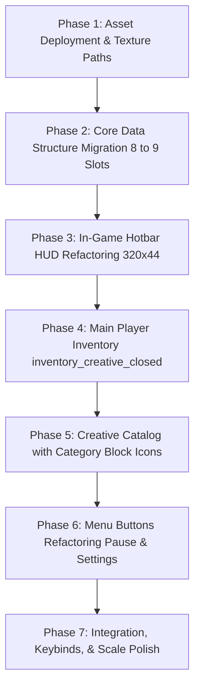

# Voxel Game Engine — Interface Migration & Replacement Plan (`interfaces_replacement_plan.md`)

This document defines the phased implementation roadmap to migrate the engine from the legacy 8-slot user interface system to the standardized **9-horizontal-slot interface architecture** specified in `docs/worldbuilding/interfaces_design.md`.

> [!IMPORTANT]
> **Practical Scope & Realistic Current Architecture**  
> * **Primary In-Game Inventory**: The active inventory screen to implement now is **`inventory_creative_closed.png`** (which includes the top **B1** toggle tab to open the creative catalog). The tab-less `inventory_closed.png` is reserved for future survival gameplay.
> * **Crafting & Armor Slots (Cards A & C)**: Because armor equip logic and crafting recipe systems do not exist in the engine yet, Card A armor slots and Card C crafting matrix are **rendered as visual placeholders / non-interactive (WIP)**.
> * **Container & Chest Storage (Card D)**: Storage containers and chest blocks do not exist in the world yet. Card D (`inventory_chest_*.png`) is formally marked as **Deferred / Future Scope**.
> * **In-Game Hotbar Interaction**: The 320 × 44 px in-game hotbar has **no mouse hover or mouse clicks** during normal gameplay because the mouse is locked to the 3D camera. Slot selection is driven strictly by keyboard keys `1`–`9` and the mouse scroll wheel via `hotbar_selection.png`. The 4 small wing buttons are **non-clickable HUD hotkey indicators** (e.g., displaying `[M]` or icons).
> * **Hotbar Progress Bars are Static Placeholders**: The XP bar (Field 1), Health bar (Field 17), and Mana/Stamina bar (Field 18) are **purely static visual placeholders**. No health, damage, leveling, or mana mechanics exist in the engine yet; no dynamic bar updates should be wired up.
> * **Outline Blueprints as Geometric Source of Truth**: All interactive UI nodes (slot cavities, clickable tabs, button hitboxes, scroll tracks) must strictly follow the pixel bounding boxes defined in the corresponding `*_outline.png` blueprints (`hotbar_outline.png`, `inventory_creative_closed_outline.png`, `inventory_creative_open_outline.png`) and their coordinate tables in `docs/worldbuilding/interfaces_design.md`.

---

## 1. Current State vs. Target Architecture

| Subsystem | Legacy Implementation | New Architecture Target | Primary Source Files |
| :--- | :--- | :--- | :--- |
| **Hotbar Slots** | 8 slots (`HOTBAR_SLOT_COUNT = 8`) | 9 primary slots + 2 special slots (off-hand + utility) | `src/player/hotbar.rs` |
| **Hotbar HUD Canvas** | 256 × 32 px (`hotbar.png`) | 320 × 44 px (`docs/worldbuilding/interfaces/hotbar.png`) | `src/player/hotbar.rs` |
| **Hotbar Selection** | Colored border | 20 × 20 px bevel frame (`hotbar_selection.png`) driven by keys 1–9 | `src/player/hotbar.rs` |
| **Hotbar Wing Badges** | None | 4 HUD hotkey indicator badges (non-clickable in gameplay) | `src/player/hotbar.rs` |
| **Player Inventory** | 8 cols × 4 rows = 32 slots | 9 cols × 4 rows = 36 slots | `src/player/inventory.rs` |
| **Active Gameplay Inventory** | 190 × 152 px (`inventory.png`) | 416 × 256 px (`inventory_creative_closed.png` with B1 tab) | `src/menu/mod.rs` |
| **Creative Catalog** | 190 × 152 px (`inventory_creative.png`) | 416 × 256 px (`inventory_creative_open.png`, 11 tabs, 90 slots) | `src/menu/creative_inventory.rs` |
| **Creative Category Tabs** | Simple text buttons | 11 tabs (12×12 px) rendering scaled 3D block icons + selection frame | `src/menu/creative_inventory.rs` |
| **Menu Buttons (Pause/Settings)** | Legacy `containers/button*.png` | Unified button suite (`button_large.png`, `button_medium.png`, `button_small.png`) | `src/menu/pause.rs`, `src/menu/settings.rs` |
| **Armor & Crafting (Cards A & C)** | None | Visual layout in place; slots set to non-interactive placeholder | `src/menu/mod.rs` |
| **Chests & Containers (Card D)** | None | **Deferred** until chest blocks and container entities are added | `docs/worldbuilding/interfaces_design.md` |

---

## 2. Blueprint Outlines as Layout Authority (`*_outline.png`)

To prevent guesswork and hardcoded magic numbers, Bevy UI nodes must be anchored strictly using the bounding boxes defined in the `*_outline.png` blueprint files:
* **Slot Hitboxes (`#880015`)**: 16 × 16 px primary cavities or 14 × 14 px compact slots.
* **Interactive Elements (`#FF7F27`)**: Tabs (B1..B12), action buttons, text input fields, and scroll tracks.
* **Card Boundaries (`#ED1C24`)**: Outer perimeters and padding offsets for Card A, Card B, and Card C.
* **Element Keys (`#A349A4`)**: 3×5 px raster IDs matching the exact table rows in `docs/worldbuilding/interfaces_design.md`.

---

## 3. Phased Implementation Roadmap



---

### Phase 1: Asset Deployment & Texture Paths
* **Goal**: Copy finalized interface assets from `docs/worldbuilding/interfaces/` into the engine's active runtime assets directory (`assets/textures/interfaces/`).
* **Target Directory**: `assets/textures/interfaces/`
* **Action Items**:
  1. Archive legacy container assets (`assets/textures/interfaces/containers/` -> `assets/textures/interfaces/legacy_containers/`).
  2. Deploy production interface textures into `assets/textures/interfaces/`:
     * HUD: `hotbar.png` (320 × 44 px), `hotbar_selection.png` (20 × 20 px).
     * Windows: `inventory_creative_closed.png` (416 × 256 px), `inventory_creative_open.png` (416 × 256 px).
     * Navigation & Controls: `inventory_creative_scroller.png` (12 × 16 px), `inventory_creative_tab_selection.png` (16 × 16 px).
     * Menu & Action Buttons: `button_large.png` & `button_large_hover.png` (96 × 16 px), `button_medium.png` & `button_medium_hover.png` (64 × 16 px), `button_small.png` & `button_small_hover.png` (16 × 16 px), `button_util.png` & `button_util_hover.png` (8 × 8 px).
     * Slot Hovers: `inventory_slot_hover.png` (16 × 16 px), `inventory_slot_special_hover.png` (14 × 14 px) — *used exclusively inside opened inventory screens, never on the gameplay HUD*.
     * Overlays: `slots/` (14 Dark Iron equipment overlays in 14 × 14 px).
     * Icons: `icons/` (23 interface icons in 16 × 16 px).
  3. Register asset handles in the engine's asset loading system.

---

### Phase 2: Core Data Structure Migration (8 -> 9 Slots)
* **Goal**: Update backend storage from 8 to 9 columns.
* **Target Files**:
  * `src/player/inventory.rs`
  * `src/player/hotbar.rs`
* **Action Items**:
  1. Update inventory grid constants in `src/player/inventory.rs`:
     ```rust
     pub const PLAYER_INVENTORY_COLS: usize = 9; // Was 8
     pub const PLAYER_INVENTORY_ROWS: usize = 4;
     pub const PLAYER_INVENTORY_SLOTS: usize = PLAYER_INVENTORY_COLS * PLAYER_INVENTORY_ROWS; // 36 slots (was 32)
     ```
  2. Add dedicated auxiliary slots to `PlayerInventory`:
     * `pub offhand_slot: Option<Voxel>` (Slot B42, 14 × 14 px)
     * `pub utility_slot: Option<Voxel>` (Slot B52, 14 × 14 px)
     * `pub armor_slots: [Option<Voxel>; 6]` (Card A slots A3..A8; stored for future use, non-interactive for now)
  3. Update hotbar constants in `src/player/hotbar.rs`:
     ```rust
     pub const HOTBAR_SLOT_COUNT: usize = 9; // Was 8
     ```
  4. Update keyboard input mappings in `hotbar_scroll_system`:
     * Add `KeyCode::Digit9` to cycle to slot index 8.

---

### Phase 3: In-Game Hotbar HUD Refactoring (320 × 44 px)
* **Goal**: Replace the legacy 256 × 32 px hotbar HUD with the finalized 320 × 44 px layout.
* **Target File**: `src/player/hotbar.rs`
* **Interaction Rules**:
  * **Zero Mouse Hover & Zero Mouse Clicks**: In 3D gameplay, the mouse is captured by camera look. There is no cursor on screen; the hotbar has **no mouse hover logic and no mouse clicks**. Hover textures (`inventory_slot_hover.png`) have no logic on the gameplay hotbar and must **never** be rendered on it.
  * **Slot Selection Only**: The active slot is highlighted solely by rendering `hotbar_selection.png` (20 × 20 px) centered over the active slot index (0..8), driven strictly by keyboard keys `1`–`9` and the mouse scroll wheel.
  * **Wing Badges (2, 3, 15, 16)**: The 4 small 8 × 8 px corner fields (2 on each wing) are **non-clickable HUD indicator badges** used to display keybind letters (e.g., `[M]`, `[J]`) or mini icons (e.g., map icon) showing HUD shortcuts to the player.
  * **Background Gameplay Hotbar Inactive During Menus**: When an inventory menu is opened, the cursor unlocks, but the background gameplay hotbar stays in the background and is non-clickable. The interactive hotbar is the one embedded inside Card B of the inventory window.
* **Action Items**:
  1. Set HUD background texture to `assets/textures/interfaces/hotbar.png` (320 × 44 px).
  2. Position the 9 primary item slots (16 × 16 px) at `y=14`, centered with coordinates:
     * `x = 65, 87, 109, 131, 153, 175, 197, 219, 241`.
  3. Position the off-hand slot display (14 × 14 px) at `(45, 17)` and utility slot display (14 × 14 px) at `(263, 17)` as non-clickable visual readouts.
  4. Map progress meters (Purely static placeholders / no dynamic gameplay logic):
     * Field 1: Top XP bar at `(59, 4)`, 204 × 4 px. Static visual background groove (leveling not implemented).
     * Field 17: Bottom-left Health bar at `(68, 36)`, 82 × 4 px. Static visual display (health mechanics not implemented).
     * Field 18: Bottom-right Mana/Stamina bar at `(172, 36)`, 82 × 4 px. Static visual display (mana/stamina not implemented).
  5. Position `hotbar_selection.png` (20 × 20 px) centered over the active slot (`hotbar.active_slot`).

---

### Phase 4: Main Player Inventory (`inventory_creative_closed.png`)
* **Goal**: Implement the primary in-game inventory screen using `inventory_creative_closed.png` (416 × 256 px).
* **Target Files**:
  * `src/menu/mod.rs`
  * `src/menu/inventory.rs` (new module or refactored inventory menu)
* **Scope & Behavior**:
  * **Primary Active Inventory**: `inventory_creative_closed.png` is the standard player inventory in the current game state because it provides the tab button to toggle the creative catalog. The survival inventory (`inventory_closed.png` without tabs) and chest storage interfaces (`inventory_chest_*.png`) are **not used for now** (neither survival mode nor chest blocks exist yet).
  * **Camera & Hotbar State**: When pressing `E` (or inventory key), the camera look locks and the free mouse cursor appears. The background gameplay hotbar becomes inactive and non-clickable. The interactive hotbar is the mirrored one embedded inside Card B.
* **Action Items**:
  1. **Creative Toggle Tab (B1)**:
     * Placed at `(118, 116)`, measuring 10 × 10 px.
     * Clicking B1 opens the expanded creative catalog (`inventory_creative_open.png`).
  2. **Card A (Player Character, `x=5..92, y=125..252`)**:
     * Field A1: Player name / level header.
     * Field A2: 3D character viewport with interactive rotation via mouse drag.
     * Fields A3..A8: 6 armor equipment slots (14 × 14 px) displaying their respective Dark Iron overlays (`helmet.png`, `chestplate.png`, etc.). **Set as non-clickable / disabled placeholders** (since armor mechanics are not yet implemented).
  3. **Card B (Storage & Mirrored Hotbar, `x=97..318, y=125..252`)**:
     * Fields B7..B42: 36 primary inventory slots (4 rows of 9 slots, 16 × 16 px). Fully interactive with hover & clicks.
     * Field B43: Mirrored off-hand slot (14 × 14 px).
     * Fields B44..B52: 9 mirrored hotbar slots (16 × 16 px). Fully interactive with hover & clicks inside the menu.
     * Field B53: Mirrored utility slot (14 × 14 px).
     * Hover feedback: Render `inventory_slot_hover.png` (16 × 16) and `inventory_slot_special_hover.png` (14 × 14) when the mouse cursor hovers over these slots.
     * Fields B3..B6: 4 action buttons (8 × 8 px: sort, trash, options, lock) using `button_util.png` and `button_util_hover.png`.
  4. **Card C (Crafting Table, `x=323..410, y=125..252`)**:
     * Fields C1..C11: 3×3 crafting matrix and result slot. **Set as non-clickable / disabled placeholders** (since crafting recipes are not yet implemented).

---

### Phase 5: Creative Catalog Modularization (`inventory_creative_open.png`)
* **Goal**: Refactor `src/menu/creative_inventory.rs` to the 416 × 256 px layout with category tabs rendering scaled 3D block icons.
* **Target File**: `src/menu/creative_inventory.rs`
* **Action Items**:
  1. **Creative Toggle Tab (B1)**:
     * Positioned at `(118, 8)`, measuring 10 × 10 px.
     * Clicking B1 collapses the catalog back to `inventory_creative_closed.png`.
  2. **11 Category Tabs (B2..B12) with Scaled 3D Block Icons**:
     * Located at `x=132..284, y=8`, tabs spaced for ~14 × 14 px tab icon bounds.
     * For each tab, render a miniature representative 3D block icon (matching the isometric 3D block icon rendering used in inventory and hotbar slots, scaled down to fit inside the 14 × 14 px tab icon area) representing each block category:
       * **B2 (`rocks`)**: Representative rock block icon (e.g., `Dolomite`).
       * **B3 (`trees`)**: Representative timber block icon (e.g., `WoodLogOak`).
       * **B4 (`soils`)**: Representative soil block icon (e.g., `LoamDirt`).
       * **B5 (`ores`)**: Representative ore block icon (e.g., `OreIron`).
       * **B6 (`caverns`)**: Representative cavern block icon (e.g., `Dripstone`).
       * **B7 (`oceans`)**: Representative marine block icon (e.g., `Coral`).
       * **B8 (`organics`)**: Representative bio-matter block icon (e.g., `BoneBlock`).
       * **B9 (`decorations`)**: Representative architectural block icon (e.g., `Bricks`).
       * **B10 (`mushrooms`)**: Representative fungal block icon (e.g., `MushroomCap`).
       * **B11 (`vegetation`)**: Representative flora block icon (e.g., `Wildflowers`).
       * **B12 (`fluids`/`systems`)**: Representative fluid/system block icon (e.g., `Water`).
     * When a tab is active, draw `inventory_creative_tab_selection.png` (16 × 16 px) docked over it.
  3. **Live Search (B14)**:
     * Located at `(223, 27)`, 72 × 8 px. Filters catalog slots by name in real time.
  4. **90-Slot Catalog Grid & Scrollbar**:
     * Fields B16..B105: 10 rows of 9 slots (16 × 16 px) displaying infinite item stacks for creative placement.
     * Field B15: Scroll track at `(298, 40..205)`, 6 × 166 px.
     * Scroll thumb: `inventory_creative_scroller.png` (12 × 16 px) dragged via mouse or scrolled via mouse wheel.
  5. **Direct Hotbar Access**:
     * Fields B106..B116: Mirrored hotbar accessible at the bottom of the creative screen for quick loadout configuration.

---

### Phase 6: System Menu Buttons Refactoring (`pause.rs`, `settings.rs`)
* **Goal**: Modernize system menus by replacing legacy wooden/beige buttons with our unified dark-obsidian / brushed-steel button suite.
* **Target Files**:
  * `src/menu/pause.rs`
  * `src/menu/settings.rs`
* **Action Items**:
  1. **Pause Menu (`src/menu/pause.rs`)**:
     * Replace `textures/interfaces/containers/button.png` and `button_hover.png` with:
       * Normal: `assets/textures/interfaces/button_large.png` (96 × 16 px) or `button_medium.png` (64 × 16 px).
       * Hover: `assets/textures/interfaces/button_large_hover.png` or `button_medium_hover.png`.
     * Update button sizing in Bevy node layout (maintaining crisp integer scaling, e.g., 2× scale at 192 × 32 px or 3× at 288 × 48 px).
     * Apply to Resume, Settings, Restart, and Quit buttons.
  2. **Settings Menu (`src/menu/settings.rs`)**:
     * Replace legacy `button.png` and `small_button.png` with:
       * Action & Option toggles: `button_medium.png` & `button_medium_hover.png` (64 × 16 px).
       * Compact stepper/increment buttons: `button_small.png` & `button_small_hover.png` (16 × 16 px).
     * Verify hover transitions switch cleanly to the frosted slate-blue metallic highlight (`#3c4552`).

---

### Phase 7: Integration, Keybinds, & Scale Polish
* **Goal**: Ensure seamless transitions, pixel-perfect alignment, and UI scaling across resolutions.
* **Verification Checklist**:
  * [ ] **Compilation**: `cargo check` and `cargo run` pass with zero errors.
  * [ ] **Camera Lock vs. Menu Unlock**:
    * Gameplay: Mouse is locked to 3D camera look. Hotbar HUD has no cursor or hover states; selection follows keys 1–9 and scroll wheel.
    * Inventory (`E`): Cursor appears, camera locks. Slots in Card B and creative catalog respond to hover (`inventory_slot_hover.png`) and click.
  * [ ] **Menu Buttons**: Verify Pause and Settings menus use `button_large`, `button_medium`, and `button_small` with active hover textures.
  * [ ] **Creative Toggle**: Clicking B1 smoothly toggles between `inventory_creative_closed` (compact) and `inventory_creative_open` (expanded catalog).
  * [ ] **Category Block Icons**: Verify that all 11 category tabs display their respective scaled block icons centered inside the 12 × 12 px tab bounds.
  * [ ] **Placeholder Safety**: Verify that clicking disabled slots (Card A armor slots, Card C crafting grid) produces no crashes or unintended item movements.
  * [ ] **UI Scaling**: Test at 1080p, 1440p, and 4K to confirm pixel art remains sharp without subpixel blur.
